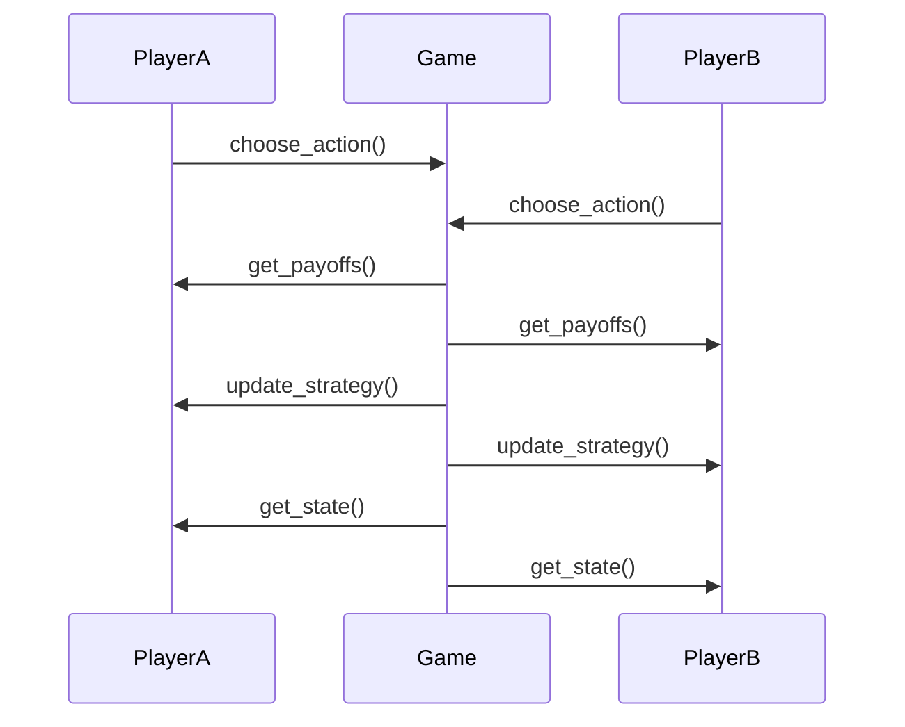

# Intermediate Foundation: Game Theory 04 Repeated Games And Folk Theorem

## 1. Architectural Mental Model

In the realm of game theory, repeated games extend the concept of a single-shot game to a scenario where the same game is played multiple times between the same players. This introduces new strategic dimensions, as players can use the history of past interactions to inform their current decisions. The architectural mental model for repeated games involves understanding how players' strategies evolve over time and how the structure of the game influences these strategies.

### Key Concepts:
- **Finite vs. Infinite Repeated Games:** Finite games have a known end, while infinite games continue indefinitely. The strategies in finite games often involve "trigger strategies," where players cooperate until one player defects, after which they defect in all subsequent rounds.
- **Discount Factor:** In infinite repeated games, players consider the future payoff, discounted by a factor $\delta \in (0,1)$. The discount factor reflects the player's preference for current payoffs over future payoffs.
- **Folk Theorem:** This theorem states that in infinitely repeated games, any feasible and individually rational payoff vector can be sustained as a Nash equilibrium, provided the discount factor is sufficiently high.

### Production Architecture:
- **State Management:** Maintain a record of past interactions to inform current strategies.
- **Strategy Adjustment:** Implement mechanisms for players to adjust their strategies based on the history of the game.
- **Payoff Calculation:** Calculate payoffs for each round and update the total payoff for each player.

## 2. Systems Taxonomy & Component Protocols

### Standard Interfaces:
- **Game Interface:** Defines the basic operations of a game, such as `play_round()`, `get_payoffs()`, and `get_state()`.
- **Player Interface:** Defines the operations for a player, such as `choose_action()`, `update_strategy()`, and `get_history()`.

### Protocols:
- **Trigger Strategy Protocol:** Specifies how a player should respond to a defection by another player.
- **Discounted Payoff Protocol:** Specifies how payoffs should be discounted over time.

### Data Models:
- **Game State:** A data structure that records the history of the game, including actions taken by each player and the resulting payoffs.
- **Player Strategy:** A data structure that defines a player's strategy, including the rules for choosing actions and updating strategies based on the game state.

## 3. Multi-Component Interaction Flow

### ASCII Sequence Diagram:
```
Player A -> Game: choose_action()
Player B -> Game: choose_action()
Game -> Player A: get_payoffs()
Game -> Player B: get_payoffs()
Game -> Player A: update_strategy()
Game -> Player B: update_strategy()
Game -> Player A: get_state()
Game -> Player B: get_state()
```

### Mermaid Sequence Diagram:


## 4. Architectural Trade-offs & Production Pitfalls

### Trade-offs:
- **Complexity vs. Simplicity:** More complex strategies can lead to better outcomes but require more computational resources and are harder to implement.
- **Short-term vs. Long-term Payoffs:** Strategies that maximize short-term payoffs may not be optimal in the long run, especially in infinite repeated games.

### Pitfalls:
- **Inconsistent State Management:** Failing to accurately record the history of the game can lead to incorrect strategy updates and payoff calculations.
- **Suboptimal Strategy Adjustment:** Inefficient strategy adjustment mechanisms can result in suboptimal performance over time.
- **Discount Factor Misinterpretation:** Misinterpreting the discount factor can lead to incorrect payoff calculations and suboptimal strategies.

## 5. Socratic Discussion Starters

1. **How does the discount factor influence the strategies in repeated games?**
2. **What are the implications of using trigger strategies in finite repeated games?**
3. **How can the Folk Theorem be applied in real-world scenarios, such as business negotiations or international relations?**
4. **What are the challenges of implementing state management in repeated games?**
5. **How can the trade-offs between complexity and simplicity be balanced in the design of repeated game architectures?**

By exploring these questions, engineers and practitioners can deepen their understanding of repeated games and their applications in various domains.
