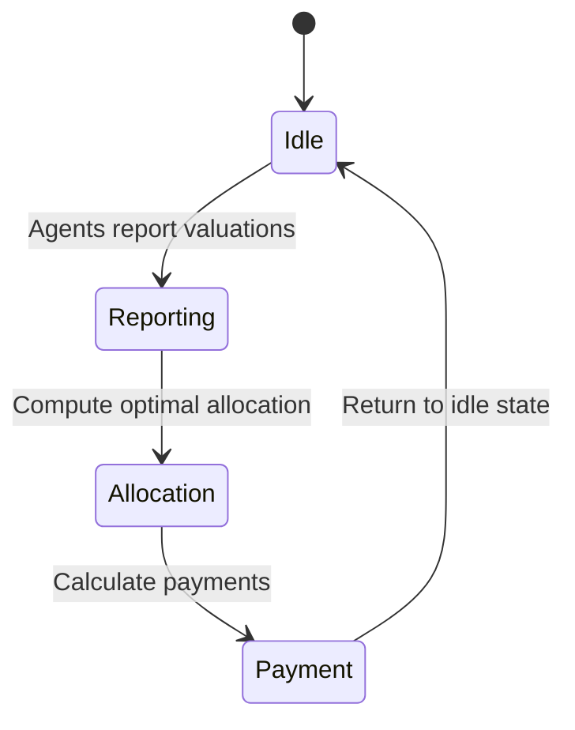

# Advanced Foundation: Game Theory 05 Mechanism Design And VCG

## 1. Theoretical Invariants & Formal Frameworks (Formal proofs, kernel or physical invariants)

### Mechanism Design
Mechanism design is a field in game theory that focuses on designing economic mechanisms to achieve specific outcomes. The primary goal is to create rules of the game such that the participants' self-interested behavior leads to a socially desirable outcome. A fundamental concept in mechanism design is the **Vickrey-Clarke-Groves (VCG) mechanism**, which is a truthful mechanism that maximizes social welfare.

#### The VCG Mechanism
The VCG mechanism is a payment rule that ensures truthfulness in the allocation of resources. Given a set of agents \( N = \{1, 2, \ldots, n\} \) and a set of resources \( R \), the VCG mechanism allocates resources to agents based on their reported valuations while ensuring that each agent's optimal strategy is to report their true valuation.

**Theorem (Truthfulness of VCG):** The VCG mechanism is truthful, meaning that for any agent \( i \in N \), it is in their best interest to report their true valuation \( v_i \).

**Proof:**
Let \( v_i \) be the true valuation of agent \( i \) for the resource allocation \( x \). The payment \( p_i \) that agent \( i \) pays in the VCG mechanism is given by:
\[ p_i = \sum_{j \neq i} \left( v_j(x_{-i}^i) - v_j(x_{-i}) \right) \]
where \( x_{-i} \) is the allocation without agent \( i \), and \( x_{-i}^i \) is the allocation when agent \( i \) reports \( v_i \).

The utility of agent \( i \) is:
\[ u_i = v_i(x_i) - p_i \]

To show truthfulness, we need to prove that:
\[ u_i(v_i) \geq u_i(\hat{v}_i) \]
for any reported valuation \( \hat{v}_i \).

Substituting the payment rule:
\[ u_i(v_i) = v_i(x_i) - \sum_{j \neq i} \left( v_j(x_{-i}^{v_i}) - v_j(x_{-i}) \right) \]
\[ u_i(\hat{v}_i) = \hat{v}_i(x_i') - \sum_{j \neq i} \left( v_j(x_{-i}^{\hat{v}_i}) - v_j(x_{-i}) \right) \]

Since \( x_i \) maximizes social welfare given \( v_i \) and \( x_i' \) maximizes social welfare given \( \hat{v}_i \), we have:
\[ v_i(x_i) + \sum_{j \neq i} v_j(x_{-i}) \geq v_i(x_i') + \sum_{j \neq i} v_j(x_{-i}^{\hat{v}_i}) \]

Rearranging terms:
\[ v_i(x_i) - \sum_{j \neq i} \left( v_j(x_{-i}^{v_i}) - v_j(x_{-i}) \right) \geq \hat{v}_i(x_i') - \sum_{j \neq i} \left( v_j(x_{-i}^{\hat{v}_i}) - v_j(x_{-i}) \right) \]

Thus:
\[ u_i(v_i) \geq u_i(\hat{v}_i) \]

This completes the proof of truthfulness.

### Invariants in Mechanism Design
Invariants in mechanism design refer to properties that remain unchanged under the mechanism's operation. A key invariant in the VCG mechanism is the **social welfare maximization** property, which ensures that the allocation of resources maximizes the sum of the agents' valuations.

**Invariant:** The VCG mechanism maximizes social welfare.

**Proof:**
By construction, the VCG mechanism allocates resources to maximize the sum of the agents' valuations. Let \( x^* \) be the allocation that maximizes social welfare:
\[ \sum_{i \in N} v_i(x_i^*) \geq \sum_{i \in N} v_i(x_i) \]
for any allocation \( x \).

Since the VCG mechanism selects \( x^* \) as the allocation, the social welfare maximization invariant holds.

## 2. Low-Level Invariant Taxonomy (Deep registers, memory models, hardware constraints, or axiomatic definitions)

### Axiomatic Definitions
In mechanism design, several axiomatic definitions are crucial for ensuring desirable properties. These include:

- **Truthfulness:** Reporting true valuations is the dominant strategy for each agent.
- **Efficiency:** The allocation maximizes the sum of the agents' valuations.
- **Budget Balance:** The total payments made by the agents equal the total payments received by the mechanism.

### Hardware Constraints
In practical implementations of mechanism design, hardware constraints can impact the feasibility and efficiency of the mechanism. For example, memory limitations may affect the storage of valuation profiles, and processing power may impact the computation of optimal allocations.

### Memory Models
Memory models are essential for understanding how valuation profiles are stored and accessed in mechanism design. A common memory model is the **random access memory (RAM) model**, where each valuation can be accessed in constant time.

## 3. Micro-Architecture & Concurrency Dynamics (Mermaid and ASCII state machines / cache / race condition diagrams)

### State Machines
State machines can be used to model the dynamics of mechanism design. For example, a state machine can represent the allocation process in the VCG mechanism.

### Cache and Race Conditions
In concurrent implementations of mechanism design, cache coherence and race conditions can impact the correctness and performance of the mechanism. For example, if multiple agents report valuations simultaneously, race conditions may arise if the mechanism does not properly synchronize access to the valuation profiles.

## 4. Subtle Failure Modes & Boundary Conditions

### Failure Modes
Subtle failure modes in mechanism design can arise from incorrect assumptions about agent behavior or computational limitations. For example, if agents have incomplete information or computational constraints, the mechanism may not achieve the desired outcomes.

### Boundary Conditions
Boundary conditions in mechanism design refer to edge cases that can impact the performance and correctness of the mechanism. For example, if the number of agents is very large, the mechanism may become computationally infeasible. Similarly, if the valuation profiles are highly correlated, the mechanism may not achieve efficient allocations.

## 5. Master Socratic Inquiries (Research-grade discussion questions)

1. **Truthfulness and Efficiency:** Can a mechanism be both truthful and efficient if agents have incomplete information? Provide a formal proof or counterexample.
2. **Budget Balance:** Under what conditions is the VCG mechanism budget balanced? Provide a formal proof or counterexample.
3. **Concurrency:** How can race conditions be avoided in concurrent implementations of the VCG mechanism? Provide a formal analysis or algorithm.
4. **Scalability:** What are the computational and memory requirements of the VCG mechanism as the number of agents increases? Provide a formal analysis or algorithm.
5. **Correlated Valuations:** How do correlated valuations impact the performance and correctness of the VCG mechanism? Provide a formal analysis or algorithm.
