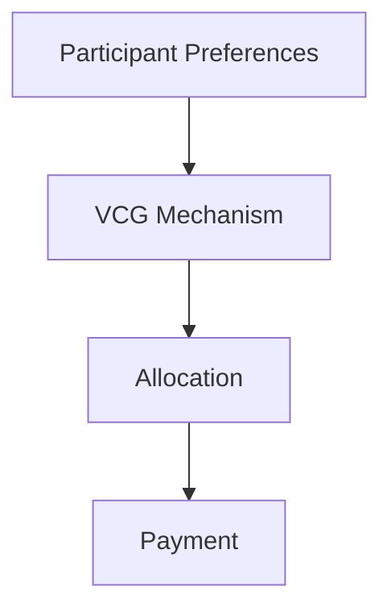

# Beginner Foundation: Game Theory 05 Mechanism Design And VCG

## 1. Everyday Intuition & First Principles

Imagine you are organizing a community event and need to decide which venue to use. You ask everyone to submit their preferences, but you want to ensure that the venue chosen is the one that maximizes overall satisfaction while also being fair. Mechanism Design is the study of how to structure rules and incentives to achieve desired outcomes in situations like this. The VCG (Vickrey-Clarke-Groves) mechanism is a specific method that ensures truthfulness in reporting preferences, leading to an efficient and fair outcome.

## 2. Foundational Vocabulary & Glossary

- **Mechanism Design:** The process of designing rules and incentives to achieve specific outcomes in strategic interactions.
- **VCG Mechanism:** A specific mechanism that incentivizes participants to report their true preferences or valuations.
- **Truthful Reporting:** When participants report their true preferences or valuations without trying to manipulate the outcome.
- **Efficiency:** The outcome maximizes the total value or satisfaction of all participants.
- **Fairness:** The outcome is equitable and does not favor any particular participant.
- **Allocation:** The distribution of resources or outcomes among participants.
- **Payment:** The compensation or cost associated with the allocation of resources or outcomes.
- **Utility:** The level of satisfaction or benefit a participant receives from a particular outcome.

## 3. Visual System Flow

### ASCII Diagram
```
+-------------------+
|   Participant     |
|  Preferences      |
+---------+---------+
          |
          v
+---------+---------+
|   VCG   |  Mechanism|
|  Design           |
+---------+---------+
          |
          v
+---------+---------+
|   Allocation      |
+---------+---------+
          |
          v
+---------+---------+
|   Payment         |
+---------+---------+
```

### Mermaid Flowchart


## 4. Common Beginner Misconceptions & Mental Traps

- **Misconception:** Mechanism Design is only about maximizing efficiency. **Trap:** It is also about fairness and ensuring truthful reporting.
- **Misconception:** The VCG mechanism is the only way to achieve truthful reporting. **Trap:** While VCG is a powerful tool, there are other mechanisms that can also achieve truthful reporting.
- **Misconception:** The VCG mechanism always results in the most efficient outcome. **Trap:** VCG is efficient under certain conditions, but it may not be the best choice in all situations.
- **Misconception:** Participants will always report their true preferences. **Trap:** While VCG incentivizes truthful reporting, participants may still have incentives to misreport if they can benefit from it.

## 5. Socratic Discussion Starters

- What is the primary goal of mechanism design?
- How does the VCG mechanism ensure truthful reporting?
- Can you think of a real-world scenario where mechanism design might be useful?
- What are the trade-offs between efficiency and fairness in mechanism design?
- How does the VCG mechanism handle situations where participants have different valuations for the same outcome?
