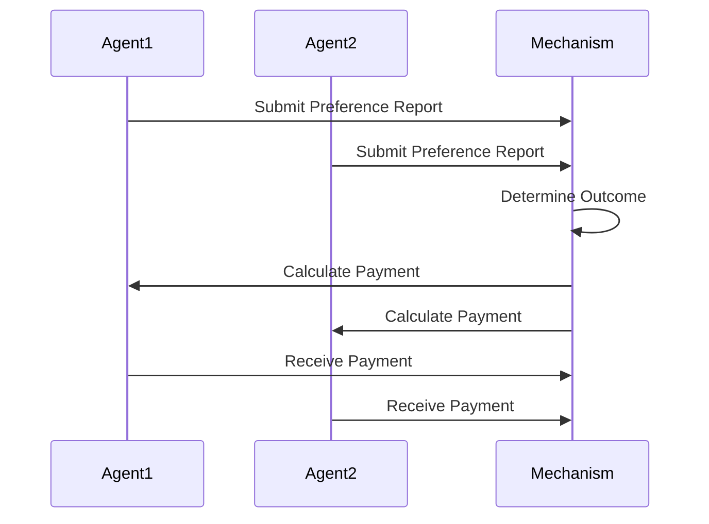

# Intermediate Foundation: Game Theory 05 Mechanism Design And VCG
## 1. Architectural Mental Model

In the realm of Game Theory, Mechanism Design is a critical area that focuses on designing systems to achieve specific outcomes by incentivizing agents to act in desired ways. The VCG (Vickrey-Clarke-Groves) mechanism is a pivotal example of such a design, ensuring truthfulness in agent reporting. To build a robust architectural mental model, we must consider the following components:

- **Agents:** Entities that participate in the game, each with their own preferences and strategies.
- **Mechanism:** The rules and procedures that dictate how agents interact and what outcomes are produced.
- **Utility Function:** A mathematical representation of an agent's preferences over possible outcomes.
- **Incentive Compatibility:** Ensuring that agents' best strategy is to report their true preferences.

The architecture of a Mechanism Design system should be modular, allowing for the easy integration of different utility functions and mechanisms. The VCG mechanism, in particular, is designed to be incentive-compatible by compensating agents based on the impact of their reports on the overall outcome.

## 2. Systems Taxonomy & Component Protocols

### Standard Interfaces

- **Agent Interface:** Defines the methods for agents to report their preferences and receive payments.
- **Mechanism Interface:** Defines the methods for the mechanism to process reports and determine outcomes.
- **Utility Interface:** Defines the methods for calculating utility based on outcomes.

### Protocols

- **Reporting Protocol:** Specifies the format and timing of preference reports from agents.
- **Outcome Determination Protocol:** Specifies the rules for determining the outcome based on reports.
- **Payment Protocol:** Specifies the rules for compensating agents based on the impact of their reports.

### Data Models

- **Preference Report:** A structured data model representing an agent's preferences.
- **Outcome:** A structured data model representing the final state of the system.
- **Payment:** A structured data model representing the compensation given to an agent.

## 3. Multi-Component Interaction Flow

### ASCII Sequence Diagram

```
Agent1 -> Mechanism: Submit Preference Report
Agent2 -> Mechanism: Submit Preference Report
...
Mechanism -> Mechanism: Determine Outcome
Mechanism -> Agent1: Calculate Payment
Mechanism -> Agent2: Calculate Payment
...
Agent1 -> Mechanism: Receive Payment
Agent2 -> Mechanism: Receive Payment
...
```

### Mermaid Sequence Diagram



## 4. Architectural Trade-offs & Production Pitfalls

### Trade-offs

- **Complexity vs. Simplicity:** More complex mechanisms can achieve better outcomes but may be harder to implement and understand.
- **Incentive Compatibility vs. Efficiency:** Ensuring agents report truthfully can sometimes lead to less efficient outcomes.

### Production Pitfalls

- **Misaligned Incentives:** If the mechanism is not designed correctly, agents may not be incentivized to report truthfully.
- **Implementation Errors:** Incorrect implementation can lead to unintended outcomes and agent dissatisfaction.
- **Scalability Issues:** As the number of agents increases, the mechanism must be able to handle the increased load efficiently.

## 5. Socratic Discussion Starters

1. **How can we ensure that the VCG mechanism remains incentive-compatible as the number of agents grows?**
2. **What are the trade-offs between using a simple mechanism and a more complex one in a real-world application?**
3. **How can we modify the VCG mechanism to handle cases where agents have incomplete information about their preferences?**
4. **What are the potential pitfalls of implementing the VCG mechanism in a distributed system?**
5. **How can we measure the efficiency of a mechanism design in a production environment?**

By addressing these questions, engineers and practitioners can deepen their understanding of Mechanism Design and the VCG mechanism, leading to more effective system design and implementation.
