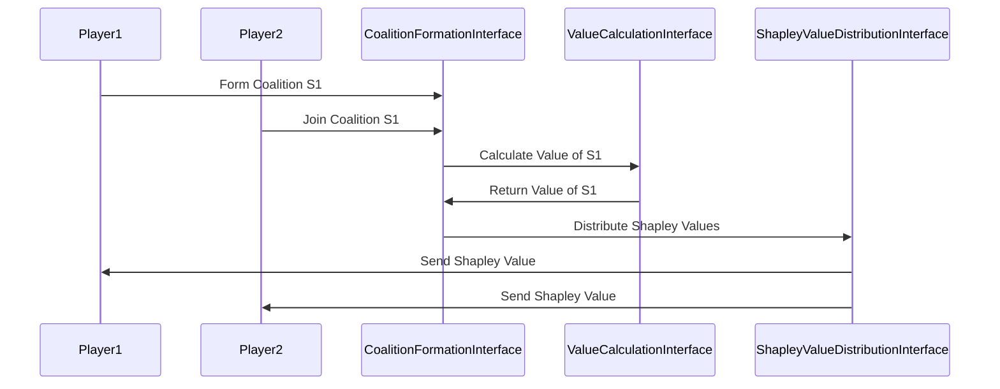

# Intermediate Foundation: Game Theory 06 Cooperative Games And Shapley Value

## 1. Architectural Mental Model

In cooperative game theory, the focus shifts from competitive scenarios to collaborative ones where players can form coalitions to achieve common goals. The Shapley value is a method for distributing the total gains to the players, assuming that they work together in a coalition. The architectural mental model for cooperative games involves understanding how different coalitions can form, how their values are computed, and how the Shapley value is used to allocate these values fairly among the players.

### Key Concepts:
- **Coalitions:** Subsets of players who decide to cooperate.
- **Characteristic Function:** A function \( v: 2^N \rightarrow \mathbb{R} \) that assigns a value to each coalition \( S \subseteq N \), where \( N \) is the set of all players.
- **Shapley Value:** A unique allocation method that distributes the total value \( v(N) \) among the players based on their marginal contributions to all possible coalitions.

### Mental Model:
Imagine a system where players are components of a larger network, and the goal is to maximize the overall utility of the network. The Shapley value helps in determining the fair contribution of each component to the network's utility, ensuring that no component is over- or under-compensated.

## 2. Systems Taxonomy & Component Protocols

### Standard Interfaces:
- **Coalition Formation Interface:** Allows players to form and manage coalitions.
- **Value Calculation Interface:** Computes the value of each coalition using the characteristic function.
- **Shapley Value Distribution Interface:** Distributes the computed values among the players based on their Shapley values.

### Protocols:
- **Coalition Formation Protocol:** Defines the rules for forming and dissolving coalitions.
- **Value Calculation Protocol:** Specifies the method for calculating the value of each coalition.
- **Shapley Value Distribution Protocol:** Establishes the rules for distributing the Shapley values among the players.

### Data Models:
- **Coalition Data Model:** Represents the structure of a coalition, including its members and the value it generates.
- **Player Data Model:** Represents the attributes and contributions of each player.
- **Shapley Value Data Model:** Represents the Shapley value of each player.

## 3. Multi-Component Interaction Flow

### ASCII Sequence Diagram:
```
Player1 -> CoalitionFormationInterface: Form Coalition S1
Player2 -> CoalitionFormationInterface: Join Coalition S1
CoalitionFormationInterface -> ValueCalculationInterface: Calculate Value of S1
ValueCalculationInterface -> CoalitionFormationInterface: Return Value of S1
CoalitionFormationInterface -> ShapleyValueDistributionInterface: Distribute Shapley Values
ShapleyValueDistributionInterface -> Player1: Send Shapley Value
ShapleyValueDistributionInterface -> Player2: Send Shapley Value
```

### Mermaid Sequence Diagram:


## 4. Architectural Trade-offs & Production Pitfalls

### Trade-offs:
- **Complexity vs. Fairness:** More complex coalitions can lead to more accurate value calculations but may increase computational complexity.
- **Scalability:** The Shapley value computation can become computationally expensive as the number of players increases.
- **Communication Overhead:** Frequent communication between components can lead to increased latency and resource consumption.

### Production Pitfalls:
- **Incorrect Coalition Formation:** Misconfigured coalition formation rules can lead to suboptimal coalitions.
- **Inaccurate Value Calculation:** Errors in the characteristic function can result in incorrect Shapley values.
- **Inefficient Distribution:** Poorly designed distribution protocols can lead to unfair allocations.

## 5. Socratic Discussion Starters

1. **How can the Shapley value be adapted for dynamic coalitions where players can join and leave at any time?**
2. **What are the implications of using the Shapley value in systems with a large number of players?**
3. **How can the computational complexity of the Shapley value be reduced without sacrificing accuracy?**
4. **In what scenarios might the Shapley value lead to unfair allocations, and how can these be mitigated?**
5. **How can the architectural design be modified to handle different types of coalitions and their interactions?**

By understanding these intermediate concepts, engineers and practitioners can design more robust and fair systems that leverage cooperative game theory and the Shapley value.
