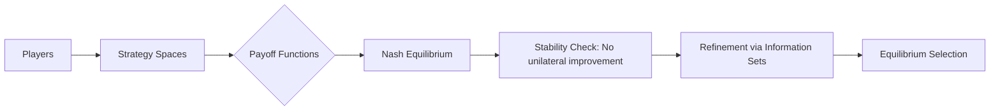

# Foundation: Game Theory

## 1. Conceptual Mental Model (Core intuition, analogies, and first principles)

Game Theory is the **mathematical study of strategic decision-making among rational agents** who interact through interdependent choices. At its core, it addresses the fundamental question: *How do agents optimize their outcomes when their actions influence each other’s payoffs?*

### Core Intuition
Imagine two players simultaneously choosing between two options (e.g., "Cooperate" or "Defect"). Each player’s payoff depends *not only* on their own choice but *also* on the opponent’s choice. This creates a **strategic interdependence** where rational agents must anticipate others’ responses to maximize their outcomes.

### First Principles
1. **Rationality**: Agents maximize their expected payoffs given their knowledge.
2. **Strategic Interdependence**: The payoff for an agent depends on the actions of all other agents.
3. **Information Constraints**: Agents may have incomplete or asymmetric knowledge of opponents’ strategies.
4. **Equilibrium Stability**: A solution is *stable* if no agent can unilaterally improve their payoff.

### Analogy
Think of a **prisoner’s dilemma** (the quintessential game theory scenario): Two suspects independently choose to confess or remain silent. Each has a dominant strategy to confess, yet mutual silence yields a better collective outcome. This illustrates how *rational self-interest* can lead to *suboptimal outcomes* due to strategic interdependence.

> **Why this matters**: Game theory provides a formal framework for understanding conflicts, cooperation, and competition in *any* system where decisions are interdependent—ranging from economics and biology to AI and political strategy.

---

## 2. Essential Terminology & Taxonomy

| Term                  | Definition & Mathematical Essence                                                                 |
|-----------------------|--------------------------------------------------------------------------------------------------|
| **Strategic Form**    | A representation of a game: `G = (P, S, u)`, where `P` = players, `S = ∪_{i∈P} S_i` = strategy spaces, `u: P × S → ℝ` = payoff functions |
| **Nash Equilibrium**  | A strategy profile `s* = (s_1*, ..., s_n*)` where `u_i(s*) ≥ u_i(s_i, s_{-i}*)` for all `i` (no unilateral deviation improves payoff) |
| **Payoff Matrix**     | A table showing payoffs for each combination of strategies (e.g., `u_i(s_i, s_j)` for players `i,j`) |
| **Dominant Strategy** | A strategy `s_i` such that `u_i(s_i, s_{-i}) > u_i(s_i', s_{-i})` for all `s_i' ≠ s_i` (independent of opponents’ choices) |
| **Mixed Strategy**    | A probability distribution over pure strategies (e.g., `s_i = ∑_k p_k δ_{s_k}` where `p_k ≥ 0`, `∑ p_k = 1`) |
| **Information Set**   | A set of states where players cannot distinguish between actions (critical for imperfect information games) |
| **Equilibrium Refinement** | A solution concept that eliminates unstable equilibria (e.g., subgame perfect equilibrium for sequential games) |
| **Rationalizability** | A strategy is rationalizable if it is a best response to some belief about opponents’ strategies |

> **Key Insight**: Game theory reduces complex strategic interactions to *mathematical structures* where equilibria emerge from rational agents’ interdependent incentives.

---

## 3. Architecture & Core Workflow

**Workflow Explanation**:
1. **Players** define the agents in the game.
2. **Strategy Spaces** specify all possible actions each player can take.
3. **Payoff Functions** map strategy combinations to numerical outcomes.
4. **Nash Equilibrium** is identified as a stable strategy profile where no player benefits from deviation.
5. **Stability Check** verifies that the equilibrium is robust to small perturbations.
6. **Information Sets** refine the equilibrium for games with incomplete information.
7. **Equilibrium Selection** resolves ambiguity in multiple equilibria (e.g., via rationalizability).

> **Why this architecture works**: It formalizes how strategic interdependence → payoff structures → equilibrium stability → real-world solutions.

---

## 4. Common Misconceptions & Mental Traps

| Misconception                     | Reality Check                                                                 | Mathematical Trap                                  |
|-----------------------------------|----------------------------------------------------------------------------|---------------------------------------------------|
| "Game theory only applies to economics" | It models *any* strategic interaction (e.g., evolution, AI, voting) | Overgeneralization of payoff functions to economic utility |
| "Rational agents always choose optimally" | Agents have bounded rationality (e.g., cognitive limits, incomplete info) | Ignoring `u_i(s_i, s_{-i})` in `s_{-i}` | 
| "Nash equilibrium is always the best outcome" | Equilibrium may be *suboptimal* (e.g., prisoner’s dilemma) | Confusing equilibrium with *social welfare* maximization |
| "All games have a unique equilibrium" | Multiple equilibria exist (e.g., coordination games) | Assuming `s*` is unique without checking `u_i(s*)` |
| "Game theory ignores real-world complexity" | It explicitly models information asymmetry and uncertainty | Overlooking `information sets` in payoff functions |

> **Critical Warning**: The most dangerous trap is treating game theory as a *predictive tool* for human behavior without acknowledging *bounded rationality* and *context-dependent payoffs*.

---

## 5. Socratic Discussion Starters

1. **Why does the prisoner’s dilemma reveal a paradox where rational self-interest leads to collective inefficiency?**  
   *(Probe: How does the mathematical definition of Nash equilibrium explain this? What would change if players had perfect communication?)*

2. **Can a game with multiple Nash equilibria still be considered "solvable"?**  
   *(Probe: How do information sets and equilibrium refinements resolve ambiguity? Give an example where rationalizability selects a unique outcome.)*

3. **If game theory models rational agents, why do humans often fail to reach Nash equilibria in real-world scenarios?**  
   *(Probe: How does bounded rationality (e.g., heuristics) alter the payoff functions? What mathematical adjustments would capture this?)*

> These questions force deep engagement with the *interplay between formal structure and real-world constraints*—the essence of game theory as a formal science.
