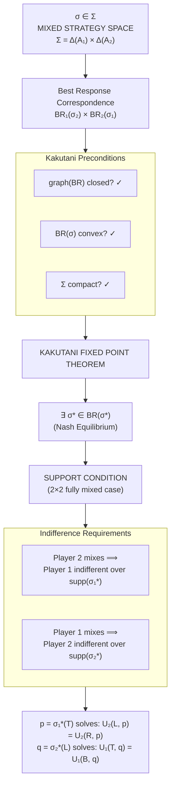

# Lesson 1: Strategic Form Games, Dominance, Nash Equilibrium

## 1. First-Principles Intuition & Invariants

The central question game theory asks is deceptively simple: when rational agents interact, each knowing the others are rational, what should each one do? The answer turns out to require a substantial mathematical apparatus, because the problem is self-referential in a way that resists naive resolution. Your optimal action depends on what others do, but their optimal action depends on what you do, and so on without obvious termination. The strategic form is the mathematical language that makes this circularity precise enough to reason about rigorously.

Before developing the formalism, it is worth locating the right intuition. Consider two firms simultaneously choosing whether to price high or low. Neither observes the other's choice before committing. Each firm's payoff depends on both choices jointly. This is the paradigmatic situation: simultaneous, complete-information, one-shot interaction among agents whose preferences are common knowledge. The strategic form abstracts away everything except the structure that matters: who the players are, what they can choose, and how payoffs depend on the joint choice profile.

**Definition 1.1 (Strategic Form Game).** A finite strategic form game, also called a normal form game, is a triple $G = (N, \{A_i\}_{i \in N}, \{u_i\}_{i \in N})$ where $N = \{1, 2, \ldots, n\}$ is a finite set of players, $A_i$ is a finite nonempty set of pure actions (or strategies) for player $i$, and $u_i : A \to \mathbb{R}$ is player $i$'s von Neumann-Morgenstern utility function defined on the joint action space $A = \prod_{i \in N} A_i$.

The notation $a_{-i}$ denotes the action profile of all players other than $i$, so a full profile is $a = (a_i, a_{-i}) \in A_i \times A_{-i}$ where $A_{-i} = \prod_{j \neq i} A_j$. This decomposition recurs throughout the theory because the fundamental unit of strategic reasoning is always a single player's decision conditional on what everyone else does.

The assumption that utilities are von Neumann-Morgenstern is not mere convention. It encodes that players are expected utility maximizers over lotteries on outcomes, which will be essential when we extend pure actions to mixed strategies. A mixed strategy $\sigma_i \in \Delta(A_i)$ is a probability distribution over player $i$'s pure action set, where $\Delta(A_i)$ denotes the simplex of probability measures on $A_i$. If $|A_i| = k$, then $\Delta(A_i) = \{ \sigma_i \in \mathbb{R}^k : \sigma_i(a_i) \ge 0 \text{ for all } a_i \in A_i, \sum_{a_i \in A_i} \sigma_i(a_i) = 1 \}$. The expected utility under a mixed strategy profile $\sigma = (\sigma_i, \sigma_{-i})$ extends $u_i$ multilinearly:

$$U_i(\sigma) = \sum_{a \in A} u_i(a) \prod_{j \in N} \sigma_j(a_j)$$

This multilinearity — the fact that $U_i$ is linear in each $\sigma_j$ separately — is the algebraic engine behind virtually every result in equilibrium theory. It means that best-response problems reduce to linear programs, mixed indifference conditions reduce to systems of linear equations, and the equilibrium correspondence inherits convexity properties sufficient for fixed-point arguments.

### Dominance: The First Rationality Filter

Before asking what rational agents will do, we ask what rational agents certainly will not do. This leads to the concept of dominance, which requires no assumptions about what others do beyond the fact that they are rational.

**Definition 1.2 (Strict Dominance).** Action $a_i \in A_i$ is strictly dominated by action $a_i' \in A_i$ if for every action profile of the opponents $a_{-i} \in A_{-i}$:

$$u_i(a_i', a_{-i}) > u_i(a_i, a_{-i})$$

If $a_i$ is strictly dominated, no rational player ever plays it, because $a_i'$ yields strictly higher utility regardless of what opponents do. The argument requires no conjecture about opponents' behavior and is thus the most robust prediction available.

**Definition 1.3 (Weak Dominance).** Action $a_i \in A_i$ is weakly dominated by $a_i' \in A_i$ if for every $a_{-i} \in A_{-i}$:

$$u_i(a_i', a_{-i}) \ge u_i(a_i, a_{-i})$$

with strict inequality for at least one $a_{-i}$.

The distinction between strict and weak dominance matters deeply in elimination procedures. Iterated elimination of strictly dominated strategies (IESDS) is order-independent: the set of surviving strategy profiles is the same regardless of the sequence in which dominated strategies are removed. Iterated elimination of weakly dominated strategies does not enjoy this invariance, and the order of elimination can affect the surviving set. This asymmetry is not merely a technical nuisance — it reflects a genuine difference in the epistemic justification for the two procedures.

**Theorem 1.1 (Order Independence of IESDS).** Let $G$ be a finite strategic form game. The set of strategy profiles surviving iterated elimination of strictly dominated strategies is independent of the order of elimination.

*Proof.* Let $\mathcal{S}^\infty$ denote the survivor set under any elimination order. It suffices to show that if strategy $a_i$ survives one maximal elimination sequence, it survives every maximal sequence. We proceed by induction on the round of elimination.

Consider two elimination sequences, and suppose strategy $s$ is eliminated in round $k$ of sequence 1 but not sequence 2. In sequence 1, $s$ is eliminated because some $s'$ strictly dominates $s$ over the reduced game $G^{k-1}$ remaining after $k-1$ rounds. That is, there exists $s_i'$ such that for all $a_{-i}$ surviving at stage $k-1$:

$$u_i(s_i', a_{-i}) > u_i(s, a_{-i})$$

Since sequence 2 eliminates only strictly dominated strategies, every strategy eliminated by sequence 2 is also eliminatable by sequence 1 (by the inductive hypothesis applied to smaller rounds). Therefore the surviving set under sequence 2 is a superset of the surviving set under sequence 1 at each stage, meaning $s_i'$ is still present when $s$ is considered. The domination inequality holds over the larger surviving set a fortiori, so $s$ is dominated and will eventually be eliminated in sequence 2 as well. By symmetric argument, the roles of the sequences can be reversed, so the two survivor sets are identical. $\blacksquare$

One can also characterize IESDS in terms of mixed strategy dominance, which turns out to be strictly more powerful. A pure strategy $a_i$ might survive elimination by any other pure strategy yet still be strictly dominated by some mixed strategy $\sigma_i \in \Delta(A_i)$. The correct elimination procedure removes strategies dominated by any strategy, pure or mixed. Under this extended dominance, the survivor set has a clean epistemic characterization as the set of strategies that are rationalizable — strategies that can be justified by some hierarchy of beliefs about opponents who are themselves rational, believe the others are rational, and so on.

**Theorem 1.2 (Rationalizability and IESDS with Mixed Strategies).** In a two-player finite game, the set of strategies surviving iterated elimination of strategies dominated by any mixed strategy coincides with the set of rationalizable strategies.

This equivalence is specific to two players. In games with three or more players, rationalizability is strictly weaker than the IESDS survivor set, because a player's mixed strategy correlates their actions, but opponents' independent mixed strategies cannot replicate that correlation. This subtle distinction becomes operationally important in mechanism design and auction theory.

---

## 2. Core Architecture & Mechanics

### The Best-Response Correspondence

Having established what rational players rule out, we now ask what they might actually do. The best-response correspondence formalizes the optimal reply structure, and Nash equilibrium is precisely the fixed point of this correspondence.

**Definition 2.1 (Best-Response Correspondence).** For player $i$, the best-response correspondence $\text{BR}_i : \Delta(A_{-i}) \rightrightarrows \Delta(A_i)$ maps each mixed strategy profile of the opponents to the set of utility-maximizing mixed strategies for player $i$:

$$\text{BR}_i(\sigma_{-i}) = \arg\max_{\sigma_i \in \Delta(A_i)} U_i(\sigma_i, \sigma_{-i})$$

Because $U_i$ is linear in $\sigma_i$ for fixed $\sigma_{-i}$, the maximizer is always achieved at a vertex of $\Delta(A_i)$ — that is, at a pure strategy — unless player $i$ is indifferent across multiple pure strategies, in which case any mixture of the indifferent strategies is also a best response. This is not a mere technical observation; it is the geometric reason why Nash equilibria in mixed strategies require indifference conditions on the support.

**Lemma 2.1 (Support Lemma).** Let $\sigma_i^*$ be a mixed strategy Nash equilibrium component for player $i$. Then every pure strategy $a_i$ in the support of $\sigma_i^*$ — that is, every $a_i$ with $\sigma_i^*(a_i) > 0$ — achieves the same expected utility against $\sigma_{-i}^*$, and no pure strategy outside the support achieves higher expected utility.

*Proof.* Suppose $\sigma_i^*$ places positive probability on $a_i$ and $a_i'$, with $U_i(a_i, \sigma_{-i}^*) > U_i(a_i', \sigma_{-i}^*)$. By linearity of $U_i$ in $\sigma_i$, we can strictly increase $U_i(\sigma_i^*, \sigma_{-i}^*)$ by transferring all weight from $a_i'$ to $a_i$. This contradicts $\sigma_i^*$ being a best response. Therefore all strategies in the support must yield equal expected utility. For any $a_i \notin \text{supp}(\sigma_i^*)$, if $U_i(a_i, \sigma_{-i}^*) > U_i(\sigma_i^*, \sigma_{-i}^*)$, then shifting positive weight to $a_i$ would increase total expected utility, again contradicting optimality. $\blacksquare$

The support lemma is the practitioner's primary computational tool. To find a fully mixed Nash equilibrium of a two-player game with action sets $A_1 = \{T, B\}$ and $A_2 = \{L, R\}$, one does not solve a fixed-point equation directly. Instead, one exploits the support condition: if player 1 mixes over $\{T, B\}$, then player 2 must be indifferent between $L$ and $R$. Writing $\sigma_1(T) = p$ and $\sigma_2(L) = q$, the indifference conditions are two linear equations in $p$ and $q$:

$$U_2(L, \sigma_1^*) = U_2(R, \sigma_1^*)$$
$$U_1(T, \sigma_2^*) = U_1(B, \sigma_2^*)$$

Each equation is linear in the opponent's mixing probability, so the system resolves to a unique $(p, q)$ whenever the coefficient matrix is nonsingular.

### Nash Equilibrium: Definition and Structural Anatomy

**Definition 2.2 (Nash Equilibrium).** A mixed strategy profile $\sigma^* = (\sigma_1^*, \ldots, \sigma_n^*)$ is a Nash equilibrium of $G$ if for every player $i \in N$:

$$U_i(\sigma_i^*, \sigma_{-i}^*) \ge U_i(\sigma_i, \sigma_{-i}^*) \quad \text{for all } \sigma_i \in \Delta(A_i)$$

Equivalently, $\sigma_i^* \in \text{BR}_i(\sigma_{-i}^*)$ for every $i$. A Nash equilibrium is therefore a fixed point of the joint best-response correspondence $\text{BR} : \prod_i \Delta(A_i) \rightrightarrows \prod_i \Delta(A_i)$ defined by $\text{BR}(\sigma) = \prod_i \text{BR}_i(\sigma_{-i})$.

The strategy space $\Sigma = \prod_i \Delta(A_i)$ is the Cartesian product of probability simplices. Each $\Delta(A_i)$ is a compact, convex subset of $\mathbb{R}^{|A_i|}$, so $\Sigma$ is itself compact and convex. The best-response correspondence maps $\Sigma$ into subsets of $\Sigma$, and Nash's theorem reduces to showing that this map satisfies the conditions of Kakutani's fixed-point theorem.

### Existence via Kakutani's Fixed-Point Theorem

**Theorem 2.1 (Kakutani's Fixed-Point Theorem).** Let $X \subset \mathbb{R}^n$ be a nonempty, compact, convex set, and let $\phi : X \rightrightarrows X$ be a correspondence with nonempty convex values such that the graph $\{(x, y) : y \in \phi(x)\}$ is closed in $X \times X$. Then there exists $x^* \in X$ such that $x^* \in \phi(x^*)$.

We now verify each condition for the best-response correspondence.

**Theorem 2.2 (Nash's Existence Theorem).** Every finite strategic form game has at least one Nash equilibrium in mixed strategies.

*Proof.* We verify the conditions of Theorem 2.1 for $\phi = \text{BR} : \Sigma \rightrightarrows \Sigma$.

**Condition 1: $\Sigma$ is nonempty, compact, and convex.** Each $\Delta(A_i)$ is the standard $(|A_i|-1)$-simplex in $\mathbb{R}^{|A_i|}$, which is bounded and closed, hence compact. It is convex by the definition of a probability simplex. The product $\Sigma = \prod_i \Delta(A_i)$ inherits compactness and convexity.

**Condition 2: $\text{BR}(\sigma)$ is nonempty for all $\sigma \in \Sigma$.** For fixed $\sigma_{-i}$, the function $\sigma_i \mapsto U_i(\sigma_i, \sigma_{-i})$ is linear and therefore continuous. By the extreme value theorem, it attains its maximum on the compact set $\Delta(A_i)$, so $\text{BR}_i(\sigma_{-i})$ is nonempty. The product $\text{BR}(\sigma) = \prod_i \text{BR}_i(\sigma_{-i})$ is therefore nonempty.

**Condition 3: $\text{BR}(\sigma)$ is convex-valued.** Fix $\sigma_{-i}$ and let $\tau_i, \tau_i' \in \text{BR}_i(\sigma_{-i})$. Then $U_i(\tau_i, \sigma_{-i}) = U_i(\tau_i', \sigma_{-i}) = M$ where $M$ is the maximum. For any $\lambda \in [0,1]$, by linearity:

$$U_i(\lambda \tau_i + (1-\lambda)\tau_i', \sigma_{-i}) = \lambda U_i(\tau_i, \sigma_{-i}) + (1-\lambda) U_i(\tau_i', \sigma_{-i}) = M$$

So $\lambda \tau_i + (1-\lambda)\tau_i' \in \text{BR}_i(\sigma_{-i})$, confirming convexity. The product of convex sets is convex.

**Condition 4: $\text{BR}$ has a closed graph.** Suppose $(\sigma^k, \tau^k) \to (\sigma, \tau)$ in $\Sigma \times \Sigma$ with $\tau^k \in \text{BR}(\sigma^k)$ for all $k$. We need $\tau \in \text{BR}(\sigma)$. For each $i$, we have $U_i(\tau_i^k, \sigma_{-i}^k) \ge U_i(\rho_i, \sigma_{-i}^k)$ for all $\rho_i \in \Delta(A_i)$. Since $U_i$ is a polynomial (finite sum of products) in the mixing probabilities, it is continuous jointly in all arguments. Taking the limit $k \to \infty$:

$$U_i(\tau_i, \sigma_{-i}) \ge U_i(\rho_i, \sigma_{-i}) \quad \text{for all } \rho_i \in \Delta(A_i)$$

so $\tau_i \in \text{BR}_i(\sigma_{-i})$ for every $i$, hence $\tau \in \text{BR}(\sigma)$.

All four conditions of Theorem 2.1 are satisfied, so there exists $\sigma^* \in \Sigma$ with $\sigma^* \in \text{BR}(\sigma^*)$. This is precisely a Nash equilibrium. $\blacksquare$

The structure of this proof is worth internalizing. The two load-bearing facts are the multilinearity of $U_i$ in mixing probabilities and the compactness of the mixed strategy simplex. Multilinearity provides convex best-response sets and continuity; compactness ensures the extreme value theorem applies at each stage. The Kakutani machinery then converts these analytic properties into the existence guarantee.

### Geometric and Algebraic Structure of the Equilibrium Set

The set of Nash equilibria of a game is the solution set of a system of polynomial inequalities and equations. For $n$ players with action sets of sizes $|A_i| = m_i$, writing out the equilibrium conditions explicitly shows that each player's indifference condition across support elements yields a system of $(m_i - 1)$ linear equations in $\sigma_{-i}$ per player $i$, plus the probability constraints $\sum_{a_i} \sigma_i(a_i) = 1$ and $\sigma_i(a_i) \ge 0$. The number of possible support structures is $\prod_i (2^{m_i} - 1)$, each defining a linear system. The full Nash equilibrium set is a finite union of solution sets of linear programs, and in generic games (games where utility values are algebraically independent over $\mathbb{Q}$), it is a finite set.

The following diagram illustrates the correspondence structure for a $2 \times 2$ game:

### A Complete Worked Example: The Inspection Game

The inspection game appears throughout mechanism design, regulatory economics, and computer security. A principal (the inspector) chooses to inspect ($I$) or not inspect ($N$). An agent simultaneously chooses to comply ($C$) or violate ($V$). The payoff matrix, with inspector as row player, is:

$$\begin{array}{c|cc}
 & C & V \\\hline
I & -c, \, 0 & g - c, \, -f \\
N & 0, \, 0 & 0, \, b
\end{array}$$

Here $c > 0$ is the cost of inspection, $g > 0$ is the gain from catching a violation, $f > 0$ is the fine, and $b > 0$ is the benefit from an undetected violation. We assume $g > c$ (inspection is worthwhile when a violation occurs) and $f > b$ (the fine exceeds the benefit).

**Step 1: Check for pure strategy Nash equilibria.** If the agent complies, the inspector prefers $N$ (saves cost $c$). If the inspector does not inspect, the agent prefers $V$ (gains $b > 0$). If the agent violates, the inspector prefers $I$ (net gain $g - c > 0$). If the inspector inspects, the agent prefers $C$ (avoids fine $f$). The best-response cycle has no fixed point in pure strategies: $(N, C) \to (N, V) \to (I, V) \to (I, C) \to (N, C)$. There is no pure Nash equilibrium.

**Step 2: Compute the mixed Nash equilibrium using the support lemma.** Let $p = \Pr[\text{inspector plays } I]$ and $q = \Pr[\text{agent plays } C]$.

For the agent to mix, the inspector must be indifferent between $I$ and $N$:

$$U_{\text{ins}}(I, q) = U_{\text{ins}}(N, q)$$

$$q(-c) + (1-q)(g-c) = q(0) + (1-q)(0)$$

$$-cq + (g-c)(1-q) = 0$$

$$g - c - gq = 0$$

$$q^* = \frac{g - c}{g}$$

For the inspector to mix, the agent must be indifferent between $C$ and $V$:

$$U_{\text{agent}}(C, p) = U_{\text{agent}}(V, p)$$

$$p(0) + (1-p)(0) = p(-f) + (1-p)(b)$$

$$0 = -pf + b - pb$$

$$pf + pb = b$$

$$p^* = \frac{b}{f + b}$$

**Step 3: Verify the support conditions.** We have $q^* = (g-c)/g \in (0,1)$ because $0 < c < g$. We have $p^* = b/(f+b) \in (0,1)$ because $b, f > 0$. Both mixing probabilities are interior, confirming a fully mixed equilibrium.

**Step 4: State the equilibrium and interpret.** The unique Nash equilibrium is $\sigma^* = (p^*, q^*)$ with $p^* = b/(f+b)$ and $q^* = (g-c)/g$. The equilibrium inspection rate $p^*$ depends only on the agent's parameters $b$ and $f$ — not on the inspector's costs or gains. This is a consequence of the indifference condition: the inspector's mixing probability is determined entirely by what makes the agent indifferent, and vice versa. Increasing the inspection cost $c$ does not change $p^*$; it changes $q^*$, the compliance rate. This counterintuitive result — that making inspection cheaper increases compliance but not inspection frequency — is a canonical insight of equilibrium analysis.

---

## 3. High-Performance Optimization & Failure Modes

### Computational Approaches to Equilibrium Finding

For small games, the support enumeration method is complete and exact. For a two-player game with $m_1 \times m_2$ actions, there are at most $(2^{m_1} - 1)(2^{m_2} - 1)$ possible support pairs. For each support pair $(S_1, S_2)$ with $S_i \subseteq A_i$ nonempty, the equilibrium conditions reduce to a square linear system: for player 2 to make player 1 indifferent across $S_1$, we need $|S_1| - 1$ equations in the $|S_2|$ free variables of $\sigma_2$ (subject to summing to 1 on $S_2$), which requires $|S_1| = |S_2|$. The practitioner solves the linear system, checks that the resulting probabilities are nonnegative, and verifies that actions outside $S_i$ are not strict best responses.

For the two-player case, this reduces to the following linear algebraic problem. Write the payoff matrix for player 1 as $A \in \mathbb{R}^{m_1 \times m_2}$ and for player 2 as $B \in \mathbb{R}^{m_1 \times m_2}$. A mixed Nash equilibrium $(\sigma_1^*, \sigma_2^*)$ with full support (both players mix over all strategies) requires:

$$A\sigma_2^* = v_1 \mathbf{1} \quad \text{and} \quad B^\top \sigma_1^* = v_2 \mathbf{1}$$

where $v_1 = U_1(\sigma^*)$ and $v_2 = U_2(\sigma^*)$ are the equilibrium payoffs, and $\mathbf{1}$ is the all-ones vector. Together with the normalization constraints $\mathbf{1}^\top \sigma_i^* = 1$, these form augmented linear systems solvable by Gaussian elimination in $O(m_i^3)$ time.

For games with more than two players or large action sets, the complexity of equilibrium finding escalates sharply. Computing a Nash equilibrium of a three-player game is PPAD-complete (Papadimitriou, 1994), a complexity class defined by the problem of following a path in a directed graph where every vertex has in-degree and out-degree at most 1. The best known algorithms in the worst case have no polynomial-time guarantee, though heuristic methods (Lemke-Howson path-following for two-player games, support enumeration with linear programming) work well in practice for moderate sizes.

**The Lemke-Howson Algorithm.** For two-player games, Lemke and Howson (1964) gave a path-following algorithm that is guaranteed to find a Nash equilibrium. The algorithm operates on a labeled polytope constructed from the best-response conditions. Each vertex of the polytope is a strategy profile $(q, r) \in \mathbb{R}^{m_1} \times \mathbb{R}^{m_2}$ (not normalized to sum to 1 yet, but representing unnormalized mixed strategies). A labeling assigns each vertex a subset of indices corresponding to actions that are best responses or have zero probability. A completely labeled vertex corresponds to a Nash equilibrium. The algorithm starts from an artificial completely labeled vertex, then follows a path of pivoting steps (each step drops one label and picks up another), guaranteed to terminate at a genuine equilibrium. The number of pivots can be exponential in the worst case but is typically efficient in practice.

### Refinements, Failure Modes, and Pathological Equilibria

The Nash equilibrium concept has well-known shortcomings that motivate a rich literature of refinements. The most important failure mode for applications is the existence of implausible equilibria supported by off-path threats that are not credible.

Consider the following $2 \times 2$ game representing a simple entry deterrence scenario. A potential entrant (player 1) chooses to enter ($E$) or stay out ($O$). An incumbent (player 2) simultaneously chooses to fight ($F$) or accommodate ($A$). The payoffs are:

$$\begin{array}{c|cc}
 & F & A \\\hline
E & -1, -1 & 2, 1 \\
O & 0, 2 & 0, 2
\end{array}$$

The profile $(O, F)$ is a Nash equilibrium: the entrant stays out because the incumbent threatens to fight, and the incumbent is indifferent between $F$ and $A$ when no entry occurs. But this equilibrium is pathological: if the entrant enters, the incumbent would strictly prefer to accommodate (payoff 1 versus $-1$ from fighting). The threat to fight is not credible, and $(O, F)$ survives as a Nash equilibrium only because the incumbent's off-path behavior is never tested.

This failure motivates the refinement of subgame perfect equilibrium, which is fully developed in the context of extensive form games, but the seed of the issue is already visible here. In pure strategic form analysis, the standard response is to apply iterated elimination of weakly dominated strategies. Strategy $F$ is weakly dominated by $A$ for the incumbent: $A$ yields weakly higher payoff regardless of the entrant's choice (payoff 2 versus $-1$ when entry occurs, payoff 2 versus 2 when no entry). After eliminating $F$, the entrant has a dominant strategy to enter, yielding the unique outcome $(E, A)$.

This example illustrates a general principle: Nash equilibria of the strategic form can encode implausible coordination on dominated off-path behavior, and refinements typically work by imposing additional constraints on the beliefs players hold about counterfactual play.

### Multiplicity, Selection, and Epistemic Foundations

A persistent technical challenge is that most games have multiple Nash equilibria, and the theory provides no universal selection criterion. The $2 \times 2$ coordination game — where both players receive payoff 1 if they coordinate on the same action and 0 otherwise — has three Nash equilibria: two pure equilibria $(\text{Row}_1, \text{Col}_1)$ and $(\text{Row}_2, \text{Col}_2)$, and one mixed equilibrium where each player randomizes with equal probability. The mixed equilibrium is Pareto-inferior to both pure equilibria and payoff-dominated in a strong sense, yet it satisfies the Nash conditions exactly.

Selection criteria proposed in the literature include Harsanyi and Selten's (1988) tracing procedure, which embeds the game in a one-parameter family connecting a trivially solvable game (where each player has a unique dominant strategy) to the original game and follows the Nash equilibrium continuously along the path. Risk dominance selects the equilibrium that is the best response to a uniform mixture over the other equilibria. Payoff dominance selects the Pareto-superior equilibrium. These criteria agree in many cases but can conflict, and no single criterion has achieved universal acceptance.

From an epistemic standpoint, the Nash equilibrium concept is fully justified when players' beliefs about each other form a common prior, are mutually consistent, and each player best-responds to their beliefs. This is precisely the content of Aumann and Brandenburger's (1995) epistemic characterization of Nash equilibrium: in a two-player game, mutual knowledge of rationality and of each player's conjecture about the opponent's strategy implies that the conjectures form a Nash equilibrium. For $n \ge 3$ players, the conditions require mutual knowledge of rationality and common knowledge of the players' conjectures. The stronger requirement for multiplayer games reflects the fact that with three or more players, a Nash equilibrium requires not just each player best-responding to others' strategies, but also that each player holds the right belief about the correlation structure of opponents' play.

The takeaway for practitioners is a disciplined hierarchy of equilibrium analysis. Begin with strict dominance elimination, which requires the weakest assumptions and gives the strongest predictions. If iterated dominance leaves a unique outcome, the analysis is complete and maximally robust. If a nontrivial survivor set remains, compute Nash equilibria via support enumeration or the Lemke-Howson algorithm. Apply refinements (dominance, risk dominance, trembling-hand perfection) to prune implausible equilibria. Document multiplicity when it persists, and treat the selection problem as a modeling question about the specific coordination mechanism available in the application domain.
