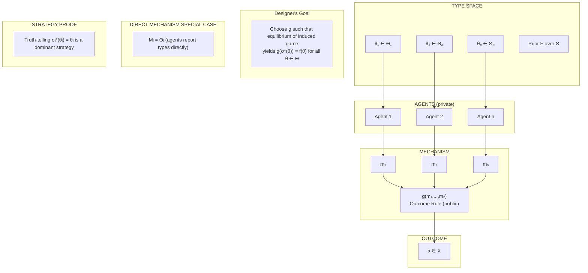
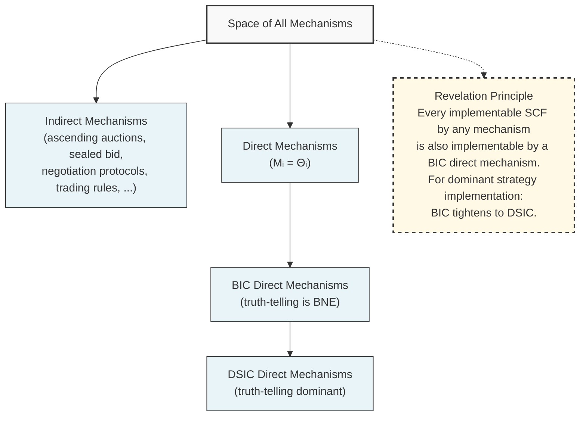

# Lesson 6: Evolutionary Dynamics, Mechanism Design, and the Revelation Principle

## 1. First-Principles Intuition & Invariants

### The Darwinian Turn in Strategic Reasoning

Classical game theory, as developed by von Neumann, Nash, and Harsanyi, assumed rational agents who maximize expected utility through deliberate calculation. This assumption is powerful but brittle: it demands that every player possess full knowledge of the payoff structure, the ability to compute best responses, and the cognitive capacity to form consistent beliefs. For many domains of genuine scientific interest—biological populations, evolving protocols in distributed systems, cultural transmission of conventions, repeated market entry games—the rationality assumption is not merely an idealization but an outright misrepresentation. The strategic actors are bacteria, neurons, boundedly rational traders, or software agents undergoing selection pressure. They do not optimize; they reproduce.

Evolutionary game theory, pioneered by John Maynard Smith and George Price in the early 1970s and formalized mathematically by Peter Taylor and Leo Jonker in 1978, replaces the deliberating individual with a population of agents whose strategy frequencies evolve over time according to differential fitness. The central object of study is no longer a single player's best response but a dynamical system over the simplex of strategy distributions. Within this framework, the equilibrium concept of choice is not the Nash equilibrium but the **Evolutionarily Stable Strategy (ESS)**, a refinement that captures the idea of a population state immune to invasion by mutants.

The intuition is as follows. Imagine a large, well-mixed population playing a symmetric two-player game. Each individual is "programmed" with a pure or mixed strategy, and pairs are drawn uniformly at random to play. The payoff of each interaction determines fitness, and fitness determines reproductive success. Strategies that earn above-average payoffs become more prevalent in the next generation; strategies that earn below-average payoffs decline. The question is: which strategy distributions are stable under this selection pressure?

### Evolutionarily Stable Strategies: The Formal Invariant

Let the game be defined by a symmetric payoff matrix $A \in \mathbb{R}^{n \times n}$, where $A_{ij}$ denotes the payoff to a player using pure strategy $i$ against a player using pure strategy $j$. A mixed strategy is a vector $\mathbf{p} \in \Delta^{n-1}$, the standard $(n-1)$-simplex:

$$\Delta^{n-1} = \left\{ \mathbf{x} \in \mathbb{R}^n \;\middle|\; x_i \geq 0 \text{ for all } i,\; \sum_{i=1}^n x_i = 1 \right\}$$

The expected payoff to a player using strategy $\mathbf{p}$ against a player using strategy $\mathbf{q}$ is the bilinear form $\pi(\mathbf{p}, \mathbf{q}) = \mathbf{p}^{\top} A \mathbf{q}$.

**Definition (Evolutionarily Stable Strategy).** A strategy $\mathbf{p}^* \in \Delta^{n-1}$ is an evolutionarily stable strategy if for every mutant strategy $\mathbf{q} \neq \mathbf{p}^*$, there exists some $\bar{\varepsilon} > 0$ such that for all $\varepsilon \in (0, \bar{\varepsilon})$, the fitness of $\mathbf{p}^*$ exceeds the fitness of $\mathbf{q}$ in the post-invasion population $(1 - \varepsilon)\mathbf{p}^* + \varepsilon \mathbf{q}$:

$$\pi\!\left(\mathbf{p}^*,\, (1-\varepsilon)\mathbf{p}^* + \varepsilon \mathbf{q}\right) > \pi\!\left(\mathbf{q},\, (1-\varepsilon)\mathbf{p}^* + \varepsilon \mathbf{q}\right)$$

Expanding both sides using bilinearity and collecting terms in $\varepsilon$, one can show that this single inequality decomposes into the following two-condition characterization, which serves as the operative definition in practice.

**Theorem (ESS Two-Condition Equivalence).** $\mathbf{p}^*$ is an ESS if and only if for every $\mathbf{q} \neq \mathbf{p}^*$:

$$\text{(ESS-1)} \quad \pi(\mathbf{p}^*, \mathbf{p}^*) \geq \pi(\mathbf{q}, \mathbf{p}^*) \qquad \text{(Nash stability)}$$

$$\text{(ESS-2)} \quad \text{If } \pi(\mathbf{p}^*, \mathbf{p}^*) = \pi(\mathbf{q}, \mathbf{p}^*), \text{ then } \pi(\mathbf{p}^*, \mathbf{q}) > \pi(\mathbf{q}, \mathbf{q}) \qquad \text{(stability under drift)}$$

**Proof.** Expand the ESS inequality:

$$\pi\!\left(\mathbf{p}^*, (1-\varepsilon)\mathbf{p}^* + \varepsilon \mathbf{q}\right) > \pi\!\left(\mathbf{q}, (1-\varepsilon)\mathbf{p}^* + \varepsilon \mathbf{q}\right)$$

Using bilinearity of $\pi$:

$$(1-\varepsilon)\pi(\mathbf{p}^*, \mathbf{p}^*) + \varepsilon\, \pi(\mathbf{p}^*, \mathbf{q}) > (1-\varepsilon)\pi(\mathbf{q}, \mathbf{p}^*) + \varepsilon\, \pi(\mathbf{q}, \mathbf{q})$$

Rearranging:

$$(1-\varepsilon)\left[\pi(\mathbf{p}^*, \mathbf{p}^*) - \pi(\mathbf{q}, \mathbf{p}^*)\right] > \varepsilon\left[\pi(\mathbf{q}, \mathbf{q}) - \pi(\mathbf{p}^*, \mathbf{q})\right]$$

If $\pi(\mathbf{p}^*, \mathbf{p}^*) > \pi(\mathbf{q}, \mathbf{p}^*)$, then for small enough $\varepsilon$ the left side dominates regardless of the right side, so the inequality holds. If $\pi(\mathbf{p}^*, \mathbf{p}^*) = \pi(\mathbf{q}, \mathbf{p}^*)$, the left side is zero, and we need $\pi(\mathbf{p}^*, \mathbf{q}) > \pi(\mathbf{q}, \mathbf{q})$ to make the right side negative. If $\pi(\mathbf{p}^*, \mathbf{p}^*) < \pi(\mathbf{q}, \mathbf{p}^*)$, the inequality fails for small $\varepsilon$. The equivalence is established. $\blacksquare$

The structure of this result is worth dwelling on. Condition ESS-1 says that $\mathbf{p}^*$ must be a Nash equilibrium: no mutant can earn strictly more against the resident population. Condition ESS-2 is the genuine evolutionary sharpening: when a mutant earns the same payoff against the resident, the resident must earn strictly more against the mutant than the mutant earns against itself. This second condition eliminates neutral-drift instability, the scenario where a mutant is equally fit in a monomorphic resident population but, once at positive frequency, can destabilize the equilibrium.

The logical implication chain is therefore: ESS $\Rightarrow$ Nash equilibrium, but Nash equilibrium $\not\Rightarrow$ ESS. The ESS is a strict refinement.

### The Hawk-Dove Game: A Canonical Derivation

The Hawk-Dove game, Maynard Smith's original motivating example, models competition over a resource of value $V > 0$ where escalated conflict imposes a cost $C > 0$ on both contestants. Hawks always escalate; Doves always display and retreat if the opponent escalates. The payoff matrix, written with rows indexed by focal player strategy and columns by opponent strategy, is:

$$A = \begin{pmatrix} \frac{V - C}{2} & V \\ 0 & \frac{V}{2} \end{pmatrix}$$

where rows and columns are ordered (Hawk, Dove). Consider first whether the pure strategy Hawk is an ESS. Applying ESS-1: $\pi(H, H) = \frac{V-C}{2}$ and $\pi(D, H) = 0$. When $C > V$, we have $\frac{V-C}{2} < 0 < 0$... more carefully, $\frac{V-C}{2} < 0$ while $\pi(D,H) = 0$, so ESS-1 fails: a Dove mutant earns strictly more against a Hawk resident. Pure Hawk is not an ESS when $C > V$.

The interesting case is the mixed ESS. Let $p^*$ be the probability of playing Hawk in the ESS. The indifference condition, derived by setting $\pi(H, \mathbf{p}^*) = \pi(D, \mathbf{p}^*)$, is:

$$p^* \cdot \frac{V-C}{2} + (1-p^*) \cdot V = p^* \cdot 0 + (1-p^*) \cdot \frac{V}{2}$$

Expanding:

$$p^* \frac{V-C}{2} + V - p^*V = \frac{V}{2} - \frac{p^*V}{2}$$

$$p^* \left(\frac{V-C}{2} - V + \frac{V}{2}\right) = \frac{V}{2} - V$$

$$p^* \left(\frac{V - C - 2V + V}{2}\right) = -\frac{V}{2}$$

$$p^* \left(\frac{-C}{2}\right) = -\frac{V}{2}$$

$$p^* = \frac{V}{C}$$

This mixed strategy $\mathbf{p}^* = (V/C,\; 1 - V/C)$ is the unique symmetric Nash equilibrium when $C > V$. To verify it satisfies ESS-2 for every mutant $q \neq p^*$, one computes $\pi(\mathbf{p}^*, \mathbf{q}) - \pi(\mathbf{q}, \mathbf{q})$ and confirms its sign is strictly positive for $q \neq p^*$, which follows from the strict concavity of $\pi(\cdot, \mathbf{q})$ on the interval. The ESS is confirmed.

### Replicator Dynamics: The Differential Equation of Selection

The ESS is a static equilibrium concept. The **replicator dynamics** provides the continuous-time flow on $\Delta^{n-1}$ that models the actual evolutionary trajectory. Let $x_i(t)$ denote the frequency of strategy $i$ in the population at time $t$. Define the fitness of strategy $i$ in state $\mathbf{x}$ as $f_i(\mathbf{x}) = (A\mathbf{x})_i = \sum_j A_{ij} x_j$, and the population mean fitness as $\bar{f}(\mathbf{x}) = \mathbf{x}^{\top} A \mathbf{x}$.

**Definition (Replicator Dynamics).** The replicator equation is the system of ODEs:

$$\dot{x}_i = x_i \left[ f_i(\mathbf{x}) - \bar{f}(\mathbf{x}) \right] = x_i \left[ (A\mathbf{x})_i - \mathbf{x}^{\top} A \mathbf{x} \right]$$

for $i = 1, \ldots, n$.

The structure is clear: strategy $i$ grows when its fitness exceeds the population mean and declines otherwise. The factor $x_i$ ensures that a strategy absent from the population ($x_i = 0$) cannot spontaneously appear, which is both biologically appropriate and mathematically significant: the faces of the simplex are invariant submanifolds. The replicator dynamics is therefore a smooth vector field on $\Delta^{n-1}$, and the simplex is forward-invariant (a fact that follows immediately by noting $\sum_i \dot{x}_i = 0$ and $\dot{x}_i \geq 0$ on the boundary face $\{x_i = 0\}$).

The relationship between ESS and replicator dynamics is captured by a pair of theorems whose proofs illuminate the connection between selection and stability.

**Theorem (ESS implies Lyapunov Stability).** If $\mathbf{p}^*$ is an ESS of the game with payoff matrix $A$, then $\mathbf{p}^*$ is a Lyapunov stable rest point of the replicator dynamics. If $\mathbf{p}^*$ is in the interior of $\Delta^{n-1}$, it is asymptotically stable.

**Proof sketch.** For the interior case, one constructs the Lyapunov function:

$$V(\mathbf{x}) = \sum_{i=1}^n p^*_i \ln\!\left(\frac{p^*_i}{x_i}\right)$$

which is the Kullback-Leibler divergence $D_{\mathrm{KL}}(\mathbf{p}^* \| \mathbf{x})$. Computing $\dot{V}$ along trajectories of the replicator dynamics:

$$\dot{V} = -\sum_i p^*_i \frac{\dot{x}_i}{x_i} = -\sum_i p^*_i \left[(A\mathbf{x})_i - \mathbf{x}^{\top}A\mathbf{x}\right] = -\left[\pi(\mathbf{p}^*, \mathbf{x}) - \pi(\mathbf{x}, \mathbf{x})\right]$$

Since $\mathbf{p}^*$ is an ESS, the ESS conditions imply $\pi(\mathbf{p}^*, \mathbf{x}) > \pi(\mathbf{x}, \mathbf{x})$ for $\mathbf{x}$ in a neighborhood of $\mathbf{p}^*$ with $\mathbf{x} \neq \mathbf{p}^*$. Therefore $\dot{V} < 0$ in that neighborhood, confirming asymptotic stability. $\blacksquare$

The converse fails in general: a rest point of the replicator dynamics need not be an ESS. Interior Nash equilibria that are not ESS are in fact neutrally stable, with closed trajectories cycling around them—the most famous instance being the rock-paper-scissors game, whose unique interior Nash equilibrium generates perpetual oscillations under the replicator dynamics rather than convergence.

**Theorem (Fundamental Theorem of Natural Selection, Replicator Form).** For any symmetric game, mean fitness $\bar{f}(\mathbf{x}) = \mathbf{x}^{\top} A \mathbf{x}$ is non-decreasing along interior trajectories of the replicator dynamics if and only if $A$ is a symmetric matrix.

This is Fisher's fundamental theorem translated into the game-theoretic idiom. For non-symmetric $A$—meaning most interesting strategic interactions—mean fitness need not increase along orbits, and the dynamics can cycle or exhibit complex behavior. This distinguishes evolutionary dynamics sharply from gradient ascent on a fixed landscape.

---

## 2. Core Architecture & Mechanics

### Mechanism Design as Inverse Game Theory

Having established how equilibria emerge from evolutionary pressure, we now pivot to a complementary and equally deep question: when we know what outcome we want to achieve, can we engineer the game itself so that rational (or boundedly rational) players produce it at equilibrium? This is the central project of **mechanism design**, sometimes called reverse game theory because the designer moves first by choosing the rules, and the agents respond strategically within those rules.

The formal setup involves a set $N = \{1, \ldots, n\}$ of agents, each possessing a **type** $\theta_i \in \Theta_i$ that encodes their private information (preferences, valuations, costs). The type profile $\boldsymbol{\theta} = (\theta_1, \ldots, \theta_n)$ is drawn from a joint distribution $F$ over $\boldsymbol{\Theta} = \prod_i \Theta_i$, known to the designer but realized privately by each agent. The designer wishes to implement a **social choice function** $f : \boldsymbol{\Theta} \to X$, which maps type profiles to outcomes in some outcome space $X$.

The difficulty is fundamental: the designer cannot observe types directly. Each agent $i$ will report a message $m_i$ from a message space $M_i$, and the designer applies an **outcome rule** $g : \prod_i M_i \to X$. The pair $\Gamma = (M_1, \ldots, M_n, g)$ constitutes a **mechanism**. Combined with the underlying type distribution and payoff structure, the mechanism induces a Bayesian game among the agents, and the designer cares about the equilibrium outcome of that induced game.

The design challenge is therefore: construct $\Gamma$ such that, when agents play their equilibrium strategies $\sigma^*_i : \Theta_i \to M_i$, the resulting outcome $g(\sigma^*_1(\theta_1), \ldots, \sigma^*_n(\theta_n))$ coincides with $f(\boldsymbol{\theta})$ for all type profiles $\boldsymbol{\theta}$. We say the mechanism **implements** $f$.

### Social Choice Functions and Incentive Compatibility

The outcome space $X$ in most applications consists of an allocation of goods or actions together with monetary transfers. Write $X = \mathcal{A} \times \mathbb{R}^n$ where $\mathcal{A}$ is the allocation space and $\mathbb{R}^n$ is the transfer space. Each agent $i$ has a **quasilinear utility**:

$$u_i(a, t_i, \theta_i) = v_i(a, \theta_i) + t_i$$

where $v_i : \mathcal{A} \times \Theta_i \to \mathbb{R}$ is the value function and $t_i \in \mathbb{R}$ is the monetary transfer to agent $i$ (positive is a payment to the agent; negative is a payment from the agent). Quasilinearity is a significant structural assumption—it rules out income effects—but it is the standard workhorse of mechanism design because it makes the analysis tractable and yields the VCG and Myerson frameworks as clean consequences.

A direct mechanism is a pair $(q, t)$ where $q : \boldsymbol{\Theta} \to \mathcal{A}$ is the allocation rule and $t : \boldsymbol{\Theta} \to \mathbb{R}^n$ is the transfer rule. Given such a mechanism, agent $i$ of true type $\theta_i$ who reports $\hat{\theta}_i$ receives utility:

$$u_i(\hat{\theta}_i; \theta_i) = v_i\!\left(q(\hat{\theta}_i, \theta_{-i}),\, \theta_i\right) + t_i(\hat{\theta}_i, \theta_{-i})$$

**Definition (Incentive Compatibility).** A direct mechanism $(q, t)$ is **Bayesian incentive compatible (BIC)** if truth-telling is a Bayes-Nash equilibrium: for all $i$, all $\theta_i \in \Theta_i$, and all $\hat{\theta}_i \in \Theta_i$:

$$\mathbb{E}_{\theta_{-i}}\!\left[v_i(q(\theta_i, \theta_{-i}), \theta_i) + t_i(\theta_i, \theta_{-i})\right] \geq \mathbb{E}_{\theta_{-i}}\!\left[v_i(q(\hat{\theta}_i, \theta_{-i}), \theta_i) + t_i(\hat{\theta}_i, \theta_{-i})\right]$$

The stronger requirement is **dominant strategy incentive compatibility (DSIC)**, also called **strategy-proofness**: truth-telling is a dominant strategy regardless of others' reports. For all $i$, all $\theta_i$, $\hat{\theta}_i$, and all $\theta_{-i}$:

$$v_i(q(\theta_i, \theta_{-i}), \theta_i) + t_i(\theta_i, \theta_{-i}) \geq v_i(q(\hat{\theta}_i, \theta_{-i}), \theta_i) + t_i(\hat{\theta}_i, \theta_{-i})$$

DSIC is the gold standard because it requires no assumptions about agents' beliefs, eliminates the multiplicity of equilibria, and makes truthful behavior individually rational in the strongest possible sense.

### The Revelation Principle: One Theorem to Rule All Mechanisms

The power of the direct mechanism framework rests on a single foundational result that, once absorbed, transforms the landscape of mechanism design from an open-ended engineering problem into a constrained optimization problem.

**Theorem (Revelation Principle, Myerson 1979).** For any mechanism $\Gamma$ and any Bayes-Nash equilibrium $\sigma^*$ of the game induced by $\Gamma$, there exists a Bayesian incentive compatible direct mechanism that implements the same social choice function as $\Gamma$ under $\sigma^*$.

**Proof.** Let $\Gamma = (M_1, \ldots, M_n, g)$ and let $\sigma^* = (\sigma^*_1, \ldots, \sigma^*_n)$ be a Bayes-Nash equilibrium with $\sigma^*_i : \Theta_i \to M_i$. Define the direct mechanism $\Gamma' = (\Theta_1, \ldots, \Theta_n, g')$ by:

$$g'(\theta_1, \ldots, \theta_n) = g(\sigma^*_1(\theta_1), \ldots, \sigma^*_n(\theta_n))$$

We claim truth-telling is a Bayes-Nash equilibrium of $\Gamma'$. Suppose agent $i$ of type $\theta_i$ considers reporting $\hat{\theta}_i$ in $\Gamma'$. This is equivalent to playing $\sigma^*_i(\hat{\theta}_i)$ in $\Gamma$, since the designer applies $g'$ by first computing $\sigma^*_i$ of the reported type. Since $\sigma^*_i(\theta_i)$ is a best response in $\Gamma$ for type $\theta_i$ when others play $\sigma^*_{-i}$, it follows that reporting truthfully in $\Gamma'$—which induces $\sigma^*_i(\theta_i)$ in $\Gamma$—is a best response in $\Gamma'$. The direct mechanism is therefore BIC, and by construction it implements the same mapping from type profiles to outcomes as $\Gamma$ under $\sigma^*$. $\blacksquare$

The implication is transformative. Without loss of generality, the designer can restrict attention to direct, incentive-compatible mechanisms when searching for implementable social choice functions. The entire space of indirect mechanisms—sealed-bid auctions, ascending clock auctions, negotiation protocols, trading platforms—collapses to a canonical direct mechanism for the purpose of characterizing what is achievable.

### Vickrey-Clarke-Groves Mechanisms: Constructing DSIC for Quasilinear Environments

The Revelation Principle guarantees that if something is implementable at all, a direct DSIC mechanism exists for it. But which social choice functions are DSIC implementable in quasilinear environments? The **Vickrey-Clarke-Groves (VCG)** family answers this question by providing an explicit, constructive class of mechanisms that achieve DSIC implementation of any efficient allocation rule.

Suppose the designer's objective is to maximize total social value: the allocation rule should select $a^* \in \arg\max_{a \in \mathcal{A}} \sum_i v_i(a, \theta_i)$. This is the **efficient allocation**. The VCG mechanism achieves DSIC for any efficient allocation, with transfers constructed to internalize each agent's externality on others.

**Definition (VCG Mechanism).** The VCG mechanism is the direct mechanism $(q^{\text{VCG}}, t^{\text{VCG}})$ where:

$$q^{\text{VCG}}(\boldsymbol{\theta}) = \arg\max_{a \in \mathcal{A}} \sum_{i=1}^n v_i(a, \theta_i)$$

$$t_i^{\text{VCG}}(\boldsymbol{\theta}) = \sum_{j \neq i} v_j(q^{\text{VCG}}(\boldsymbol{\theta}), \theta_j) + h_i(\theta_{-i})$$

where $h_i : \Theta_{-i} \to \mathbb{R}$ is any function of the other agents' reports. The term $\sum_{j \neq i} v_j(q^{\text{VCG}}(\boldsymbol{\theta}), \theta_j)$ is the total value accruing to all agents other than $i$, which agent $i$ effectively receives as a payment.

**Theorem (VCG Achieves DSIC).** Under the VCG mechanism, truth-telling is a dominant strategy for every agent.

**Proof.** Fix agent $i$ with true type $\theta_i$. Suppose all others report their true types $\theta_{-i}$. Agent $i$'s utility from reporting $\hat{\theta}_i$ is:

$$u_i(\hat{\theta}_i; \theta_i) = v_i\!\left(q^{\text{VCG}}(\hat{\theta}_i, \theta_{-i}),\, \theta_i\right) + \sum_{j \neq i} v_j\!\left(q^{\text{VCG}}(\hat{\theta}_i, \theta_{-i}),\, \theta_j\right) + h_i(\theta_{-i})$$

$$= \sum_{j=1}^n v_j\!\left(q^{\text{VCG}}(\hat{\theta}_i, \theta_{-i}),\, \theta_j\right) + h_i(\theta_{-i})$$

Note that $v_i$ is evaluated at the true type $\theta_i$ while the allocation is determined by the reported type $\hat{\theta}_i$. When agent $i$ reports truthfully ($\hat{\theta}_i = \theta_i$), the allocation maximizes $\sum_j v_j(a, \theta_j)$ over $a \in \mathcal{A}$, which is exactly the quantity appearing inside the utility expression. Any other report $\hat{\theta}_i \neq \theta_i$ induces an allocation that weakly decreases $\sum_j v_j(a, \theta_j)$ since $q^{\text{VCG}}(\hat{\theta}_i, \theta_{-i})$ maximizes a different objective function. Therefore:

$$\sum_{j=1}^n v_j\!\left(q^{\text{VCG}}(\theta_i, \theta_{-i}),\, \theta_j\right) \geq \sum_{j=1}^n v_j\!\left(q^{\text{VCG}}(\hat{\theta}_i, \theta_{-i}),\, \theta_j\right)$$

for all $\hat{\theta}_i$ and all $\theta_{-i}$. Hence $u_i(\theta_i; \theta_i) \geq u_i(\hat{\theta}_i; \theta_i)$ for all $\hat{\theta}_i$ and $\theta_{-i}$, establishing dominant strategy truth-telling. $\blacksquare$

The Clarke pivot rule is the canonical special case obtained by setting:

$$h_i(\theta_{-i}) = -\max_{a \in \mathcal{A}} \sum_{j \neq i} v_j(a, \theta_j)$$

which makes the transfer equal to agent $i$'s marginal contribution to social welfare:

$$t_i^{\text{Clarke}}(\boldsymbol{\theta}) = \sum_{j \neq i} v_j(q^*, \theta_j) - \max_{a} \sum_{j \neq i} v_j(a, \theta_j)$$

This is non-positive: agent $i$ pays (or receives zero) according to the negative externality it imposes by participating. If agent $i$'s presence does not change the efficient allocation, the transfer is zero; if it does, agent $i$ pays the welfare loss it inflicts on others.

**Example: Second-Price (Vickrey) Auction.** In a single-item auction with $n$ bidders where agent $i$ has value $v_i \in \mathbb{R}_{\geq 0}$ for the item, $\mathcal{A} = \{1, \ldots, n\}$ (the index of the winner). The VCG allocation assigns the item to $i^* = \arg\max_i v_i$. The Clarke transfer to the winner is:

$$t_{i^*} = -\max_{j \neq i^*} v_j = -v_{(2)}$$

where $v_{(2)}$ is the second-highest valuation. All other agents receive zero transfer. The winner pays the second-highest bid—exactly the Vickrey auction. This is not a coincidence: the Vickrey auction is the unique symmetric efficient DSIC mechanism for single-item allocation, and it falls out of the VCG construction as the special case $n$-agent, single-unit problem.

### Myerson's Optimal Auction Theorem

VCG delivers efficiency but makes no claim about revenue. Myerson's 1981 masterwork asks a different question: given a revenue-maximizing designer (auctioneer), what is the optimal mechanism? The answer requires introducing the concept of **virtual valuation**, a quantity that corrects raw valuations for the information rent the designer must concede to induce truthful reporting.

Assume the single-agent problem first to build intuition. Agent $i$ has type $\theta_i$ drawn independently from distribution $F_i$ with density $f_i$, supported on $[\underline{\theta}_i, \bar{\theta}_i]$. The designer offers a direct mechanism $(q_i(\theta_i), t_i(\theta_i))$ where $q_i \in [0,1]$ is the probability of allocation and $t_i$ is the payment. The agent participates if and only if the mechanism satisfies **individual rationality (IR)**:

$$U_i(\theta_i) = \theta_i q_i(\theta_i) - t_i(\theta_i) \geq 0 \quad \text{for all } \theta_i$$

For a BIC mechanism, the envelope theorem applied to the agent's optimization problem yields a fundamental characterization of information rents. Define the agent's information rent as $U_i(\theta_i) = \theta_i q_i(\theta_i) - t_i(\theta_i)$. By the envelope theorem for incentive-compatible mechanisms:

$$U_i(\theta_i) = U_i(\underline{\theta}_i) + \int_{\underline{\theta}_i}^{\theta_i} q_i(s)\, ds$$

Substituting back and using the IR constraint $U_i(\underline{\theta}_i) \geq 0$ (binding optimally at $U_i(\underline{\theta}_i) = 0$), the expected payment is:

$$\mathbb{E}_{\theta_i}[t_i(\theta_i)] = \mathbb{E}_{\theta_i}\!\left[\theta_i q_i(\theta_i) - \int_{\underline{\theta}_i}^{\theta_i} q_i(s)\, ds\right]$$

Integrating the second term by parts:

$$\mathbb{E}_{\theta_i}\!\left[\int_{\underline{\theta}_i}^{\theta_i} q_i(s)\, ds\right] = \int_{\underline{\theta}_i}^{\bar{\theta}_i} q_i(s) \frac{1 - F_i(s)}{f_i(s)} f_i(s)\, ds = \mathbb{E}_{\theta_i}\!\left[q_i(\theta_i) \cdot \frac{1 - F_i(\theta_i)}{f_i(\theta_i)}\right]$$

Therefore the designer's expected revenue is:

$$\mathbb{E}_{\theta_i}[t_i(\theta_i)] = \mathbb{E}_{\theta_i}\!\left[q_i(\theta_i)\left(\theta_i - \frac{1 - F_i(\theta_i)}{f_i(\theta_i)}\right)\right]$$

**Definition (Virtual Valuation).** The virtual valuation of agent $i$ with type $\theta_i$ is:

$$\psi_i(\theta_i) = \theta_i - \frac{1 - F_i(\theta_i)}{f_i(\theta_i)}$$

The term $\frac{1 - F_i(\theta_i)}{f_i(\theta_i)}$ is the inverse hazard rate. It measures the information rent the designer must yield to type $\theta_i$ to prevent types just below $\theta_i$ from mimicking it. High types earn informational rents because the incentive compatibility constraints propagate upward through the type distribution.

**Theorem (Myerson's Optimal Auction).** Suppose each agent's type $\theta_i$ is drawn independently from $F_i$, and each $F_i$ satisfies the **regularity condition** that $\psi_i(\theta_i)$ is strictly increasing in $\theta_i$ (which holds when $F_i/(1 - F_i)$ has an increasing hazard rate, as the uniform distribution and many common distributions satisfy). Then the revenue-maximizing BIC, IR auction allocates the item to the agent with the highest positive virtual valuation:

$$q^*(\boldsymbol{\theta}) = \begin{cases} 1 & \text{if } i^* = \arg\max_i \psi_i(\theta_i) \text{ and } \psi_{i^*}(\theta_{i^*}) > 0 \\ 0 & \text{if } \max_i \psi_i(\theta_i) \leq 0 \end{cases}$$

The corresponding transfers are determined by the envelope formula.

**Proof (Revenue Equivalence and Pointwise Optimization).** The expected revenue from an $n$-agent auction is:

$$R = \sum_{i=1}^n \mathbb{E}_{\boldsymbol{\theta}}\!\left[q_i(\boldsymbol{\theta}) \cdot \psi_i(\theta_i)\right]$$

which follows by applying the single-agent envelope argument to each agent independently (using independence of types). To maximize $R$ pointwise over realizations $\boldsymbol{\theta}$, the designer maximizes $\sum_i q_i(\boldsymbol{\theta}) \psi_i(\theta_i)$ subject to $\sum_i q_i(\boldsymbol{\theta}) \leq 1$ and $q_i(\boldsymbol{\theta}) \geq 0$. The pointwise solution is to set $q_{i^*}(\boldsymbol{\theta}) = 1$ for the agent with the highest virtual valuation, provided that maximum is positive (otherwise, retain the item, earning virtual valuation equal to the designer's own value, normalized to zero). Regularity ensures that this allocation rule is monotone in each agent's own type, which is the necessary and sufficient condition for BIC, completing the argument. $\blacksquare$

The critical insight in Myerson's theorem is the distinction between the agent's true valuation and virtual valuation. For a uniform distribution on $[0,1]$, $\psi_i(\theta_i) = 2\theta_i - 1$, which is positive only when $\theta_i > 1/2$. This means the revenue-optimal auction withholds the item when all bids are below $1/2$—a seemingly inefficient outcome that is nonetheless optimal because the revenue gain from maintaining a credible reserve price exceeds the expected welfare loss from non-allocation.

---

## 3. High-Performance Optimization & Failure Modes

### When Evolutionary Dynamics Fail to Converge

The replicator dynamics framework carries several structural limitations that the practitioner must confront directly. The first concerns the relationship between rest points and Nash equilibria in games with multiple equilibria. Because the faces of the simplex are invariant, an asymptotically stable interior fixed point may coexist with a stable boundary fixed point, and initial conditions entirely determine which equilibrium is selected. The evolutionary path is therefore path-dependent in a mathematically precise sense: the basin of attraction of each stable rest point is an open set, and the boundary between basins is itself an invariant manifold that the dynamics cannot cross.

For the rock-paper-scissors game with payoff matrix:

$$A = \begin{pmatrix} 0 & -1 & 1 \\ 1 & 0 & -1 \\ -1 & 1 & 0 \end{pmatrix}$$

the unique Nash equilibrium $\mathbf{p}^* = (1/3, 1/3, 1/3)$ is not an ESS—it fails condition ESS-2 because by symmetry of the zero-sum game, all strategies earn equal payoffs against each other, so $\pi(\mathbf{p}^*, \mathbf{q}) = \pi(\mathbf{q}, \mathbf{q})$, violating the strict inequality required by ESS-2.

## Conclusion: Integrating Mechanism Design with Evolutionary Stability

The apparent tension between Myerson's revenue-optimal mechanism and evolutionary stability reflects a deeper principle: both frameworks optimize over constrained strategy spaces, and both identify equilibria that are fragile to perturbations outside their respective domains. In mechanism design, the revelation principle collapses the strategy space to truthful reports, and incentive compatibility ensures no agent benefits from misreporting given others' truthfulness. In evolutionary game theory, an ESS is stable against small-mass invasions, but the basin of attraction depends critically on the game structure and initial conditions. The rock-paper-scissors example demonstrates that cyclic games admit no strict ESS in interior points—the unique symmetric Nash equilibrium $(1/3, 1/3, 1/3)$ is neutrally stable, meaning mutants do not invade but also do not decline, and the population exhibits perpetual cycling in finite samples. This limitation is not pathological but diagnostic: it reveals that replicator dynamics in zero-sum symmetric games admit interior rest points that are neutrally stable rather than asymptotically stable; trajectories cycle around them rather than converging. When mechanism design principles are embedded in evolutionary settings—as in repeated auctions or multi-agent resource allocation—the designer must account for the fact that truthful revelation, while incentive-compatible in static games, may not constitute an evolutionary stable strategy if agents can condition strategies on history or signal type through costly actions. The integration of these frameworks requires specifying not only the static incentive structure but the evolutionary timescale, the mutation process, and the informational feedback that allows agents to learn the distribution of types in the population.

The practical implication is that high-stakes mechanism design in decentralized or multi-generational settings must embed robustness checks: (1) verify that the desired outcome remains incentive-compatible under misspecification of the type distribution; (2) confirm that the allocation rule is monotone and satisfies the payment envelope identity; regularity ensures that the revenue-optimal allocation rule is monotone, making BIC necessary and sufficient; and (3) test stability by simulating replicator dynamics or empirical best-response dynamics to identify whether the target equilibrium lies in a basin of attraction robust to small perturbations and realistic mutation rates. When cyclic structures emerge—as they do in competitive markets with strategic complementarities—the system may not converge; instead, the designer should shift objectives from fixed-point stability to cycle detection and amplitude control, ensuring that oscillations remain bounded and predictable.

---

## Summary & Verification Matrix

| **Concept** | **Governing Invariant** | **Core Mechanism** | **Failure Mode** | **Diagnostic Criterion** |
|---|---|---|---|---|
| **Incentive Compatibility (IC)** | Truthful report maximizes payoff given others' truthfulness | Allocation rule must be monotone in agent's own type; payment rule satisfies Myerson's differential equation | Agent prefers misreporting or strategic silence | $u_i(\theta_i, \theta_{-i}) \geq u_i(\theta'_i, \theta_{-i})$ for all $\theta'_i$ |
| **Bayesian Incentive Compatibility (BIC)** | Ex-ante expected payoff from truthfulness exceeds any deviation | Regularity of CDF ensures monotonicity is necessary and sufficient for BIC | Virtual valuation becomes negative (reserve price withholds trade) | Monotone allocation + payment satisfying Myerson equation ⟹ BIC |
| **Evolutionarily Stable Strategy (ESS)** | Strategy $\sigma^*$ is stable against small-mass mutant invasions | Payoff against residents exceeds payoff against mutants; strict inequality on the support of mutant | Cyclic or neutrally stable games admit no interior strict ESS | ESS-1: $u(\sigma^*, \sigma^*) \geq u(\sigma, \sigma^*)$; ESS-2: $u(\sigma^*, \sigma) > u(\sigma, \sigma)$ for $\sigma \neq \sigma^*$ |
| **Replicator Dynamics Convergence** | Faces of simplex are invariant; stable rest points determine selection | Growth rate of strategy proportional to payoff relative to population mean | Path-dependent equilibrium selection; interior cycles in zero-sum games | Eigenvalues of Jacobian; basin of attraction determined by invariant manifolds |
| **Rock-Paper-Scissors Pathology** | Zero-sum symmetric game with unique symmetric Nash $(1/3, 1/3, 1/3)$ | Neutral stability: mutants do not invade but do not decline; population cycles | No convergence to rest point; perpetual oscillation in finite populations | All mutant strategies earn identical payoff against $\mathbf{p}^*$; fails ESS-2 |
| **Integration Challenge** | Static IC and dynamic stability are orthogonal constraints | Mechanism must be IC *and* rest-point stable under realistic mutation/learning processes | Truthful revelation is IC but not evolutionarily stable if agents signal type through costly actions or condition on history | Verify BIC holds; simulate replicator or empirical best-response dynamics; confirm basin of attraction is robust to initial conditions |
