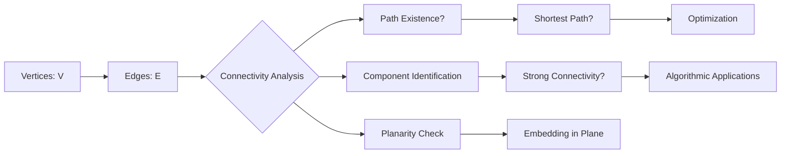

# Foundation: Graph Theory

## 1. Conceptual Mental Model (Core intuition, analogies, and first principles)

Graph Theory is the study of **abstract networks of relationships**—a foundational framework for modeling discrete systems where entities are connected by relationships. At its core, it addresses the question: *How do we represent and analyze systems of interdependent units?*  

**Intuition**: Imagine a social network where people (vertices) form connections (edges) based on friendships. Graph Theory provides the mathematical language to describe this network’s structure, identify communities, detect influential nodes, and answer questions like *"Is there a path between Alice and Bob?"* without needing physical space or continuous geometry.  

**First Principles**:  
- **Discrete Structure**: Graphs are finite collections of points (vertices) and connections (edges).  
- **Relationships over Space**: Edges represent *relationships* (e.g., "is connected to"), not physical distances.  
- **Abstraction**: The focus is on *connectivity patterns*, not geometric embeddings.  
- **Universality**: Graphs model *any* system with binary relationships (e.g., computer networks, chemical bonds, transportation systems).  

**Why it matters in formal sciences**: Graph Theory bridges combinatorics, logic, and computation by providing a rigorous framework for analyzing discrete structures. It underpins algorithms for optimization, network security, and complex system modeling—making it indispensable in applied mathematics and theoretical computer science.

---

## 2. Essential Terminology & Taxonomy

| Term                | Definition                                                                 | Mathematical Notation       |
|---------------------|---------------------------------------------------------------------------|-----------------------------|
| **Vertex**          | An entity in the graph (node)                                             | $v \in V$                  |
| **Edge**            | A relationship between two vertices                                        | $e = (u, v)$               |
| **Simple Graph**    | No multiple edges between vertices; no self-loops                          | $G = (V, E)$, $E \subseteq V \times V$ |
| **Directed Graph**  | Edges have direction (ordered pairs)                                       | $G = (V, E)$, $E \subseteq V \times V$ |
| **Weighted Graph**  | Edges have numerical weights (e.g., distances, costs)                       | $w(e) \in \mathbb{R}^+$    |
| **Connected Graph** | There exists a path between every pair of vertices                          | $\forall u,v \in V$, $u \text{ connected to } v$ |
| **Planar Graph**    | Can be drawn on a plane without edge crossings                             | $G$ embeds in $\mathbb{R}^2$ without crossings |

> **Key Insight**: These terms form a *hierarchical taxonomy*. For example, a *directed weighted graph* is a specialized case of a simple graph where edges are ordered and assigned weights.

---

## 3. Architecture & Core Workflow

**System Flow Explanation**:  
1. **Input**: A set of vertices $V$ and edges $E$ (defined by $G = (V, E)$).  
2. **Connectivity Analysis**: Determine if the graph is *connected* (all vertices linked) or *disconnected* (multiple components).  
3. **Path Queries**: Solve for existence, length, or shortest paths between vertices.  
4. **Planarity Check**: Verify if the graph can be embedded in 2D without edge crossings (critical for circuit design).  
5. **Output**: Structural properties (e.g., connectedness, planarity) enabling applications like network routing or circuit layout.

> **Why this workflow matters**: It reflects how graph theory *operates*—not as a static object, but as a dynamic system for answering computational questions about relationships.

---

## 4. Common Misconceptions & Mental Traps

| Misconception                          | Correct Understanding                                                                 | Why It Matters                                                                 |
|----------------------------------------|------------------------------------------------------------------------------------|--------------------------------------------------------------------------------|
| "Graphs are only for social networks"  | Graphs model *any* binary relationship system (e.g., neural networks, molecular bonds) | Overgeneralization obscures the *universal applicability* of graph theory.       |
| "Connected graphs must be planar"      | $K_5$ (complete graph on 5 vertices) is connected but *not* planar                  | Planarity is a *separate* property from connectivity; misapplying this leads to flawed network designs. |
| "All graphs have unique embeddings"    | Multiple planar embeddings exist for the same graph (e.g., $K_4$ has 2 distinct planar drawings) | Assuming uniqueness causes errors in geometric applications (e.g., VLSI design). |
| "Weighted graphs are only for distances" | Weights can represent *any* quantitative relationship (e.g., trust scores, traffic flow) | Ignoring this restricts graph theory’s utility in optimization problems.        |

> **Critical Insight**: Graph theory’s power lies in its *abstraction*—not in physical constraints. Misconceptions often arise from conflating *mathematical properties* with *real-world interpretations*.

---

## 5. Socratic Discussion Starters

1. **How would you define a graph *without* using the term "vertex" or "edge"?**  
   *(Probes abstraction and foundational language—can you build the concept from first principles?)*

2. **Why can't the complete graph $K_5$ be embedded in the plane without edge crossings?**  
   *(Forces geometric intuition and understanding of planarity as a topological constraint—no hand-waving allowed.)*

3. **Suppose you have a graph where every vertex has degree 3. Must this graph be connected?**  
   *(Tests whether you grasp the *interplay* between degree constraints and connectivity—critical for algorithm design.)*

These questions target deep conceptual understanding, not rote definitions—exactly the kind of inquiry a formal sciences professor would prioritize.
