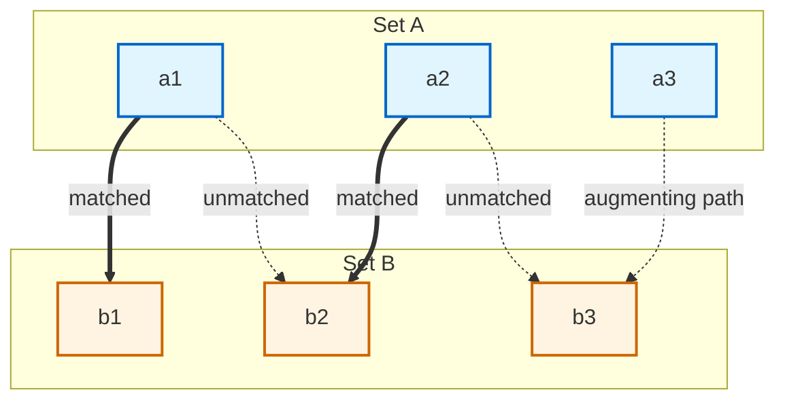

# Lesson 4: Trees, Matching, Coloring

## 1. First-Principles Intuition & Invariants

Graph theory rests on three structural pillars that recur throughout combinatorics, algorithm design, and algebraic topology: the acyclic connected subgraph we call a tree, the conflict-free pairing of vertices we call a matching, and the resource-allocation problem encoded in graph coloring. Each of these concepts begins with a deceptively simple question — when can a connected graph have no cycles? when can every vertex find a partner? how many colors suffice to distinguish adjacent vertices? — and each question unfolds into a rich landscape of exact theorems, computational algorithms, and hard combinatorial boundaries. This lesson traces those unfoldings with the care they deserve.

### Trees: Acyclicity as Structural Minimality

A **tree** is a connected graph that contains no cycle. This one-sentence definition conceals an extraordinary rigidity: a tree on $n$ vertices has precisely $n - 1$ edges, and that count is not incidental but structurally forced. To understand why, begin from first principles. A connected graph on $n$ vertices requires at least $n - 1$ edges to maintain connectivity — fewer edges would leave at least one component disconnected, since each new edge added to a forest (an acyclic graph, possibly disconnected) reduces the number of connected components by exactly one. Starting from $n$ isolated vertices (each a component), we need $n - 1$ edge-additions to reach a single component. Any additional edge, the $(n)$th edge, must join two vertices already path-connected, thereby creating a cycle. So the integer $n - 1$ sits at the precise threshold between connectivity and acyclicity.

This threshold yields a family of equivalent characterizations that form the standard toolkit. For a graph $G = (V, E)$ with $|V| = n$, the following are equivalent:

**Theorem 1.1 (Tree Characterizations).** The following statements are mutually equivalent for a graph $G$ on $n$ vertices.

(i) $G$ is connected and acyclic.
(ii) $G$ is connected and $|E| = n - 1$.
(iii) $G$ is acyclic and $|E| = n - 1$.
(iv) Every pair of vertices is connected by a unique simple path.
(v) $G$ is minimally connected: removing any edge disconnects $G$.
(vi) $G$ is maximally acyclic: adding any edge between non-adjacent vertices creates exactly one cycle.

*Proof of the cycle (i) $\Rightarrow$ (iv) $\Rightarrow$ (v) $\Rightarrow$ (i).* Assume (i): $G$ is connected and acyclic. For any two vertices $u, v \in V$, connectivity guarantees at least one simple path $P$ from $u$ to $v$. Suppose for contradiction that two distinct simple paths $P_1$ and $P_2$ exist from $u$ to $v$. Since they are distinct, there exists a first vertex $w$ where they diverge: $P_1$ continues along some edge $e_1 = (w, x)$ while $P_2$ continues along $e_2 = (w, y)$ with $e_1 \neq e_2$. Following $P_1$ from $w$ and $P_2$ from $w$ until they reconverge at some vertex $z$ (which must exist since both paths reach $v$), the subpath of $P_1$ from $w$ to $z$ concatenated with the reverse of the subpath of $P_2$ from $w$ to $z$ forms a closed walk. Since both paths are simple, this closed walk is a cycle, contradicting acyclicity. So (i) $\Rightarrow$ (iv).

For (iv) $\Rightarrow$ (v): assume every pair of vertices has a unique simple path. For any edge $e = (u,v)$, the unique path from $u$ to $v$ is exactly the edge $e$ itself; removing $e$ destroys the only path between $u$ and $v$, disconnecting $G$.

For (v) $\Rightarrow$ (i): assume $G$ is minimally connected, meaning every edge removal disconnects $G$. $G$ is connected by assumption, so we need only show acyclicity. Suppose some cycle $C$ exists in $G$. Any edge $e$ of $C$ has the property that the remaining edges of $C$ provide an alternate path between its endpoints, so removing $e$ does not disconnect $G$. This contradicts minimal connectivity. Hence $G$ is acyclic. $\blacksquare$

The equivalence of (i), (ii), and (iii) follows from the edge-count argument above, which we now make precise as a lemma.

**Lemma 1.2.** A forest on $n$ vertices and $k$ connected components has exactly $n - k$ edges.

*Proof.* By induction on $n$. Base case $n = 1$: one vertex, one component, zero edges; $1 - 1 = 0$. Inductive step: suppose the claim holds for all forests with fewer than $n$ vertices. Take a forest $F$ on $n$ vertices and $k$ components. Any tree component of $F$ has at least one leaf (a vertex of degree 1), since a finite tree always contains a leaf — if no vertex had degree 1, every vertex would have degree $\geq 2$, and a standard walk argument produces a cycle, contradicting acyclicity. Remove a leaf $v$ from $F$; the resulting graph $F'$ has $n - 1$ vertices and $k' $ components, where $k' = k$ (removing a leaf from a tree component does not split it; it merely shrinks it). By induction, $F'$ has $(n-1) - k$ edges. Since $v$ contributed exactly one edge to $F$, we have $|E(F)| = (n - 1 - k) + 1 = n - k$. $\blacksquare$

The leaf-existence fact used in the proof is itself worth isolating: every finite tree $T$ on $n \geq 2$ vertices has at least two leaves. This follows from summing degrees, $\sum_{v} \deg(v) = 2(n-1)$, and observing that if at most one vertex had degree 1, the sum of degrees would be at least $1 + 2(n-1) = 2n - 1$, contradicting $2(n-1) = 2n - 2$.

### Spanning Trees and Cayley's Formula

Given a connected graph $G$, a **spanning tree** is a subgraph $T \subseteq G$ that is a tree and contains every vertex of $G$. Spanning trees are the combinatorial analogue of a basis: they provide a connected, acyclic skeleton that "spans" the vertex set with the minimum number of edges. Every connected graph has at least one spanning tree, and the question of how many spanning trees a graph has is answered, in the special case of the complete graph $K_n$, by one of the most beautiful formulas in combinatorics.

**Theorem 1.3 (Cayley's Formula).** The number of labeled spanning trees of the complete graph $K_n$ is $n^{n-2}$.

The standard proof uses the **Prüfer sequence**, a bijection between labeled trees on $\{1, 2, \ldots, n\}$ and sequences of length $n - 2$ drawn from $\{1, 2, \ldots, n\}$. We construct the correspondence explicitly.

*Prüfer Encoding.* Given a labeled tree $T$ on vertex set $[n] = \{1, \ldots, n\}$, build a sequence $\text{Prüfer}(T) = (a_1, a_2, \ldots, a_{n-2})$ as follows: at each step, identify the leaf of $T$ with the smallest label, record the label of its unique neighbor, and delete that leaf. After $n - 2$ steps, exactly two vertices remain.

*Prüfer Decoding.* Given a sequence $(a_1, \ldots, a_{n-2}) \in [n]^{n-2}$, reconstruct $T$: let $L_1$ be the smallest integer in $[n]$ not appearing in $(a_1, \ldots, a_{n-2})$. Add edge $(L_1, a_1)$, then remove $a_1$ from the sequence and $L_1$ from consideration. At step $i$, let $L_i$ be the smallest integer in $[n]$ not appearing in $(a_i, \ldots, a_{n-2})$ and not yet removed. Add edge $(L_i, a_i)$ and proceed. After $n - 2$ steps, connect the two remaining vertices with a final edge.

The encoding and decoding are mutual inverses — a verification by induction shows that each labeled tree maps to a unique Prüfer sequence and each sequence decodes to a unique tree — establishing a bijection between labeled trees on $[n]$ and $[n]^{n-2}$. Since $|[n]^{n-2}| = n^{n-2}$, the formula follows. $\blacksquare$

The degree of vertex $i$ in the tree equals one plus the number of times $i$ appears in its Prüfer sequence, a fact with immediate combinatorial applications: the sequences in which a fixed set of vertices appears with prescribed multiplicities count exactly the trees with prescribed degree sequences.

### Bipartite Graphs and the Structure of Matching

A graph $G = (V, E)$ is **bipartite** if its vertex set can be partitioned into two independent sets $A$ and $B$ — meaning every edge has one endpoint in $A$ and one in $B$. Bipartite graphs are the natural setting for assignment problems: workers and tasks, students and dorms, medical residents and hospitals. They are also characterized by a purely structural condition.

**Theorem 1.4.** A graph is bipartite if and only if it contains no odd-length cycle.

*Proof.* The forward direction is immediate: in a bipartite graph $G = (A \cup B, E)$, any cycle alternates between $A$ and $B$, so a cycle of length $k$ requires $k$ alternations and therefore $k$ must be even.

For the converse, suppose $G$ contains no odd cycle. It suffices to show $G$ is 2-colorable. Fix a connected component; fix a vertex $r$ and 2-color by BFS parity: color $v$ with $0$ if the shortest path from $r$ to $v$ has even length, and with $1$ if odd. For any edge $(u, v)$, if $u$ and $v$ had the same color, then their BFS distances from $r$ differ by an even number, and the edge $(u,v)$ together with the two BFS paths would construct an odd cycle, contradicting our assumption. So every edge has endpoints of different colors, confirming bipartiteness. $\blacksquare$

A **matching** in $G$ is a set $M \subseteq E$ of pairwise non-adjacent edges: no two edges in $M$ share a vertex. A vertex is **matched** if it is incident to some edge in $M$. A matching is **perfect** if every vertex is matched, and a **maximum matching** is one of maximum cardinality.

The theory of bipartite matching reaches its apex in Hall's theorem, which translates the existence of a perfect matching into a neighborhood condition.

**Theorem 1.5 (Hall's Marriage Theorem, 1935).** Let $G = (A \cup B, E)$ be a bipartite graph with $|A| = |B|$. A perfect matching exists if and only if for every subset $S \subseteq A$, the neighborhood $N(S) \subseteq B$ satisfies $|N(S)| \geq |S|$.

The condition $|N(S)| \geq |S|$ for all $S \subseteq A$ is called **Hall's condition**. Its necessity is transparent: if some subset $S$ of $A$ has fewer than $|S|$ neighbors in $B$, then the vertices of $S$ collectively compete for fewer than $|S|$ partners in $B$, making a perfect matching geometrically impossible.

The sufficiency — that Hall's condition guarantees a perfect matching — is the nontrivial direction, and we prove it by induction on $|A|$.

*Proof of sufficiency.* Base case: $|A| = 1$. Hall's condition requires $|N(\{a\})| \geq 1$ for the single vertex $a \in A$, so $a$ has at least one neighbor in $B$; pair $a$ with any such neighbor. Inductive step: assume the theorem holds for all bipartite graphs with $|A| < n$, and consider a bipartite graph with $|A| = n$ satisfying Hall's condition.

**Case 1:** Every proper nonempty subset $S \subsetneq A$ satisfies $|N(S)| \geq |S| + 1$ (the condition is "slack" everywhere). Pick any vertex $a \in A$ and any neighbor $b \in N(a)$. Remove $a$ and $b$ from $G$ to form $G'$ with bipartition $A' = A \setminus \{a\}$ and $B' = B \setminus \{b\}$. We verify Hall's condition for $G'$: for any $S \subseteq A'$, the neighborhood of $S$ in $G'$ is at least $N_{G}(S) \setminus \{b\}$, which has size at least $(|S| + 1) - 1 = |S|$. By induction, $G'$ has a perfect matching $M'$. Then $M' \cup \{(a, b)\}$ is a perfect matching of $G$.

**Case 2:** Some proper nonempty subset $S \subsetneq A$ satisfies $|N(S)| = |S|$ (the condition is "tight"). The induced bipartite subgraph $G[S \cup N(S)]$ satisfies Hall's condition (since $G$ does and Hall's condition is closed under restriction to tight sets). By induction, it has a perfect matching $M_1$ saturating $S$.

Consider the remaining graph $G' = G[(A \setminus S) \cup (B \setminus N(S))]$. We claim $G'$ satisfies Hall's condition. For any subset $T \subseteq A \setminus S$, consider $N_{G}(S \cup T)$. Since $G$ satisfies Hall's condition, $|N_G(S \cup T)| \geq |S \cup T| = |S| + |T|$. But $N_G(S) = N(S)$ has size $|S|$, so $|N_G(T) \setminus N(S)| \geq |T|$. The left side is exactly $|N_{G'}(T)|$, confirming Hall's condition in $G'$. By induction, $G'$ has a perfect matching $M_2$. Then $M_1 \cup M_2$ is a perfect matching of $G$. $\blacksquare$

Hall's theorem has immediate corollaries of broad utility. If $G$ is a $k$-regular bipartite graph (every vertex has degree exactly $k$), then Hall's condition holds automatically: for any $S \subseteq A$, counting edges between $S$ and $N(S)$ gives exactly $k|S|$ edges from the $S$ side, but at most $k|N(S)|$ edges from the $N(S)$ side, so $k|S| \leq k|N(S)|$, yielding $|N(S)| \geq |S|$. Hence every $k$-regular bipartite graph has a perfect matching, and in fact its edge set can be decomposed into $k$ disjoint perfect matchings.

The algorithmic problem of finding a maximum matching in a bipartite graph is solved by the **Hungarian algorithm** (Kuhn, 1955), which works through augmenting paths. An **augmenting path** relative to a matching $M$ is a path from an unmatched vertex in $A$ to an unmatched vertex in $B$ whose edges alternate between non-matching and matching edges. Augmenting along such a path — swapping matched and unmatched edges along its length — increases $|M|$ by exactly one. Berge's lemma states that a matching $M$ is maximum if and only if no augmenting path exists. The Hungarian algorithm iteratively searches for augmenting paths via BFS/DFS, achieving $O(|V| \cdot |E|)$ runtime.

For weighted bipartite matching — assigning workers to jobs with associated costs — the problem becomes the **assignment problem**, solvable in $O(n^3)$ by the original Hungarian method using the dual LP formulation, where the primal seeks to maximize total edge weight over matchings and the dual variables correspond to vertex potentials satisfying complementary slackness.

### Graph Coloring and the Chromatic Number

The **chromatic number** $\chi(G)$ of a graph $G$ is the minimum number of colors required to color the vertices of $G$ such that no two adjacent vertices share a color. A $k$-coloring is a function $c : V \to \{1, 2, \ldots, k\}$ with $c(u) \neq c(v)$ for every edge $(u, v)$. Graph coloring abstracts scheduling, register allocation, frequency assignment, and map-drawing problems into a single combinatorial framework.

The chromatic number satisfies two canonical lower bounds. First, the **clique number** $\omega(G)$ — the size of the largest complete subgraph (clique) in $G$ — provides a lower bound, since all vertices in a clique must receive distinct colors: $\chi(G) \geq \omega(G)$. Second, the **fractional chromatic number** $\omega(G) \leq \chi_f(G) \leq \chi(G)$, defined via fractional relaxation of the integer coloring LP, provides a tighter bound in some cases. Neither bound is tight in general: Mycielski's construction produces triangle-free graphs ($\omega = 2$) with arbitrarily large chromatic number.

An upper bound comes from the greedy algorithm: ordering vertices $v_1, v_2, \ldots, v_n$ and assigning each $v_i$ the smallest color not used by its already-colored neighbors, the greedy algorithm uses at most $\Delta(G) + 1$ colors, where $\Delta(G)$ is the maximum degree. This yields $\chi(G) \leq \Delta(G) + 1$.

**Theorem 1.6 (Brooks' Theorem, 1941).** For any connected graph $G$ that is neither a complete graph $K_n$ nor an odd cycle $C_{2k+1}$,

$$\chi(G) \leq \Delta(G).$$

The proof constructs an ordering of vertices for the greedy algorithm such that each vertex (except two special ones at the start) has at most $\Delta - 1$ already-colored neighbors when it is colored. The construction branches on whether $G$ is 2-connected or not, and in the 2-connected case uses a spanning tree rooted such that the root has two neighbors colored alike, freeing a color for the root itself.

Chromatic polynomials provide an algebraic approach. The **chromatic polynomial** $P(G, k)$ counts the number of proper $k$-colorings of $G$ as a polynomial in $k$. It satisfies the deletion-contraction recurrence:

$$P(G, k) = P(G - e, k) - P(G / e, k),$$

where $G - e$ is the graph with edge $e$ removed and $G / e$ is the graph with edge $e$ contracted (the two endpoints merged). This recurrence reduces any graph to a sum of contributions from simpler graphs, terminating when every component is a single vertex, whose chromatic polynomial is $k$. For the complete graph $K_n$, $P(K_n, k) = k(k-1)(k-2)\cdots(k-n+1)$, and for a tree $T_n$ on $n$ vertices, $P(T_n, k) = k(k-1)^{n-1}$.

The critical computational fact is that computing $\chi(G)$ is $\mathsf{NP}$-hard: the problem of deciding whether $\chi(G) \leq 3$ is $\mathsf{NP}$-complete. For $k = 2$, checking 2-colorability is equivalent by Theorem 1.4 to checking bipartiteness, which is solvable in $O(|V| + |E|)$ by BFS. The jump from $k = 2$ to $k = 3$ is a phase transition from polynomial to $\mathsf{NP}$-hard, one of the fundamental asymmetries in computational complexity.

### Planarity and the Four Color Theorem

A graph is **planar** if it can be drawn in the plane with no edge crossings. The combinatorial structure of planar graphs is tightly constrained by Euler's formula, which connects vertices, edges, and faces (connected regions of the plane, including the unbounded outer face) of any connected planar drawing.

**Theorem 1.7 (Euler's Formula).** For any connected planar graph drawn in the plane with $v$ vertices, $e$ edges, and $f$ faces,

$$v - e + f = 2.$$

*Proof.* By induction on $e$. If $e = 0$, then $G$ is a single vertex ($v = 1$), there is one face ($f = 1$), and $1 - 0 + 1 = 2$. For the inductive step, consider a connected planar graph with $e \geq 1$ edges.

**Case 1:** $G$ is a tree. Then $e = v - 1$ and $f = 1$ (trees have no interior cycles, hence a single face). So $v - (v-1) + 1 = 2$. $\checkmark$

**Case 2:** $G$ has a cycle. Remove an edge $e_0$ from some cycle; the resulting graph $G'$ remains connected (since cycle edges are not bridges) and is planar with $v' = v$, $e' = e - 1$, and $f' = f - 1$ (removing a cycle edge merges two faces into one). By induction, $v - (e-1) + (f-1) = 2$, hence $v - e + f = 2$. $\blacksquare$

From Euler's formula, we derive that every simple planar graph with $v \geq 3$ satisfies $e \leq 3v - 6$, since each face is bounded by at least 3 edges and each edge borders at most 2 faces, giving $3f \leq 2e$. Substituting into Euler's formula yields $f = 2 - v + e$, so $3(2 - v + e) \leq 2e$, giving $6 - 3v + 3e \leq 2e$, i.e., $e \leq 3v - 6$.

This inequality immediately proves that $K_5$ is nonplanar: $K_5$ has $v = 5$ and $e = 10$, but $3(5) - 6 = 9 < 10$. For $K_{3,3}$, the bound $e \leq 3v - 6$ does not directly apply since $K_{3,3}$ is bipartite (no triangles), but the tighter bound $e \leq 2v - 4$ (from $4f \leq 2e$ for triangle-free graphs) gives $2(6) - 4 = 8 < 9 = e(K_{3,3})$, confirming nonplanarity.

**Theorem 1.8 (Kuratowski's Theorem, 1930).** A graph is planar if and only if it contains no subdivision of $K_5$ or $K_{3,3}$ as a subgraph.

A subdivision of a graph replaces each edge with a path of one or more edges. Kuratowski's theorem is a topological characterization of planarity, and Wagner's equivalent theorem replaces "subdivision" with "minor" (a graph obtained by deleting vertices, deleting edges, and contracting edges).

The chromatic number of planar graphs is bounded above by 4 — the celebrated Four Color Theorem, conjectured in 1852, proved by Appel and Haken in 1976 using a computer-aided case analysis of 1,936 reducible configurations, and re-proved more cleanly by Robertson, Sanders, Seymour, and Thomas in 1997.

**Theorem 1.9 (Four Color Theorem).** Every planar graph satisfies $\chi(G) \leq 4$.

A purely human proof remains unknown. What is known by human means is the **Five Color Theorem** of Heawood (1890), provable via induction using the fact that every planar graph has a vertex of degree at most 5 (from $e \leq 3v - 6$ and the handshaking lemma, since if all degrees were $\geq 6$ then $2e \geq 6v$, contradicting $2e \leq 6v - 12$). The key step of the five-color proof uses a Kempe chain argument on two colors when a degree-5 vertex's neighbors use all five candidate colors.

---

## 2. Core Architecture & Mechanics

### The Algebraic Machinery of Spanning Trees: Matrix-Tree Theorem

The number of spanning trees of an arbitrary connected graph $G$ on $n$ vertices is computed by Kirchhoff's **Matrix-Tree Theorem**, which links combinatorics to linear algebra through the graph Laplacian.

**Definition 2.1 (Graph Laplacian).** Let $G = (V, E)$ with $V = \{v_1, \ldots, v_n\}$. The **degree matrix** $D$ is the diagonal matrix with $D_{ii} = \deg(v_i)$. The **adjacency matrix** $A$ has $A_{ij} = 1$ if $(v_i, v_j) \in E$ and 0 otherwise. The **Laplacian** is $L = D - A$.

Explicitly:

$$L_{ij} = \begin{cases} \deg(v_i) & \text{if } i = j \\ -1 & \text{if } (v_i, v_j) \in E \\ 0 & \text{otherwise.} \end{cases}$$

The Laplacian is symmetric positive semidefinite. Its smallest eigenvalue is always 0, with eigenvector $\mathbf{1}$ (the all-ones vector), since $L \mathbf{1} = 0$ reflects the fact that row sums vanish. For a connected graph, 0 is a simple eigenvalue (multiplicity 1); the second smallest eigenvalue $\lambda_2 > 0$ is the **algebraic connectivity** or Fiedler value, measuring how well-connected the graph is.

**Theorem 2.2 (Kirchhoff's Matrix-Tree Theorem).** Let $L$ be the Laplacian of a connected graph $G$ on $n$ vertices. The number of spanning trees of $G$ equals any cofactor of $L$:

$$\tau(G) = \frac{1}{n} \prod_{i=2}^{n} \lambda_i,$$

where $\lambda_2, \ldots, \lambda_n$ are the nonzero eigenvalues of $L$. Equivalently, $\tau(G) = \det(L^*)$, where $L^*$ is any $(n-1) \times (n-1)$ matrix obtained by deleting the $i$th row and $i$th column from $L$.

*Proof sketch.* Write $L = B B^\top$ where $B$ is the signed incidence matrix: orient each edge arbitrarily, then $B_{ve} = +1$ if $v$ is the head of edge $e$, $-1$ if $v$ is the tail, 0 otherwise. By the Cauchy-Binet theorem, the cofactor $\det(L^*)$ equals the sum over all $(n-1)$-element subsets $F$ of edges of $(\det B_{F}^*)^2$, where $B_F^*$ is the reduced incidence matrix restricted to edges $F$. A classical result in algebraic graph theory states that $\det B_F^* = \pm 1$ if $F$ is a spanning tree and $0$ otherwise (since spanning trees are exactly the sets of $n-1$ edges with nonsingular reduced incidence matrices). The sum thus counts spanning trees. $\blacksquare$

For example, the complete graph $K_n$ has Laplacian eigenvalues $n$ (with multiplicity $n-1$) and $0$ (with multiplicity 1), giving $\tau(K_n) = n^{n-2}$, recovering Cayley's Formula.

### Minimum Spanning Trees: Greedy Algorithms and Matroid Structure

In practice, edges carry weights, and we seek a spanning tree of minimum total weight. The **Minimum Spanning Tree (MST)** problem is solved by two classical greedy algorithms: Kruskal's and Prim's. Both are correct because the set of spanning trees of a connected graph forms a **graphic matroid** — a structure in which greedy algorithms are exactly optimal.

A **matroid** $M = (E, \mathcal{I})$ is a pair of a ground set $E$ and a family $\mathcal{I}$ of "independent sets" satisfying: (1) $\emptyset \in \mathcal{I}$; (2) if $X \in \mathcal{I}$ and $Y \subseteq X$ then $Y \in \mathcal{I}$ (hereditary); (3) if $X, Y \in \mathcal{I}$ and $|Y| > |X|$, then some $e \in Y \setminus X$ satisfies $X \cup \{e\} \in \mathcal{I}$ (augmentation/exchange). For the graphic matroid of $G$, $E$ is the edge set and $\mathcal{I}$ is the family of acyclic subgraphs (forests). The maximal independent sets are the spanning forests, or spanning trees for connected $G$.

**Theorem 2.3 (Greedy Optimality in Matroids).** For a matroid $M = (E, \mathcal{I})$ with edge weights $w : E \to \mathbb{R}$, the greedy algorithm — always adding the minimum-weight independent element — finds a minimum-weight basis.

The proof invokes the exchange axiom: if greedy chose $e$ before $e'$ with $w(e') < w(e)$, we can exchange $e$ for $e'$ in the basis while maintaining independence and improving weight, contradicting greediness. The formal argument by exchange produces a contradiction with the assumed optimality of the greedy basis whenever the greedy fails, via induction on the step where greedy and OPT first diverge.

**Kruskal's Algorithm** sorts all edges by weight and adds each edge if it does not create a cycle (implemented efficiently by a Union-Find data structure). With $m = |E|$ edges, sorting costs $O(m \log m)$ and union-find operations cost $O(m \alpha(n))$ where $\alpha$ is the inverse Ackermann function, giving total complexity $O(m \log m)$.

**Prim's Algorithm** maintains a growing tree and repeatedly adds the minimum-weight edge leaving the current tree. Implemented with a Fibonacci heap, it runs in $O(m + n \log n)$, optimal for dense graphs. The MST's optimality is equivalently characterized by the **cycle property** (the maximum-weight edge in any cycle is not in the MST) and the **cut property** (the minimum-weight edge crossing any cut is in every MST).

### The Augmenting Path Architecture for Maximum Matching

The computational core of bipartite matching is the alternating path search. Given the current matching $M$, we construct an **alternating BFS tree** rooted at unmatched vertices in $A$, where odd levels traverse unmatched edges and even levels traverse matched edges. The structure of this search is illustrated below.

For general (non-bipartite) graphs, Edmonds' Blossom algorithm handles odd cycles (blossoms) that the alternating path search must "shrink" before continuing, running in $O(n^3)$ overall.

### Chromatic Polynomial Computation via Deletion-Contraction

The deletion-contraction recurrence for the chromatic polynomial $P(G, k) = P(G - e, k) - P(G/e, k)$ defines a recursive algorithm whose structure is a binary tree of subproblems. Each level of the tree either removes an edge (increasing the graph's disconnectedness) or contracts it (reducing vertex count). The recursion terminates when every component is an edge (chromatic polynomial $k(k-1)$) or a single vertex ($k$).

For the cycle $C_n$, the deletion-contraction unfolds as follows. Remove one edge $e$ from $C_n$; $C_n - e$ is a path $P_n$, which is a tree with chromatic polynomial $k(k-1)^{n-1}$. Contract $e$ in $C_n$; $C_n / e = C_{n-1}$. So:

$$P(C_n, k) = k(k-1)^{n-1} - P(C_{n-1}, k).$$

Unrolling this recurrence from the base case $P(C_3, k) = P(K_3, k) = k(k-1)(k-2)$, one obtains the closed form:

$$P(C_n, k) = (k-1)^n + (-1)^n (k-1).$$

Verification: $P(C_3, k) = (k-1)^3 - (k-1) = (k-1)[(k-1)^2 - 1] = (k-1)(k^2 - 2k) = k(k-1)(k-2)$. $\checkmark$

### The Four-Color Proof Architecture (Structural Outline)

The modern Robertson-Sanders-Seymour-Thomas (RSST) proof of the Four Color Theorem proceeds through three structural phases: an unavoidability proof (showing the planar graph must contain at least one of a fixed set of "configurations"), a reducibility proof (showing that any such configuration can be reduced: if the smaller graph without the configuration is 4-colorable, then so is the original), and a discharge argument that transfers "charge" across the graph to demonstrate that every planar graph must contain an unavoidable configuration. The RSST reducible set has 633 configurations, reduced from Appel-Haken's original 1,936 through improved discharge rules.

The discharge method assigns each vertex $v$ an initial charge of $6 - \deg(v)$ (chosen so total charge is $\sum_v (6 - \deg(v)) = 6v - 2e \cdot \frac{6}{2}$... more precisely, using $6v - 12 > 2e \cdot 2$ from $e \leq 3v - 6$, so total charge $= 12 > 0$). Charge is then redistributed by rules: high-degree vertices donate charge to low-degree vertices. If no configuration in the reducible set appeared, then after discharge every vertex would have non-positive charge — but total charge is positive, a contradiction.

---

## 3. High-Performance Optimization & Failure Modes

### Minimum Spanning Tree: Boundary Cases and Algorithmic Traps

The greedy correctness of Kruskal's and Prim's algorithms requires that edge weights be distinct, or that ties are broken consistently. When multiple edges share the same weight, the MST may not be unique: there can be exponentially many minimum spanning trees (up to $n^{n-2}$ in the worst case). Algorithms remain correct — they produce some MST — but comparisons between implementations may produce different trees, which matters in applications like network reliability analysis where the MST's structure (not just its weight) is relevant.

A more subtle failure mode arises in **dynamic MST**: when edges are inserted or deleted from the graph online, naively rerunning Kruskal's from scratch costs $O(m \log m)$ per update. Dynamic MST algorithms maintain the spanning tree under insertions and deletions in $O(\log^2 n)$ amortized time per update (Holm, de Lichtenberg, Thorup, 2001), by decomposing the spanning tree into levels and rebuilding only damaged levels. The key invariant is that a spanning tree edge of level $\ell$ is in the MST of the subgraph containing only level-$\leq \ell$ edges. Violating this invariant during deletion requires a replacement edge search, which succeeds in $O(\log^2 n)$ amortized steps by exponentially decreasing the number of edges searched at each level.

### Matching: When Hall's Condition Fails and Deficiency

When Hall's condition fails for some $S \subseteq A$ with $|N(S)| < |S|$, no perfect matching exists. The maximum matching size is instead given by the **deficiency formula** (König's minimax theorem in one form). The **deficiency** of a subset $S \subseteq A$ is $\text{def}(S) = |S| - |N(S)|$, and the maximum deficiency is:

$$|A| - \nu(G) = \max_{S \subseteq A} \text{def}(S),$$

where $\nu(G)$ is the size of a maximum matching. This tells us exactly how many vertices in $A$ must go unmatched. Algorithmically, the maximum deficiency set $S^*$ is found as the set of vertices in $A$ not reachable by alternating paths from unmatched $A$-vertices in the final matching, combined with their neighborhood expansion — a byproduct of the augmenting path algorithm at termination.

The companion theorem is **König's theorem** for bipartite graphs: the size of a maximum matching equals the size of a minimum vertex cover (a set $C \subseteq V$ such that every edge has at least one endpoint in $C$). This minimax duality is a consequence of LP duality applied to the matching polytope of bipartite graphs — an instance where the LP relaxation is integral (the bipartite matching polytope is a perfect integer polytope), meaning the LP optimal solution is automatically integer-valued.

**Theorem 3.1 (König's Theorem, 1931).** In a bipartite graph $G$, $\nu(G) = \tau(G)$, where $\nu(G)$ is the maximum matching size and $\tau(G)$ is the minimum vertex cover size.

*Proof.* The inequality $\nu(G) \leq \tau(G)$ holds in any graph: each matching edge requires a distinct vertex in any cover. For the reverse inequality, take a maximum matching $M$ of size $\nu$. By the alternating path algorithm, let $U \subseteq A$ be the unmatched vertices in $A$ and let $Z$ be the set of vertices reachable from $U$ by alternating paths. Set $C = (A \setminus Z) \cup (B \cap Z)$. One verifies that $C$ is a vertex cover: any uncovered edge would yield an augmenting path, contradicting maximality. And $|C| = |M|$: each vertex in $A \setminus Z$ is matched (unmatched vertices in $A$ are in $U \subseteq Z$), and each vertex in $B \cap Z$ is matched (since $B$-vertices in $Z$ were reached via matching edges). The matched partners form a bijection, giving $|C| = |M| = \nu$. $\blacksquare$

### Chromatic Number: Hardness, Approximation, and Structural Bounds

Computing $\chi(G)$ is not merely $\mathsf{NP}$-hard but hard to approximate: Zuckerman (2007) proved that no polynomial-time algorithm can approximate $\chi(G)$ within a factor of $n^{1-\epsilon}$ for any $\epsilon > 0$ unless $\mathsf{P} = \mathsf{NP}$, by reduction from maximum independent set. This makes coloring one of the hardest approximation problems in combinatorial optimization.

Practical algorithms resort to branch-and-bound, constraint propagation, and symmetry-breaking. The **DSATUR** heuristic (Brélaz, 1979) assigns colors greedily by prioritizing the vertex with the highest **saturation** (number of distinct colors among already-colored neighbors), breaking ties by degree. DSATUR produces optimal colorings for many structured graph families (perfect graphs, planar graphs, chordal graphs) while remaining a heuristic in general.

For **perfect graphs** — a class defined by $\chi(H) = \omega(H)$ for every induced subgraph $H$ — the chromatic number and clique number coincide exactly, and both can be computed in polynomial time via the ellipsoid method applied to the theta function. The **Strong Perfect Graph Theorem** (Chudnovsky, Robertson, Seymour, Thomas, 2006), conjectured by Berge in 1960, characterizes perfect graphs as precisely those graphs containing no odd hole (induced odd cycle of length $\geq 5$) and no odd antihole (complement of an odd hole) as induced subgraphs.

### Edge Coloring and Vizing's Theorem

A **proper edge coloring** assigns colors to edges such that no two edges sharing a vertex have the same color; the minimum number of colors needed is the **chromatic index** $\chi'(G)$. The obvious lower bound is $\chi'(G) \geq \Delta(G)$. Vizing's theorem sharpens this to a dichotomy.

**Theorem 3.2 (Vizing's Theorem, 1964).** For any simple graph $G$, $\chi'(G) \in \{\Delta(G), \Delta(G) + 1\}$.

Graphs with $\chi'(G) = \Delta(G)$ are called **Class 1**; those with $\chi'(G) = \Delta(G) + 1$ are **Class 2**. Complete graphs $K_n$ on even $n$ are Class 1; on odd $n$ they are Class 2. Deciding whether a graph is Class 1 or Class 2 is $\mathsf{NP}$-complete in general. Vizing's proof itself is constructive: it shows that any $(k < \Delta + 1)$-edge-coloring can be extended to properly color one additional edge via alternating color chains (Kempe chains in the edge-coloring context), eventually producing a $(\Delta+1)$-edge-coloring.

For bipartite graphs, König's edge coloring theorem states $\chi'(G) = \Delta(G)$ always (Class 1), and a $\Delta$-edge-coloring decomposes into $\Delta$ perfect matchings — recoverable in $O(m \log \Delta)$ time by the matching decomposition of regular bipartite graphs.

### Planarity Testing and the Complexity of Embedding

Deciding planarity is solvable in linear time $O(n)$ by the **LR-planarity algorithm** (de Fraysseix, Ossona de Mendez, Rosenstiehl) or the earlier $O(n)$ algorithm of Hopcroft and Tarjan (1974), which uses a DFS-based path addition method. The key data structure is the **SPQR tree**, which decomposes a biconnected graph into its triconnected components and allows planarity to be checked hierarchically. Each triconnected component is either a bond (two vertices with parallel edges), a polygon (a cycle), or a 3-connected graph, and the combinatorial embedding of each piece is essentially unique for 3-connected graphs by Whitney's theorem.

**Theorem 3.3 (Whitney's Theorem, 1932).** A 3-connected planar graph has a unique embedding in the sphere (up to homeomorphism).

This uniqueness means that for 3-connected planar graphs, the face structure is combinatorially determined, and the dual graph is well-defined and unique. For graphs of lower connectivity, the embedding is not unique, and different embeddings may yield different face structures — a source of subtlety in algorithms relying on planarity.

The **genus** of a graph measures its non-planarity: $G$ has genus $g$ if it can be embedded on a surface of genus $g$ (a sphere with $g$ handles) but not genus $g-1$. Euler's formula generalizes to $v - e + f = 2 - 2g$, and the edge bound becomes $e \leq 3v - 3(2 - 2g) = 3v + 6g - 6$. Computing the genus of a graph is $\mathsf{NP}$-hard in general, though polynomial for fixed genus by Robertson-Seymour theory.

### Ramsey Theory: Coloring at the Combinatorial Boundary

A fundamental failure mode of coloring — or rather a universal constraint — is encoded in Ramsey theory. **Ramsey's theorem** states that for any $r, s \geq 1$, there exists a minimum integer $R(r, s)$ such that any 2-coloring of the edges of $K_{R(r,s)}$ contains either a red $K_r$ or a blue $K_s$. The Ramsey numbers satisfy the recurrence $R(r, s) \leq R(r-1, s) + R(r, s-1)$, giving the upper bound:

$$R(r, s) \leq \binom{r + s - 2}{r - 1}.$$

The probabilistic method (Erdős, 1947) gives the lower bound $R(s, s) \geq 2^{s/2}$ by showing that a random 2-coloring of $K_n$ has zero monochromatic $K_s$ with positive probability when $n < 2^{s/2}$. The exact value $R(3, 3) = 6$ is classical; $R(5, 5)$ is unknown, with bounds $43 \leq R(5,5) \leq 48$.

Ramsey theory is not merely a curiosity but a hard boundary on what graph-theoretic structures can be avoided. In the context of coloring, it says that sufficiently dense graphs cannot be colored with few colors without creating large monochromatic cliques. In algorithm design, Ramsey-type phenomena set information-theoretic lower bounds on decision tree complexity for graph problems. The interplay between structure (planarity, bipartiteness, tree decomposition) and coloring complexity (chromatic number, chromatic index, Ramsey multiplicity) is the deep organizing tension of the entire field, and mastering these interactions equips the working mathematician and computer scientist with one of the most powerful combinatorial lenses available.
