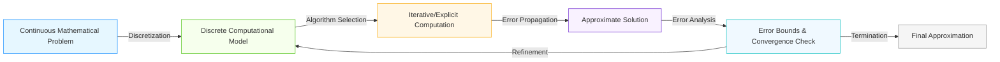

# Foundation: Numerical Analysis

## 1. Conceptual Mental Model (Core intuition, analogies, and first principles)

Numerical Analysis is the **systematic study of algorithms for solving mathematical problems using finite computational resources**. At its core, it addresses the fundamental tension between *ideal mathematical objects* (e.g., continuous functions, infinite series) and *computational reality* (e.g., finite precision, discrete steps). 

**Core intuition**: Mathematics is often defined in terms of *infinite* or *continuous* structures, but computers operate on *finite* and *discrete* resources. Numerical analysis provides the **rules for translating mathematical problems into computable approximations** while rigorously bounding the error introduced by this translation.

**Analogy**: Imagine constructing a bridge across a river.  
- *Ideal bridge*: A perfectly smooth, infinitely strong arch (continuous mathematics)  
- *Computational bridge*: A discrete framework of steel beams with finite strength (numerical approximation)  
The field asks: *How do we design the discrete structure so that it approximates the ideal bridge with minimal error, while surviving real-world constraints?*

**First principles**:  
1. **Approximation is foundational**: All numerical methods begin with a *discretization* (e.g., dividing a continuous domain into finite intervals).  
2. **Error is quantifiable**: Every approximation introduces error, which must be bounded and controlled.  
3. **Computational cost matters**: Algorithms must balance accuracy with computational efficiency (time, memory).  

This framework transforms abstract mathematical problems into *engineerable computational processes*—the essence of applied numerical analysis.

---

## 2. Essential Terminology & Taxonomy

| Term                | Definition & Foundational Significance                                                                 |
|---------------------|------------------------------------------------------------------------------------------------------|
| **Approximation**   | The process of representing a mathematical object (e.g., function, solution) using a simpler, finite-form structure (e.g., polynomials, piecewise constants). *Core to all numerical methods*. |
| **Stability**       | The property that small perturbations in input data or intermediate calculations do not cause unbounded error growth in the output. *Critical for reliable computation*. |
| **Convergence**     | The property that a sequence of approximations (e.g., iterates of an algorithm) approaches a true solution as the discretization parameter (e.g., step size) tends to zero. *Guarantees accuracy in the limit*. |
| **Conditioning**   | The sensitivity of a problem's solution to small changes in input data. A problem is *well-conditioned* if small input perturbations cause small output perturbations; *ill-conditioned* otherwise. |
| **Error Analysis**  | The systematic study of error sources (truncation, rounding, discretization) and their propagation through algorithms. *Quantifies the trade-off between accuracy and cost*. |
| **Iterative Method** | An algorithm that generates a sequence of approximations $x_{k+1} = f(x_k)$, where convergence depends on stability and convergence criteria. *Fundamental for solving nonlinear problems*. |
| **Discretization**  | The process of converting a continuous mathematical problem into a discrete one (e.g., replacing a differential equation with a finite difference scheme). *The bridge between theory and computation*. |

---

## 3. Architecture & Core Workflow

**Workflow Explanation**:  
1. **Problem → Discretization**: Convert continuous problem (e.g., ODE) into discrete form (e.g., finite differences).  
2. **Algorithm Selection**: Choose iterative method (e.g., Newton-Raphson) to solve the discrete model.  
3. **Computation**: Execute algorithm to generate sequence of approximations.  
4. **Error Analysis**: Quantify error sources and propagate through the computation.  
5. **Convergence Check**: Determine if error bounds satisfy tolerance (e.g., $||x_n - x^*|| < \epsilon$).  
6. **Termination**: Output final approximation or refine discretization.  

*Key Insight*: The cycle between **error analysis** and **discretization** ensures robustness—this closed loop is the backbone of reliable numerical computation.

---

## 4. Common Misconceptions & Mental Traps

1. **"Numerical methods are just 'approximations'—so they don’t matter."**  
   *Trap*: Fails to recognize that *structured approximation* (with error bounds) is the foundation of modern engineering and scientific computation. Without rigorous error control, approximations become meaningless.

2. **"Convergence implies stability."**  
   *Trap*: Convergence (sequence approaches solution) does not guarantee stability (small errors don’t amplify). A method may converge but become unstable for large input perturbations (e.g., ill-conditioned problems).

3. **"All problems are well-conditioned."**  
   *Trap*: Many problems (e.g., solving $x = \sin(x)$) are inherently ill-conditioned—small input changes cause large output variations. Numerical methods must explicitly handle this.

4. **"Discretization is a one-time step."**  
   *Trap*: Discretization parameters (e.g., step size) must be chosen *ad hoc* based on error analysis. Poor choices lead to unstable or inaccurate results.

---

## 5. Socratic Discussion Starters

1. **Why does stability matter more than convergence in practical numerical computation?**  
   *(Probes the distinction between theoretical convergence and real-world robustness—e.g., how a stable method can fail with tiny input errors despite converging mathematically)*

2. **Can a problem be ill-conditioned but still have stable numerical solutions?**  
   *(Challenges the relationship between conditioning and stability—e.g., through regularization or adaptive discretization)*

3. **How does the choice of discretization (e.g., finite differences vs. finite elements) fundamentally alter the error structure?**  
   *(Explores the role of approximation quality in error propagation—e.g., why some discretizations introduce higher-order truncation errors)*
