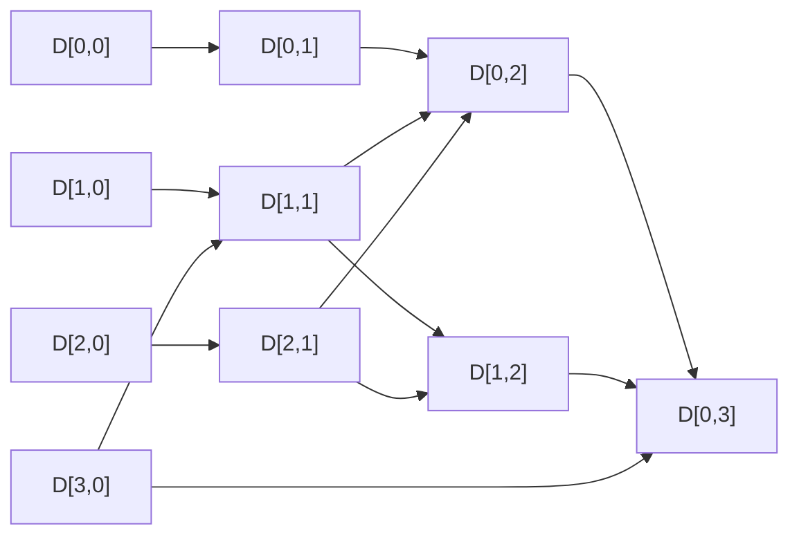

# Lesson 2: Polynomial Interpolation, Divided Differences, Approximation Theory

## 1. First-Principles Intuition & Invariants

Polynomial interpolation stands as one of the oldest and most elegant problems in numerical analysis: given a finite set of distinct data points $(x_0, y_0), (x_1, y_1), \ldots, (x_n, y_n)$, construct a polynomial $p(x)$ of minimal degree such that $p(x_i) = y_i$ for all $i = 0, 1, \ldots, n$. This seemingly simple requirement encodes a profound algebraic fact rooted in the structure of polynomial vector spaces. Since the space of polynomials of degree at most $n$ forms an $(n+1)$-dimensional vector space over the reals, and the interpolation conditions impose exactly $n+1$ linear constraints, the system is generically uniquely determined. This uniqueness is not merely a convenience but a fundamental consequence of the Vandermonde determinant being nonzero for distinct nodes.

The existence and uniqueness theorem for polynomial interpolation guarantees that for any choice of $n+1$ distinct interpolation nodes $x_0, x_1, \ldots, x_n$ and corresponding values $y_0, y_1, \ldots, y_n$, there exists a unique polynomial $p \in \mathbb{P}_n$ satisfying the interpolation constraints. The proof proceeds by observing that the linear system induced by the Vandermonde matrix is invertible precisely when the nodes are distinct. However, while existence and uniqueness are theoretically satisfying, they reveal nothing about the computational practicality or numerical stability of constructing such polynomials. The classical Vandermonde approach, which solves the linear system directly, suffers from catastrophic ill-conditioning as $n$ grows, with condition numbers that can scale exponentially with the degree.

The Lagrange form of the interpolating polynomial provides our first constructive representation. Define the Lagrange basis polynomials

$$L_j(x) = \prod_{\substack{k=0 \\ k \neq j}}^n \frac{x - x_k}{x_j - x_k}$$

for $j = 0, 1, \ldots, n$. Each $L_j$ is a polynomial of degree $n$ satisfying the cardinal property $L_j(x_i) = \delta_{ij}$, where $\delta_{ij}$ denotes the Kronecker delta. This orthogonality condition with respect to point evaluation functionals is the key structural insight. The interpolating polynomial then admits the representation

$$p(x) = \sum_{j=0}^n y_j L_j(x).$$

To verify correctness, evaluate $p(x_i)$ for any $i \in \{0, 1, \ldots, n\}$. The cardinal property ensures that only the $i$-th term survives, yielding $p(x_i) = y_i$ as required. The Lagrange form is elegant and explicit, requiring no system solving. However, its computational cost is substantial: constructing the basis polynomials requires $O(n^2)$ arithmetic operations, and evaluating $p(x)$ at a single point demands $O(n^2)$ additional operations due to the nested product-quotient structure.

More critically, the Lagrange form is algorithmically rigid. If we augment the data set with an additional point $(x_{n+1}, y_{n+1})$, the entire basis must be recomputed from scratch. The degree of the polynomial increases from $n$ to $n+1$, invalidating all previously computed Lagrange basis functions. This lack of incremental structure motivates the development of the Newton form, which exploits a recursive telescoping construction to achieve computational economy and algorithmic flexibility.

The Newton form represents the interpolating polynomial as

$$p(x) = c_0 + c_1(x - x_0) + c_2(x - x_0)(x - x_1) + \cdots + c_n(x - x_0)(x - x_1) \cdots (x - x_{n-1}),$$

where the coefficients $c_k$ are determined by the interpolation conditions. The nested structure of the basis functions $\pi_k(x) = \prod_{j=0}^{k-1}(x - x_j)$ ensures that adding a new data point $(x_{n+1}, y_{n+1})$ requires computing only the single new coefficient $c_{n+1}$ without disturbing the prior coefficients. This incremental property is invaluable in adaptive algorithms where interpolation nodes are added dynamically based on error estimates or convergence criteria.

The coefficients in the Newton form are precisely the divided differences of the data. The divided difference of order zero is defined as $f[x_i] = y_i$. The first-order divided difference is the discrete analog of the derivative:

$$f[x_i, x_{i+1}] = \frac{f[x_{i+1}] - f[x_i]}{x_{i+1} - x_i}.$$

Higher-order divided differences are defined recursively:

$$f[x_i, x_{i+1}, \ldots, x_{i+k}] = \frac{f[x_{i+1}, \ldots, x_{i+k}] - f[x_i, \ldots, x_{i+k-1}]}{x_{i+k} - x_i}.$$

This recursive structure mirrors the Pascal triangle construction for binomial coefficients. The divided difference $f[x_0, x_1, \ldots, x_k]$ is symmetric in its arguments, a nontrivial fact that follows from the uniqueness of the interpolating polynomial and the explicit Lagrange representation. The symmetry property ensures that the divided difference is well-defined even though the recursive definition appears to depend on the ordering of the nodes.

The connection between divided differences and the Newton form is direct: the coefficient $c_k$ in the Newton representation equals the $k$-th order divided difference $f[x_0, x_1, \ldots, x_k]$. Thus,

$$p(x) = f[x_0] + f[x_0, x_1](x - x_0) + f[x_0, x_1, x_2](x - x_0)(x - x_1) + \cdots + f[x_0, \ldots, x_n](x - x_0) \cdots (x - x_{n-1}).$$

This representation is constructive and efficient. The divided difference table is computed in $O(n^2)$ operations using dynamic programming, storing intermediate results in a triangular array. Once the table is constructed, evaluating $p(x)$ at a point requires only $O(n)$ operations via Horner's nested multiplication scheme applied to the Newton basis.

The fundamental question in interpolation theory is not merely whether we can construct an interpolating polynomial, but whether the polynomial provides a useful approximation to an underlying function $f$ from which the data points are sampled. If the data arises from a smooth function $f \in C^{n+1}[a, b]$, the interpolation error at a point $x \in [a, b]$ admits the explicit representation

$$f(x) - p(x) = \frac{f^{(n+1)}(\xi)}{(n+1)!} \prod_{j=0}^n (x - x_j)$$

for some $\xi$ in the smallest interval containing $x$ and all the interpolation nodes $x_0, \ldots, x_n$. This error formula is derived through repeated application of Rolle's theorem and the mean value theorem, constructing an auxiliary function whose $(n+1)$-th derivative vanishes at the interpolation nodes. The product $\prod_{j=0}^n (x - x_j)$ is the node polynomial, capturing the geometric distribution of the interpolation points. The error is minimized when the node polynomial is small in magnitude over the interpolation interval.

For equispaced nodes on $[-1, 1]$, the node polynomial grows exponentially near the endpoints of the interval. This phenomenon, known as Runge's phenomenon, manifests dramatically when interpolating smooth functions like $f(x) = 1/(1 + 25x^2)$ on $[-1, 1]$ with uniformly spaced nodes. As the polynomial degree increases, the interpolant oscillates wildly near the interval endpoints, diverging catastrophically from the true function despite the data being sampled from an infinitely differentiable function. The maximum error does not decrease but instead grows without bound, violating the naive expectation that higher-degree polynomials provide better approximations.

The resolution to Runge's phenomenon lies in the strategic placement of interpolation nodes. The Chebyshev nodes of the first kind are defined as

$$x_j = \cos\left(\frac{(2j+1)\pi}{2(n+1)}\right), \quad j = 0, 1, \ldots, n,$$

corresponding to the zeros of the Chebyshev polynomial $T_{n+1}(x) = \cos((n+1) \arccos x)$ on $[-1, 1]$. These nodes cluster near the endpoints of the interval, counteracting the exponential growth of the node polynomial. The Chebyshev node polynomial $\prod_{j=0}^n (x - x_j)$ is bounded by $2^{-n}$ in magnitude over $[-1, 1]$, achieving the minimax optimum among all monic polynomials of degree $n+1$. This clustering property ensures that the interpolation error decreases geometrically with $n$ for functions with sufficient regularity, restoring the convergence property that fails for equispaced nodes.

When the function $f$ does not pass exactly through prescribed data points due to measurement noise or modeling error, polynomial interpolation is inappropriate. Instead, we seek a polynomial $p^* \in \mathbb{P}_m$ of degree $m < n$ that minimizes the least-squares discrepancy

$$\sum_{i=0}^n (p(x_i) - y_i)^2.$$

This optimization problem is convex quadratic, admitting a unique solution characterized by the normal equations. The least-squares polynomial $p^*$ is the orthogonal projection of the data vector $(y_0, y_1, \ldots, y_n)$ onto the subspace spanned by the evaluations of the polynomial basis at the interpolation nodes. Solving the normal equations directly via the monomial basis $1, x, x^2, \ldots, x^m$ leads to the infamous ill-conditioned Hilbert matrix, whose condition number grows exponentially with $m$.

Orthogonal polynomial bases circumvent this numerical catastrophe. An orthogonal polynomial system $\{\phi_0, \phi_1, \ldots, \phi_m\}$ satisfies

$$\sum_{i=0}^n w_i \phi_j(x_i) \phi_k(x_i) = 0 \quad \text{for } j \neq k,$$

where $w_i > 0$ are positive weights. With an orthogonal basis, the least-squares problem decouples into independent scalar optimizations:

$$c_k = \frac{\sum_{i=0}^n w_i y_i \phi_k(x_i)}{\sum_{i=0}^n w_i \phi_k(x_i)^2}.$$

The Gram-Schmidt orthogonalization process constructs such a basis from the monomial basis, though the classical Gram-Schmidt algorithm suffers from numerical instability in finite precision arithmetic. Modified Gram-Schmidt or the stable three-term recurrence relations for orthogonal polynomials provide numerically robust alternatives.

The Chebyshev polynomials $T_k(x) = \cos(k \arccos x)$ form an orthogonal system with respect to the weight function $w(x) = 1/\sqrt{1 - x^2}$ on $[-1, 1]$. They satisfy the recurrence

$$T_{k+1}(x) = 2x T_k(x) - T_{k-1}(x)$$

with initial conditions $T_0(x) = 1$ and $T_1(x) = x$. The discrete Chebyshev polynomials, orthogonal with respect to summation over Chebyshev nodes, provide an even more computationally convenient basis for least-squares approximation. The fast discrete cosine transform (DCT) accelerates the computation of Chebyshev coefficients to $O(n \log n)$ operations, leveraging the intimate connection between Chebyshev polynomials and trigonometric functions through the change of variables $x = \cos \theta$.

The theoretical underpinning of polynomial approximation is Weierstrass's approximation theorem, which asserts that continuous functions on compact intervals can be uniformly approximated arbitrarily well by polynomials. However, the theorem is nonconstructive, providing no information about the degree required to achieve a specified accuracy. Jackson's theorem quantifies this by bounding the error of the best polynomial approximation of degree $n$ to a function $f \in C^k[a, b]$ by $C \omega(f^{(k)}, 1/n) / n^k$, where $\omega$ denotes the modulus of continuity and $C$ is a universal constant. For analytic functions, the approximation error decreases exponentially with the polynomial degree, while for functions with limited smoothness, the convergence rate is algebraic, determined by the number of continuous derivatives.

The interplay between interpolation and approximation theory reveals a subtle distinction: interpolation enforces exact agreement at specified nodes but provides no global optimality guarantee, while approximation seeks global optimality in a specified norm but typically does not interpolate the data exactly. Balancing these competing objectives—exactness versus stability, high fidelity versus smoothness—constitutes the central tension in polynomial methods for function approximation.

## 2. Core Architecture & Mechanics

The construction of interpolating polynomials and their efficient evaluation hinges on algorithmic data structures that exploit the recursive and incremental properties of divided differences and nested multiplication. We dissect the computational mechanics of the Newton form in detail, beginning with the divided difference table, proceeding through coefficient extraction, and culminating in Horner-style evaluation.

The divided difference table organizes the computation of all divided differences $f[x_i, x_{i+1}, \ldots, x_{i+k}]$ for $0 \le i \le n$ and $0 \le k \le n - i$ in a two-dimensional triangular array. The table is populated column by column, where the zeroth column contains the data values $y_i = f[x_i]$, and each subsequent column is computed from the two entries immediately to its left using the recurrence formula. Let $D[i, k]$ denote the divided difference $f[x_i, x_{i+1}, \ldots, x_{i+k}]$. The recurrence relation becomes

$$D[i, k] = \frac{D[i+1, k-1] - D[i, k-1]}{x_{i+k} - x_i}.$$

The base case is $D[i, 0] = y_i$ for $i = 0, 1, \ldots, n$. The Newton form coefficients are precisely the diagonal entries $c_k = D[0, k]$ for $k = 0, 1, \ldots, n$. The following schematic illustrates the table structure for four data points:

Each arrow represents a single application of the recurrence formula. The coefficients $c_0, c_1, c_2, c_3$ are read from the top row $D[0, 0], D[0, 1], D[0, 2], D[0, 3]$. The computational cost is dominated by the $O(n^2)$ arithmetic operations required to fill the table, with each entry requiring one subtraction, one division, and lookups of two previously computed values and two node coordinates.

The storage requirement is $O(n^2)$ if the entire table is retained, but an in-place algorithm can reduce this to $O(n)$ by overwriting columns as they are consumed. Since the computation of column $k$ requires only column $k-1$, we can use two one-dimensional arrays of length $n - k + 1$ and $n - k$, swapping their roles after each column is computed. Alternatively, a single one-dimensional array can be updated in place by processing entries in the correct order, though this requires careful index management to avoid overwriting values before they are consumed.

Once the coefficients $c_0, c_1, \ldots, c_n$ are extracted, evaluating the Newton form at a point $x$ proceeds via nested multiplication, the polynomial analog of Horner's method. The naive evaluation

$$p(x) = c_0 + c_1(x - x_0) + c_2(x - x_0)(x - x_1) + \cdots + c_n(x - x_0)(x - x_1) \cdots (x - x_{n-1})$$

requires $O(n^2)$ operations if each basis polynomial $\pi_k(x)$ is computed independently. Horner's scheme reduces this to $O(n)$ by factoring the expression recursively from the highest-degree term inward:

$$p(x) = c_0 + (x - x_0) \left[ c_1 + (x - x_1) \left[ c_2 + \cdots + (x - x_{n-1}) c_n \right] \right].$$

The computation proceeds iteratively by initializing $v = c_n$ and then updating $v \leftarrow c_{n-k} + (x - x_{n-k}) v$ for $k = 1, 2, \ldots, n$ in sequence. The final value is $v = p(x)$. This nested structure minimizes both operation count and accumulated rounding error, making it the standard evaluation method in production numerical libraries.

The Lagrange form, while less amenable to incremental updates, admits a barycentric reformulation that dramatically improves its computational efficiency and numerical stability. The standard Lagrange formula

$$p(x) = \sum_{j=0}^n y_j \prod_{\substack{k=0 \\ k \neq j}}^n \frac{x - x_k}{x_j - x_k}$$

can be rewritten using the node polynomial $\ell(x) = \prod_{k=0}^n (x - x_k)$ and the barycentric weights

$$w_j = \frac{1}{\prod_{\substack{k=0 \\ k \neq j}}^n (x_j - x_k)}.$$

The barycentric weights depend only on the node configuration, not on the data values. They are computed once as a preprocessing step in $O(n^2)$ operations. The interpolant is then expressed as

$$p(x) = \ell(x) \sum_{j=0}^n \frac{w_j y_j}{x - x_j}.$$

For evaluation at a point $x \neq x_j$ for all $j$, this formula requires $O(n)$ operations: $n$ evaluations of $(x - x_j)^{-1}$, $n$ multiplications by $w_j y_j$, one summation, and one multiplication by $\ell(x)$. When $x = x_i$ for some $i$, the formula degenerates, but the interpolation condition $p(x_i) = y_i$ is enforced directly. A further simplification, the modified barycentric form, eliminates the need to compute $\ell(x)$ explicitly by dividing the numerator and denominator by it, yielding

$$p(x) = \frac{\sum_{j=0}^n \frac{w_j y_j}{x - x_j}}{\sum_{j=0}^n \frac{w_j}{x - x_j}}.$$

This form is numerically stable, avoiding the catastrophic cancellation that can occur in the Vandermonde approach. The denominator normalizes the formula, ensuring that polynomial constants interpolate correctly.

For Chebyshev points of the second kind (the extrema $\cos(j\pi/n)$), the barycentric weights admit a closed form:

$$w_j = (-1)^j \delta_j,$$

where $\delta_0 = \delta_n = 1/2$ and $\delta_j = 1$ for $j = 1, 2, \ldots, n-1$. This explicit formula eliminates the $O(n^2)$ preprocessing cost, reducing it to $O(n)$ operations. The simplicity of the weights for Chebyshev nodes is a direct consequence of the trigonometric identity governing the zeros of $\cos((n+1) \theta)$.

The least-squares polynomial approximation in the orthogonal Chebyshev basis proceeds by first transforming the problem to Chebyshev space via the change of variables $x = \cos \theta$ and then computing the discrete Chebyshev transform of the data. Given data $(x_i, y_i)$ sampled at the Chebyshev nodes $x_j = \cos(\theta_j)$ with $\theta_j = (2j+1)\pi/(2(n+1))$, the Chebyshev coefficients $a_k$ of the interpolant are given by

$$a_k = \frac{2}{n+1} \sum_{j=0}^n y_j \cos(k \theta_j).$$

This is precisely the Type-II discrete cosine transform (DCT-II), which is computed in $O(n \log n)$ operations using the fast Fourier transform (FFT) via standard padding and symmetry tricks. The inverse transform reconstructs the polynomial values from the coefficients via

$$p(\cos \theta) = \frac{a_0}{2} + \sum_{k=1}^n a_k \cos(k \theta).$$

The truncation of this series at degree $m < n$ yields the best $L^2$ approximation of degree $m$ to the data in the Chebyshev basis. The Chebyshev coefficients decay exponentially for analytic functions, providing a natural criterion for adaptive degree selection: truncate the series when $|a_k|$ falls below a specified tolerance.

The Clenshaw algorithm evaluates the truncated Chebyshev series at a point $x \in [-1, 1]$ in $O(m)$ operations using a stable three-term recurrence. Given coefficients $a_0, a_1, \ldots, a_m$, initialize $b_{m+1} = b_{m+2} = 0$ and compute

$$b_k = a_k + 2x b_{k+1} - b_{k+2}$$

for $k = m, m-1, \ldots, 1$. The value of the series is then $p(x) = a_0 + x b_1 - b_2$. This backward recurrence is numerically stable and exploits the recurrence relation for Chebyshev polynomials without explicitly forming the basis functions.

For general scattered data, constructing an orthogonal polynomial basis requires Gram-Schmidt orthogonalization or solution of the moment matrix. Given distinct nodes $x_0, x_1, \ldots, x_n$ and positive weights $w_0, w_1, \ldots, w_n$, the discrete inner product is defined as

$$\langle p, q \rangle = \sum_{i=0}^n w_i p(x_i) q(x_i).$$

The Gram-Schmidt process starts with $\phi_0(x) = 1$ and iteratively constructs $\phi_k(x)$ by orthogonalizing the monomial $x^k$ against $\phi_0, \phi_1, \ldots, \phi_{k-1}$:

$$\phi_k(x) = x^k - \sum_{j=0}^{k-1} \frac{\langle x^k, \phi_j \rangle}{\langle \phi_j, \phi_j \rangle} \phi_j(x).$$

Each $\phi_k$ is normalized by dividing by $\sqrt{\langle \phi_k, \phi_k \rangle}$ if an orthonormal basis is desired. The computational cost is $O(m^2 n)$ for constructing $m$ basis functions evaluated at $n$ nodes. Once the basis is available, the least-squares coefficients are computed via the decoupled formula, and the approximant is evaluated by summing the weighted basis functions.

The three-term recurrence relation for orthogonal polynomials provides a more efficient and numerically stable alternative to Gram-Schmidt. Any sequence of orthogonal polynomials satisfies

$$\phi_{k+1}(x) = (x - \alpha_k) \phi_k(x) - \beta_k \phi_{k-1}(x),$$

where the coefficients $\alpha_k$ and $\beta_k$ are determined by the inner product and the orthogonality conditions:

$$\alpha_k = \frac{\langle x \phi_k, \phi_k \rangle}{\langle \phi_k, \phi_k \rangle}, \quad \beta_k = \frac{\langle \phi_k, \phi_k \rangle}{\langle \phi_{k-1}, \phi_{k-1} \rangle}.$$

This recurrence is computed forward, starting with $\phi_0(x) = 1$ and $\phi_1(x) = x - \alpha_0$. The recurrence coefficients encode the entire orthogonal polynomial system, and their computation requires only $O(m^2 n)$ operations for $m$ polynomials evaluated at $n$ nodes. The stability of the three-term recurrence is superior to Gram-Schmidt, as it does not accumulate orthogonality errors through repeated projections.

## 3. High-Performance Optimization & Failure Modes

Polynomial interpolation and approximation, while theoretically elegant, harbor numerous computational pitfalls and performance bottlenecks that manifest in finite precision arithmetic and large-scale applications. Understanding these failure modes and deploying appropriate countermeasures is essential for robust numerical software.

The catastrophic ill-conditioning of the Vandermonde matrix is the first and most famous failure mode. The condition number of the Vandermonde matrix for equispaced nodes on $[0, 1]$ grows like $O(2^n n^{n/2})$, rendering the system effectively singular for $n \gtrsim 20$ in standard double precision. This exponential growth is intrinsic to the geometry of the monomial basis, which becomes increasingly collinear as the degree increases. The Newton form and barycentric Lagrange form avoid this catastrophe by never forming the Vandermonde matrix, instead exploiting incremental and rational structures that maintain numerical stability.

The divided difference recurrence, while stable in exact arithmetic, suffers from catastrophic cancellation when the nodes are closely spaced. The numerator $D[i+1, k-1] - D[i, k-1]$ involves subtracting two nearly equal quantities, causing a loss of significant digits. The denominator $x_{i+k} - x_i$ becomes small for clustered nodes, amplifying the relative error. This phenomenon is mitigated by scaling: transform the problem to a standard interval like $[-1, 1]$ via an affine change of variables before computing divided differences, and apply the inverse transformation to the resulting polynomial. This scaling confines the node coordinates to a moderate dynamic range, reducing the severity of cancellation.

For extremely high-degree interpolation ($n \gtrsim 1000$), even the Newton form encounters stability issues due to accumulated rounding errors in the nested multiplication. Each Horner step introduces a rounding error proportional to the machine epsilon $\epsilon_{\text{mach}}$, and these errors accumulate over $n$ steps. The forward error bound for Horner's method is $O(n \epsilon_{\text{mach}} \|p\|_\infty)$, which is acceptable for moderate $n$ but becomes problematic for very high degrees. Compensated Horner schemes, which track and correct for accumulated rounding errors using error-free transformations, can improve accuracy at the cost of doubling the operation count.

Runge's phenomenon represents a fundamental limitation of polynomial interpolation with equispaced nodes. It is not a numerical artifact but a genuine mathematical obstacle: the Lebesgue constant for equispaced nodes on $[-1, 1]$ grows exponentially with $n$, bounding the worst-case interpolation error by $\Lambda_n \|f - p^*\|_\infty$, where $p^*$ is the best polynomial approximation and $\Lambda_n$ is the Lebesgue constant. For equispaced nodes, $\Lambda_n \approx 2^n / (e n \log n)$, while for Chebyshev nodes, $\Lambda_n \approx (2/\pi) \log(n + 1)$, growing only logarithmically. This dramatic difference explains why Chebyshev nodes succeed where equispaced nodes fail. In practical applications, always prefer Chebyshev or other optimally distributed nodes unless the node placement is dictated by external constraints.

When the node distribution cannot be controlled—for example, in scattered data interpolation arising from experimental measurements or finite element meshes—the Lebesgue constant provides a diagnostic for the expected interpolation quality. Computing the Lebesgue constant exactly requires solving a minimax optimization problem, but practical estimates can be obtained by sampling the Lagrange basis functions or barycentric weights at a dense grid and computing the maximum of their absolute sum. If the Lebesgue constant is unacceptably large, the node set is poorly conditioned for polynomial interpolation, and alternative methods like radial basis functions or piecewise polynomial splines should be considered.

The choice of polynomial degree is a critical tuning parameter that balances approximation accuracy against computational cost and stability. For interpolation, the degree is determined by the number of data points: $n$ points require a polynomial of degree $n-1$. However, for noisy data, interpolating exactly is counterproductive, as the polynomial will fit the noise rather than the underlying signal. The principle of Occam's razor suggests using the lowest degree that adequately captures the signal. Cross-validation provides a data-driven method for degree selection: partition the data into training and validation sets, fit polynomials of varying degrees to the training data, and select the degree that minimizes the validation error. Regularized least-squares methods, which add a penalty term proportional to the polynomial's roughness (measured by the $L^2$ norm of its second derivative, for example), provide an automatic degree selection mechanism by shrinking high-degree coefficients.

The discrete Chebyshev transform via the FFT is a powerful tool for high-degree polynomial approximation, but it introduces subtle failure modes related to aliasing. When the underlying function has significant Fourier content beyond the Nyquist frequency $\pi/(2\Delta \theta)$, where $\Delta \theta$ is the angular spacing between Chebyshev nodes, the DCT will fold high-frequency components into the low-frequency spectrum, corrupting the computed coefficients. This aliasing error is controlled by oversampling: use $n \gg m$ Chebyshev nodes to compute a degree-$m$ polynomial, effectively applying a low-pass filter in frequency space. The aliasing error decays exponentially with the oversampling ratio for analytic functions, making this strategy highly effective in practice.

Adaptive interpolation algorithms dynamically adjust the polynomial degree and node distribution to achieve a prescribed error tolerance. The simplest adaptive strategy is hierarchical refinement: start with a low-degree interpolant, evaluate the error at a dense set of test points, and recursively subdivide intervals where the error exceeds the tolerance. Nested node sequences, such as the Clenshaw-Curtis quadrature nodes (which are the Chebyshev extrema $\cos(k\pi/n)$, distinct from the Chebyshev nodes of the first kind), enable efficient reuse of function evaluations when refining the interpolant. The error estimate can be obtained from the magnitude of the highest-degree Chebyshev coefficient, leveraging the exponential decay property.

For multivariate polynomial interpolation in dimensions $d > 1$, the curse of dimensionality imposes severe constraints on feasible polynomial degrees. A full polynomial of total degree $n$ in $d$ variables contains $\binom{n+d}{d}$ terms, which grows factorially with $d$ for fixed $n$. Sparse polynomial interpolation, which selects a subset of terms based on anisotropic smoothness or sparsity priors, mitigates this explosion. Adaptive sparse grids and hyperbolic cross approximations reduce the sample complexity from $O(N^d)$ to $O(N (\log N)^{d-1})$ for achieving accuracy $N^{-1}$, a dramatic improvement for $d \gtrsim 3$.

Memory bandwidth often becomes the bottleneck in polynomial evaluation and interpolation for large $n$. The divided difference table and barycentric weights, while only $O(n)$ in size, are accessed in a strided pattern that can incur cache misses and TLB faults. Blocking and tiling strategies, which partition the computation into cache-sized chunks, improve temporal locality. For batch evaluation at many points, vectorization using SIMD (single instruction, multiple data) instructions parallelizes the arithmetic operations, exploiting modern CPU architectures. The Horner iteration and Clenshaw recursion are inherently sequential in their dependence chains, limiting instruction-level parallelism, but evaluating the polynomial at multiple points simultaneously is trivially parallel and scales linearly with the number of cores or SIMD lanes.

For extremely high-degree polynomials ($n \gtrsim 10^6$), which arise in spectral methods for partial differential equations or high-precision function representation, the FFT-based Chebyshev transform becomes the dominant computational cost. Optimized FFT libraries like FFTW or Intel MKL provide near-peak performance on modern hardware, achieving gigaflop throughput by exploiting cache hierarchies, vectorization, and cache-oblivious algorithms. Precomputing and caching FFT plans amortizes the planning overhead across multiple transforms, essential in iterative solvers where the transform is applied thousands of times.

Interval arithmetic provides rigorous error bounds for polynomial interpolation by propagating intervals through the divided difference recurrence and Horner evaluation. Each arithmetic operation is replaced by an interval operation that conservatively bounds all possible rounding errors and mathematical approximation errors. The resulting interval $[p_{\text{lo}}, p_{\text{hi}}]$ is guaranteed to contain the true polynomial value, enabling verified computation. However, interval arithmetic is pessimistic, often overestimating errors by orders of magnitude due to the dependency problem: repeated occurrences of the same variable are treated as independent intervals, inflating the bounds.

The stability of least-squares polynomial approximation is intimately tied to the condition number of the Gram matrix $G_{jk} = \langle \phi_j, \phi_k \rangle$. For orthogonal bases, $G$ is diagonal, yielding a condition number of unity. For the monomial basis, the Gram matrix is the discrete analog of the Hilbert matrix, with condition number $O(2^{2m})$ for degree $m$. This exponential growth makes direct solution of the normal equations catastrophically unstable for $m \gtrsim 10$. The QR decomposition of the design matrix $A_{ij} = \phi_j(x_i)$ circumvents this issue by avoiding the formation of $G = A^T A$, instead solving the least-squares problem via $R c = Q^T y$, where $A = QR$ is the QR factorization. The condition number of the least-squares problem is $\kappa(A)$ rather than $\kappa(A)^2$, a quadratic improvement in stability.

Regularization techniques, such as Tikhonov regularization or truncated SVD (singular value decomposition), stabilize ill-conditioned least-squares problems by adding a small positive definite perturbation to the Gram matrix or discarding small singular values. The regularization parameter $\lambda$ controls the bias-variance tradeoff: large $\lambda$ yields a smoother, more biased approximation, while small $\lambda$ permits fitting noise. The L-curve and generalized cross-validation provide principled methods for selecting $\lambda$ based on the data alone, without requiring knowledge of the true noise level.

In summary, high-performance polynomial interpolation and approximation demand careful attention to node placement, basis selection, algorithmic structure, and numerical stability. Chebyshev nodes and the barycentric Lagrange form provide a robust default for interpolation, while orthogonal polynomial bases and the discrete Chebyshev transform offer efficient and stable least-squares approximation. Adaptive refinement, error estimation via coefficient decay, and regularization for noisy data complete the practitioner's toolkit for production-grade polynomial methods.
