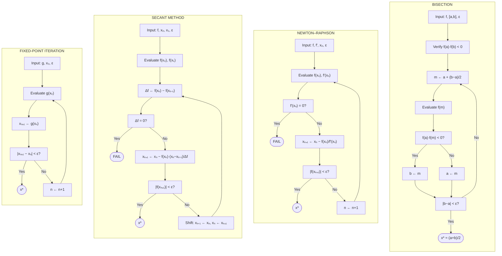

# Lesson 4: Root-Finding Algorithms, Fixed-Point Theory, Convergence Rates

## 1. First-Principles Intuition & Invariants

The central problem of numerical root-finding is deceptively simple to state: given a continuous function $f : \mathbb{R} \to \mathbb{R}$, find $x^* \in \mathbb{R}$ such that $f(x^*) = 0$. This zero $x^*$ is called a **root** or **zero of $f$**. Despite the simplicity of the statement, the problem encompasses a vast landscape of practical difficulty. Polynomial equations of degree five or higher possess no general closed-form solution by the Abel–Ruffini theorem, transcendental equations like $x = \cos x$ admit no algebraic manipulation that isolates the unknown, and systems arising from discretized differential equations are far too large for direct inversion. Numerical root-finding algorithms are the universal answer, and understanding them precisely — their convergence behavior, their failure modes, and their geometric and analytic invariants — is indispensable for any serious practitioner.

Before examining any specific method, it is worth articulating the two fundamental quantities that govern all root-finding analysis. The **forward error** at the $n$-th iterate $x_n$ is $|x_n - x^*|$, measuring how far the current approximation sits from the true root. The **backward error** is $|f(x_n)|$, measuring how far the function value deviates from zero. These two quantities are related but not identical: a function may have a very small backward error $|f(x_n)| \approx 0$ while the forward error $|x_n - x^*|$ remains large, as occurs near a root where $f'(x^*) \approx 0$ and the function is nearly flat. Conversely, a large backward error at a steep crossing implies only a moderate forward error. For well-conditioned problems — those where the derivative $f'(x^*)$ is bounded away from zero — the two errors are proportional through the implicit function theorem, but practitioners must remain aware of which quantity their stopping criterion actually controls.

The **order of convergence** of a sequence of iterates $\{x_n\}$ to a limit $x^*$ is the supremal constant $p \geq 1$ for which a finite positive constant $C$ exists satisfying

$$\lim_{n \to \infty} \frac{|x_{n+1} - x^*|}{|x_n - x^*|^p} = C.$$

When $p = 1$ and $C < 1$, convergence is **linear**, meaning the error contracts by a constant factor $C$ each iteration. When $p = 2$, convergence is **quadratic**: the number of correct significant digits roughly doubles with each step. The intermediate case $1 < p < 2$ is called **superlinear**, and arises naturally in the secant method with order $p = \phi = (1+\sqrt{5})/2 \approx 1.618$. These rates are not merely aesthetic distinctions — they determine whether a computation requiring twelve-digit accuracy takes ten iterations or a hundred.

### The Intermediate Value Theorem as the Bisection Invariant

The bisection method rests entirely on one theorem. If $f$ is continuous on $[a, b]$ and $f(a) \cdot f(b) < 0$, then by the **Intermediate Value Theorem** (IVT) there exists at least one $x^* \in (a, b)$ with $f(x^*) = 0$. The IVT is an existence guarantee derived from the completeness of $\mathbb{R}$: a continuous function on a connected set maps to a connected set, and a connected subset of $\mathbb{R}$ is an interval. If $f(a) < 0 < f(b)$, then $0$ lies in the image, and therefore some point in the domain maps to it.

Bisection exploits this guarantee by maintaining it as a loop invariant. At every stage, the algorithm holds an interval $[a_n, b_n]$ such that $f(a_n) \cdot f(b_n) < 0$. The midpoint $m_n = (a_n + b_n)/2$ is evaluated, and the interval is halved by replacing whichever endpoint shares the sign of $f(m_n)$. The bracket length after $n$ steps is exactly $(b - a)/2^n$, so the forward error satisfies

$$|x_n - x^*| \leq \frac{b - a}{2^n}.$$

Solving for the number of steps required to reach a tolerance $\varepsilon$ yields $n \geq \log_2\!\left((b-a)/\varepsilon\right)$, which for a unit interval and $\varepsilon = 10^{-12}$ demands roughly forty iterations. Bisection is **linearly convergent** with rate $C = 1/2$, and while this may appear slow against quadratic methods, it carries something none of them possess: an unconditional, certificate-backed convergence guarantee. No smoothness assumption beyond continuity is required. For root isolation in certified computation, bisection is the gold standard.

### Newton–Raphson and the Geometry of Tangent Lines

The Newton–Raphson method, independently developed by Isaac Newton in his 1669 manuscript *De Analysi* and refined by Joseph Raphson in 1690, proceeds from a geometrically transparent idea: at the current iterate $x_n$, replace $f$ by its first-order Taylor expansion and solve the resulting linear equation for the next iterate. The Taylor expansion of $f$ around $x_n$ is

$$f(x) = f(x_n) + f'(x_n)(x - x_n) + \frac{1}{2}f''(\xi)(x - x_n)^2$$

for some $\xi$ between $x$ and $x_n$. Setting the linear part to zero gives the Newton step:

$$x_{n+1} = x_n - \frac{f(x_n)}{f'(x_n)}.$$

Geometrically, $x_{n+1}$ is the $x$-intercept of the tangent line to the graph of $f$ at the point $(x_n, f(x_n))$. This is obvious from the equation of the tangent: $y - f(x_n) = f'(x_n)(x - x_n)$, set $y = 0$ and solve.

To derive the quadratic convergence rate, let $e_n = x_n - x^*$ denote the error at step $n$. Since $f(x^*) = 0$, the Taylor expansion of $f(x_n) = f(x^* + e_n)$ gives

$$f(x_n) = f(x^*) + f'(x^*)e_n + \frac{1}{2}f''(x^*)e_n^2 + O(e_n^3) = f'(x^*)e_n + \frac{1}{2}f''(x^*)e_n^2 + O(e_n^3).$$

Similarly, $f'(x_n) = f'(x^*) + f''(x^*)e_n + O(e_n^2)$. Therefore,

$$x_{n+1} - x^* = e_n - \frac{f(x_n)}{f'(x_n)} = e_n - \frac{f'(x^*)e_n + \frac{1}{2}f''(x^*)e_n^2 + O(e_n^3)}{f'(x^*) + f''(x^*)e_n + O(e_n^2)}.$$

Factoring $f'(x^*)$ from the denominator and expanding via $(1 + \epsilon)^{-1} \approx 1 - \epsilon$ for small $\epsilon$:

$$e_{n+1} = e_n - \frac{e_n + \frac{f''(x^*)}{2f'(x^*)}e_n^2 + O(e_n^3)}{1 + \frac{f''(x^*)}{f'(x^*)}e_n + O(e_n^2)}.$$

$$e_{n+1} = e_n - \left(e_n + \frac{f''(x^*)}{2f'(x^*)}e_n^2\right)\left(1 - \frac{f''(x^*)}{f'(x^*)}e_n\right) + O(e_n^3).$$

Expanding and collecting terms through $O(e_n^2)$:

$$e_{n+1} = e_n - e_n - \frac{f''(x^*)}{2f'(x^*)}e_n^2 + \frac{f''(x^*)}{f'(x^*)}e_n^2 + O(e_n^3) = \frac{f''(x^*)}{2f'(x^*)}e_n^2 + O(e_n^3).$$

Thus the asymptotic error constant is

$$\lim_{n \to \infty} \frac{|e_{n+1}|}{|e_n|^2} = \frac{|f''(x^*)|}{2|f'(x^*)|},$$

confirming order $p = 2$ whenever $f'(x^*) \neq 0$ and $f''$ is continuous near $x^*$. The condition $f'(x^*) \neq 0$ is essential: when $x^*$ is a **multiple root** of multiplicity $m \geq 2$, meaning $f(x^*) = f'(x^*) = \cdots = f^{(m-1)}(x^*) = 0$ while $f^{(m)}(x^*) \neq 0$, Newton's method degrades to linear convergence with constant $C = (m-1)/m$. The cure for multiple roots is the modified iteration $x_{n+1} = x_n - m \cdot f(x_n)/f'(x_n)$, which restores quadratic convergence at the cost of needing to know $m$ in advance, or the deflation-based iteration on $u(x) = f(x)/f'(x)$, whose roots are the simple roots of $f$ with multiplicity reset to one.

### The Secant Method and Superlinear Convergence

Newton's method requires evaluating $f'$ at each step, which is expensive when $f$ is expensive to differentiate, unavailable analytically, or computed from discrete data. The **secant method** circumvents this by replacing the derivative $f'(x_n)$ with the finite difference approximation

$$f'(x_n) \approx \frac{f(x_n) - f(x_{n-1})}{x_n - x_{n-1}},$$

yielding the two-point recurrence

$$x_{n+1} = x_n - f(x_n) \cdot \frac{x_n - x_{n-1}}{f(x_n) - f(x_{n-1})}.$$

Geometrically, instead of a tangent line, the secant method draws the **secant line** through $(x_{n-1}, f(x_{n-1}))$ and $(x_n, f(x_n))$ and takes its $x$-intercept as the next iterate. Whereas Newton requires one new function evaluation per step (plus one derivative evaluation), the secant method requires only one new function evaluation per step, since $f(x_{n-1})$ was already computed at the previous iteration.

The convergence order of the secant method is derived through a more delicate argument. Under the assumption that $f$ is sufficiently smooth and $x^* $ is a simple root, one posits the ansatz $|e_{n+1}| \sim C|e_n|^p$ and shows self-consistency. The classical derivation, following Ortega and Rheinboldt, proceeds by writing $e_{n+1}$ in terms of $e_n$ and $e_{n-1}$:

$$e_{n+1} = \frac{f''(x^*)}{2f'(x^*)}e_n e_{n-1} + O(e_n^2 e_{n-1} + e_n e_{n-1}^2).$$

Substituting the ansatz $|e_{n+1}| \approx K|e_n|^p$ and $|e_n| \approx K|e_{n-1}|^p$ into the leading term:

$$K|e_n|^p \approx \frac{|f''(x^*)|}{2|f'(x^*)|}|e_n| \cdot |e_{n-1}| = \frac{|f''(x^*)|}{2|f'(x^*)|}|e_n| \cdot K^{-1/p}|e_n|^{1/p}.$$

This requires $p = 1 + 1/p$, so $p^2 = p + 1$, giving $p = (1 + \sqrt{5})/2 = \phi \approx 1.618$. The secant method converges superlinearly at the golden ratio. This remarkable number is not a coincidence: the two-step recurrence structure of the secant method is algebraically identical to the Fibonacci recurrence, whose ratio of consecutive terms converges to $\phi$.

### Fixed-Point Iteration and the Contraction Mapping Theorem

Both Newton–Raphson and bisection can be recast as special cases of **fixed-point iteration**, a unifying framework of deep importance. Given $f(x) = 0$, any algebraic rearrangement of the form $x = g(x)$ defines a **fixed-point problem** whose solutions $x^* = g(x^*)$ are the same as the roots of $f$. The iteration $x_{n+1} = g(x_n)$ is called **fixed-point iteration** or **Picard iteration**, and the function $g$ is the **iteration function**. For Newton's method, $g(x) = x - f(x)/f'(x)$; for simple iteration applied to $f(x) = x - \cos x$, one might choose $g(x) = \cos x$.

The fundamental convergence theorem for fixed-point iteration is the **Banach Fixed-Point Theorem**, also called the **Contraction Mapping Theorem**.

**Theorem (Banach, 1922).** Let $(X, d)$ be a complete metric space and $g : X \to X$ a map satisfying the **contraction condition**: there exists a constant $L \in [0, 1)$ such that

$$d(g(x), g(y)) \leq L \cdot d(x, y) \quad \text{for all } x, y \in X.$$

Then $g$ has a unique fixed point $x^* \in X$, and for any initial point $x_0 \in X$, the iterates $x_{n+1} = g(x_n)$ converge to $x^*$. Moreover, the a priori error bound is

$$d(x_n, x^*) \leq \frac{L^n}{1 - L} d(x_1, x_0),$$

and the a posteriori error bound is

$$d(x_n, x^*) \leq \frac{L}{1 - L} d(x_n, x_{n-1}).$$

**Proof.** We first establish that $\{x_n\}$ is a Cauchy sequence. For $m > n$, the triangle inequality and induction give

$$d(x_m, x_n) \leq d(x_m, x_{m-1}) + d(x_{m-1}, x_{m-2}) + \cdots + d(x_{n+1}, x_n).$$

Since $d(x_{k+1}, x_k) = d(g(x_k), g(x_{k-1})) \leq L \cdot d(x_k, x_{k-1}) \leq \cdots \leq L^k d(x_1, x_0)$, the sum telescopes to

$$d(x_m, x_n) \leq \sum_{k=n}^{m-1} L^k d(x_1, x_0) \leq \frac{L^n}{1 - L} d(x_1, x_0).$$

Since $L < 1$, the right-hand side tends to zero as $n \to \infty$, so $\{x_n\}$ is Cauchy. By completeness of $X$, the sequence converges to some $x^* \in X$. Continuity of $g$ (which follows from the Lipschitz condition) gives $g(x^*) = g(\lim x_n) = \lim g(x_n) = \lim x_{n+1} = x^*$, so $x^*$ is a fixed point. Uniqueness follows because if $y^*$ were another fixed point, then $d(x^*, y^*) = d(g(x^*), g(y^*)) \leq L \cdot d(x^*, y^*)$, which forces $d(x^*, y^*) = 0$ since $L < 1$. $\blacksquare$

In the scalar case $X = [a, b] \subset \mathbb{R}$ with the Euclidean metric, the contraction condition is implied by $|g'(x)| \leq L < 1$ throughout $[a, b]$ via the Mean Value Theorem. This gives the practitioner a concrete, checkable criterion: compute or bound $|g'(x)|$ on the interval of interest. If the supremum is less than one, the iteration converges, and $L$ determines the linear rate. The closer $L$ is to zero, the faster the convergence.

For Newton's method, the iteration function is $g(x) = x - f(x)/f'(x)$, and its derivative is

$$g'(x) = 1 - \frac{(f'(x))^2 - f(x)f''(x)}{(f'(x))^2} = \frac{f(x)f''(x)}{(f'(x))^2}.$$

At the root $x^*$, since $f(x^*) = 0$, we have $g'(x^*) = 0$. A contraction with $L$ near zero at the fixed point itself explains why Newton's method achieves quadratic rather than merely linear convergence: the contraction constant is not a fixed $L < 1$ but a quantity proportional to $|e_n|$ itself, giving the self-reinforcing error reduction $|e_{n+1}| \lesssim C|e_n|^2$.

### Basin of Attraction

The concept of **basin of attraction** formalizes the question of which initial guesses lead to convergence. For an iteration function $g$ with fixed point $x^*$, the **basin of attraction** of $x^*$ is the set

$$\mathcal{B}(x^*) = \{x_0 \in \mathbb{R} : x_n = g^n(x_0) \to x^* \text{ as } n \to \infty\},$$

where $g^n$ denotes the $n$-fold composition of $g$ with itself. For bisection, the basin of attraction is precisely the initial bracketing interval — a fully transparent, explicit set. For Newton's method, the basin of attraction can be pathologically complicated. Even for a polynomial as simple as $f(z) = z^3 - 1$ over the complex plane, the basins of attraction of the three cube roots of unity form a **fractal boundary** (the **Newton fractal**) of Hausdorff dimension two, meaning that every neighborhood of a boundary point contains initial conditions converging to all three distinct roots. This is not a theoretical curiosity but a practical warning: for Newton's method applied to nonconvex or multirooted problems, the global behavior can be chaotic, and convergence to the desired root is not guaranteed without a good initial estimate.

For fixed-point iteration in one dimension, a sufficient condition for local convergence is that $|g'(x^*)| < 1$. If $|g'(x^*)| > 1$, the fixed point is **repelling** and the iteration diverges from any starting point other than $x^*$ itself. The local basin of attraction in the attracting case extends at least to the nearest point where $|g'(x)| = 1$, though the exact boundary requires careful analysis.

---

## 2. Core Architecture & Mechanics

### Algorithm Structures and Execution Flows

The four algorithms under study have distinct data structures and execution patterns. Understanding these concretely — not just abstractly — determines how they are implemented correctly, combined effectively, and extended to systems of equations.

**Bisection** maintains a triple $(a_n, b_n, f(a_n))$, exploiting the fact that $f(b_n) = -\text{sign}(f(a_n)) \cdot |f(b_n)|$ is determined by the sign invariant and need not be stored separately. At each iteration, one new function evaluation occurs: $f(m_n)$ at the midpoint $m_n = (a_n + b_n)/2$. The state update is:

$$[a_{n+1}, b_{n+1}] = \begin{cases} [a_n, m_n] & \text{if } f(a_n) \cdot f(m_n) < 0, \\ [m_n, b_n] & \text{otherwise.} \end{cases}$$

The critical arithmetic hazard is computing the midpoint. The naive formula $(a + b)/2$ can produce a midpoint outside $[a, b]$ due to floating-point rounding when $a$ and $b$ are both large and close together. The numerically stable form is $a + (b - a)/2$, which anchors the computation to the smaller value $a$ and adds a positive fraction of a small difference, avoiding catastrophic cancellation.

**Newton–Raphson** maintains a single scalar $x_n$ and requires evaluating both $f(x_n)$ and $f'(x_n)$. For functions specified analytically, these are computed together from the same input. For functions defined by code, **automatic differentiation** (AD) in either forward or reverse mode provides $f'$ at a cost of at most a small constant multiple of evaluating $f$ alone. When neither analytic derivatives nor AD are available, a finite-difference approximation $f'(x_n) \approx (f(x_n + h) - f(x_n))/h$ for a small step $h$ converts Newton's method into a **quasi-Newton** scheme, though the optimal choice of $h$ balances truncation error ($O(h)$) against cancellation error ($O(\varepsilon_{\text{mach}}/h)$), pointing to $h \sim \sqrt{\varepsilon_{\text{mach}}} \approx 10^{-8}$ for double-precision arithmetic.

The execution flow of the four algorithms is illustrated in the following state-machine diagram:

### Convergence Rate Comparison Under Identical Conditions

To make the convergence rates concrete, consider the problem $f(x) = x^3 - 2$ with exact root $x^* = 2^{1/3} \approx 1.2599210498949$. Starting Newton's method from $x_0 = 1.5$:

$$f(x) = x^3 - 2, \quad f'(x) = 3x^2.$$

The iterates are $x_{n+1} = x_n - (x_n^3 - 2)/(3x_n^2) = (2x_n^3 + 2)/(3x_n^2)$, the classical iteration for cube roots. Starting from $x_0 = 1.5$:

| $n$ | $x_n$ | $\|e_n\|$ | $\|e_{n+1}\|/\|e_n\|^2$ |
|-----|-------|----------|----------------------|
| 0 | 1.500000000000000 | $2.41 \times 10^{-1}$ | — |
| 1 | 1.296296296296296 | $3.63 \times 10^{-2}$ | 0.624 |
| 2 | 1.260932224924148 | $1.01 \times 10^{-3}$ | 0.767 |
| 3 | 1.259921327156993 | $7.92 \times 10^{-7}$ | 0.774 |
| 4 | 1.259921049894920 | $4.84 \times 10^{-13}$ | 0.772 |

The asymptotic constant $|f''(x^*)|/(2|f'(x^*)|) = |6x^*|/(2 \cdot 3x^{*2}) = 1/x^* \approx 0.794$ matches the observed ratios, confirming the theoretical prediction. After four iterations, Newton's method has fourteen correct digits from a starting error of $0.24$.

The same problem under bisection, starting from $[1, 2]$ with error reduction factor $1/2$ per step, requires $\lceil \log_2(1/\varepsilon) \rceil$ steps for tolerance $\varepsilon$: for $\varepsilon = 10^{-13}$, this demands $\lceil 43.3 \rceil = 44$ iterations — eleven times as many.

### Fixed-Point Reformulation and the Choice of $g$

The choice of iteration function $g$ is not unique, and different choices yield radically different convergence behavior for the same root problem. Consider $f(x) = x^2 - 2$ with root $x^* = \sqrt{2}$. Three natural reformulations are:

$$g_1(x) = \frac{2}{x}, \quad g_2(x) = \frac{x}{2} + \frac{1}{x}, \quad g_3(x) = x - (x^2 - 2).$$

Computing derivatives at $x^* = \sqrt{2}$: $g_1'(x^*) = -2/(x^*)^2 = -1$, which lies on the boundary of the contraction condition and yields oscillatory divergence. $g_2'(x^*) = 1/2 - 1/(x^*)^2 = 0$, meaning $g_2$ defines a superattracting fixed point — in fact, $g_2$ is precisely the Newton iteration, giving $g_2'(x^*) = 0$ and quadratic convergence. $g_3'(x^*) = 1 - 2x^* = 1 - 2\sqrt{2} \approx -1.83$, which exceeds one in absolute value, causing divergence.

This comparison illustrates that the question "will fixed-point iteration converge?" cannot be answered without specifying the iteration function, and the act of choosing $g$ is equivalent to designing the algorithm. The Newton iteration is in this sense the **optimal first-order fixed-point scheme** for a simple root: it is the unique choice making $g'(x^*) = 0$, the best possible value short of an iteration that terminates in one step.

### Stopping Criteria: Backward Error, Forward Error, and Mixed Criteria

The question of when to terminate an iteration is analytically non-trivial and practically critical. Three criteria appear in practice, and their relationships depend on the local conditioning of $f$.

The **absolute backward error criterion** halts when $|f(x_n)| < \varepsilon_b$. This is the most direct test of the residual and requires no knowledge of $x^*$. It is reliable when $|f'(x^*)|$ is of order one: by the mean value theorem, $|f(x_n)| = |f(x_n) - f(x^*)| = |f'(\xi)||x_n - x^*|$ for some $\xi$ between $x_n$ and $x^*$, so $|x_n - x^*| \approx |f(x_n)|/|f'(x^*)|$. When $f'(x^*)$ is small, a tiny residual can mask a large forward error.

The **absolute forward error criterion** halts when $|x_{n+1} - x_n| < \varepsilon_f$. Since $|x_{n+1} - x_n|$ is an observable proxy for $|e_n|$ (accurate up to a factor depending on the convergence rate), this directly controls the step size. For a quadratically convergent method, $|x_{n+1} - x_n| \approx |e_{n+1} - e_n| \approx |e_n|$ once iterates are close to the root, making this a reliable estimate.

The **mixed criterion** requires both: halt when $|f(x_n)| < \varepsilon_b$ and $|x_{n+1} - x_n| < \varepsilon_f$. This guards against two distinct pathologies: a flat function where the residual shrinks faster than the iterate moves, and a step that is small because the method has stalled rather than converged.

For bisection specifically, the most natural criterion is the interval length $|b_n - a_n| < \varepsilon$, which directly certificates the forward error. The a posteriori bound $|x_n - x^*| \leq |b_n - a_n|/2$ is exact.

An important finite-precision consideration governs all stopping criteria: in IEEE 754 double-precision arithmetic, the **machine epsilon** is $\varepsilon_{\text{mach}} = 2^{-52} \approx 2.22 \times 10^{-16}$. No iterative method can produce a forward error smaller than $O(\varepsilon_{\text{mach}} \cdot |x^*|)$ regardless of theoretical convergence rate, because the iterate $x_n$ is itself only representable to about sixteen significant digits. Setting $\varepsilon < \varepsilon_{\text{mach}}$ causes algorithms to loop indefinitely, and practitioners should use $\varepsilon \geq \sqrt{\varepsilon_{\text{mach}}} \approx 10^{-8}$ as a conservative lower bound unless extended-precision arithmetic is in use.

---

## 3. High-Performance Optimization & Failure Modes

### Hybridization: Combining Guarantees with Speed

No single method dominates across all problem types. The state-of-the-art approach in production numerical libraries is the **hybrid method**, which combines the global convergence guarantee of bisection with the speed of a higher-order method. The two canonical hybrids are **Brent's method** (1973) and **Illinois algorithm** (a secant-based variant with bracket preservation).

Brent's method maintains a bracket $[a, b]$ satisfying $f(a) \cdot f(b) < 0$ at all times, guaranteeing termination, while attempting to advance via inverse quadratic interpolation (IQI) or the secant step whenever those steps fall within the bracket. The IQI step fits a quadratic polynomial through the three most recent iterates and takes the root of that polynomial, which achieves superlinear convergence in smooth problems. If the proposed IQI or secant step falls outside the bracket, or if progress is slower than bisection, the method falls back to bisection. This fallback condition is triggered by comparing the step size against a threshold involving the previous step size and the current bracket width.

The state maintained by Brent's method can be summarized as a 5-tuple $(a, b, c, f_a, f_b, f_c)$ where $a$ and $b$ are the current bracket endpoints, $c$ is the best previous iterate (or the previous $b$), and $f_a, f_b, f_c$ are their function values. The convergence rate in smooth regimes approaches the golden ratio $\phi$ of the secant method when IQI steps are unavailable or fall outside the bracket, while the worst-case behavior is bounded by bisection. Brent's method is implemented as `scipy.optimize.brentq` in Python, `fzero` in MATLAB, and `zbrent` in Numerical Recipes; it is the de facto standard for robust scalar root-finding in scientific software.

### Failure Mode: Division by Zero in Newton's Method

The most common failure of Newton's method in practice is not divergence from a poor initial guess but **division by zero or near-zero** when $f'(x_n) \approx 0$. This occurs either because the iterate has drifted near a local extremum of $f$ or because the root is a multiple root. The safe implementation of Newton's method includes a guard:

If $|f'(x_n)| < \delta$ for a threshold $\delta$ chosen relative to the problem scale (e.g., $\delta = \varepsilon_{\text{mach}}^{1/2} \cdot \max_{k \leq n}|f'(x_k)|$), the Newton step is replaced by a bisection step (provided a bracket is maintained) or the step is capped at a maximum allowed step size. The damped Newton method enforces $|x_{n+1} - x_n| \leq \Delta_{\max}$, replacing the full Newton step with $x_{n+1} = x_n - \alpha f(x_n)/f'(x_n)$ where the step length $\alpha \in (0, 1]$ is chosen by backtracking line search to satisfy the sufficient decrease condition $|f(x_{n+1})| < (1 - c\alpha)|f(x_n)|$ for a constant $c \in (0, 1)$.

### Failure Mode: Stagnation and Cycling in Secant Method

The secant method can stagnate or cycle when $f(x_n) \approx f(x_{n-1})$, causing $\Delta f \approx 0$ and an enormous or undefined step. This is distinct from the Newton failure since it can occur even when the derivative is well-behaved: it arises when the two iterates happen to have nearly equal function values, which occurs for functions with inflection points or near-flat regions. The cure is to restart from a bisection step whenever $|\Delta f| < \delta |f(x_n)|$ for a small constant $\delta$, or to maintain a bracket and fall back to Brent's method.

### Failure Mode: Slow Convergence Near Multiple Roots

As derived in Section 1, Newton's method at a root of multiplicity $m$ converges linearly with rate $C = (m-1)/m$. For $m = 2$, this gives $C = 1/2$, identical to bisection. For $m = 10$, the rate $C = 9/10$ means the error shrinks only by ten percent per iteration, requiring approximately $\log_{10}(1/\varepsilon)$ iterations for tolerance $\varepsilon$ — roughly 160 iterations for $\varepsilon = 10^{-16}$. The deflation remedy defines $u(x) = f(x)/f'(x)$. At a root of multiplicity $m$, writing $f(x) = (x - x^*)^m h(x)$ with $h(x^*) \neq 0$:

$$f'(x) = m(x - x^*)^{m-1}h(x) + (x - x^*)^m h'(x),$$

$$u(x) = \frac{(x - x^*)^m h(x)}{m(x - x^*)^{m-1}h(x) + (x - x^*)^m h'(x)} = \frac{(x - x^*)h(x)}{mh(x) + (x - x^*)h'(x)}.$$

At $x^*$, $u(x^*) = 0$ and the derivative of $u$ at $x^*$ is $u'(x^*) = h(x^*)/(mh(x^*)) = 1/m \neq 0$. The root $x^*$ is thus a **simple root** of $u$, and Newton's method applied to $u$ converges quadratically. The practical cost is that $u'(x) = f'(x)^2 - f(x)f''(x))/(f'(x))^2$ requires evaluating $f''$, though a finite-difference approximation suffices.

### Failure Mode: Newton Fractal and Poor Initial Guesses

For polynomial root-finding over $\mathbb{C}$, Newton's method starting from a point near the **Julia set** of the Newton iteration function $g(z) = z - p(z)/p'(z)$ can converge to any root or fail to converge. The practical mitigation is **deflation**: once a root $z_1^*$ is found to sufficient accuracy, factor it out as $p(z)/(z - z_1^*)$ before searching for the next root. This deflation is performed via synthetic division and reduces the problem degree, but it accumulates rounding errors. The standard practice in production polynomial solvers (e.g., `numpy.polynomial.polynomial.polyroots`, which uses companion matrix eigenvalues via the QR algorithm) avoids per-root Newton iteration entirely for this reason.

### Convergence Rate Hierarchy and Method Selection Guide

The practitioner's decision among methods depends on the interplay of several factors: smoothness of $f$, availability of $f'$, need for guaranteed convergence, and cost per function evaluation. The convergence rates, function evaluations per iteration, and guarantee status of the four methods are:

| Method | Order $p$ | Evals/iter | Global guarantee | Requirements |
|---|---|---|---|---|
| Bisection | 1, $C=1/2$ | 1 ($f$ only) | Yes (IVT) | Continuity, bracket |
| Secant | $\phi \approx 1.618$ | 1 ($f$ only) | No | Smoothness, two initial pts |
| Newton | 2 | 2 ($f$ and $f'$) | No | $C^2$, $f'(x^*) \neq 0$ |
| Fixed-point | 1, $C = |g'(x^*)|$ | 1 ($g$ only) | Local ($|g'|< 1$) | Contraction near $x^*$ |

The practical resolution for mission-critical computation is Brent's method (bisection fallback with secant/IQI acceleration) when only $f$ evaluations are available, and a damped, globalized Newton's method (with backtracking line search and bisection safeguard) when $f'$ is available analytically or via AD. The purely theoretical bisection and Newton methods serve as the foundational poles from which all practical hybrid schemes are designed.

### Extended Precision and Interval Arithmetic

For problems requiring certified results — formal verification, rigorous mathematical computation, or safety-critical engineering — the floating-point error analysis above is insufficient. **Interval arithmetic** replaces each real number $x$ with a closed interval $[\underline{x}, \overline{x}]$ guaranteed to contain the true value, and all arithmetic operations propagate interval bounds rigorously. Applied to bisection, interval arithmetic produces an **enclosure** of the root with a mathematically proven error bound, not merely a floating-point approximation. The **Moore–Skelboe algorithm** and Alefeld–Potra–Shi root-finding schemes implement this approach. Libraries such as `mpmath` in Python provide arbitrary-precision floating-point arithmetic, allowing the practitioner to push beyond double-precision when the problem conditioning demands it — for instance, when computing roots of Wilkinson's polynomial $w(x) = \prod_{k=1}^{20}(x - k)$, whose coefficients are so ill-conditioned that double-precision computation of roots from coefficients fails catastrophically while interval Newton methods succeed.

### Toward Systems of Equations

The entire framework of this lesson extends to systems $\mathbf{F}(\mathbf{x}) = \mathbf{0}$ with $\mathbf{F} : \mathbb{R}^n \to \mathbb{R}^n$. Newton's method becomes

$$\mathbf{x}_{n+1} = \mathbf{x}_n - J_F(\mathbf{x}_n)^{-1}\mathbf{F}(\mathbf{x}_n),$$

where $J_F$ is the **Jacobian matrix** of $\mathbf{F}$. In practice, the linear system $J_F(\mathbf{x}_n)\Delta\mathbf{x}_n = -\mathbf{F}(\mathbf{x}_n)$ is solved for the Newton step $\Delta\mathbf{x}_n$ via LU factorization rather than matrix inversion. The quadratic convergence of scalar Newton's method persists in $n$ dimensions under the analogous condition that $J_F(\mathbf{x}^*)$ is nonsingular, and the Banach fixed-point theorem in the Banach space $\mathbb{R}^n$ (or more generally in any Banach space $X$) provides the convergence theory for multidimensional fixed-point iteration. The **Kantorovich theorem** quantifies the basin of attraction for the multidimensional Newton method in terms of the norms of $J_F(\mathbf{x}_0)^{-1}$ and the Hessian of $\mathbf{F}$ at the initial point, and guarantees convergence when a computable criterion involving these quantities is satisfied — providing the multidimensional analogue of the bracketing guarantee that bisection enjoys in one dimension. This direction, together with quasi-Newton methods such as Broyden's rank-one update, forms the bridge from scalar root-finding into the broader domain of nonlinear systems and optimization, the subject of the lessons that follow.
