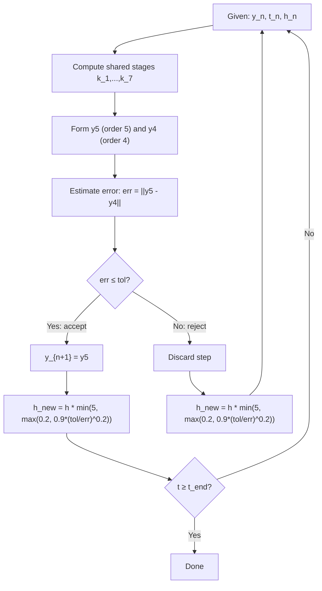

# Lesson 6: Numerical ODE Solvers, Consistency, Zero-Stability, Stiffness

## 1. First-Principles Intuition & Invariants

The numerical solution of ordinary differential equations rests on a deceptively simple act of translation: we take a continuous dynamical system governed by an instantaneous rate of change and replace it with a discrete recurrence relation whose iterates we can compute on a machine. The initial value problem (IVP) $y'(t) = f(t, y)$, $y(t_0) = y_0$, where $y: \mathbb{R} \to \mathbb{R}^d$ and $f: \mathbb{R} \times \mathbb{R}^d \to \mathbb{R}^d$, encodes the evolution of a state under a vector field. By the Picard–Lindelöf theorem, if $f$ is continuous in $t$ and Lipschitz continuous in $y$ with constant $L$, so that $\|f(t, y_a) - f(t, y_b)\| \leq L \|y_a - y_b\|$, then a unique solution exists on some interval $[t_0, t_f]$. This well-posedness is the bedrock: without it, no numerical method, however sophisticated, can produce meaningful results, because the problem itself lacks a well-defined answer to approximate.

The discretization paradigm replaces the continuum $\{y(t) : t \in [t_0, t_f]\}$ with a finite sequence $\{y_n\}_{n=0}^{N}$ living on a mesh $t_n = t_0 + nh$, where $h = (t_f - t_0)/N$ is the step size. A numerical method is a rule that computes $y_{n+1}$ (or $y_{n+k}$ for a $k$-step method) from prior values. The central question of numerical ODE theory is not merely whether $y_n$ approximates $y(t_n)$, but *why* it does, *how fast* it converges, and *under what conditions* the approximation remains bounded. Three structural properties—consistency, zero-stability, and convergence—govern this enterprise, and their logical relationship is settled by Dahlquist's equivalence theorem, the keystone of the entire theory.

**Consistency** asks whether the method is even capable of representing the exact solution in the limit $h \to 0$. For a linear $k$-step method written in the standard form

$$\sum_{j=0}^{k} \alpha_j \, y_{n+j} = h \sum_{j=0}^{k} \beta_j \, f(t_{n+j}, y_{n+j}),$$

we define the **local truncation error** by substituting the exact solution $y(t)$ into the difference equation:

$$\tau_n = \frac{1}{h}\sum_{j=0}^{k} \alpha_j \, y(t_{n+j}) - \sum_{j=0}^{k} \beta_j \, f(t_{n+j}, y(t_{n+j})).$$

The method is **consistent** if $\max_{n} \|\tau_n\| \to 0$ as $h \to 0$. Expanding $y(t_{n+j})$ and $f(t_{n+j}, y(t_{n+j}))$ in Taylor series about $t_n$ and matching coefficients yields two algebraic conditions on the characteristic polynomials $\rho(\xi) = \sum_{j=0}^{k} \alpha_j \xi^j$ and $\sigma(\xi) = \sum_{j=0}^{k} \beta_j \xi^j$:

$$\rho(1) = \sum_{j=0}^{k} \alpha_j = 0, \qquad \rho'(1) = \sigma(1), \quad \text{i.e.,} \quad \sum_{j=0}^{k} j\,\alpha_j = \sum_{j=0}^{k} \beta_j.$$

The first condition ensures that the method reproduces constants; the second ensures it reproduces linear functions. Together they guarantee order at least one. More generally, the method has **order $p$** if $\tau_n = O(h^p)$, which requires

$$\sum_{j=0}^{k} \alpha_j \, j^q = q \sum_{j=0}^{k} \beta_j \, j^{q-1}, \qquad q = 1, 2, \ldots, p.$$

**Zero-stability** is a property of the method itself, independent of the differential equation. It demands that small perturbations in the starting values or in the right-hand side do not get amplified without bound as the integration proceeds. Formally, the method is zero-stable if, when applied to the trivial equation $y' = 0$ (so that $f \equiv 0$), the resulting homogeneous recurrence $\sum \alpha_j y_{n+j} = 0$ produces bounded solutions for any initial data. This translates to the **root condition** on $\rho(\xi)$: every root $\xi_i$ of $\rho$ must satisfy $|\xi_i| \leq 1$, and any root with $|\xi_i| = 1$ must be simple (not repeated). The name "zero-stability" distinguishes this from the stronger notion of absolute stability (discussed in Section 3), because it pertains to the limiting case $h \to 0$ (equivalently $\lambda h \to 0$) and concerns the method's intrinsic recurrence structure rather than its behavior at finite $h$.

**Convergence** is the property the practitioner actually needs: $\max_{0 \leq n \leq N} \|y_n - y(t_n)\| \to 0$ as $h \to 0$ (with $Nh = t_f - t_0$ fixed), assuming the starting values satisfy $y_j \to y_0$ for $j = 0, \ldots, k-1$. Dahlquist's equivalence theorem establishes that convergence is not an independent property but the logical consequence of the first two.

**Theorem (Dahlquist, 1956).** *A linear $k$-step method applied to the IVP $y' = f(t,y)$, $y(t_0) = y_0$, where $f$ is continuous and Lipschitz in $y$, is convergent if and only if it is consistent and zero-stable.*

The proof of the forward direction (consistency + zero-stability $\Rightarrow$ convergence) is constructive and reveals the precise mechanism by which the two hypotheses combine.

*Proof.* Define the error $e_n = y_n - y(t_n)$. The exact solution satisfies

$$\sum_{j=0}^{k} \alpha_j \, y(t_{n+j}) = h \sum_{j=0}^{k} \beta_j \, f(t_{n+j}, y(t_{n+j})) + h\,\tau_n,$$

while the numerical solution satisfies

$$\sum_{j=0}^{k} \alpha_j \, y_{n+j} = h \sum_{j=0}^{k} \beta_j \, f(t_{n+j}, y_{n+j}).$$

Subtracting yields the **error recurrence**:

$$\sum_{j=0}^{k} \alpha_j \, e_{n+j} = h \sum_{j=0}^{k} \beta_j \left[f(t_{n+j}, y_{n+j}) - f(t_{n+j}, y(t_{n+j}))\right] - h\,\tau_n.$$

By the Lipschitz condition, each bracketed difference is bounded by $L\|e_{n+j}\|$. Denote $\delta_{n+j} = f(t_{n+j}, y_{n+j}) - f(t_{n+j}, y(t_{n+j}))$, so $\|\delta_{n+j}\| \leq L\|e_{n+j}\|$.

The critical lemma—**discrete stability under the root condition**—states that if $\rho(\xi)$ satisfies the root condition, then there exists a constant $C_\rho$, depending only on the coefficients $\alpha_j$, such that any solution of the inhomogeneous recurrence $\sum \alpha_j u_{n+j} = g_n$ satisfies

$$\|u_n\| \leq C_\rho \left(\sum_{j=0}^{k-1} \|u_j\| + \sum_{j=0}^{n-k} \|g_j\|\right).$$

This follows from factoring $\rho(\xi) = \alpha_k \prod_{i} (\xi - \xi_i)^{m_i}$. The general solution of the homogeneous recurrence is a linear combination of terms $n^{\ell} \xi_i^n$ for $\ell = 0, \ldots, m_i - 1$. By the root condition, for $|\xi_i| < 1$ these decay exponentially (exponential decay dominates polynomial growth), and for $|\xi_i| = 1$ the multiplicity $m_i = 1$ ensures the term is simply $\xi_i^n$, which has modulus one. Hence all homogeneous solutions are bounded, and the particular solution can be bounded by convolution with the bounded Green's function of the recurrence, yielding the lemma.

Applying this lemma to the error recurrence with $g_n = h \sum_{j=0}^{k} \beta_j \delta_{n+j} - h\tau_n$:

$$\|e_n\| \leq C_\rho \left(\sum_{j=0}^{k-1} \|e_j\| + h \sum_{j=0}^{n-k} \sum_{l=0}^{k} |\beta_l| \, L \, \|e_{j+l}\| + h \sum_{j=0}^{n-k} \|\tau_j\|\right).$$

Setting $E_n = \max_{0 \leq j \leq n} \|e_j\|$, $\Gamma = L \sum |\beta_l|$, $T = \max_j \|\tau_j\|$, and $E_{\text{start}} = \max_{0 \leq j \leq k-1} \|e_j\|$, and using $hn \leq t_f - t_0$:

$$E_n \leq C_\rho \left(k \, E_{\text{start}} + h \, \Gamma \, k \, n \, E_n + (t_f - t_0) \, T\right).$$

For $h$ sufficiently small (specifically $C_\rho \, \Gamma \, k \, (t_f - t_0) < 1/2$), we absorb the $E_n$ term:

$$E_n \leq 2 C_\rho \left(k \, E_{\text{start}} + (t_f - t_0) \, T\right).$$

Consistency gives $T = \max \|\tau_n\| \to 0$ as $h \to 0$, and the starting values satisfy $E_{\text{start}} \to 0$. Therefore $E_n \to 0$, establishing convergence. $\blacksquare$

The converse proceeds by contrapositive. If the method is inconsistent, applying it to $y' = 0$, $y(0) = 1$ (exact solution $y \equiv 1$) reveals that $\sum \alpha_j \neq 0$ produces $y_n$ that does not converge to 1. If zero-stability fails, a root $\xi_i$ of $\rho$ with $|\xi_i| > 1$ or a repeated root on the unit circle generates a solution $y_n = \xi_i^n$ or $y_n = n\xi_i^n$ that diverges, again contradicting convergence. Both directions together complete the equivalence. $\blacksquare$

The order of convergence follows from this framework: if the method has consistency order $p$ (local truncation error $O(h^p)$) and is zero-stable, then the global error is $O(h^p)$. The local error per step, which is $h \cdot \tau_n = O(h^{p+1})$, accumulates over $N = O(1/h)$ steps, yielding a global error of $O(h^p)$. This is not merely an asymptotic statement; it provides the concrete rate at which refinement pays off.

Dahlquist's second theorem, proved in 1963, imposes a fundamental limitation on how good a linear multistep method can be while remaining suitable for stiff problems. It states that if a linear multistep method is **A-stable** (meaning its stability region contains the entire left half of the complex plane, a concept we develop fully in Section 3), then its order $p$ satisfies $p \leq 2$. Moreover, among all A-stable LMMs of order 2, the trapezoidal rule has the smallest error constant $|\tau_n|/h^2$. This barrier, which we will revisit after developing the stability machinery, explains why practitioners turn to implicit Runge-Kutta methods or BDF formulas for stiff integration: the LMM framework is structurally limited to order 2 if A-stability is required, while implicit RK methods (such as the Gauss-Legendre family) achieve A-stability at arbitrarily high order.

## 2. Core Architecture & Mechanics

The simplest one-step method, **forward Euler**, follows directly from the first-order Taylor expansion $y(t_{n+1}) = y(t_n) + h\,y'(t_n) + O(h^2)$, replacing $y'(t_n)$ with $f(t_n, y_n)$:

$$y_{n+1} = y_n + h\,f(t_n, y_n).$$

Its local truncation error is $\tau_n = \frac{h}{2} y''(t_n) + O(h^2)$, giving order 1. The method is explicit: $y_{n+1}$ is computed by a single function evaluation with no equation solving. This simplicity is also its weakness. When $f$ is stiff (a term we make precise in Section 3), the step size $h$ is constrained not by accuracy but by a stability bound $|1 + h\lambda| \leq 1$ that can force $h$ to be impractically small.

The **backward Euler** method reverses the evaluation point:

$$y_{n+1} = y_n + h\,f(t_{n+1}, y_{n+1}).$$

This is implicit: $y_{n+1}$ appears on both sides, and at each step we must solve the nonlinear equation $G(y_{n+1}) = y_{n+1} - y_n - h\,f(t_{n+1}, y_{n+1}) = 0$. In practice this is done by Newton iteration. Starting from a predictor $\hat{y}_{n+1}^{(0)}$ (often the forward Euler value $y_n + h f(t_n, y_n)$), we iterate

$$y_{n+1}^{(m+1)} = y_{n+1}^{(m)} - J^{-1}\left(y_{n+1}^{(m)} - y_n - h\,f(t_{n+1}, y_{n+1}^{(m)})\right),$$

where $J = I - h\,\partial f/\partial y$ is the iteration Jacobian evaluated at the current iterate. Each Newton step requires one Jacobian evaluation (or a reused factored Jacobian across several time steps) and one linear solve. The cost is significant but buys unconditional stability for stiff problems.

The **$\theta$-method** interpolates between these two extremes:

$$y_{n+1} = y_n + h\left[\theta\,f(t_{n+1}, y_{n+1}) + (1-\theta)\,f(t_n, y_n)\right],$$

with $\theta = 0$ giving forward Euler, $\theta = 1$ giving backward Euler, and $\theta = 1/2$ giving the **trapezoidal rule** (Crank–Nicolson), which has order 2 and is the unique A-stable LMM of optimal accuracy by Dahlquist's second theorem. The trapezoidal rule's amplification factor for the test equation $y' = \lambda y$ is $R(z) = (1 + z/2)/(1 - z/2)$ where $z = h\lambda$, and $|R(z)| < 1$ for all $\text{Re}(z) < 0$, confirming A-stability.

**Runge-Kutta methods** generalize the Euler family by performing multiple stage evaluations within each step to achieve higher order. A general $s$-stage RK method is specified by its **Butcher tableau**:

$$\begin{array}{c|c} c & A \\ \hline & b^T \end{array} \qquad \text{meaning} \qquad \begin{aligned} k_i &= f\!\left(t_n + c_i h,\; y_n + h\sum_{j=1}^{s} a_{ij} k_j\right), \\ y_{n+1} &= y_n + h\sum_{i=1}^{s} b_i k_i. \end{aligned}$$

The abscissae $c_i$ specify the time at which each stage is evaluated, the matrix $A = (a_{ij})$ governs the coupling between stages, and the weights $b_i$ combine the stages into the step output. When $A$ is strictly lower triangular ($a_{ij} = 0$ for $j \geq i$), each $k_i$ depends only on previously computed stages, and the method is **explicit**. When $A$ has entries above the diagonal, stages are coupled and the method is **implicit**, requiring a system of nonlinear equations to be solved at each step.

The classical fourth-order method (RK4) has the tableau

$$\begin{array}{c|cccc} 0 & 0 & 0 & 0 & 0 \\ \frac{1}{2} & \frac{1}{2} & 0 & 0 & 0 \\ \frac{1}{2} & 0 & \frac{1}{2} & 0 & 0 \\ 1 & 0 & 0 & 1 & 0 \\ \hline & \frac{1}{6} & \frac{1}{3} & \frac{1}{3} & \frac{1}{6} \end{array}$$

and computes four stages per step:

```python
def rk4_step(f, t, y, h):
    k1 = f(t, y)
    k2 = f(t + h/2, y + h/2 * k1)
    k3 = f(t + h/2, y + h/2 * k2)
    k4 = f(t + h, y + h * k3)
    return y + h * (k1 + 2*k2 + 2*k3 + k4) / 6
```

The order conditions for RK methods arise from matching the Taylor expansion of the numerical solution to that of the exact solution. These conditions are most naturally expressed through the theory of rooted trees, where each tree of order $q$ corresponds to one order condition. The simplifying assumptions of Butcher reduce the combinatorial burden:

- **B($p$):** $\sum_{i=1}^{s} b_i c_i^{q-1} = 1/q$ for $q = 1, \ldots, p$ (quadrature conditions on the weights),
- **C($\eta$):** $\sum_{j=1}^{s} a_{ij} c_j^{q-1} = c_i^q / q$ for $q = 1, \ldots, \eta$ and all $i$ (stage order conditions),
- **D($\xi$):** $\sum_{i=1}^{s} b_i c_i^{q-1} a_{ij} = b_j(1 - c_j^q)/q$ for $q = 1, \ldots, \xi$ and all $j$ (dual conditions).

**Theorem (Butcher's simplifying assumptions).** If B($p$), C($\eta$), and D($\xi$) hold with $p \leq \eta + \xi + 1$ and $p \leq 2\eta + 2$, then the method has order at least $p$.

For order 4, the explicit conditions (without simplifying assumptions) are:

$$\sum b_i = 1, \qquad \sum b_i c_i = \frac{1}{2}, \qquad \sum b_i c_i^2 = \frac{1}{3}, \qquad \sum_{i,j} b_i a_{ij} c_j = \frac{1}{6},$$

$$\sum b_i c_i^3 = \frac{1}{4}, \qquad \sum_{i,j} b_i c_i a_{ij} c_j = \frac{1}{8}, \qquad \sum_{i,j} b_i a_{ij} c_j^2 = \frac{1}{12}, \qquad \sum_{i,j,k} b_i a_{ij} a_{jk} c_k = \frac{1}{24}.$$

These eight conditions correspond to the eight rooted trees with at most four nodes. The number of order conditions grows rapidly: 1, 1, 2, 4, 9, 20, 48, 115 for orders 1 through 8. This combinatorial explosion is why high-order explicit RK methods require many stages; in fact, for explicit methods, achieving order $p$ requires $s \geq p$ stages for $p \leq 4$, but $s \geq 6$ for order 5, $s \geq 7$ for order 6, and the minimal number of stages grows faster than $p$ for $p \geq 5$.

For stiff problems, **implicit Runge-Kutta methods** are essential. The most important families are the **Gauss-Legendre methods**, which achieve order $2s$ with $s$ stages (the maximum possible by the Butcher barrier) and are A-stable for all $s$; the **Radau IIA methods**, which have order $2s - 1$, are L-stable (a stronger property than A-stability), and place the last stage at $c_s = 1$ so that the step output coincides with the last stage (stiffly accurate); and the **SDIRK** (Singly Diagonally Implicit Runge-Kutta) methods, which have a lower-triangular $A$ with equal diagonal entries $a_{ii} = \gamma$, allowing stage-by-stage solution rather than solving all stages simultaneously. The Radau IIA method with $s = 2$ stages has order 3 and the tableau

$$\begin{array}{c|cc} \frac{1}{3} - \frac{\sqrt{3}}{6} & \frac{5}{12} - \frac{\sqrt{3}}{6} & -\frac{1}{12} + \frac{\sqrt{3}}{6} \\ \frac{1}{3} + \frac{\sqrt{3}}{6} & \frac{5}{12} + \frac{\sqrt{3}}{6} & -\frac{1}{12} - \frac{\sqrt{3}}{6} \\ \hline & \frac{1}{2} + \frac{\sqrt{3}}{6} & \frac{1}{2} - \frac{\sqrt{3}}{6} \end{array}$$

Its stability function, being a $(2,1)$-Padé approximant of $e^z$, satisfies $|R(z)| < 1$ for all $\text{Re}(z) < 0$ (A-stable) and $R(z) \to 0$ as $|z| \to \infty$ in the left half-plane (L-stable).

Moving to **linear multistep methods (LMMs)**, the Adams family is derived by integrating the ODE $y' = f(t, y)$ exactly over one step:

$$y(t_{n+1}) - y(t_n) = \int_{t_n}^{t_{n+1}} f(t, y(t))\,dt,$$

and approximating the integrand $f$ by a polynomial interpolant through previously computed function values. The **Adams-Bashforth** methods use an explicit interpolant through $f_n, f_{n-1}, \ldots, f_{n-k+1}$, while the **Adams-Moulton** methods augment this set with $f_{n+1}$, making them implicit.

The $k$-step Adams-Bashforth method of order $k$ is:

| $k$ | Formula |
|-----|---------|
| 1 | $y_{n+1} = y_n + h\,f_n$ |
| 2 | $y_{n+1} = y_n + h\left(\frac{3}{2}f_n - \frac{1}{2}f_{n-1}\right)$ |
| 3 | $y_{n+1} = y_n + h\left(\frac{23}{12}f_n - \frac{16}{12}f_{n-1} + \frac{5}{12}f_{n-2}\right)$ |
| 4 | $y_{n+1} = y_n + h\left(\frac{55}{24}f_n - \frac{59}{24}f_{n-1} + \frac{37}{24}f_{n-2} - \frac{9}{24}f_{n-3}\right)$ |

The corresponding Adams-Moulton methods (one order higher for the same number of steps) are:

| Steps | Order | Formula |
|-------|-------|---------|
| 1 | 2 | $y_{n+1} = y_n + \frac{h}{2}(f_{n+1} + f_n)$ |
| 2 | 3 | $y_{n+1} = y_n + h\left(\frac{5}{12}f_{n+1} + \frac{8}{12}f_n - \frac{1}{12}f_{n-1}\right)$ |
| 3 | 4 | $y_{n+1} = y_n + h\left(\frac{9}{24}f_{n+1} + \frac{19}{24}f_n - \frac{5}{24}f_{n-1} + \frac{1}{24}f_{n-2}\right)$ |

All Adams methods share the characteristic polynomial $\rho(\xi) = \xi^k - \xi^{k-1}$ (for the $k$-step method shifted so the newest value is $y_{n+k}$), whose roots are $\xi = 1$ (simple) and $\xi = 0$ (with multiplicity $k-1$). This satisfies the root condition, so all Adams methods are zero-stable. They are optimal in a precise sense: among all zero-stable LMMs of order $p$ using $k$ steps, the Adams methods minimize the error constant $|\tau_n|/h^{p+1}$.

The **Backward Differentiation Formulas (BDF)** take a different approach: instead of integrating $f$, they differentiate a polynomial interpolant of $y$. The $k$-step BDF method approximates $y'(t_{n+1})$ by differentiating the polynomial of degree $k$ that interpolates $y_{n+1}, y_n, \ldots, y_{n-k+1}$:

$$\sum_{j=0}^{k} \alpha_j \, y_{n+1-j} = h\,f_{n+1},$$

where the coefficients are determined by requiring exactness for polynomials up to degree $k$. The first six BDF methods are:

| $k$ | Formula | Order |
|-----|---------|-------|
| 1 | $y_{n+1} - y_n = h\,f_{n+1}$ | 1 |
| 2 | $\frac{3}{2}y_{n+1} - 2y_n + \frac{1}{2}y_{n-1} = h\,f_{n+1}$ | 2 |
| 3 | $\frac{11}{6}y_{n+1} - 3y_n + \frac{3}{2}y_{n-1} - \frac{1}{3}y_{n-2} = h\,f_{n+1}$ | 3 |
| 4 | $\frac{25}{12}y_{n+1} - 4y_n + 3y_{n-1} - \frac{4}{3}y_{n-2} + \frac{1}{4}y_{n-3} = h\,f_{n+1}$ | 4 |
| 5 | $\frac{137}{60}y_{n+1} - 5y_n + 5y_{n-1} - \frac{10}{3}y_{n-2} + \frac{5}{4}y_{n-3} - \frac{1}{5}y_{n-4} = h\,f_{n+1}$ | 5 |
| 6 | $\frac{147}{60}y_{n+1} - 6y_n + \frac{15}{2}y_{n-1} - \frac{20}{3}y_{n-2} + \frac{15}{4}y_{n-3} - \frac{6}{5}y_{n-4} + \frac{1}{6}y_{n-5} = h\,f_{n+1}$ | 6 |

BDF methods are zero-stable for $k \leq 6$ and unstable for $k \geq 7$ (the characteristic polynomial acquires roots outside the unit disk). Their importance lies in their favorable absolute stability properties, which we analyze in Section 3.

In practice, multistep methods are often deployed in **predictor-corrector (P-C) mode**, which combines an explicit predictor (typically Adams-Bashforth) with an implicit corrector (typically Adams-Moulton) without solving the corrector equation to convergence. The standard **PECE** mode proceeds as follows: **P**redict $\hat{y}_{n+1}$ using the explicit AB formula; **E**valuate $\hat{f}_{n+1} = f(t_{n+1}, \hat{y}_{n+1})$; **C**orrect using the implicit AM formula, substituting $\hat{f}_{n+1}$ for $f_{n+1}$ to obtain $y_{n+1}$; **E**valuate $f_{n+1} = f(t_{n+1}, y_{n+1})$ for use in the next step. This costs two function evaluations per step regardless of the order, which is economical for non-stiff problems. The predictor-corrector pair AB(4)–AM(4) achieves order 4 with the stability properties of a fourth-order method, at a fraction of the cost of RK4 (which needs four evaluations per step).

```python
def pece_adams_step(f, t, y_hist, f_hist, h):
    # y_hist = [y_n, y_{n-1}, y_{n-2}, y_{n-3}], f_hist = [f_n, f_{n-1}, f_{n-2}, f_{n-3}]
    # Predict (AB4)
    y_pred = y_hist[0] + h * (55/24*f_hist[0] - 59/24*f_hist[1]
                               + 37/24*f_hist[2] - 9/24*f_hist[3])
    f_pred = f(t + h, y_pred)
    # Correct (AM4)
    y_corr = y_hist[0] + h * (9/24*f_pred + 19/24*f_hist[0]
                               - 5/24*f_hist[1] + 1/24*f_hist[2])
    f_corr = f(t + h, y_corr)
    return y_corr, f_corr
```

A critical practical concern for multistep methods is the **starting procedure**. A $k$-step method requires $k$ starting values, but only $y_0$ is given by the IVP. The remaining $k-1$ values must be generated by a self-starting method, typically a high-order RK method with sufficiently small step size, or by a series of lower-order multistep methods ramping up from order 1. The starting values must be accurate to at least the order of the multistep method; otherwise, the error in the starting values persists and pollutes the entire integration, a manifestation of the fact that convergence requires $E_{\text{start}} \to 0$ as demonstrated in the proof of Dahlquist's theorem.

## 3. High-Performance Optimization & Failure Modes

### Absolute Stability and the Test Equation

The analysis of absolute stability reduces the general nonlinear ODE to the linear scalar **test equation** $y' = \lambda y$, $y(0) = 1$, where $\lambda \in \mathbb{C}$ is a complex parameter. While this seems like a drastic simplification, it captures the essential behavior of the method near a solution trajectory: linearizing the ODE about a point on the solution curve yields $y' = J y$ where $J = \partial f/\partial y$ is the Jacobian, and the eigenvalues of $J$ play the role of $\lambda$. The test equation has the exact solution $y(t) = e^{\lambda t}$, which decays when $\text{Re}(\lambda) < 0$.

Applying a one-step method to the test equation produces an **amplification factor** $R(z)$ with $z = h\lambda$, such that $y_{n+1} = R(z)\,y_n$ and $y_n = [R(z)]^n$. The method is **absolutely stable** for a given $z$ if $|R(z)| \leq 1$, and the **stability region** is the set $\mathcal{S} = \{z \in \mathbb{C} : |R(z)| \leq 1\}$. The method reproduces the qualitative behavior of the exact solution ($|e^z| \leq 1$ iff $\text{Re}(z) \leq 0$) precisely when the left half-plane is contained in $\mathcal{S}$.

For explicit RK methods of order $p$ with $s = p$ stages, $R(z)$ is the $p$-th order Taylor polynomial of $e^z$:

$$R(z) = \sum_{i=0}^{p} \frac{z^i}{i!}.$$

For forward Euler ($p = 1$): $R(z) = 1 + z$, and the stability region is the disk $|1 + z| \leq 1$, centered at $z = -1$ with radius 1. For RK4 ($p = 4$): $R(z) = 1 + z + z^2/2 + z^3/6 + z^4/24$, whose stability region extends slightly into the right half-plane but is still bounded, with the leftmost point at $z \approx -2.78$ on the real axis.

For implicit methods, the amplification functions are radically different:

| Method | $R(z)$ | Stability region |
|--------|--------|-----------------|
| Backward Euler | $\dfrac{1}{1-z}$ | Exterior of disk $\|1-z\| \geq 1$ |
| Trapezoidal | $\dfrac{1+z/2}{1-z/2}$ | Left half-plane $\text{Re}(z) \leq 0$ |
| Gauss-Legendre (order $2s$) | $(s,s)$-Padé of $e^z$ | Left half-plane |

A method is **A-stable** if its stability region contains the entire left half-plane $\{z : \text{Re}(z) \leq 0\}$. This means that for any $\lambda$ with $\text{Re}(\lambda) < 0$, the method is unconditionally stable for any step size $h > 0$. A method is **L-stable** if it is A-stable and additionally $\lim_{|z|\to\infty} R(z) = 0$ in the left half-plane, meaning it damps infinitely stiff components to zero in a single step. The trapezoidal rule is A-stable but not L-stable ($R(z) \to -1$ as $z \to -\infty$), which can cause oscillations in very stiff problems. Backward Euler is L-stable ($R(z) \to 0$ as $z \to -\infty$), as are all Radau IIA methods.

For multistep methods, the stability analysis is more involved because the method generates a recurrence rather than a simple iteration. Applying the LMM $\sum \alpha_j y_{n+j} = h \sum \beta_j f_{n+j}$ to $y' = \lambda y$ yields

$$\sum_{j=0}^{k} \alpha_j \, y_{n+j} = z \sum_{j=0}^{k} \beta_j \, y_{n+j}, \qquad z = h\lambda,$$

which is a linear recurrence with characteristic polynomial

$$\pi(\xi; z) = \rho(\xi) - z\,\sigma(\xi) = \sum_{j=0}^{k} (\alpha_j - z\,\beta_j)\,\xi^j.$$

The method is stable at $z$ if all roots $\xi_i(z)$ of $\pi(\xi; z)$ satisfy $|\xi_i(z)| \leq 1$ (with simple roots on the unit circle). The stability region is $\mathcal{S} = \{z : \pi(\cdot; z) \text{ satisfies the root condition}\}$.

For BDF methods, the stability analysis proceeds by substituting $y_n = \xi^n$ into the BDF formula, yielding the characteristic equation $\rho(\xi) = z\,\sigma(\xi)$ where $\sigma(\xi) = \xi^k$ (since BDF is a single-derivative formula with only $f_{n+1}$). The boundary of the stability region is traced by the **boundary locus** $\{z = \rho(e^{i\theta})/\sigma(e^{i\theta}) : \theta \in [0, 2\pi)\}$, i.e., $z(\theta) = \rho(e^{i\theta})/e^{ik\theta}$.

The BDF stability properties are:

| $k$ (order) | A-stable? | A($\alpha$)-stable? | $\alpha$ |
|-------------|-----------|---------------------|----------|
| 1 | Yes | Yes | $90°$ |
| 2 | Yes | Yes | $90°$ |
| 3 | No | Yes | $\approx 86.03°$ |
| 4 | No | Yes | $\approx 73.35°$ |
| 5 | No | Yes | $\approx 51.84°$ |
| 6 | No | Yes | $\approx 17.84°$ |

Here **A($\alpha$)-stability** means the stability region contains the wedge $\{z : |\arg(-z)| \leq \alpha, \text{Re}(z) < 0\}$. BDF1 and BDF2 are A-stable; BDF3 through BDF6 are A($\alpha$)-stable with decreasing angle; BDF7 and higher are not even zero-stable.

### Stiffness

A problem is **stiff** when it contains widely separated time scales, and the fast scales are stable (decaying) but force the step size to be impractically small if an explicit method is used. The canonical example is the linear system $y' = -J y$ where $J$ has eigenvalues spanning orders of magnitude, say $\lambda_1 = -1$ and $\lambda_2 = -10^6$. The slow mode $e^{-t}$ governs the physically interesting dynamics on a time scale of $O(1)$, but the fast mode $e^{-10^6 t}$ dies almost instantly. After the transient, the solution is dominated by the slow mode, and an accurate step size could be $h \sim 0.1$. Yet forward Euler requires $|1 + h\lambda_2| \leq 1$, i.e., $h \leq 2 \times 10^{-6}$, purely to prevent the fast (already-decayed) mode from being amplified by the method. The method spends millions of tiny steps tracking a mode that is effectively zero.

More formally, a problem is stiff when the eigenvalues $\lambda_i$ of the Jacobian satisfy $\text{Re}(\lambda_i) \ll 0$ for some $i$ (fast stable modes) while the integration interval $[t_0, t_f]$ is long compared to the slowest time scale $1/|\text{Re}(\lambda_{\text{slow}})|$. The **stiffness ratio** is $|\text{Re}(\lambda_{\text{fast}})| / |\text{Re}(\lambda_{\text{slow}})|$; ratios of $10^3$ to $10^9$ are common in chemical kinetics, circuit simulation, and structural mechanics.

For stiff problems, the practitioner must use methods whose stability regions cover the left half-plane (A-stable or A($\alpha$)-stable methods). Implicit methods—backward Euler, trapezoidal rule, BDF, Radau IIA, SDIRK—transform the stability constraint from $h < O(1/|\lambda_{\text{fast}}|)$ to no constraint at all (for A-stable methods) or a very mild one. The price is the cost of solving nonlinear equations at each step, but for sufficiently stiff problems, the ability to take large steps overwhelms the per-step cost. A stiff integrator taking 100 steps at $h = 0.01$ with Newton iteration (cost: $O(d^3)$ per step for the Jacobian factorization, where $d$ is the system dimension) will vastly outperform forward Euler taking $10^6$ steps at $h = 10^{-6}$ with cost $O(d)$ per step.

### Adaptive Step-Size Control

Adaptive step-size control rests on the principle of **error estimation and feedback**: at each step, estimate the local error, compare it to a tolerance, and adjust the step size so the error per step stays near the tolerance. The most effective technique for one-step methods is the **embedded Runge-Kutta pair**, where two methods of adjacent orders share the same stage evaluations, so the higher-order solution comes essentially for free.

The **Dormand-Prince (DOPRI5)** pair, used in MATLAB's `ode45`, provides solutions of order 5 and order 4 from seven shared stages. Its Butcher tableau is:

$$
\begin{array}{c|ccccccc}
0 & 0 \\
\frac{1}{5} & \frac{1}{5} \\
\frac{3}{10} & \frac{3}{40} & \frac{9}{40} \\
\frac{4}{5} & \frac{44}{45} & -\frac{56}{15} & \frac{32}{9} \\
\frac{8}{9} & \frac{19372}{6561} & -\frac{25360}{2187} & \frac{64448}{6561} & -\frac{212}{729} \\
1 & \frac{9017}{3168} & -\frac{355}{33} & \frac{46732}{5247} & \frac{49}{176} & -\frac{5103}{18656} \\
1 & \frac{35}{384} & 0 & \frac{500}{1113} & \frac{125}{192} & -\frac{2187}{6784} & \frac{11}{84} \\
\hline
b^{(5)} & \frac{35}{384} & 0 & \frac{500}{1113} & \frac{125}{192} & -\frac{2187}{6784} & \frac{11}{84} & 0 \\
b^{(4)} & \frac{5179}{57600} & 0 & \frac{7571}{16695} & \frac{393}{640} & -\frac{92097}{339200} & \frac{187}{2100} & \frac{1}{40}
\end{array}
$$

The fifth-order solution $\hat{y}_{n+1} = y_n + h \sum b_i^{(5)} k_i$ is used to advance, while the fourth-order solution $y_{n+1} = y_n + h \sum b_i^{(4)} k_i$ provides the error estimate $\text{err} = \|\hat{y}_{n+1} - y_{n+1}\| = \|h \sum (b_i^{(5)} - b_i^{(4)}) k_i\|$. Since the pair shares all seven stage evaluations, this error estimate adds no function evaluations.

The step-size update formula is derived from the scaling of the local error. If the local error scales as $\text{err}(h) \approx C h^{p+1}$ (where $p$ is the order of the lower-order method, here $p = 4$), and the current step gives error $\text{err}$, then the step size that would achieve the target tolerance $\text{tol}$ is

$$h_{\text{new}} = h \cdot \left(\frac{\text{tol}}{\text{err}}\right)^{1/(p+1)}.$$

In practice, safety factors and clamping are applied to prevent erratic step-size oscillation:

$$h_{\text{new}} = h \cdot \min\left(f_{\max},\; \max\left(f_{\min},\; f_{\text{safety}} \cdot \left(\frac{\text{tol}}{\text{err}}\right)^{1/(p+1)}\right)\right),$$

where $f_{\text{safety}} = 0.9$ is a safety margin (aiming slightly below the tolerance), $f_{\max} = 5$ limits aggressive growth, and $f_{\min} = 0.2$ limits aggressive shrinkage. If $\text{err} > \text{tol}$, the step is rejected and retried with $h_{\text{new}}$; if $\text{err} \leq \text{tol}$, the step is accepted and $h_{\text{new}}$ is used for the next step.

```python
def adaptive_rk_step(f, t, y, h, tol, p=4):
    # DOPRI5: compute 7 stages, two solutions of order 5 and 4
    k1 = f(t, y)
    k2 = f(t + h/5, y + h*(1/5*k1))
    k3 = f(t + 3*h/10, y + h*(3/40*k1 + 9/40*k2))
    k4 = f(t + 4*h/5, y + h*(44/45*k1 - 56/15*k2 + 32/9*k3))
    k5 = f(t + 8*h/9, y + h*(19372/6561*k1 - 25360/2187*k2
             + 64448/6561*k3 - 212/729*k4))
    k6 = f(t + h, y + h*(9017/3168*k1 - 355/33*k2 + 46732/5247*k3
             + 49/176*k4 - 5103/18656*k5))
    y5 = y + h*(35/384*k1 + 500/1113*k3 + 125/192*k4
                - 2187/6784*k5 + 11/84*k6)
    k7 = f(t + h, y5)
    y4 = y + h*(5179/57600*k1 + 7571/16695*k3 + 393/640*k4
                - 92097/339200*k5 + 187/2100*k6 + 1/40*k7)
    err = np.linalg.norm(y5 - y4)
    if err == 0:
        return y5, h * 5  # no error: grow step
    factor = min(5.0, max(0.2, 0.9 * (tol/err)**(1/(p+1))))
    if err <= tol:
        return y5, h * factor  # accept
    else:
        return None, h * factor  # reject, retry
```

The feedback loop can be visualized as follows:



More sophisticated **PI controllers** improve on the basic I-controller (which uses only the current error) by incorporating error history, smoothing the step-size sequence and reducing oscillation. The PI controller of Gustafsson and Söderlind computes

$$h_{\text{new}} = h \cdot \left(\frac{\text{tol}}{\text{err}_n}\right)^{k_I} \left(\frac{\text{err}_{n-1}}{\text{tol}}\right)^{k_P},$$

with typical gains $k_I = 0.3/p$ and $k_P = 0.4/p$. This controller anticipates trends: if the error has been growing over consecutive steps, it reduces $h$ more aggressively than a pure I-controller would, preventing a rejection before it happens.

### Failure Modes and Mitigations

The most common failure mode is applying an explicit method to a stiff problem. The symptom is dramatic: the integrator takes enormous numbers of tiny steps, the solution barely advances, and the CPU time explodes. The fix is to switch to an implicit method. Modern software (MATLAB's `ode15s`, SciPy's `solve_ivp(method='Radau' or 'BDF')`) detects stiffness automatically by monitoring the number of step rejections and the convergence of Newton iterations, then switching to a stiff solver or suggesting one to the user.

**Order reduction** afflicts high-order implicit RK methods on very stiff or singularly perturbed problems. The phenomenon occurs when the stage order (governed by the C conditions) rather than the step order (governed by the full set of order conditions) limits the convergence rate. For Radau IIA methods, the stage order is $s$, so order reduction manifests only when the stiffness parameter is extreme. For SDIRK methods with stage order 1, order reduction is more severe. The practical mitigation is to use methods with high stage order (Radau, Lobatto) or to accept the reduced order for very stiff problems.

**Step-size oscillation** arises when the error estimate hovers near the tolerance, causing the controller to alternately accept and reject steps. The PI controller mitigates this by incorporating history, but severe oscillation may require lowering the tolerance or switching to a more robust controller (e.g., the H211b controller with bandwidth-limited response).

**Starting value inaccuracy** for multistep methods is a subtle but dangerous failure mode. If the starting values $y_1, \ldots, y_{k-1}$ (generated by a Runge-Kutta starter) have error larger than $O(h^p)$, the global error of the multistep method is dominated by the starting error rather than the method's own truncation error, and the observed convergence order is lower than expected. The fix is to start with a step size $h_{\text{start}} \ll h$ for the first few RK steps, or to use a starter of order at least $p+1$.

**Jacobian conditioning** limits the performance of implicit methods. The Newton iteration matrix $J = I - h \partial f/\partial y$ becomes ill-conditioned when the Jacobian has large negative eigenvalues and $h$ is large, because the identity term is dominated by the $hJ$ term. Numerical Jacobian approximation via finite differences introduces additional error; the standard forward-difference formula $\partial f_i/\partial y_j \approx (f_i(y + \epsilon e_j) - f_i(y))/\epsilon$ with $\epsilon = \sqrt{\epsilon_{\text{mach}}} \cdot \|y\|$ has relative error $O(\sqrt{\epsilon_{\text{mach}}}) \approx 10^{-8}$, which may be insufficient for tight tolerances. Analytic Jacobians or automatic differentiation should be used when available. The Jacobian should be evaluated and factored as infrequently as possible: reusing a single LU factorization for 10–20 time steps is standard practice, with recomputation triggered by Newton convergence failure.

The table below summarizes the method selection decision for a practitioner confronting a new problem:

| Problem characteristic | Recommended method | Rationale |
|----------------------|---------------------|-----------|
| Non-stiff, moderate accuracy | DOPRI5 (adaptive RK pair) | Self-starting, efficient, error-controlled |
| Non-stiff, high accuracy | DOPRI8 or Verner pair | Higher order reduces step count at tight tolerances |
| Mildly stiff, smooth | Trapezoidal rule or SDIRK | A-stable, moderate cost per step |
| Stiff, need damping | BDF (order 2–5) or Radau IIA | A($\alpha$)-stable/A-stable, L-stable variants available |
| Very stiff, discontinuous | BDF order 1 (backward Euler) | L-stable, robust to nonsmoothness |
| Hamiltonian / conservative | Symplectic RK or implicit midpoint | Preserves phase-space structure |

The interplay of consistency, zero-stability, and absolute stability defines the landscape of numerical ODE solvers. Consistency ensures the method targets the right equation; zero-stability ensures errors do not grow unboundedly as $h \to 0$; absolute stability ensures errors do not grow at finite $h$. Dahlquist's theorem guarantees that the first two suffice for convergence, while the stiffness analysis tells us when convergence alone is not enough—when the problem's own structure demands methods whose stability regions are large enough to encompass the fast time scales without resolving them. The practitioner's art lies in matching the method's stability properties to the problem's spectral structure, and in using adaptive error control to let the step size track the local smoothness of the solution rather than the global stiffness of the system.
