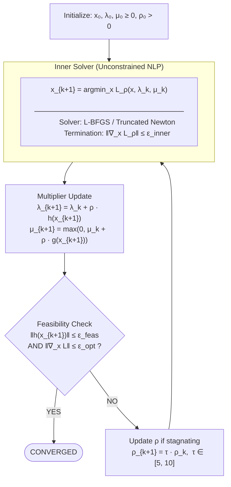
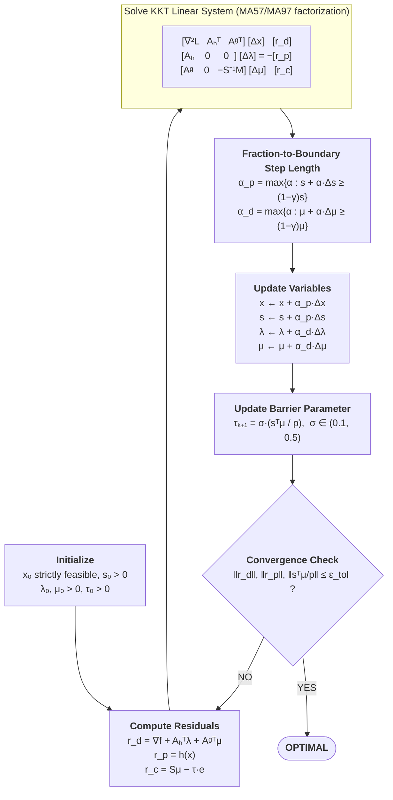

# Lesson 3: Constrained Nonlinear Programming

## 1. First-Principles Intuition & Invariants

The fundamental tension in constrained optimization is geometric in nature. When you minimize a smooth function $f : \mathbb{R}^n \to \mathbb{R}$ without constraints, the optimum is characterized by the vanishing of the gradient: $\nabla f(x^*) = 0$. The feasible set is all of $\mathbb{R}^n$, and the gradient points nowhere useful once it reaches zero. Introduce a constraint — even a single equality $g(x) = 0$ defining a hypersurface $\mathcal{M} \subset \mathbb{R}^n$ — and this picture collapses. The unconstrained minimum may lie off the manifold entirely, and the gradient at the constrained optimum need not vanish; it need only be orthogonal to the tangent space of $\mathcal{M}$ at that point. This orthogonality condition is the geometric seed from which the entire theory of Lagrangian multipliers, duality, and constraint qualification grows.

The general constrained nonlinear program (NLP) takes the form

$$\min_{x \in \mathbb{R}^n} \; f(x) \quad \text{subject to} \quad h_i(x) = 0, \; i = 1, \ldots, m, \quad g_j(x) \leq 0, \; j = 1, \ldots, p,$$

where $f$, $h_i$, and $g_j$ are assumed to be at least twice continuously differentiable. The feasible region is $\mathcal{F} = \{x \in \mathbb{R}^n : h_i(x) = 0 \; \forall i, \; g_j(x) \leq 0 \; \forall j\}$, a closed set that is generally neither convex nor smooth as a manifold. The structure of $\mathcal{F}$ is what distinguishes practical NLP from convex programming: the landscape of $f$ restricted to $\mathcal{F}$ can be riddled with local minima, saddle points on the constraint boundary, and degenerate vertices where multiple constraints become simultaneously active.

### The KKT Conditions as Necessary Optimality

The first-order necessary conditions for a local minimum $x^*$ of this program — provided a regularity condition called a *constraint qualification* holds — are the Karush-Kuhn-Tucker (KKT) conditions. Define the Lagrangian

$$\mathcal{L}(x, \lambda, \mu) = f(x) + \sum_{i=1}^m \lambda_i h_i(x) + \sum_{j=1}^p \mu_j g_j(x).$$

The KKT conditions then state that there exist multipliers $\lambda \in \mathbb{R}^m$ and $\mu \in \mathbb{R}^p$ such that the following hold simultaneously at $x^*$:

$$\nabla_x \mathcal{L}(x^*, \lambda^*, \mu^*) = \nabla f(x^*) + \sum_{i=1}^m \lambda_i^* \nabla h_i(x^*) + \sum_{j=1}^p \mu_j^* \nabla g_j(x^*) = 0,$$

$$h_i(x^*) = 0 \quad \forall i, \qquad g_j(x^*) \leq 0 \quad \forall j,$$

$$\mu_j^* \geq 0 \quad \forall j, \qquad \mu_j^* g_j(x^*) = 0 \quad \forall j.$$

The last condition, $\mu_j^* g_j(x^*) = 0$, is *complementary slackness*. It encodes a sharp economic intuition: an inequality constraint contributes to the first-order balance only when it is *active* ($g_j(x^*) = 0$); a slack constraint ($g_j(x^*) < 0$) carries zero shadow price ($\mu_j^* = 0$) and exerts no force on the optimum. The active set $\mathcal{A}(x^*) = \{j : g_j(x^*) = 0\}$ is the combinatorial object that determines the local geometry of the problem: near $x^*$, the NLP behaves like a system of equality-constrained subproblems parameterized by which constraints bind.

The constraint qualification most commonly invoked in practice is *Linear Independence Constraint Qualification* (LICQ): the gradients $\{\nabla h_i(x^*)\}_{i=1}^m \cup \{\nabla g_j(x^*)\}_{j \in \mathcal{A}(x^*)}$ are linearly independent. LICQ guarantees that the KKT multipliers exist and are unique. Weaker qualifications — Mangasarian-Fromovitz (MFCQ), constant rank (CRCQ) — are sufficient for multiplier existence without uniqueness, and understanding which qualification holds at a given candidate point is essential for certifying the reliability of algorithmic output.

The second-order sufficient condition (SOSC) closes the gap between *necessary* and *sufficient*. SOSC states that if the KKT conditions hold and if the reduced Hessian $Z^T \nabla^2_{xx} \mathcal{L}(x^*, \lambda^*, \mu^*) Z$ is positive definite on the critical cone $\mathcal{C}(x^*) = \{d : \nabla h_i(x^*)^T d = 0 \; \forall i, \; \nabla g_j(x^*)^T d = 0 \; \forall j \in \mathcal{A}(x^*)\}$ — where $Z$ is any matrix whose columns form a basis for $\mathcal{C}(x^*)$ — then $x^*$ is a strict local minimum. SOSC is the theoretical license for the quadratic convergence rates that the methods of this lesson exploit.

### Duality and the Lagrangian Dual

Alongside the primal problem lives its Lagrangian dual. The dual function is

$$q(\lambda, \mu) = \inf_{x \in \mathbb{R}^n} \mathcal{L}(x, \lambda, \mu),$$

defined for all $\mu \geq 0$. Because $q$ is the pointwise infimum of affine functions in $(\lambda, \mu)$, it is always concave regardless of the convexity of $f$. The dual problem maximizes $q$ over $\mu \geq 0$. Weak duality holds universally: $q(\lambda, \mu) \leq f(x^*)$ for any feasible $x^*$ and dual-feasible $(\lambda, \mu)$. The *duality gap* $f(x^*) - q(\lambda^*, \mu^*)$ measures how much primal and dual objectives diverge. For convex programs satisfying Slater's condition (existence of a strictly feasible point), strong duality holds and the gap is zero — a fact that all interior-point methods for convex NLP depend on structurally.

For nonconvex NLPs, the duality gap is generically positive, which is why primal methods (penalty, augmented Lagrangian, SQP) remain indispensable: they work directly on the primal problem without relying on duality for optimality certificates.

---

## 2. Core Architecture & Mechanics

### Penalty Methods: Pushing Infeasibility Out

The oldest strategy for handling constraints is to dissolve them into the objective by penalizing infeasibility. The *quadratic penalty method* replaces the constrained NLP with a sequence of unconstrained problems

$$\min_{x \in \mathbb{R}^n} \; \phi_\rho(x) = f(x) + \frac{\rho}{2} \sum_{i=1}^m h_i(x)^2 + \frac{\rho}{2} \sum_{j=1}^p \max(0, g_j(x))^2,$$

where $\rho > 0$ is the penalty parameter, driven toward $+\infty$ along a sequence $\rho_k \to \infty$. The logic is transparent: as $\rho$ grows, any point with nonzero constraint violation incurs an increasingly steep cost, so minimizers of $\phi_\rho$ are driven toward feasibility. More precisely, if $x_\rho^*$ denotes the minimizer of $\phi_\rho$, then under mild regularity conditions, $x_\rho^* \to x^*$ as $\rho \to \infty$, and the KKT multipliers can be recovered from $\lambda_i^* \approx \rho h_i(x_\rho^*)$ and $\mu_j^* \approx \rho \max(0, g_j(x_\rho^*))$.

The convergence story, however, is mechanically troubled. As $\rho$ grows, the Hessian of $\phi_\rho$ becomes increasingly ill-conditioned. Consider the equality-constrained case alone: $\nabla^2 \phi_\rho = \nabla^2 f + \rho \sum_i \nabla h_i \nabla h_i^T + \rho \sum_i h_i \nabla^2 h_i$. Near the solution, the dominant term is $\rho \sum_i \nabla h_i \nabla h_i^T$, whose eigenvalue in the constraint-normal directions scales as $\rho$ while eigenvalues in the tangential directions remain $O(1)$. The condition number of $\nabla^2 \phi_\rho$ therefore grows as $O(\rho)$, making the inner unconstrained solve increasingly expensive and numerically fragile as $\rho \to \infty$. This is not a deficiency of any particular implementation; it is an intrinsic property of the quadratic penalty formulation.

The *exact penalty method* sidesteps the ill-conditioning issue by using a nondifferentiable $\ell_1$ penalty:

$$\phi_\rho^{(1)}(x) = f(x) + \rho \sum_{i=1}^m |h_i(x)| + \rho \sum_{j=1}^p \max(0, g_j(x)).$$

A classical result due to Han and Mangasarian establishes that if $\rho > \|\lambda^*\|_\infty \vee \|\mu^*\|_\infty$ — that is, if $\rho$ exceeds the magnitude of every KKT multiplier — then every local solution of the NLP is a local minimum of $\phi_\rho^{(1)}$. This exactness property means no sequence of increasing penalties is needed; a single value of $\rho$ suffices. The price is nondifferentiability, which complicates the inner solver: subdifferential calculus or smoothing is required, and standard gradient-based methods must be replaced by nonsmooth alternatives or bundle methods.

### The Augmented Lagrangian: Dualizing the Penalty

The augmented Lagrangian method, developed independently by Hestenes and Powell in 1969, synthesizes the multiplier estimates of Lagrangian duality with the regularizing effect of a quadratic penalty. For equality constraints, the augmented Lagrangian is

$$\mathcal{L}_\rho(x, \lambda) = f(x) + \lambda^T h(x) + \frac{\rho}{2} \|h(x)\|^2,$$

and the algorithm alternates between minimizing over $x$ (with $\lambda$ fixed) and updating the multiplier estimate via

$$\lambda_{k+1} = \lambda_k + \rho h(x_{k+1}).$$

The critical structural insight is that for a fixed penalty parameter $\rho$, the augmented Lagrangian achieves exact satisfaction of the first-order conditions at a *finite* $\rho$, provided $\rho$ is large enough relative to the multipliers. More precisely, the stationary condition $\nabla_x \mathcal{L}_\rho(x^*, \lambda^*) = \nabla f(x^*) + (\lambda^* + \rho h(x^*))^T \nabla h(x^*) = 0$ coincides with the KKT condition $\nabla f(x^*) + \lambda^{*T} \nabla h(x^*) = 0$ when $\lambda^*$ is the true multiplier and $h(x^*) = 0$. The multiplier update $\lambda_{k+1} = \lambda_k + \rho h(x_k)$ is a gradient ascent step on the dual function; each step corrects the current multiplier estimate toward $\lambda^*$ at a rate proportional to $\rho$.

For inequality constraints $g_j(x) \leq 0$, the augmented Lagrangian takes the form

$$\mathcal{L}_\rho(x, \mu) = f(x) + \frac{1}{2\rho} \sum_{j=1}^p \left[ \max(0, \mu_j + \rho g_j(x))^2 - \mu_j^2 \right],$$

with the multiplier update $\mu_{j,k+1} = \max(0, \mu_{j,k} + \rho g_j(x_{k+1}))$. The $\max(0, \cdot)$ projection enforces the nonnegativity of inequality multipliers automatically.

The convergence properties of the augmented Lagrangian are substantially superior to pure penalty methods. Because $\rho$ need not go to infinity for convergence, the condition number of $\nabla^2_x \mathcal{L}_\rho$ remains bounded throughout the algorithm — a qualitative improvement that translates directly into better-conditioned inner solves. Under LICQ and SOSC, the method exhibits *superlinear* convergence in the multiplier iterates when the inner subproblem is solved exactly, and *linear* convergence with rate $1 - O(1/\rho)$ when solved approximately. The practical implementation, known as ALGENCAN (or in its LANCELOT incarnation), solves the inner subproblem using a truncated Newton or L-BFGS method, using the current multiplier estimate as a warm start for the next outer iteration.

The computational flow of the augmented Lagrangian method is captured in the following diagram.

### Sequential Quadratic Programming

Sequential Quadratic Programming (SQP) is the dominant paradigm for smooth, moderately-sized NLPs and the workhorse behind SNOPT, NLPQL, and the nonlinear solvers embedded in MATLAB's `fmincon` and CasADi. The idea is Newton's method applied directly to the KKT system, with each Newton step solving a quadratic program.

At iteration $k$, given a primal-dual iterate $(x_k, \lambda_k, \mu_k)$, the SQP subproblem approximates $f$ by its second-order Taylor expansion about $x_k$ and linearizes the constraints:

$$\min_{d \in \mathbb{R}^n} \quad \frac{1}{2} d^T W_k d + \nabla f(x_k)^T d$$

$$\text{subject to} \quad \nabla h_i(x_k)^T d + h_i(x_k) = 0, \quad i = 1, \ldots, m,$$

$$\nabla g_j(x_k)^T d + g_j(x_k) \leq 0, \quad j = 1, \ldots, p,$$

where $W_k = \nabla^2_{xx} \mathcal{L}(x_k, \lambda_k, \mu_k)$ is the Hessian of the Lagrangian. Solving this QP yields a step direction $d_k$ and new multiplier estimates $(\lambda_k^+, \mu_k^+)$ from the QP dual variables. The new iterate is then $x_{k+1} = x_k + \alpha_k d_k$, where $\alpha_k$ is chosen by a line search using the $\ell_1$ merit function

$$\phi_\sigma(x) = f(x) + \sigma \sum_i |h_i(x)| + \sigma \sum_j \max(0, g_j(x))$$

to ensure global convergence (progress from infeasible starting points toward the feasible set while reducing $f$).

The convergence theory for SQP is elegant. Under LICQ, SOSC, and strict complementarity, the full-step SQP iteration (with $\alpha_k = 1$) converges *quadratically* to the KKT point: $\|x_{k+1} - x^*\| = O(\|x_k - x^*\|^2)$. This quadratic rate is the analogue of Newton's theorem for nonlinear equations, applied to the KKT system $F(x, \lambda, \mu) = 0$. The KKT system has the block structure

$$F(x, \lambda, \mu) = \begin{pmatrix} \nabla f(x) + \sum_i \lambda_i \nabla h_i(x) + \sum_j \mu_j \nabla g_j(x) \\ h(x) \\ \mu_j g_j(x), \; j = 1, \ldots, p \end{pmatrix} = 0,$$

and the Newton step on this system is exactly the SQP subproblem. The Jacobian of $F$ at the solution is

$$\nabla F(x^*, \lambda^*, \mu^*) = \begin{pmatrix} \nabla^2_{xx}\mathcal{L} & A_h^T & A_\mathcal{A}^T \\ A_h & 0 & 0 \\ 0 & 0 & \text{diag}(\mu^*_{j \in \mathcal{A}}) \end{pmatrix},$$

where $A_h$ is the Jacobian of the equality constraints and $A_\mathcal{A}$ is the Jacobian of the active inequality constraints. Under SOSC and LICQ, this matrix is nonsingular, guaranteeing a well-defined Newton step and local quadratic convergence.

In large-scale practice, the exact Hessian $W_k = \nabla^2_{xx}\mathcal{L}$ is expensive to form and factorize. Quasi-Newton approximations via BFGS or SR1 updates preserve the positive-definiteness needed for the QP subproblem to be well-posed while reducing per-iteration cost from $O(n^3)$ to $O(n^2)$. The *limited-memory* variant L-BFGS reduces storage to $O(mn)$ where $m$ is the history window (typically $5 \leq m \leq 20$), enabling SQP to scale to problems with thousands of variables.

### Interior Point and Barrier Methods

Interior point methods (IPMs) approach the NLP from the interior of the feasible region, exploiting the analytic structure of the barrier function to avoid combinatorial active-set decisions entirely. For a problem with only inequality constraints, the *logarithmic barrier* approach reformulates

$$\min_x f(x) \quad \text{s.t.} \quad g_j(x) \leq 0, \; j = 1, \ldots, p$$

as a sequence of unconstrained problems

$$\min_x \; B_\tau(x) = f(x) - \tau \sum_{j=1}^p \log(-g_j(x)),$$

where $\tau > 0$ is the barrier parameter driven to zero. The function $B_\tau$ is defined only for strictly feasible points $g_j(x) < 0 \; \forall j$ — the *interior* of the feasible set — and the logarithmic term creates a smooth wall that becomes infinitely steep as any constraint approaches activity. The minimizer $x^*(\tau)$ of $B_\tau$ traces a smooth path called the *central path* parameterized by $\tau$; as $\tau \to 0$, $x^*(\tau) \to x^*$, the solution of the original NLP.

The central path has a precise algebraic characterization. The optimality condition for $B_\tau$ is

$$\nabla f(x) - \tau \sum_{j=1}^p \frac{1}{-g_j(x)} \nabla g_j(x) = 0.$$

Defining $\mu_j = \tau / (-g_j(x)) > 0$ and $s_j = -g_j(x) > 0$ (the slack variables), this becomes

$$\nabla f(x) + \sum_{j=1}^p \mu_j \nabla g_j(x) = 0, \quad \mu_j s_j = \tau \; \forall j, \quad g_j(x) + s_j = 0 \; \forall j.$$

This is precisely the KKT system, except that the complementarity condition $\mu_j s_j = 0$ is relaxed to $\mu_j s_j = \tau$. The central path is the locus of points satisfying this *perturbed KKT system* as $\tau$ varies. As $\tau \to 0$, the perturbed complementarity converges to exact complementarity, and $(x^*(\tau), \mu^*(\tau)) \to (x^*, \mu^*)$.

The *primal-dual* IPM, the form used in IPOPT and all modern interior point solvers, does not minimize $B_\tau$ explicitly. Instead, it applies a Newton step directly to the perturbed KKT system, maintaining both primal variables $x$, slacks $s$, and dual variables $\mu$ simultaneously. The Newton system for the perturbed KKT conditions (augmented with equality constraints $h(x) = 0$ via multipliers $\lambda$) is the symmetric indefinite linear system

$$\begin{pmatrix} \nabla^2_{xx}\mathcal{L} & A_h^T & A_g^T \\ A_h & 0 & 0 \\ A_g & 0 & -S^{-1}M \end{pmatrix} \begin{pmatrix} \Delta x \\ \Delta \lambda \\ \Delta \mu \end{pmatrix} = -\begin{pmatrix} r_d \\ r_p \\ r_c \end{pmatrix},$$

where $S = \text{diag}(s_j)$, $M = \text{diag}(\mu_j)$, $r_d = \nabla f + A_h^T \lambda + A_g^T \mu$ is the dual residual, $r_p = h(x)$ is the primal residual, and $r_c = S\mu - \tau e$ is the complementarity residual. This $(n + m + p) \times (n + m + p)$ system, known as the *KKT matrix*, is solved at each IPM iteration using sparse symmetric indefinite factorization (MA57 or MA97 from the HSL library in IPOPT's default configuration).

The barrier parameter $\tau$ is decreased according to a fraction-to-the-boundary rule: after each Newton step, $\tau_{k+1} = \sigma_k \tau_k$ where $\sigma_k \in (0,1)$ is chosen adaptively based on the current centering measure $\bar{\mu} = s^T \mu / p$. The step length $\alpha$ in primal and dual directions is determined independently to maintain $s > 0$ and $\mu > 0$:

$$\alpha^{\text{primal}} = \max\{\alpha \in (0,1] : s + \alpha \Delta s \geq (1-\gamma) s\}, \quad \alpha^{\text{dual}} = \max\{\alpha \in (0,1] : \mu + \alpha \Delta \mu \geq (1-\gamma) \mu\},$$

where $\gamma \in (0,1)$ (typically $\gamma = 0.99$) prevents iterates from touching the boundary prematurely.

The computational pipeline of the primal-dual IPM is architecturally distinct from SQP:

A central result of IPM theory is that for linear programs, primal-dual IPMs achieve *polynomial* complexity: the number of iterations to reduce duality gap by a factor $\epsilon$ is $O(\sqrt{n} \log(1/\epsilon))$. For nonlinear programs, global convergence results are more delicate; modern implementations like IPOPT supplement the pure Newton direction with a *filter method* due to Fletcher and Leyffer to handle the nonconvex case, using a two-dimensional acceptability criterion in the $(f, \theta)$-plane (where $\theta = \|h\| + \|\max(0,g)\|$ is the infeasibility measure) rather than a scalar merit function.

---

## 3. High-Performance Optimization & Failure Modes

### Scaling, Preconditioning, and Numerical Conditioning

No matter which method is chosen, numerical conditioning of the problem's data is the single largest determinant of solver reliability. The KKT matrix common to both SQP and IPM is an indefinite saddle-point system, and its condition number governs both the accuracy of the computed Newton step and the number of iterative refinement steps required. Poor problem scaling — variables with natural magnitudes spanning many orders of magnitude, or constraints with vastly different units — inflates condition numbers gratuitously and is responsible for a large fraction of solver failures that are misdiagnosed as algorithm deficiencies.

The practitioner's first obligation before submitting a problem to any NLP solver is to rescale. The standard approach normalizes variables by their expected magnitudes $\hat{x}_i = x_i / s_i$ where $s_i$ is chosen so that all $\hat{x}_i$ are $O(1)$ near the solution, and rescales constraints $\hat{h}_i = h_i / c_i$ and $\hat{g}_j = g_j / d_j$ so that all constraint values are $O(1)$ when feasibility is approached. After this normalization, the multiplier magnitudes $|\lambda_i^*|$ and $|\mu_j^*|$ should all be $O(1)$ as well, since they represent marginal costs of the rescaled constraints. If the multipliers span several orders of magnitude after rescaling, it typically indicates that the problem is *inherently* ill-conditioned — often because of near-redundant constraints.

For the KKT system specifically, the condition number of the primal-dual matrix scales as $\max(\|\nabla^2_{xx}\mathcal{L}\| / \sigma_{\min}(A)) \cdot (\max \mu_j / \min s_j)$ in the IPM context. As $\tau \to 0$, the complementarity term $S^{-1}M$ has entries $\mu_j / s_j \to \infty$ for active constraints (where $s_j \to 0$), causing systematic ill-conditioning near the solution. This is not removable — it is inherent to the central path — and is managed by *inertia correction*: if the KKT matrix has fewer than $n$ positive eigenvalues (detected by the pivot sequence during symmetric indefinite factorization), a regularization term $\delta I$ is added to the $(1,1)$ block to restore the correct inertia $(n, m+p, 0)$.

IPOPT's inertia correction procedure increments $\delta$ from an initial value $\delta_0 = 10^{-4}$ by factors of 8 until the factorization has correct inertia. This strategy is robust but introduces an approximation into the Newton step; monitoring the number of inertia corrections per outer iteration is a useful diagnostic. More than two or three corrections per iteration suggests either that the Hessian of the Lagrangian is not positive definite on the null space of the active constraint Jacobians (a local nonconvexity), or that the problem scaling is poor.

### Warm Starting, Active Set Strategies, and Parametric Sensitivity

For problems embedded in a computational pipeline — model predictive control (MPC), parametric design optimization, bilevel programs — the same NLP must be solved repeatedly for varying data $(f_\theta, h_\theta, g_\theta)$ parameterized by some $\theta$. Warm starting from the previous solution dramatically reduces iteration counts, but the strategies differ sharply between SQP and IPM.

SQP and active-set QP solvers warm-start naturally: the active set $\mathcal{A}(x^*(\theta))$ changes only when $\theta$ crosses a *critical region boundary* in the parameter space, and within a region, the same set of constraints is active and the KKT system has the same sparsity pattern. Active-set methods exploit this by initializing with the previous active set, adding and removing constraints one at a time as the iterate progresses. The result is that for small parameter perturbations, an active-set SQP solver may converge in a single Newton step, making SQP the preferred choice for real-time MPC applications where solution time must be bounded and predictable.

IPM warm-starting is more problematic because the central path is an interior object: the boundary of the feasible set is avoided by design. When the solution lies on the boundary (which it generically does, since active constraints define the optimum), the IPM iterates must travel from the warm-started interior point to this boundary on every call, burning a fixed $O(\sqrt{n})$ iteration budget regardless of how close the previous solution was. Research into IPM warm-starting (the work of Yıldırım and Wright, Gondzio's proximity warm start) partially mitigates this, but active-set methods retain a fundamental advantage in the parametric setting.

### Failure Modes and Their Signatures

Infeasibility is the most common failure mode. When no feasible point exists — either because the constraints are genuinely contradictory or because the initial point has led the method into a region with a local infeasibility — the solver must detect and report this correctly rather than iterating indefinitely. SQP detects infeasibility when the QP subproblem itself is infeasible; a good implementation then solves a *feasibility QP* (minimizing a measure of infeasibility subject to the linearized constraints) to report an infeasibility certificate. IPOPT's filter mechanism monitors $\theta_k = \|h(x_k)\| + \|\max(0, g(x_k))\|$; if the filter accepts only points that increase $\theta$, the iterates are stuck in an infeasible region and restoration phase is triggered, explicitly minimizing infeasibility as the primary objective.

Unboundedness — the objective diverging to $-\infty$ along a feasible direction — manifests in SQP as the QP subproblem being unbounded, which arises when the Hessian approximation $W_k$ lacks positive definiteness in a direction consistent with feasibility. The remedy is to enforce a trust region on the SQP step: replace the line search with a constraint $\|d\|_2 \leq \Delta_k$ (or $\|d\|_\infty \leq \Delta_k$), yielding a quadratic program with a compact feasible set that cannot be unbounded. Trust-region SQP (the approach in SNOPT) is more robust than line-search SQP in the presence of nonconvexities but requires tuning of $\Delta_k$.

Degenerate KKT points — where LICQ fails because the active constraint gradients are linearly dependent — cause multiplier nonuniqueness and are a source of slow convergence or cycling. The geometric picture is a vertex of the feasible set where more constraints are active than the codimension of the active face. Handling requires a *constraint qualification refinement* step: either degeneracy can be identified by rank-deficiency of the active constraint Jacobian (detected during the QP solve via a rank-revealing QR factorization), after which a regularization of the multiplier system is applied, or the solver can adopt a *stabilized SQP* formulation that explicitly parameterizes multiplier nonuniqueness.

### A Complete Worked Example: Minimizing the Rosenbrock Function on a Disk

To make the mechanics concrete, consider minimizing the Rosenbrock function $f(x,y) = (1-x)^2 + 100(y - x^2)^2$ subject to $g(x,y) = x^2 + y^2 - 1 \leq 0$. The unconstrained minimizer is $(1, 1)$, which satisfies $1^2 + 1^2 = 2 > 1$, so the constraint is active at the solution and the constrained optimum lies on the unit circle.

The Lagrangian is $\mathcal{L}(x, y, \mu) = (1-x)^2 + 100(y-x^2)^2 + \mu(x^2 + y^2 - 1)$, and the KKT conditions are

$$\frac{\partial \mathcal{L}}{\partial x} = -2(1-x) - 400x(y-x^2) + 2\mu x = 0,$$

$$\frac{\partial \mathcal{L}}{\partial y} = 200(y - x^2) + 2\mu y = 0,$$

$$\mu \geq 0, \quad x^2 + y^2 \leq 1, \quad \mu(x^2 + y^2 - 1) = 0.$$

Since the unconstrained minimizer is infeasible, the constraint must be active: $x^2 + y^2 = 1$. From the second KKT equation, $\mu = -100(y-x^2)/y$ (assuming $y \neq 0$). Substituting into the first and combining with the circle constraint yields a system in $(x,y)$ that must be solved numerically. Using an augmented Lagrangian approach with $\rho = 10$ and initialized at $(x_0, y_0) = (0.5, 0)$, the multiplier update sequence $\mu_{k+1} = \max(0, \mu_k + \rho(x_k^2 + y_k^2 - 1))$ converges to $\mu^* \approx 0.108$ and the primal iterates converge to $x^* \approx (0.7864, 0.6178)$, the unique KKT point on the upper arc of the circle.

The SOSC check at this point requires computing the Hessian of the Lagrangian

$$\nabla^2_{xx}\mathcal{L}(x^*, \mu^*) = \begin{pmatrix} 2 - 400(y^* - x^{*2}) + 800x^{*2} + 2\mu^* & -400x^* \\ -400x^* & 200 + 2\mu^* \end{pmatrix}$$

and verifying that it is positive definite on the tangent space to the circle at $x^*$, which is spanned by $v = (-y^*, x^*)$. Computing $v^T \nabla^2_{xx}\mathcal{L} \, v > 0$ confirms that the SOSC holds and that $x^*$ is a strict local minimizer of $f$ on the disk.

### Practical Algorithm Selection

Choosing among penalty methods, augmented Lagrangian, SQP, and IPM is a decision driven by problem structure rather than algorithmic preference. For small-to-medium problems ($n, m, p \lesssim 10^3$) with dense constraint Jacobians, full-Hessian SQP (NLPQL, SNOPT) achieves the fastest per-iteration progress and quadratic terminal convergence. For large sparse problems ($n \gtrsim 10^4$), the sparsity-exploiting KKT factorization in IPOPT dominates, particularly when the problem is well-scaled and the number of active constraints at the solution is not too large relative to $n$. Augmented Lagrangian methods (ALGENCAN, LANCELOT) occupy a middle ground: they are more robust than pure penalty methods and do not require the dense linear algebra of SQP, making them well-suited for problems where constraint Jacobians are unavailable analytically and must be approximated by finite differences, or for problems with many local infeasibilities where the multiplier-correction mechanism provides helpful regularization.

For parametric NLPs arising in MPC and sensitivity analysis, active-set SQP with warm starting is essentially the only viable approach at the solution rates demanded by real-time control (milliseconds per solve). The ACADO and qpOASES toolchains implement this architecture, using a condensed QP formulation that eliminates state variables to reduce the QP size from $O(Nn)$ to $O(N m_u)$ where $N$ is the horizon length and $m_u$ is the control dimension, enabling SQP to run at kilohertz rates on embedded hardware.

The deepest practical lesson of constrained nonlinear programming is that no single method is universally superior. The geometry of the feasible set, the density of the constraint Jacobian, the nonconvexity of the objective, the parametric or one-shot nature of the problem, and the available Hessian information jointly determine which algorithm will converge fastest and most reliably. Mastery of the field means understanding each method's internal mechanics well enough to predict its behavior on a given problem class — and to interpret, rather than merely observe, the solver's output when things go wrong.
