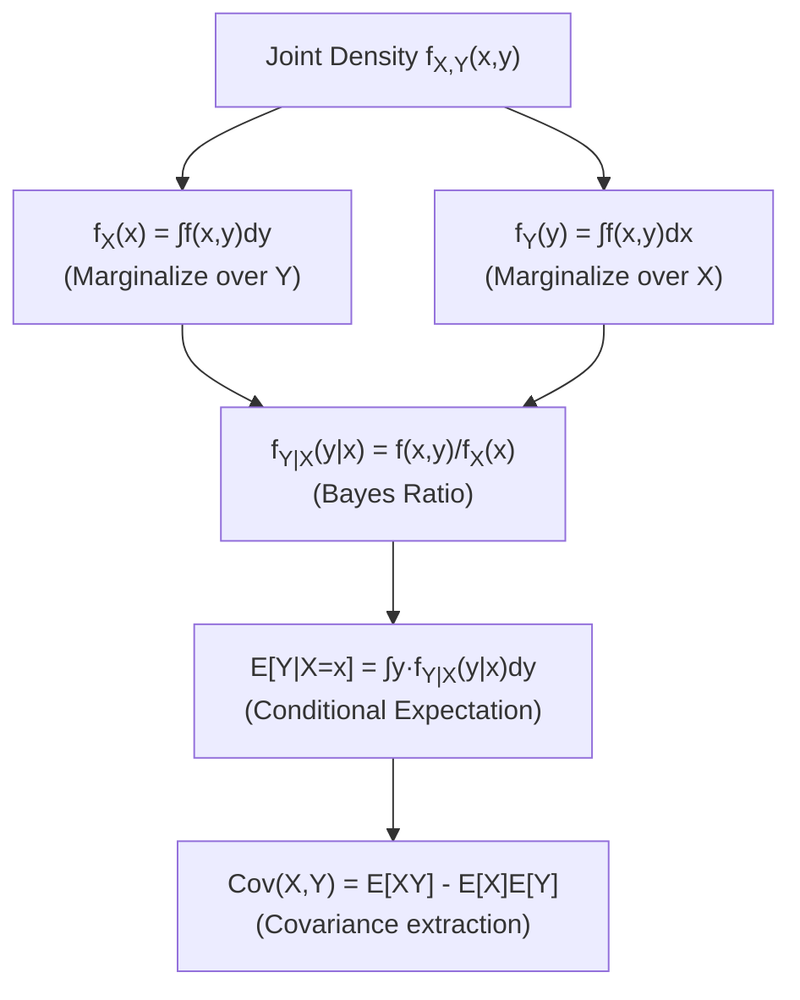

# Lesson 3: Joint Distributions, Marginals, Dependence Structures

## 1. First-Principles Intuition & Invariants

Probability theory, in its single-variable form, is already a powerful instrument. It lets us quantify uncertainty, reason about limiting behavior, and derive the distributions of transformed random quantities. Yet virtually every real problem of consequence involves not one uncertain quantity but several: the joint fluctuation of asset prices, the correlated errors in a linear regression, the dependence between a cipher's plaintext and its observable side-channel. As soon as we ask how two or more random variables *relate* to one another, we enter the domain of joint distributions, and a qualitatively richer set of questions becomes available. It is not enough to know the marginal behavior of each variable in isolation; we must understand the full probabilistic geometry of the ensemble.

The foundational object is the **joint distribution** of a random vector $\mathbf{X} = (X_1, X_2, \ldots, X_n)$ defined on a probability space $(\Omega, \mathcal{F}, \mathbb{P})$. Rather than tracking each coordinate separately, we capture all probabilistic information in a single measure $\mu_{\mathbf{X}}$ on $\mathbb{R}^n$, or equivalently in the **joint cumulative distribution function**

$$F_{X_1,\ldots,X_n}(x_1,\ldots,x_n) = \mathbb{P}(X_1 \le x_1,\, X_2 \le x_2,\, \ldots,\, X_n \le x_n).$$

For the continuous case, when this CDF is sufficiently smooth, we differentiate to obtain the **joint probability density function**

$$f_{X_1,\ldots,X_n}(x_1,\ldots,x_n) = \frac{\partial^n F}{\partial x_1 \,\partial x_2 \cdots \partial x_n},$$

characterized by non-negativity and the normalization condition $\int_{\mathbb{R}^n} f(\mathbf{x})\,d\mathbf{x} = 1$. The joint density carries strictly more information than the collection of individual marginal densities, and this surplus is precisely the dependence structure.

**Recovering Marginals from the Joint.** Given the joint density of $(X, Y)$, the marginal density of $X$ alone is obtained by integrating out $Y$:

$$f_X(x) = \int_{-\infty}^{\infty} f_{X,Y}(x,y)\,dy.$$

This operation has an immediate geometric interpretation: $f_X(x)$ is the "shadow" or projection of the joint density surface onto the $x$-axis. Formally, this is an application of the disintegration theorem, which guarantees that any joint measure on a product space can be decomposed into a marginal measure on the first coordinate and a family of conditional measures parametrized by that coordinate. The notation makes the direction of projection explicit: integrating over $y$ removes $Y$ from the picture, leaving only the marginal law of $X$.

**Conditional Densities.** The conditional density of $Y$ given $X = x$ is defined, wherever $f_X(x) > 0$, by Bayes's ratio

$$f_{Y \mid X}(y \mid x) = \frac{f_{X,Y}(x,y)}{f_X(x)}.$$

This is not merely a formal definition: it encodes the precise probabilistic update that occurs when we learn the value of $X$. For fixed $x$, the function $y \mapsto f_{Y \mid X}(y \mid x)$ is itself a valid probability density, integrating to one over $y$. The chain rule of probability follows immediately: $f_{X,Y}(x,y) = f_{Y \mid X}(y \mid x)\,f_X(x)$, which is the continuous analog of the multiplicative rule for conditional probability. Iterating this factorization across $n$ variables yields

$$f_{X_1,\ldots,X_n}(x_1,\ldots,x_n) = f_{X_1}(x_1) \cdot f_{X_2 \mid X_1}(x_2 \mid x_1) \cdots f_{X_n \mid X_1,\ldots,X_{n-1}}(x_n \mid x_1,\ldots,x_{n-1}),$$

a product chain that underlies autoregressive models, hidden Markov chains, and the graphical model factorizations central to probabilistic inference.

**Independence as a Structural Invariant.** The random variables $X$ and $Y$ are independent if and only if their joint density factors as a product of marginals for all $(x, y)$:

$$f_{X,Y}(x,y) = f_X(x)\,f_Y(y).$$

Independence is an enormously strong condition. It asserts that knowing $X$ confers zero information about $Y$, in the precise sense that $f_{Y \mid X}(y \mid x) = f_Y(y)$ for every $x$. When independence holds, all moments factor: $\mathbb{E}[g(X)h(Y)] = \mathbb{E}[g(X)]\,\mathbb{E}[h(Y)]$ for any measurable $g$ and $h$ for which the expectations exist. In particular, $\mathbb{E}[XY] = \mathbb{E}[X]\,\mathbb{E}[Y]$, which makes the covariance vanish. The critical point to internalize is that the implication runs only one way: independence forces zero covariance, but zero covariance does not force independence. This asymmetry is one of the central subtleties of dependence theory, and we will examine it carefully in Section 2.

**The Multivariate Gaussian as a Canonical Joint Distribution.** Before dissecting the machinery of dependence, it is worth anchoring the abstraction in the most important joint distribution in applied mathematics. The multivariate Gaussian $\mathbf{X} \sim \mathcal{N}(\boldsymbol{\mu}, \Sigma)$ on $\mathbb{R}^n$ has joint density

$$f(\mathbf{x}) = \frac{1}{(2\pi)^{n/2}|\Sigma|^{1/2}} \exp\!\left(-\frac{1}{2}(\mathbf{x} - \boldsymbol{\mu})^\top \Sigma^{-1}(\mathbf{x} - \boldsymbol{\mu})\right),$$

where $\boldsymbol{\mu} \in \mathbb{R}^n$ is the mean vector and $\Sigma \in \mathbb{R}^{n \times n}$ is the covariance matrix, which must be symmetric and positive semi-definite. The Gaussian is exceptional among joint distributions because its dependence structure is *completely* encoded by pairwise second moments: for Gaussians, and only for Gaussians in this strong sense, uncorrelatedness is equivalent to independence. The quadratic form in the exponent, $(\mathbf{x} - \boldsymbol{\mu})^\top \Sigma^{-1} (\mathbf{x} - \boldsymbol{\mu})$, defines an ellipsoidal level set whose principal axes align with the eigenvectors of $\Sigma$ and whose axis lengths are proportional to the square roots of the corresponding eigenvalues. This geometric picture becomes essential when we work with PCA, Kalman filters, and Gaussian process regression.

---

## 2. Core Architecture & Mechanics

### The Covariance Matrix: Construction and Algebraic Properties

For a random vector $\mathbf{X} = (X_1, \ldots, X_n)^\top$ with finite second moments, the **covariance matrix** is the $n \times n$ matrix

$$\Sigma = \text{Cov}(\mathbf{X}) = \mathbb{E}\!\left[(\mathbf{X} - \boldsymbol{\mu})(\mathbf{X} - \boldsymbol{\mu})^\top\right],$$

where $\boldsymbol{\mu} = \mathbb{E}[\mathbf{X}]$. The $(i,j)$ entry of $\Sigma$ is the covariance $\sigma_{ij} = \text{Cov}(X_i, X_j) = \mathbb{E}[(X_i - \mu_i)(X_j - \mu_j)]$, and the diagonal entries $\sigma_{ii} = \text{Var}(X_i)$ are the individual variances.

We now derive the two most important structural properties of $\Sigma$.

**Symmetry.** Since $\text{Cov}(X_i, X_j) = \text{Cov}(X_j, X_i)$ by definition, we have $\Sigma^\top = \Sigma$.

**Positive Semi-Definiteness.** For any vector $\mathbf{v} \in \mathbb{R}^n$, consider the scalar random variable $Z = \mathbf{v}^\top \mathbf{X}$. Since variance is non-negative,

$$0 \le \text{Var}(Z) = \text{Var}(\mathbf{v}^\top \mathbf{X}) = \mathbf{v}^\top \text{Cov}(\mathbf{X})\,\mathbf{v} = \mathbf{v}^\top \Sigma \mathbf{v}.$$

Because this holds for all $\mathbf{v}$, $\Sigma$ is positive semi-definite. It is positive definite (all eigenvalues strictly positive) if and only if no component of $\mathbf{X}$ is an exact affine function of the others, i.e., there is no perfect linear dependence among the coordinates.

The **correlation matrix** $R$ is obtained by normalizing: $R_{ij} = \rho(X_i, X_j) = \sigma_{ij} / (\sigma_i \sigma_j)$, where $\sigma_i = \sqrt{\text{Var}(X_i)}$. Equivalently, $R = D^{-1} \Sigma D^{-1}$, where $D = \text{diag}(\sigma_1, \ldots, \sigma_n)$. The Pearson correlation coefficient $\rho(X, Y)$ satisfies $|\rho| \le 1$ by the Cauchy-Schwarz inequality, with $|\rho| = 1$ if and only if $Y = aX + b$ almost surely for some constants $a, b$. It measures the strength and direction of the *linear* association between $X$ and $Y$.

### Independence vs. Uncorrelatedness: The Canonical Counterexample

The distinction between independence and uncorrelatedness is one of the most consequential in all of applied probability, and it deserves a fully worked example rather than a passing remark.

Let $X \sim \text{Uniform}(-1, 1)$, so $f_X(x) = 1/2$ for $x \in (-1,1)$, and define $Y = X^2$. Then:

$$\text{Cov}(X, Y) = \mathbb{E}[XY] - \mathbb{E}[X]\,\mathbb{E}[Y] = \mathbb{E}[X^3] - \mathbb{E}[X]\,\mathbb{E}[X^2].$$

Since $f_X$ is symmetric around zero, all odd moments of $X$ vanish: $\mathbb{E}[X^k] = 0$ for $k$ odd. In particular, $\mathbb{E}[X^3] = 0$ and $\mathbb{E}[X] = 0$. Therefore $\text{Cov}(X, Y) = 0$, so $X$ and $Y$ are uncorrelated. Yet they are manifestly not independent: knowing $X = 0.5$ tells us immediately that $Y = 0.25$, so $Y$ is a deterministic function of $X$. The joint distribution of $(X, X^2)$ is entirely supported on the parabola $y = x^2$ in $\mathbb{R}^2$, which no product measure can replicate. The lesson is that covariance measures only linear association; it is blind to the nonlinear dependence exhibited here.

### The Structural Pipeline of a Joint Distribution

The following diagram shows how the components of a bivariate distribution relate to one another through conditioning, marginalization, and moment extraction:

Each arrow represents a well-defined mathematical operation. The joint density is the top-level object; every derived quantity, marginal density, conditional density, conditional expectation, covariance, is obtained from it by integration, ratio, or moment extraction. This hierarchy prevents conceptual confusion about what is "fundamental" versus what is "derived."

### Copulas: Separating Marginals from Dependence

The covariance matrix fully characterizes dependence within the Gaussian family, but for heavy-tailed distributions, skewed risks, or asymmetric tail dependence, it is entirely inadequate. Copula theory provides the correct separation.

**Sklar's Theorem.** Let $F_{X,Y}$ be any joint CDF with marginals $F_X$ and $F_Y$. There exists a function $C : [0,1]^2 \to [0,1]$, called a **copula**, such that

$$F_{X,Y}(x,y) = C(F_X(x),\, F_Y(y)).$$

If $F_X$ and $F_Y$ are continuous, then $C$ is unique. Conversely, for any copula $C$ and any marginal CDFs $F_X$, $F_Y$, the function $C(F_X(x), F_Y(y))$ defines a valid joint CDF with those marginals.

This theorem has a striking operational consequence: the entire dependence structure of $(X, Y)$ is encoded in $C$ alone, completely separated from the marginal behaviors $F_X$ and $F_Y$. We can pair any marginals with any copula to construct a valid joint distribution, and we can extract the copula from any joint distribution by the probability integral transform.

The derivation of the copula density proceeds directly. If $F_X$ and $F_Y$ are differentiable, let $u = F_X(x)$ and $v = F_Y(y)$, so $u, v \in [0,1]$. The copula density is

$$c(u,v) = \frac{\partial^2 C(u,v)}{\partial u\,\partial v},$$

and the joint density of $(X,Y)$ recovers as

$$f_{X,Y}(x,y) = c(F_X(x),\, F_Y(y))\cdot f_X(x)\cdot f_Y(y).$$

This factorization isolates exactly what the copula contributes: the multiplicative correction $c(F_X(x), F_Y(y))$ over the independent case $f_X(x) f_Y(y)$. When $C$ is the independence copula $C(u,v) = uv$, we get $c \equiv 1$ and the joint density factors completely. Any deviation of $c$ from 1 is a pure signature of dependence.

**The Gaussian Copula.** The Gaussian copula with correlation parameter $\rho \in (-1,1)$ is defined by

$$C_\rho^{\text{Ga}}(u,v) = \Phi_\rho(\Phi^{-1}(u),\, \Phi^{-1}(v)),$$

where $\Phi_\rho$ is the standard bivariate normal CDF with correlation $\rho$, and $\Phi^{-1}$ is the standard normal quantile function. We can pair this copula with, say, Pareto marginals to obtain a joint distribution that has Gaussian rank correlation but heavy tails. This construction was central to CDO pricing models in quantitative finance before the 2008 crisis, where the assumption that the Gaussian copula's tail dependence was adequate turned out to be catastrophically wrong.

**The Clayton Copula and Tail Dependence.** The Clayton copula is

$$C_\theta(u,v) = \left(u^{-\theta} + v^{-\theta} - 1\right)^{-1/\theta}, \quad \theta > 0.$$

Its defining feature is **lower tail dependence**: as both $u$ and $v$ approach zero (the lower tail), $C_\theta(u,v)$ decays more slowly than the product $uv$, meaning extreme low values of $X$ and $Y$ co-occur with higher probability than the Gaussian copula predicts. The lower tail dependence coefficient is $\lambda_L = 2^{-1/\theta} > 0$, while the upper tail dependence coefficient is $\lambda_U = 0$. This asymmetry makes the Clayton copula natural for insurance loss models, where simultaneous large losses are the operative risk.

**Kendall's $\tau$ and Spearman's $\rho_S$ as Copula Invariants.** Because copulas are invariant under strictly increasing transformations of the marginals, rank-based dependence measures are copula properties rather than properties of the specific marginals. Kendall's $\tau$ for a copula $C$ is

$$\tau = 4 \int_0^1\int_0^1 C(u,v)\,c(u,v)\,du\,dv - 1 = 4\,\mathbb{E}[C(U,V)] - 1,$$

where $(U,V) \sim C$. Spearman's rank correlation is

$$\rho_S = 12\int_0^1\int_0^1 C(u,v)\,du\,dv - 3.$$

Both measures depend only on $C$ and not on the marginals, which makes them more robust dependence summaries than Pearson's $\rho$ when heavy tails or nonlinear transformations are present.

---

## 3. High-Performance Optimization & Failure Modes

### Computing Marginals and Conditionals: Exact vs. Numerical Integration

In low-dimensional settings, marginal densities can often be computed in closed form by exploiting conjugacy or known integral identities. For instance, if $(X, Y)$ follows a bivariate normal, the marginal of $X$ is $\mathcal{N}(\mu_X, \sigma_X^2)$ regardless of the correlation, obtained by evaluating the Gaussian integral over $y$. The conditional distribution $Y \mid X = x$ is also Gaussian with mean $\mu_Y + \rho(\sigma_Y/\sigma_X)(x - \mu_X)$ and variance $\sigma_Y^2(1 - \rho^2)$. These closed-form results depend entirely on the quadratic exponent structure of the Gaussian and do not generalize automatically.

For non-conjugate joint densities, numerical integration becomes necessary. In two dimensions, **tensor-product quadrature** (e.g., Gauss-Legendre nodes on a grid) works reliably, with error $O(h^{2k})$ for a $k$-th order rule and step size $h$. The critical failure mode is the **curse of dimensionality**: if we use $m$ quadrature points per dimension, the total number of function evaluations scales as $m^n$ for an $n$-dimensional integral. By dimension 10, this is computationally prohibitive for modest $m$.

The standard remediation is **Monte Carlo integration**. Given $N$ samples $\mathbf{x}^{(1)}, \ldots, \mathbf{x}^{(N)}$ from the joint density $f$, the marginal expectation $\mathbb{E}[g(X_1)] = \int g(x_1) f(\mathbf{x})\,d\mathbf{x}$ is approximated by the sample mean $\hat{\mu}_N = N^{-1} \sum_{i=1}^N g(X_1^{(i)})$. By the central limit theorem, the error $|\hat{\mu}_N - \mathbb{E}[g(X_1)]|$ has standard deviation $O(N^{-1/2})$ independent of the dimension $n$, and concentration inequalities provide high-probability bounds with an additional logarithmic factor. This dimension-free convergence rate is Monte Carlo's decisive advantage over quadrature in high dimensions, though the $O(N^{-1/2})$ rate is slower than quadrature's $O(h^{2k})$ in low dimensions.

### Estimating Covariance Matrices from Samples

Given $N$ i.i.d. samples $\mathbf{x}^{(1)}, \ldots, \mathbf{x}^{(N)}$ from $\mathbf{X} \sim (\boldsymbol{\mu}, \Sigma)$, the sample covariance matrix is

$$\hat{\Sigma} = \frac{1}{N-1} \sum_{i=1}^N (\mathbf{x}^{(i)} - \bar{\mathbf{x}})(\mathbf{x}^{(i)} - \bar{\mathbf{x}})^\top,$$

where $\bar{\mathbf{x}} = N^{-1}\sum_i \mathbf{x}^{(i)}$. The factor $N-1$ (Bessel's correction) renders $\hat{\Sigma}$ an unbiased estimator of $\Sigma$: $\mathbb{E}[\hat{\Sigma}] = \Sigma$.

The pathological regime is $n \approx N$ or $n > N$. When the number of variables $n$ exceeds the number of samples $N$, the sample covariance matrix is singular by rank considerations: $\hat{\Sigma}$ has rank at most $N-1$, so it cannot be positive definite. Even before hitting this hard boundary, the sample covariance in high dimensions is severely ill-conditioned: eigenvalues are systematically biased (small eigenvalues are underestimated, large eigenvalues are overestimated) according to the **Marčenko-Pastur distribution** from random matrix theory, which characterizes the limiting spectral distribution of $\hat{\Sigma}$ as $n, N \to \infty$ with ratio $n/N \to \gamma \in (0, \infty)$.

The standard remediation is **shrinkage estimation**. The Ledoit-Wolf estimator replaces $\hat{\Sigma}$ with

$$\hat{\Sigma}_{\text{LW}} = (1 - \alpha)\hat{\Sigma} + \alpha \hat{\mu}_{\text{var}} I,$$

where $\hat{\mu}_{\text{var}}$ is the average sample variance and $\alpha \in [0,1]$ is the shrinkage intensity chosen to minimize the expected Frobenius error $\mathbb{E}[\|\hat{\Sigma}_\alpha - \Sigma\|_F^2]$. Ledoit and Wolf derived an analytic, asymptotically optimal formula for $\alpha$ that requires no cross-validation. The resulting estimator is always positive definite and well-conditioned, making it directly invertible for use in Gaussian density evaluation, Mahalanobis distance computation, and portfolio optimization.

### Copula Fitting: MLE, the IFM Method, and Tail Dependence Diagnostics

Fitting a copula to data involves two steps: choosing a copula family and estimating its parameters. The **inference functions for margins (IFM)** method, introduced by Joe (1997), decouples these steps for computational tractability. In the first step, each marginal $F_{X_i}$ is fitted independently by maximum likelihood. In the second step, the pseudo-observations $\hat{U}_i^{(j)} = \hat{F}_{X_i}(x_i^{(j)})$ are computed by applying the fitted marginal CDFs to each data point, transforming each coordinate to the uniform scale. The copula parameters are then estimated by maximizing the copula log-likelihood

$$\ell(\theta) = \sum_{j=1}^N \log c_\theta(\hat{U}_1^{(j)}, \ldots, \hat{U}_n^{(j)}).$$

The IFM estimator is consistent and asymptotically normal under regularity conditions, though it is not fully efficient because the first-stage marginal estimation introduces estimation error that is propagated into the second stage. Full MLE over all parameters simultaneously achieves efficiency but requires optimizing over a much larger parameter space and is prone to numerical instability.

A critical diagnostic step before committing to a copula family is **tail dependence analysis**. The upper tail dependence coefficient is

$$\lambda_U = \lim_{u \to 1^-} \mathbb{P}(U > u \mid V > u) = \lim_{u \to 1^-} \frac{1 - 2u + C(u,u)}{1 - u},$$

and the lower tail dependence coefficient is $\lambda_L = \lim_{u \to 0^+} C(u,u)/u$. These limits are properties of the copula $C$, not of the marginals. The Gaussian copula has $\lambda_L = \lambda_U = 0$ for all $|\rho| < 1$, meaning that extreme co-movements are asymptotically independent under it—a severe misspecification when modeling financial crises, network cascade failures, or simultaneous extreme meteorological events. The Student-$t$ copula with $\nu$ degrees of freedom has symmetric tail dependence $\lambda_U = \lambda_L = 2T_{\nu+1}(-\sqrt{(\nu+1)(1-\rho)/(1+\rho)}) > 0$, making it substantially more appropriate when joint extremes are observed in the data.

### Mutual Information as a Dependence Measure Beyond Covariance

When nonlinear dependence is present and the covariance is zero (as in the $Y = X^2$ example from Section 2), one needs a dependence measure that detects arbitrary statistical dependence. The **mutual information** between $X$ and $Y$ is

$$I(X;Y) = \int\!\int f_{X,Y}(x,y) \log \frac{f_{X,Y}(x,y)}{f_X(x)\,f_Y(y)}\,dx\,dy = D_{\text{KL}}(f_{X,Y} \,\|\, f_X \otimes f_Y),$$

the Kullback-Leibler divergence from the joint density to the product of marginals. Mutual information is zero if and only if $X$ and $Y$ are independent, and it is invariant under any bijective (invertible measurable) transformation of either variable—a strict generalization of the rank-invariance of copula measures. It is therefore blind to the choice of marginal scale, detecting only the copula contribution. Estimating mutual information from samples is nontrivial in high dimensions; the $k$-nearest-neighbor estimator of Kraskov, Stögbauer, and Grassberger (2004) has bias that decays with $N$ and is controllable via the choice of $k$ and is the standard choice in practice, requiring only pairwise Euclidean distances and no density estimation.

The **maximal information coefficient (MIC)** extends this idea by searching over all possible discretizations of the $(X, Y)$ plane and maximizing a normalized mutual information over that search, producing a scalar in $[0,1]$ that equals zero for independence and one for noiseless functional dependence. MIC is computationally heavier than the KSG mutual information estimator but more interpretable as an effect size.

### Conditioning Failures: Degeneracy and the Jacobian Trap

A subtle failure mode in multivariate analysis is computing conditional densities from degenerate joints. If $\mathbf{X}$ has a covariance matrix $\Sigma$ that is singular (rank $r < n$), then $\mathbf{X}$ has no density with respect to Lebesgue measure on $\mathbb{R}^n$; its support lives on an $r$-dimensional affine subspace. Any formula for $f_{Y \mid X}$ that involves $f_{\mathbf{X}}$ in the denominator will be undefined almost everywhere. The correct treatment requires working with the conditional distribution on the affine subspace, using the appropriate lower-dimensional Lebesgue measure.

A related failure occurs in nonlinear transformations. If $\mathbf{Y} = g(\mathbf{X})$ for a differentiable bijection $g : \mathbb{R}^n \to \mathbb{R}^n$, the density of $\mathbf{Y}$ is

$$f_{\mathbf{Y}}(\mathbf{y}) = f_{\mathbf{X}}(g^{-1}(\mathbf{y})) \cdot \left|\det J_{g^{-1}}(\mathbf{y})\right|,$$

where $J_{g^{-1}}$ is the Jacobian matrix of $g^{-1}$. Forgetting the absolute Jacobian determinant is an error that invalidates every subsequent moment calculation and copula extraction from $\mathbf{Y}$. This correction is not optional: it is the change-of-variables formula for Lebesgue integration, and it reflects the local volume distortion that $g$ applies to infinitesimal probability mass.

### The Conditional Independence Graph and Precision Matrices

For a Gaussian vector $\mathbf{X} \sim \mathcal{N}(\boldsymbol{\mu}, \Sigma)$, partial correlations provide a finer dependence structure than pairwise correlations. The partial correlation between $X_i$ and $X_j$ given all other variables $\mathbf{X}_{\setminus ij}$ is

$$\rho_{ij \cdot \text{rest}} = -\frac{(\Sigma^{-1})_{ij}}{\sqrt{(\Sigma^{-1})_{ii}(\Sigma^{-1})_{jj}}}.$$

This remarkable result says that $X_i$ and $X_j$ are **conditionally independent** given all remaining variables if and only if the $(i,j)$ entry of the precision matrix $\Omega = \Sigma^{-1}$ is zero. The **Gaussian graphical model** builds an undirected graph on $n$ nodes by drawing an edge between $i$ and $j$ precisely when $\Omega_{ij} \ne 0$. This graph encodes the full Markov structure of $\mathbf{X}$: it identifies which pairs of variables carry direct dependence versus dependence that is entirely mediated through other variables. Estimating this graph from data is the problem of **sparse precision matrix estimation**, solved by the graphical lasso (GLASSO) algorithm, which maximizes the penalized Gaussian log-likelihood

$$\ell(\Omega) = \log\det\Omega - \text{tr}(\hat{S}\,\Omega) - \lambda\|\Omega\|_1,$$

where $\hat{S}$ is the sample covariance, $\|\Omega\|_1 = \sum_{i \ne j} |\Omega_{ij}|$ is the off-diagonal $\ell_1$ penalty promoting sparsity, and $\lambda > 0$ controls the sparsity level. The GLASSO solution is block-coordinatewise solvable via a modified lasso regression for each row of $\Omega$, and it recovers the true graph support with high probability when $\lambda \asymp \sqrt{\log n / N}$ under appropriate conditions on $\Sigma$.

Together, these tools—covariance matrices, copulas, mutual information, and precision matrices—form a coherent toolkit for characterizing, measuring, and exploiting the dependence structure of multivariate distributions. Each instrument answers a different question: covariance measures linear co-movement, copulas separate marginal shape from joint geometry, mutual information detects arbitrary dependence, and precision matrices reveal the conditional independence graph. A practitioner who can deploy all four has genuine command of the structure of a multivariate distribution, rather than a summary statistic that may conceal the most consequential features of the data-generating process.
