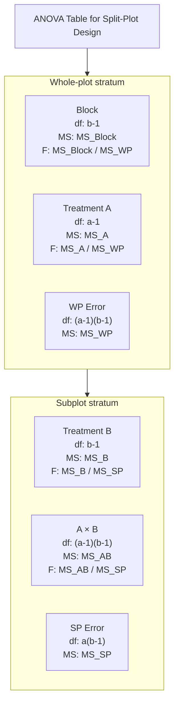

# Lesson 4: Experimental Design & Causality

## 1. First-Principles Intuition & Invariants

The central epistemological challenge in experimental science and applied statistics is the identification of **causal relationships** rather than mere associational patterns. When we observe that variable $X$ correlates with outcome $Y$, we confront the fundamental ambiguity: does $X$ cause $Y$, does $Y$ cause $X$, or does some latent confounder $Z$ induce spurious correlation between both? The resolution of this ambiguity requires deliberate manipulation of the treatment variable under controlled conditions, paired with principled randomization to break confounding pathways. This is the province of **experimental design theory**, a formalization of the scientific method grounded in probabilistic symmetry-breaking and structural causal inference.

The philosophical foundation rests on the **counterfactual framework** articulated by Jerzy Neyman, Donald Rubin, and Ronald Fisher across the twentieth century. For each experimental unit $i$ in a population, we postulate the existence of **potential outcomes** $Y_i(1)$ and $Y_i(0)$, representing the response unit $i$ would exhibit under treatment and control conditions respectively. The individual treatment effect for unit $i$ is defined as the difference $\tau_i = Y_i(1) - Y_i(0)$, yet we face the **fundamental problem of causal inference**: we can observe at most one of these potential outcomes for any given unit. If unit $i$ receives treatment, we observe $Y_i(1)$ but $Y_i(0)$ remains a counterfactual quantity; conversely, control assignment reveals $Y_i(0)$ but conceals $Y_i(1)$.

This irreducible missing-data structure motivates the shift from individual-level causal effects to **population-level causal estimands**. The most commonly targeted parameter is the **average treatment effect** (ATE), defined as $\tau = \mathbb{E}[Y_i(1) - Y_i(0)] = \mathbb{E}[Y_i(1)] - \mathbb{E}[Y_i(0)]$, which aggregates individual effects across the entire population. Under ideal experimental conditions, the sample analog $\bar{Y}_{\text{treat}} - \bar{Y}_{\text{control}}$ provides an unbiased estimator for $\tau$, but only when assignment mechanism satisfies critical probabilistic invariants.

**Randomization** serves as the master key that unlocks causal identification. When treatment assignment $W_i \in \{0,1\}$ is determined by an independent randomization device—such as a fair coin flip, random number generator, or stratified permutation—the assignment becomes **statistically independent** of all potential outcomes and all pre-treatment covariates: $W_i \perp \!\!\! \perp \{Y_i(0), Y_i(1), X_i\}$. This probabilistic independence guarantees that treatment and control groups are **exchangeable** in expectation: any systematic difference in observed outcomes can be attributed to the causal effect of treatment rather than selection bias. Formally, randomization ensures that $\mathbb{E}[Y_i(1) \mid W_i = 1] = \mathbb{E}[Y_i(1)]$ and $\mathbb{E}[Y_i(0) \mid W_i = 0] = \mathbb{E}[Y_i(0)]$, allowing us to identify the ATE as $\mathbb{E}[Y_i \mid W_i = 1] - \mathbb{E}[Y_i \mid W_i = 0]$.

The variance of the treatment effect estimator under complete randomization is $\text{Var}(\hat{\tau}) = \frac{\sigma_1^2}{n_1} + \frac{\sigma_0^2}{n_0}$, where $\sigma_1^2$ and $\sigma_0^2$ denote the within-group variances and $n_1, n_0$ represent the sample sizes in treatment and control arms. For fixed total sample size $n = n_1 + n_0$, this variance is minimized when $n_1 = n_0 = n/2$, yielding the principle of **balanced allocation**. However, when unit-level heterogeneity is substantial and observable covariates $X_i$ are strongly predictive of outcomes, complete randomization may yield imbalanced samples with respect to these covariates purely by chance, inflating estimator variance and reducing statistical power.

This motivates **restricted randomization** procedures that impose additional structure on the assignment mechanism while preserving the fundamental independence property. The most important restricted designs are **blocking** (stratified randomization), **rerandomization** (rejection sampling on covariate balance), and **paired experiments** (matched randomization). These techniques partition the sample space into homogeneous subgroups and randomize independently within each stratum, ensuring balance on known prognostic factors and reducing residual variance. The mathematical justification follows from the law of total variance: $\text{Var}(Y) = \mathbb{E}[\text{Var}(Y \mid X)] + \text{Var}(\mathbb{E}[Y \mid X])$. By conditioning on blocks defined by $X$, we eliminate the second term, retaining only within-block variability.

Beyond simple comparative experiments, modern scientific inquiry often requires simultaneous investigation of multiple factors and their interactions. A **factorial design** systematically varies $k$ factors across $\prod_{j=1}^k l_j$ treatment combinations, where factor $j$ assumes $l_j$ distinct levels. The canonical case is the $2^k$ factorial, in which each of $k$ factors is toggled between two levels (e.g., present/absent, high/low), generating $2^k$ treatment cells. The appeal of factorial designs lies in their **efficiency**: with $n$ total observations, we estimate not only $k$ main effects but also all $\binom{k}{2}$ two-way interactions, $\binom{k}{3}$ three-way interactions, and so forth, extracting exponentially more information than $k$ separate one-factor-at-a-time experiments.

The linear model framework for a $2^3$ factorial experiment with factors $A$, $B$, $C$ takes the form:

$$
Y_{ijkl} = \mu + \alpha_i + \beta_j + \gamma_k + (\alpha\beta)_{ij} + (\alpha\gamma)_{ik} + (\beta\gamma)_{jk} + (\alpha\beta\gamma)_{ijk} + \epsilon_{ijkl}
$$

where $i,j,k \in \{0,1\}$ index factor levels, $l$ indexes replicates, $\alpha_i, \beta_j, \gamma_k$ represent main effects, $(\alpha\beta)_{ij}, (\alpha\gamma)_{ik}, (\beta\gamma)_{jk}$ capture two-way interactions, and $(\alpha\beta\gamma)_{ijk}$ models the three-way interaction. The interaction terms quantify **effect modification**: the degree to which the causal effect of one factor depends on the levels of other factors. Under sum-to-zero constraints ($\sum_i \alpha_i = 0$, etc.), these parameters are uniquely identified and estimated via ordinary least squares. The omnibus F-test for the interaction term $(\alpha\beta)_{ij}$ evaluates the null hypothesis of **no effect modification**, testing whether the factors operate independently on the additive scale.

When experimental units exhibit hierarchical structure—students nested within classrooms, patients nested within hospitals, repeated measurements nested within subjects—the independence assumption of classical linear models is violated. **Nested designs** and **random effects models** formalize this dependence structure through hierarchical variance decomposition. Consider a two-level nested design with $a$ groups, each containing $b$ subunits. The random effects model posits:

$$
Y_{ij} = \mu + \alpha_i + \epsilon_{ij}, \quad \alpha_i \sim N(0, \sigma_\alpha^2), \quad \epsilon_{ij} \sim N(0, \sigma_\epsilon^2)
$$

where $\alpha_i$ represents the random effect of group $i$ and $\epsilon_{ij}$ is the unit-level residual. The total variance decomposes as $\text{Var}(Y_{ij}) = \sigma_\alpha^2 + \sigma_\epsilon^2$, and the **intraclass correlation coefficient** (ICC) quantifies the proportion of variance attributable to group-level clustering: $\rho = \sigma_\alpha^2 / (\sigma_\alpha^2 + \sigma_\epsilon^2)$. When $\rho$ is substantial, ignoring the clustering induces **design effect** inflation, underestimating standard errors and yielding false confidence in statistical significance. The effective sample size for clustered data is approximately $n_{\text{eff}} = n / [1 + (b-1)\rho]$, where $n = ab$ is the nominal sample size and $b$ is the cluster size.

**Latin square designs** address situations where two nuisance factors must be controlled but complete blocking is infeasible. In agricultural field trials, for instance, fertility gradients may vary systematically along both North-South and East-West axes. A $p \times p$ Latin square arranges $p$ treatments in a $p \times p$ grid such that each treatment appears exactly once in each row and exactly once in each column, achieving orthogonal blocking on both spatial dimensions with only $p^2$ experimental units rather than the $p^3$ required for a complete factorial with two blocking factors. The linear model is:

$$
Y_{ij} = \mu + \tau_{T(i,j)} + \rho_i + \gamma_j + \epsilon_{ij}
$$

where $\tau_i$ is the treatment effect, $\rho_j$ is the row effect, $\gamma_k$ is the column effect, and the Latin square structure ensures that $i$, $j$, and $k$ are in one-to-one correspondence for observed cells. The orthogonality property guarantees that treatment effect estimates remain unbiased even when row and column effects are substantial, and the ANOVA decomposition allocates variance to treatments, rows, columns, and residual components.

**Split-plot designs** emerge when practical constraints prevent complete randomization of all factors at the same hierarchical level. In agricultural experiments, irrigation treatments may be applied to large plots (whole plots), while fertilizer treatments are randomized within subplots. Similarly, in industrial experiments, temperature settings may be difficult to change (whole-plot factor), while catalyst concentrations are easily varied (subplot factor). The split-plot structure induces two error strata with distinct variances: whole-plot error $\epsilon_i \sim N(0, \sigma_{\text{wp}}^2)$ and subplot error $\epsilon_{ij} \sim N(0, \sigma_{\text{sp}}^2)$. The mixed model representation is:

$$
Y_{ijk} = \mu + \alpha_i + \delta_k + \epsilon_i + \beta_j + (\alpha\beta)_{ij} + (\beta\delta)_{jk} + (\alpha\beta\delta)_{ijk} + \epsilon_{ijk}
$$

where $\alpha_i$ is the whole-plot treatment effect, $\beta_j$ is the subplot treatment effect, $\delta_k$ is the block effect, and the two error terms capture variation at different scales. Crucially, tests for whole-plot effects use the whole-plot error mean square as the denominator in the F-statistic, while tests for subplot effects and interactions use the subplot error mean square, reflecting the different precision with which effects at each level are estimated.

The machinery of experimental design extends beyond controlled randomized trials to the analysis of **observational studies**, where treatment assignment is not under the investigator's control but rather determined by natural processes, policy decisions, or individual choices. In such settings, the conditional independence assumption $W_i \perp \!\!\! \perp \{Y_i(0), Y_i(1)\} \mid X_i$—known as **unconfoundedness** or **ignorability**—replaces unconditional randomization as the identifying assumption. This asserts that within strata defined by observed covariates $X_i$, treatment assignment is as good as random. Under unconfoundedness, the ATE is identified via the **adjustment formula**:

$$
\tau = \mathbb{E}_X[\mathbb{E}[Y \mid W=1, X] - \mathbb{E}[Y \mid W=0, X]]
$$

This nested expectation structure highlights the two-stage procedure: first, estimate conditional mean functions $\mu_1(x) = \mathbb{E}[Y \mid W=1, X=x]$ and $\mu_0(x) = \mathbb{E}[Y \mid W=0, X=x]$ via regression, matching, or weighting; second, average the conditional treatment effects $\mu_1(x) - \mu_0(x)$ over the covariate distribution. The validity of causal conclusions hinges critically on the plausibility of the unconfoundedness assumption, which is fundamentally untestable from observed data alone. Sensitivity analysis techniques quantify the magnitude of hidden confounding that would be required to overturn a significant finding, providing a robustness check against violations of the ignorability assumption.

**Propensity score methods** offer a dimension-reduction strategy for high-dimensional covariate adjustment. The propensity score $e(x) = P(W=1 \mid X=x)$ is the conditional probability of treatment assignment given covariates. Rosenbaum and Rubin's foundational theorem establishes that if unconfoundedness holds conditional on $X$, it also holds conditional on $e(X)$: $W \perp \!\!\! \perp \{Y(0), Y(1)\} \mid e(X)$. This reduces the adjustment problem from potentially high-dimensional $X$ to scalar $e(X)$, enabling stratification, matching, or inverse probability weighting on a single summary score. The ATE is identified as:

$$
\tau = \mathbb{E}\left[\frac{W \cdot Y}{e(X)}\right] - \mathbb{E}\left[\frac{(1-W) \cdot Y}{1 - e(X)}\right]
$$

This **Horvitz-Thompson inverse probability weighting** estimator reweights observations by the inverse of their assignment probabilities, creating a pseudo-population in which treatment is independent of covariates. In practice, the propensity score is unknown and must be estimated via logistic regression or machine learning methods, introducing additional estimation variance and potential model misspecification bias.

**Instrumental variables** (IV) provide an alternative identification strategy when unconfoundedness fails but a valid instrument $Z$ exists—a variable that affects treatment but influences the outcome only through its effect on treatment. The IV estimand for a binary instrument and binary treatment is:

$$
\tau_{\text{LATE}} = \frac{\mathbb{E}[Y \mid Z=1] - \mathbb{E}[Y \mid Z=0]}{\mathbb{E}[W \mid Z=1] - \mathbb{E}[W \mid Z=0]}
$$

This **local average treatment effect** (LATE) represents the causal effect for the subpopulation of **compliers**—units whose treatment status is influenced by the instrument. The IV approach requires three core assumptions: **relevance** ($Z$ is correlated with $W$), **exclusion restriction** ($Z$ affects $Y$ only through $W$), and **independence** ($Z$ is as good as randomly assigned). The exclusion restriction is the most contentious, as it rules out any direct pathway from instrument to outcome, a structural assumption that cannot be empirically verified.

**Regression discontinuity designs** (RDD) exploit deterministic assignment rules based on a continuous running variable. When treatment is assigned to all units exceeding a threshold $c$—$W_i = \mathbb{1}(X_i \geq c)$—the causal effect is identified by comparing outcomes just above and just below the cutoff, where units are presumed to be exchangeable in all respects except treatment status. The RDD estimand is:

$$
\tau_{\text{RDD}} = \lim_{x \downarrow c} \mathbb{E}[Y \mid X=x] - \lim_{x \uparrow c} \mathbb{E}[Y \mid X=x]
$$

This identifies the ATE at the threshold, a local parameter that may not generalize to the full population. The validity of RDD hinges on the **continuity assumption**: all potential confounders must be continuous at the cutoff, ensuring that the discrete jump in treatment assignment is the sole discontinuity. Graphical inspection of pre-treatment covariates and density tests for manipulation of the running variable provide diagnostic checks, though precise units near the threshold may strategically sort across the cutoff, violating the local randomization assumption.

The causal inference framework synthesizes these disparate methodologies under a unified potential outcomes logic. The **stable unit treatment value assumption** (SUTVA) asserts that (1) the potential outcome for unit $i$ depends only on its own treatment status, not on the treatment assignments of other units (**no interference**), and (2) there are no hidden variations in treatment (**consistency**). Violations of SUTVA—such as spillover effects in social networks or vaccine trials, or heterogeneous treatment versions—require extensions to causal models that explicitly represent interference structures or multi-valued treatment contrasts.

The distinction between **fixed effects** and **random effects** models encodes contrasting inferential goals. Fixed effects treat factor levels as the complete population of interest, with parameters $\alpha_1, \ldots, \alpha_a$ estimated as fixed unknown constants. Inference pertains only to the observed levels, and the null hypothesis $H_0: \alpha_1 = \cdots = \alpha_a$ tests whether these specific levels differ. Random effects treat observed levels as a random sample from a broader population, with $\alpha_i \sim N(0, \sigma_\alpha^2)$, and inference targets the variance component $\sigma_\alpha^2$. The null hypothesis $H_0: \sigma_\alpha^2 = 0$ assesses whether there is any group-level variation in the population, enabling generalization beyond the observed sample. The choice between fixed and random effects is fundamentally a question of the scope of inference: is the goal to compare specific treatments, or to quantify variability across a population of treatments?

The **analysis of covariance** (ANCOVA) model combines experimental design with regression adjustment for pre-treatment covariates. For a completely randomized experiment with covariate $X$, the model is:

$$
Y_i = \mu + \tau W_i + \beta X_i + \epsilon_i
$$

where $\tau$ is the treatment effect and $\beta$ is the covariate slope. Randomization ensures that $W_i \perp \!\!\! \perp X_i$, so the OLS estimator for $\tau$ remains unbiased even if $\beta \neq 0$. However, conditioning on $X$ reduces residual variance, yielding $\text{Var}(\hat{\tau}_{\text{ANCOVA}}) = \text{Var}(\hat{\tau}_{\text{unadjusted}}) \cdot (1 - \rho_{YX}^2)$, where $\rho_{YX}$ is the correlation between outcome and covariate. This variance reduction translates directly into increased statistical power, particularly when baseline covariates are strongly predictive of outcomes. The efficiency gain is asymptotically equivalent to increasing the sample size by a factor of $1/(1 - \rho_{YX}^2)$.

The construction of **estimable contrasts** in factorial designs follows from the principle that we can only estimate linear combinations of parameters that are orthogonal to the constraint space. Under sum-to-zero constraints, the main effect of factor $A$ in a $2^2$ factorial is the contrast $\psi = (\mu_{11} + \mu_{10} - \mu_{01} - \mu_{00})/2$, averaging the effect of $A$ over both levels of $B$. The interaction contrast is $\psi_{\text{int}} = (\mu_{11} - \mu_{10}) - (\mu_{01} - \mu_{00})$, measuring the difference in the effect of $A$ between levels of $B$. These contrasts are orthogonal in the sense that $\text{Cov}(\hat{\psi}, \hat{\psi}_{\text{int}}) = 0$ under balanced allocation, ensuring that main effects and interactions are estimated independently.

## 2. Core Architecture & Mechanics

The computational realization of experimental design and causal inference relies on a structured workflow that integrates design matrix construction, contrast coding, variance component estimation, and hypothesis testing. The fundamental data structure is the **design matrix** $\mathbf{X} \in \mathbb{R}^{n \times p}$, where row $i$ encodes the treatment and covariate configuration for experimental unit $i$, and columns represent intercept, main effects, interactions, and covariates. The response vector $\mathbf{y} \in \mathbb{R}^n$ collects observed outcomes, and the linear model is expressed as $\mathbf{y} = \mathbf{X}\boldsymbol{\beta} + \boldsymbol{\epsilon}$, where $\boldsymbol{\beta}$ contains estimable parameters and $\boldsymbol{\epsilon} \sim N(\mathbf{0}, \sigma^2 \mathbf{V})$ models the error structure with covariance matrix $\mathbf{V}$.

For a completely randomized two-arm trial with $n_1 = n_0 = 50$, the design matrix is a column of ones (intercept) concatenated with a treatment indicator:

$$
\mathbf{X} = \begin{bmatrix} 1 & 0 \\ \vdots & \vdots \\ 1 & 0 \\ 1 & 1 \\ \vdots & \vdots \\ 1 & 1 \end{bmatrix}_{100 \times 2}
$$

The OLS estimator $\hat{\boldsymbol{\beta}} = (\mathbf{X}^\top \mathbf{X})^{-1} \mathbf{X}^\top \mathbf{y}$ yields $\hat{\beta}_0 = \bar{y}_0$ (control mean) and $\hat{\beta}_1 = \bar{y}_1 - \bar{y}_0$ (treatment effect). The covariance matrix of $\hat{\boldsymbol{\beta}}$ is $\text{Var}(\hat{\boldsymbol{\beta}}) = \sigma^2 (\mathbf{X}^\top \mathbf{X})^{-1}$, with $\sigma^2$ estimated by the residual mean square $\hat{\sigma}^2 = \|\mathbf{y} - \mathbf{X}\hat{\boldsymbol{\beta}}\|^2 / (n - p)$. The standard error for the treatment effect is $\text{SE}(\hat{\beta}_1) = \hat{\sigma}\sqrt{1/n_1 + 1/n_0}$, and the two-sample t-test statistic is $t = \hat{\beta}_1 / \text{SE}(\hat{\beta}_1)$, which follows a $t_{n-2}$ distribution under the null hypothesis $H_0: \beta_1 = 0$.

**Blocking** introduces a modified design matrix that includes indicator variables for each block. For a randomized block design with $b$ blocks and two treatments per block, the model is $Y_{ij} = \mu + \tau_i + \beta_j + \epsilon_{ij}$, where $i \in \{0,1\}$ indexes treatment and $j \in \{1, \ldots, b\}$ indexes blocks. The design matrix includes the intercept, a treatment column, and $b-1$ block indicators (omitting one block as the reference category to avoid collinearity). The treatment effect estimator becomes $\hat{\tau} = \frac{1}{b}\sum_{j=1}^b (Y_{1j} - Y_{0j})$, which averages within-block differences, eliminating between-block variation from the estimate. The variance reduction relative to complete randomization is $\text{Var}(\hat{\tau}_{\text{blocked}}) = \text{Var}(\hat{\tau}_{\text{CRD}}) \cdot (1 - \rho_{\text{block}})$, where $\rho_{\text{block}}$ is the intraclass correlation within blocks.

For a $2^3$ factorial design with factors $A$, $B$, $C$, the design matrix expands to include all main effects and interactions. Using effect coding ($-1, +1$ for low and high levels), the columns are:

$$
\begin{array}{cccccccc}
\text{Int} & A & B & C & AB & AC & BC & ABC \\
1 & -1 & -1 & -1 & 1 & 1 & 1 & -1 \\
1 & +1 & -1 & -1 & -1 & -1 & 1 & +1 \\
1 & -1 & +1 & -1 & -1 & 1 & -1 & +1 \\
1 & +1 & +1 & -1 & +1 & -1 & -1 & -1 \\
1 & -1 & -1 & +1 & 1 & -1 & -1 & +1 \\
1 & +1 & -1 & +1 & -1 & +1 & -1 & -1 \\
1 & -1 & +1 & +1 & -1 & -1 & +1 & -1 \\
1 & +1 & +1 & +1 & +1 & +1 & +1 & +1
\end{array}
$$

Each row corresponds to one of the eight treatment combinations. The columns for interaction terms are formed by element-wise multiplication of the corresponding main effect columns: $AB = A \cdot B$, $AC = A \cdot C$, and so forth. The orthogonality of effect coding ensures that $\mathbf{X}^\top \mathbf{X}$ is diagonal (up to the sample size factor), so main effects and interactions are estimated independently. The coefficients $\hat{\beta}_A, \hat{\beta}_B, \hat{\beta}_C$ estimate main effects, while $\hat{\beta}_{AB}, \hat{\beta}_{AC}, \hat{\beta}_{BC}, \hat{\beta}_{ABC}$ quantify interaction effects.

The **ANOVA decomposition** partitions total sum of squares into components attributable to each factor and interaction:

$$
\text{SS}_{\text{Total}} = \text{SS}_A + \text{SS}_B + \text{SS}_C + \text{SS}_{AB} + \text{SS}_{AC} + \text{SS}_{BC} + \text{SS}_{ABC} + \text{SS}_{\text{Error}}
$$

Each sum of squares is computed as $\text{SS}_{\text{Effect}} = \|\mathbf{X}_{\text{Effect}}\hat{\boldsymbol{\beta}}_{\text{Effect}}\|^2$, where $\mathbf{X}_{\text{Effect}}$ is the submatrix of columns corresponding to the effect, and degrees of freedom are the number of parameters in the effect. The mean square for each effect is $\text{MS}_{\text{Effect}} = \text{SS}_{\text{Effect}} / \text{df}_{\text{Effect}}$, and the F-statistic is $F = \text{MS}_{\text{Effect}} / \text{MS}_{\text{Error}}$, which under the null hypothesis of no effect follows an $F_{\text{df}_{\text{Effect}}, \text{df}_{\text{Error}}}$ distribution. The ANOVA table presents these components in a structured format, enabling sequential hypothesis testing for each main effect and interaction.

**Mixed models** for nested and split-plot designs require estimation of both fixed effects $\boldsymbol{\beta}$ and variance components $\sigma_\alpha^2, \sigma_\epsilon^2$. The model is $\mathbf{y} = \mathbf{X}\boldsymbol{\beta} + \mathbf{Z}\boldsymbol{\alpha} + \boldsymbol{\epsilon}$, where $\mathbf{Z}$ is the design matrix for random effects, $\boldsymbol{\alpha} \sim N(\mathbf{0}, \sigma_\alpha^2 \mathbf{I}_a)$ are random group effects, and $\boldsymbol{\epsilon} \sim N(\mathbf{0}, \sigma_\epsilon^2 \mathbf{I}_n)$ are unit-level residuals. The marginal covariance of $\mathbf{y}$ is $\text{Var}(\mathbf{y}) = \mathbf{V} = \sigma_\alpha^2 \mathbf{Z}\mathbf{Z}^\top + \sigma_\epsilon^2 \mathbf{I}_n$, which has a block-diagonal structure reflecting the clustering. Estimation proceeds via **restricted maximum likelihood** (REML), which maximizes the likelihood of $\mathbf{y}$ after projecting out the fixed effects, yielding unbiased estimates of variance components.

The REML objective function is:

$$
\ell_{\text{REML}}(\sigma_\alpha^2, \sigma_\epsilon^2) = -\frac{1}{2}\left[ \log|\mathbf{V}| + \log|\mathbf{X}^\top \mathbf{V}^{-1}\mathbf{X}| + \mathbf{y}^\top \mathbf{P} \mathbf{y} \right]
$$

where $\mathbf{P} = \mathbf{V}^{-1} - \mathbf{V}^{-1}\mathbf{X}(\mathbf{X}^\top \mathbf{V}^{-1}\mathbf{X})^{-1}\mathbf{X}^\top \mathbf{V}^{-1}$ is the projection matrix onto the residual space. Maximization with respect to $\sigma_\alpha^2$ and $\sigma_\epsilon^2$ is performed via iterative algorithms such as Newton-Raphson or expectation-maximization (EM). Once variance components are estimated, the **best linear unbiased predictor** (BLUP) for random effects is $\hat{\boldsymbol{\alpha}} = \hat{\sigma}_\alpha^2 \mathbf{Z}^\top \hat{\mathbf{V}}^{-1}(\mathbf{y} - \mathbf{X}\hat{\boldsymbol{\beta}})$, and the generalized least squares (GLS) estimator for fixed effects is $\hat{\boldsymbol{\beta}} = (\mathbf{X}^\top \hat{\mathbf{V}}^{-1}\mathbf{X})^{-1}\mathbf{X}^\top \hat{\mathbf{V}}^{-1}\mathbf{y}$.

For split-plot designs, the covariance structure is more complex. Consider a design with $a$ whole plots, each divided into $b$ subplots. The model is $Y_{ijk} = \mu + \alpha_i + \delta_k + \epsilon_i + \beta_j + (\alpha\beta)_{ij} + \epsilon_{ijk}$, where $\epsilon_i$ is whole-plot error and $\epsilon_{ijk}$ is subplot error. The covariance matrix has the form:

$$
\text{Var}(\mathbf{y}_k) = \sigma_{\text{wp}}^2 (\mathbf{I}_a \otimes \mathbf{J}_b) + \sigma_{\text{sp}}^2 \mathbf{I}_{ab}
$$

where $\mathbf{J}_b$ is a $b \times b$ matrix of ones, and $\otimes$ denotes the Kronecker product. This structure captures the fact that observations within the same whole plot share a common random effect $\epsilon_i$, inducing positive correlation $\text{Cor}(Y_{ijk}, Y_{ij'k}) = \sigma_{\text{wp}}^2 / (\sigma_{\text{wp}}^2 + \sigma_{\text{sp}}^2)$ for subplots within the same whole plot, while observations in different whole plots are independent.

The **analysis workflow** for split-plot designs involves constructing separate error strata and computing appropriate F-statistics for each type of effect. The ANOVA table distinguishes whole-plot effects (tested against whole-plot error) from subplot effects and interactions (tested against subplot error):

**Latin square analysis** proceeds similarly, with the model $Y_{ijk} = \mu + \tau_i + \rho_j + \gamma_k + \epsilon_{ijk}$ and the constraint that each treatment appears exactly once in each row and column. The design matrix includes columns for treatments, rows, and columns, with one level of each factor omitted as the reference. The sum of squares decomposition is:

$$
\text{SS}_{\text{Total}} = \text{SS}_{\text{Treatments}} + \text{SS}_{\text{Rows}} + \text{SS}_{\text{Columns}} + \text{SS}_{\text{Error}}
$$

with degrees of freedom $(p-1)$ for each of treatments, rows, and columns, and $(p-2)(p-1)$ for error. The F-test for treatment effects is $F = \text{MS}_{\text{Treatments}} / \text{MS}_{\text{Error}}$.

**Propensity score estimation** in observational studies typically employs logistic regression. For binary treatment $W$ and covariates $\mathbf{X}$, the propensity score model is:

$$
\log\left(\frac{e(\mathbf{X})}{1 - e(\mathbf{X})}\right) = \mathbf{X}^\top \boldsymbol{\gamma}
$$

The parameters $\boldsymbol{\gamma}$ are estimated via maximum likelihood, yielding fitted propensity scores $\hat{e}(\mathbf{X}_i) = \text{expit}(\mathbf{X}_i^\top \hat{\boldsymbol{\gamma}})$, where $\text{expit}(z) = 1/(1 + e^{-z})$ is the inverse logit function. The inverse probability weighting estimator for the ATE is:

$$
\hat{\tau}_{\text{IPW}} = \frac{1}{n}\sum_{i=1}^n \frac{W_i Y_i}{\hat{e}(\mathbf{X}_i)} - \frac{1}{n}\sum_{i=1}^n \frac{(1-W_i) Y_i}{1 - \hat{e}(\mathbf{X}_i)}
$$

The variance of this estimator accounts for both sampling variability and propensity score estimation uncertainty. A robust variance estimator is:

$$
\widehat{\text{Var}}(\hat{\tau}_{\text{IPW}}) = \frac{1}{n}\sum_{i=1}^n \left[\frac{W_i (Y_i - \hat{\mu}_1)^2}{\hat{e}(\mathbf{X}_i)^2} + \frac{(1-W_i)(Y_i - \hat{\mu}_0)^2}{(1 - \hat{e}(\mathbf{X}_i))^2}\right]
$$

where $\hat{\mu}_1$ and $\hat{\mu}_0$ are weighted estimates of conditional means in treatment and control groups.

**Regression discontinuity estimation** focuses on local polynomial regression near the threshold. For units with running variable $X_i$ near cutoff $c$, the model is:

$$
Y_i = \alpha_0 + \tau \cdot W_i + \beta_1(X_i - c) + \beta_2 W_i(X_i - c) + \epsilon_i
$$

where $W_i = \mathbb{1}(X_i \geq c)$ and $(X_i - c)$ is the centered running variable. The parameter $\tau$ estimates the treatment effect at the threshold. Higher-order polynomials (quadratic, cubic) may be included to capture nonlinearities, and **local linear regression** with triangular or Epanechnikov kernels provides adaptive bandwidth selection. The optimal bandwidth $h$ balances bias (too large) against variance (too small), typically chosen via cross-validation or the Imbens-Kalyanaraman rule:

$$
h_{\text{opt}} = \left[\frac{C_K \cdot \text{RVar}}{n \cdot \text{Curv}^2}\right]^{1/5}
$$

where $C_K$ depends on the kernel, $\text{RVar}$ is the conditional variance of $Y$ given $X$, and $\text{Curv}$ measures the curvature of the conditional expectation function.

**Difference-in-differences** (DiD) exploits panel data structure with multiple time periods and a treatment that switches on at a specific time for a treated group. The model is:

$$
Y_{it} = \alpha_i + \lambda_t + \tau \cdot D_{it} + \epsilon_{it}
$$

where $\alpha_i$ are unit fixed effects, $\lambda_t$ are time fixed effects, and $D_{it} = \mathbb{1}(\text{Treated}_i \times \text{Post}_t)$ is the interaction term. The DiD estimator is:

$$
\hat{\tau}_{\text{DiD}} = (\bar{Y}_{\text{treat,post}} - \bar{Y}_{\text{treat,pre}}) - (\bar{Y}_{\text{control,post}} - \bar{Y}_{\text{control,pre}})
$$

This double-differencing removes time-invariant confounders (via within-unit differences) and common time trends (via treated-control differences). The identifying assumption is **parallel trends**: in the absence of treatment, the treated and control groups would have followed parallel trajectories. Graphical inspection of pre-treatment trends and placebo tests on pre-treatment periods provide diagnostic evidence, though the assumption remains fundamentally untestable in the post-treatment period.

**Synthetic control methods** generalize DiD to settings with a single treated unit and multiple control units. A synthetic control is a weighted combination of control units that best matches the pre-treatment trajectory of the treated unit:

$$
\hat{\mathbf{w}} = \arg\min_{\mathbf{w}} \|\mathbf{X}_1 - \mathbf{X}_0 \mathbf{w}\|_{\mathbf{V}}^2 \quad \text{s.t.} \quad \sum_{j=2}^{J} w_j = 1, \, w_j \geq 0
$$

where $\mathbf{X}_1$ is the vector of pre-treatment outcomes for the treated unit, $\mathbf{X}_0$ is the matrix of pre-treatment outcomes for control units, and $\mathbf{V}$ is a weight matrix that balances fit across different pre-treatment periods or covariates. The post-treatment effect is estimated as the difference between the treated unit's observed outcome and the synthetic control prediction.

## 3. High-Performance Optimization & Failure Modes

The efficiency and validity of experimental design and causal inference depend critically on anticipating and mitigating a constellation of failure modes spanning randomization breakdowns, model misspecification, estimation instability, and inferential over-reach. Statistical power calculations at the design stage prevent underpowered studies that waste resources and fail to detect scientifically meaningful effects. For a two-sample comparison of means with common variance $\sigma^2$, the required sample size to detect an effect $\delta$ with power $1 - \beta$ at significance level $\alpha$ is:

$$
n = \frac{2\sigma^2(z_{1-\alpha/2} + z_{1-\beta})^2}{\delta^2}
$$

where $z_q$ denotes the $q$-quantile of the standard normal distribution. For $\alpha = 0.05$, $\beta = 0.20$ (80% power), and a standardized effect size $\delta/\sigma = 0.5$, this yields $n \approx 64$ per arm, or 128 total. Power increases with sample size, effect size, and baseline precision, but decreases with higher significance thresholds and greater outcome variability. Underpowered studies exhibit inflated Type M (magnitude) errors and Type S (sign) errors, where significant findings overestimate effect sizes and occasionally reverse direction due to sampling noise.

**Randomization diagnostics** verify the integrity of the assignment mechanism by testing balance on pre-treatment covariates. For each covariate $X_j$, compute the standardized mean difference (SMD):

$$
\text{SMD}_j = \frac{\bar{X}_{j,\text{treat}} - \bar{X}_{j,\text{control}}}{\sqrt{(s_{j,\text{treat}}^2 + s_{j,\text{control}}^2)/2}}
$$

where $\bar{X}_{j,\cdot}$ and $s_{j,\cdot}^2$ are group-specific means and variances. As a rule of thumb, $|\text{SMD}_j| > 0.1$ signals meaningful imbalance, though in large samples even small imbalances may be statistically significant. Omnibus balance tests such as the $\chi^2$ test for joint covariate differences or the Hansen-Bowers test for permutation-based balance provide aggregated evidence, but lack power to detect imbalance on specific covariates. Graphical diagnostics such as Love plots display SMD for all covariates before and after adjustment, highlighting variables requiring additional control.

**Blocking efficiency** is quantified by the intraclass correlation $\rho_{\text{block}}$ and the ratio of blocked to unblocked variance: $\text{VR} = \text{Var}(\hat{\tau}_{\text{CRD}}) / \text{Var}(\hat{\tau}_{\text{blocked}}) = 1/(1 - \rho_{\text{block}})$. When $\rho_{\text{block}} = 0.5$, blocking doubles precision, equivalent to doubling the sample size. However, blocking on a weakly predictive variable consumes degrees of freedom without commensurate variance reduction, yielding net efficiency loss. The optimal blocking variable is the one with the highest squared correlation with the outcome, $\rho_{Y,\text{block}}^2$. In practice, pilot data or historical studies inform blocking variable selection, and stratified randomization software libraries (e.g., `blockTools` in R, `stratrand` in Python) automate the partitioning and within-stratum randomization.

**Factorial design analysis** confronts the challenge of multiple testing and interaction interpretation. With $k$ factors, there are $2^k - 1$ estimable effects (main effects and interactions), leading to inflated family-wise error rate (FWER) if each is tested at level $\alpha$. Bonferroni correction controls FWER at $\alpha$ by testing each hypothesis at level $\alpha/(2^k - 1)$, but this conservative approach reduces power, particularly for higher-order interactions that are often negligible. **Hierarchical testing** strategies prioritize lower-order effects: test main effects first, then two-way interactions, proceeding to higher orders only if significant effects emerge at lower levels. This respects the **effect hierarchy principle**: interactions should be interpreted only in the context of their constituent main effects.

**Effect sparsity** assumptions underpin **fractional factorial designs**, which evaluate only a carefully selected subset of the $2^k$ treatment combinations. A $2^{k-p}$ fractional factorial evaluates $2^{k-p}$ runs, sacrificing the ability to estimate all $2^k - 1$ effects independently. Instead, effects are **aliased** (confounded) according to the design's **defining relation**. For example, a $2^{5-2}$ design with defining relation $I = ABCE = BCDF = ADEF$ confounds main effects with three-way interactions and two-way interactions with each other. Resolution III designs confound main effects with two-way interactions (acceptable only if interactions are negligible), Resolution IV designs confound main effects with three-way interactions and two-way interactions with each other, and Resolution V designs confound main effects with four-way interactions and two-way interactions with three-way interactions. Software such as the `FrF2` package in R or `pyDOE2` in Python generates optimal fractional factorial designs given the number of factors and desired resolution.

**Mixed model estimation** via REML is sensitive to boundary constraints on variance components. When the true variance component is near zero, the REML estimate may converge to exactly zero, particularly in small samples, leading to singular covariance matrices and inflated Type I error rates for fixed effects. **Profile likelihood confidence intervals** provide more accurate inference than Wald intervals in such settings, and **likelihood ratio tests** for variance components (comparing models with and without the random effect) are preferred over Wald tests. The null hypothesis $H_0: \sigma_\alpha^2 = 0$ lies on the boundary of the parameter space, so the asymptotic null distribution of the likelihood ratio statistic is a 50-50 mixture of $\chi^2_0$ and $\chi^2_1$, not the standard $\chi^2_1$ distribution.

**Propensity score models** require careful specification to avoid misspecification bias. Omitting important confounders or misspecifying functional forms leads to residual confounding and biased treatment effect estimates. **Covariate balance diagnostics** after weighting or matching are essential: compute weighted SMD for each covariate and verify that $|\text{SMD}_j| < 0.1$ for all $j$. If imbalance persists, the propensity score model should be enriched with additional covariates, interactions, or nonlinear transformations (splines, polynomials). Machine learning methods such as boosted regression trees or random forests can capture complex confounding structures without requiring manual specification, though they risk overfitting and instability in small samples. **Cross-fitting** strategies partition the data, estimate propensity scores on one subset, and compute treatment effects on the complementary subset, iterating over all partitions and averaging to reduce overfitting bias.

**Overlap** (common support) is a necessary condition for valid propensity score adjustment. If the propensity score distributions in treated and control groups have minimal overlap, the inverse probability weights become extreme, yielding unstable estimates with infinite variance in the limit. Trimming observations with extreme propensity scores ($\hat{e}(\mathbf{X}_i) < 0.1$ or $\hat{e}(\mathbf{X}_i) > 0.9$) or restricting analysis to the region of common support trades off bias reduction for population definition changes: the estimand shifts from the population ATE to the ATE among the overlapping subpopulation. **Doubly robust estimators** combine outcome regression and propensity score weighting, remaining consistent if either model is correctly specified:

$$
\hat{\tau}_{\text{DR}} = \frac{1}{n}\sum_{i=1}^n \left[\frac{W_i(Y_i - \hat{\mu}_1(\mathbf{X}_i))}{\hat{e}(\mathbf{X}_i)} + \hat{\mu}_1(\mathbf{X}_i) - \frac{(1-W_i)(Y_i - \hat{\mu}_0(\mathbf{X}_i))}{1 - \hat{e}(\mathbf{X}_i)} - \hat{\mu}_0(\mathbf{X}_i)\right]
$$

This provides insurance against misspecification of either the outcome model $\mu_w(\mathbf{X})$ or the propensity score model $e(\mathbf{X})$, though it remains vulnerable to simultaneous misspecification of both.

**Instrumental variable validity** hinges on untestable exclusion restrictions. Weak instruments—where the first-stage F-statistic $F < 10$—lead to asymptotic bias toward the OLS estimate and severe finite-sample bias in the IV estimate. The **two-stage least squares** (2SLS) estimator proceeds by regressing $W$ on $Z$ (first stage), obtaining fitted values $\hat{W}$, then regressing $Y$ on $\hat{W}$ (second stage). The standard error formula must account for the first-stage estimation, typically via clustered or heteroskedasticity-robust standard errors. **Overidentification tests** (Hansen's J-test) assess whether multiple instruments yield consistent estimates, though these tests have low power and cannot detect violations of the exclusion restriction if all instruments are invalid in the same direction.

**Regression discontinuity designs** face threats from manipulation of the running variable and misspecification of the functional form. The **McCrary density test** checks for discontinuities in the density of the running variable at the cutoff: a significant jump suggests that units sort strategically across the threshold, violating the local randomization assumption. Flexible functional forms (local linear or quadratic regression, restricted cubic splines) allow the outcome-running variable relationship to differ on either side of the cutoff, capturing nonlinearities without imposing global parametric constraints. Sensitivity to bandwidth choice is assessed by reporting estimates across a range of bandwidths and verifying that the qualitative conclusion is stable. **Placebo cutoffs** at values away from the true threshold should yield null effects if the design is valid; significant effects at placebo cutoffs signal model misspecification or confounding trends.

**Multiple outcomes and endpoints** introduce multiplicity problems, inflating the family-wise error rate and increasing the probability of false discoveries. Pre-registration of primary and secondary endpoints, along with explicit multiplicity adjustment (Bonferroni, Holm, Hochberg, or Benjamini-Hochberg false discovery rate control), mitigates selective reporting and p-hacking. When outcomes are correlated, **gatekeeping procedures** exploit the correlation structure to allocate alpha more efficiently than Bonferroni, testing outcomes sequentially and stopping when a non-significant result is encountered.

**Non-compliance** in randomized trials, where units assigned to treatment do not receive it (or vice versa), requires **intention-to-treat** (ITT) analysis for unbiased estimation of the assignment effect, and **per-protocol** or **complier average causal effect** (CACE) analysis for the effect of treatment received. The ITT estimand $\tau_{\text{ITT}} = \mathbb{E}[Y_i(W_i = 1)] - \mathbb{E}[Y_i(W_i = 0)]$ compares outcomes by assigned treatment, preserving randomization but attenuating the effect by the compliance rate. The CACE estimand, estimated via instrumental variables with the randomized assignment as the instrument for treatment received, identifies the effect among compliers:

$$
\tau_{\text{CACE}} = \frac{\mathbb{E}[Y_i \mid Z_i = 1] - \mathbb{E}[Y_i \mid Z_i = 0]}{\mathbb{E}[W_i \mid Z_i = 1] - \mathbb{E}[W_i \mid Z_i = 0]}
$$

where $Z_i$ is the randomized assignment and $W_i$ is the treatment received. This assumes **monotonicity** (no defiers who do the opposite of their assignment) and **exclusion restriction** (assignment affects outcomes only through treatment received), both of which are untestable but often plausible in controlled settings.

**Attrition and missing data** threaten internal validity when dropout rates differ between treatment and control groups or when missingness is related to potential outcomes. **Missing completely at random** (MCAR) requires that missingness is independent of both observed and unobserved outcomes, a strong assumption often violated in practice. **Missing at random** (MAR) permits missingness to depend on observed covariates and outcomes, allowing valid inference via **multiple imputation** or **inverse probability weighting** for missingness. Imputation models should include the treatment indicator, outcome, and all covariates associated with missingness or the outcome. Sensitivity analysis under **missing not at random** (MNAR) scenarios—where missingness depends on unobserved outcomes—bounds the range of plausible treatment effects under varying assumptions about the missing data mechanism.

**Cluster randomization**, where treatment is assigned to groups rather than individuals, induces intracluster correlation that inflates standard errors relative to individual randomization. The **design effect** is $\text{DE} = 1 + (m - 1)\rho$, where $m$ is the cluster size and $\rho$ is the intraclass correlation coefficient. Effective sample size is $n_{\text{eff}} = n / \text{DE}$, and required sample size must be inflated by the design effect to maintain power. **Cluster-robust standard errors** (Liang-Zeger sandwich estimators) or mixed models with cluster random effects provide valid inference. For small numbers of clusters ($< 30$), asymptotic approximations are unreliable, and **permutation tests** or **wild cluster bootstrap** methods yield more accurate p-values.

**Adaptive designs** that modify randomization probabilities or sample sizes based on accumulating data offer potential efficiency gains but introduce bias if not carefully implemented. **Response-adaptive randomization** shifts allocation toward better-performing treatments, improving patient outcomes in clinical trials but complicating inference. **Sequential stopping rules** (e.g., O'Brien-Fleming, Pocock boundaries) control Type I error in settings where interim analyses may terminate the trial early for efficacy or futility. The **alpha-spending function** allocates the overall significance level across interim and final analyses, ensuring that the family-wise error rate remains at the nominal level despite multiple looks at the data.

**Bayesian experimental design** integrates prior information into the design and analysis, selecting sample sizes and allocation ratios to maximize expected information or minimize posterior variance. The **expected sample size under the alternative hypothesis** in Bayesian designs is often lower than frequentist fixed-sample designs with equivalent power, though this comes at the cost of requiring specification of a prior distribution over treatment effects. **Bayesian adaptive trials** update the prior as data accumulate, allowing seamless transitions between phases and dynamic incorporation of external evidence.

The synthesis of experimental design principles with causal inference frameworks provides a rigorous foundation for scientific discovery and policy evaluation. Randomization remains the gold standard for causal identification, leveraging probabilistic symmetry-breaking to isolate treatment effects from confounding. When randomization is infeasible, quasi-experimental designs and observational adjustment methods offer second-best solutions, though they impose stronger and often untestable assumptions. The choice among designs—completely randomized, blocked, factorial, nested, split-plot—must balance statistical efficiency, logistical constraints, and scientific objectives. Robust inference requires careful attention to design implementation, covariate balance, model specification, and sensitivity to violations of identifying assumptions, ensuring that causal conclusions rest on solid inferential foundations rather than statistical artifacts or optimistic extrapolations.
