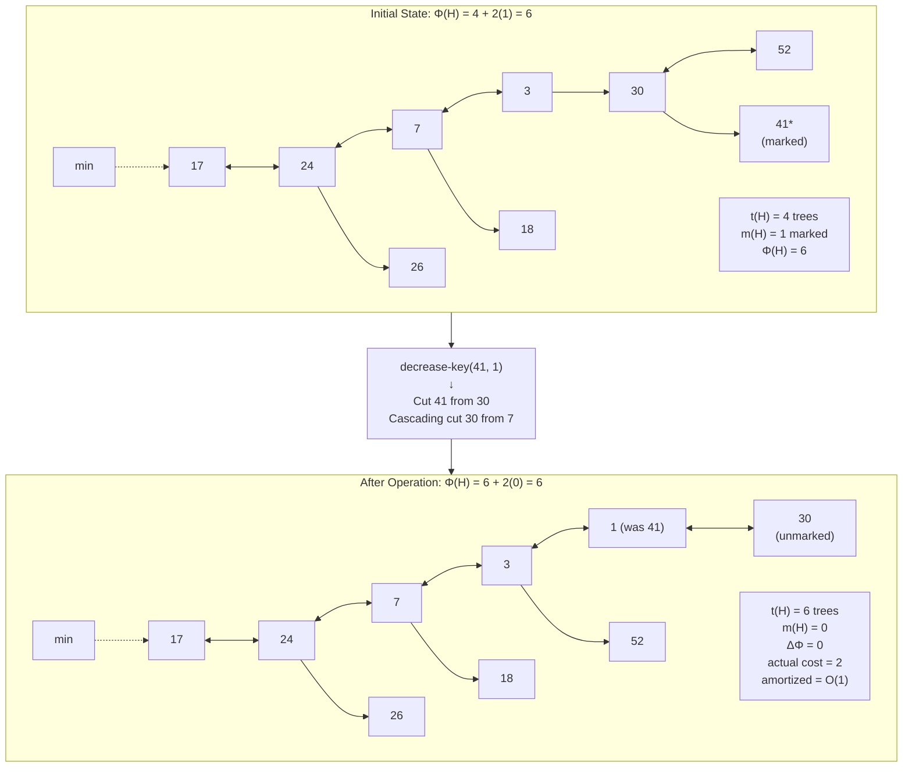

# Lesson 1: Amortized Analysis with Potential Method

## 1. First-Principles Intuition & Invariants

The central tension in algorithm analysis is the gap between worst-case and typical behavior. A single call to `push` on a dynamic array costs $O(n)$ when it triggers a resize, yet no practitioner treats dynamic arrays as slow. The reason is that the expensive call is not merely rare — it is *causally coupled* to a long prior sequence of cheap calls that made it possible. Worst-case analysis, applied naively operation by operation, refuses to see this coupling. Amortized analysis exists precisely to formalize it.

The word "amortized" is borrowed from accounting: a business does not expense the full cost of a building in the year it is purchased; it spreads that cost over the building's productive life. The same logic applies to data structure operations. If a sequence of $n$ operations on a structure costs $T(n)$ in total, the amortized cost per operation is $T(n)/n$, regardless of how unevenly that total is distributed across individual calls. What makes this powerful is that the guarantee is about the *sequence*, not any single operation. For algorithm designers, this is precisely the right frame: users of a data structure issue sequences of operations, and their programs run to completion — they do not stall mid-sequence when one operation is expensive.

There are three canonical techniques for establishing amortized bounds: aggregate analysis, the accounting method, and the potential method. They are logically equivalent — any bound provable by one is provable by the others — but they differ in the cognitive machinery they require and the kind of intuition they expose.

**Aggregate analysis** is the most direct. You compute the exact total cost $\sum_{i=1}^n c_i$ of an adversarially chosen sequence of $n$ operations, then divide by $n$. The elegance is in its honesty: no abstraction, just a closed-form sum and a division. For the binary counter — where incrementing a $k$-bit counter flips all trailing ones to zero plus one more bit — the total number of bit flips across $n$ increments is $\sum_{i=0}^{\lfloor \log_2 n \rfloor} \lfloor n / 2^i \rfloor < 2n$, giving amortized cost $O(1)$ per increment. The proof is clean, but aggregate analysis scales poorly in complexity: for structures with multiple interacting operation types, tracking the global sum becomes unwieldy. You cannot, for example, easily apply it to splay trees or Fibonacci heaps, where the cost of one operation type interacts non-trivially with the state left by another.

**The accounting method** introduces a currency metaphor. Each operation is assigned an *amortized charge* $\hat{c}_i$, which may exceed or fall below its actual cost $c_i$. The difference $\hat{c}_i - c_i$ represents credit deposited into or withdrawn from a bank account maintained by the data structure. The invariant is that the account balance never goes negative: $\sum_{i=1}^t (\hat{c}_i - c_i) \geq 0$ for all prefixes of the sequence. This guarantees that $\sum_{i=1}^n \hat{c}_i \geq \sum_{i=1}^n c_i$, so the sum of amortized charges upper-bounds total actual cost. The accounting method demands that credit be prepaid and physically "stored" at specific locations in the structure — a slot in an array, a node in a tree — ready to be spent when that location participates in a future expensive operation. This locality of credit assignment is what makes the method intuitive but also slightly informal: the analyst must argue clearly about where credit lives and how it is consumed.

**The potential method** is the accounting method made rigorous through the language of real-valued functions. Rather than tracking credit at individual locations, it defines a single scalar *potential function* $\Phi: \mathcal{D} \to \mathbb{R}$ mapping the state of the data structure to a real number. The potential encodes, in one quantity, all the "stored work" in the structure at any moment. The amortized cost of the $i$-th operation is defined as:

$$\hat{c}_i = c_i + \Phi(D_i) - \Phi(D_{i-1})$$

where $D_i$ denotes the state of the structure after the $i$-th operation. This is a definition, not a constraint — but the constraint comes immediately by telescoping. Summing over all $n$ operations:

$$\sum_{i=1}^n \hat{c}_i = \sum_{i=1}^n c_i + \Phi(D_n) - \Phi(D_0)$$

so

$$\sum_{i=1}^n c_i = \sum_{i=1}^n \hat{c}_i - \Phi(D_n) + \Phi(D_0)$$

If we ensure $\Phi(D_i) \geq \Phi(D_0)$ for all $i$ — equivalently, if the potential never drops below its initial value — then $-\Phi(D_n) + \Phi(D_0) \leq 0$, and we obtain:

$$\sum_{i=1}^n c_i \leq \sum_{i=1}^n \hat{c}_i$$

The total actual cost is at most the total amortized cost. This is the fundamental inequality of the potential method. It converts a global statement about total cost into a local condition: bound $\hat{c}_i$ for each operation individually, verify $\Phi \geq \Phi(D_0)$, and the amortized bound follows automatically.

The art of the potential method lies entirely in choosing $\Phi$. The function must be large when the structure is "primed for an expensive operation" and small otherwise, so that expensive operations draw down potential (paying for their own cost) while cheap operations build it back up. A potential that is always zero gives $\hat{c}_i = c_i$, which recovers nothing. A potential that grows without bound inflates the amortized charges without reflecting true work. The correct $\Phi$ is one that tracks precisely the quantity of deferred work embedded in the structure — and identifying that quantity requires genuine structural insight into the data structure at hand.

The two invariants that must hold for any valid potential function are: $\Phi(D_0) = 0$ (or any fixed lower bound, by convention taken to be zero after normalization) and $\Phi(D_i) \geq 0$ for all $i \geq 0$. Under these conditions, $\Phi(D_n) \geq 0 = \Phi(D_0)$, satisfying the requirement. Any positive-valued function anchored at zero satisfies these invariants structurally; the analytical challenge is to construct one that also makes $\hat{c}_i = O(f(n))$ for the desired bound $f$.

---

## 2. Core Architecture & Mechanics

### Dynamic Arrays: Potential as Stored Excess Capacity

The dynamic array — called `ArrayList` in Java, `std::vector` in C++, `list` in Python — maintains a contiguous buffer of capacity $m$ holding $n \leq m$ elements. A `push_back` that finds $n < m$ costs $\Theta(1)$: write the element and increment the counter. A `push_back` that finds $n = m$ must allocate a new buffer of size $2m$, copy all $n$ elements, and then write the new element, costing $\Theta(n)$. The question is whether this $\Theta(n)$ spike can be absorbed into an $O(1)$ amortized bound.

Define the potential function as:

$$\Phi(D) = 2n - m$$

where $n$ is the number of elements currently stored and $m$ is the current buffer capacity. After initialization with $n = 0, m = 1$, we have $\Phi(D_0) = 0$. The invariant $\Phi \geq 0$ holds because a correctly managed dynamic array always satisfies $n \geq m/2$ (every resize doubles the buffer, and no subsequent deletions are considered here): when the array is exactly half full after a resize, $n = m/2$, so $\Phi = 2(m/2) - m = 0$; as elements are added, $n$ grows toward $m$ and $\Phi$ grows toward $m = 2n - \Phi$, confirming $\Phi \geq 0$ throughout.

**Case 1: No resize.** The actual cost is $c_i = 1$. After the push, $n' = n + 1$ and $m' = m$. The potential change is:

$$\Delta\Phi = \Phi(D_i) - \Phi(D_{i-1}) = (2(n+1) - m) - (2n - m) = 2$$

The amortized cost is:

$$\hat{c}_i = 1 + 2 = 3$$

**Case 2: Resize triggers.** Here $n = m$ before the push. The actual cost is $c_i = n + 1$ (copying $n$ elements plus the new write). After the push, $n' = n + 1$ and $m' = 2m = 2n$. The potential change is:

$$\Delta\Phi = (2(n+1) - 2n) - (2n - n) = 2 - n$$

The amortized cost is:

$$\hat{c}_i = (n + 1) + (2 - n) = 3$$

In both cases, the amortized cost is exactly $3 = O(1)$. The potential function $2n - m$ measures how much deferred work is stored in the array: each of the $m/2$ elements added since the last resize has deposited 2 units of potential, and the resize spends all of it at once. The balance sheet clears perfectly.

```mermaid
flowchart TD
    A["State Before Push<br/>No Resize"]
    B["Array: e1 | e2 | e3 | e4 | __ | __ | __ | __"]
    C["n=4, m=8"]
    D["Φ = 2(4) - 8 = 0"]
    
    E["After Push"]
    F["Array: e1 | e2 | e3 | e4 | e5 | __ | __ | __"]
    G["n=5, m=8"]
    H["Φ = 2(5) - 8 = 2"]
    I["ΔΦ = +2"]
    J["Actual Cost = 1"]
    K["Amortized Cost = 3"]
    
    L["State Before Push<br/>Resize Required"]
    M["Array: e1 | e2 | e3 | e4"]
    N["n=4, m=4"]
    O["Φ = 2(4) - 4 = 4"]
    
    P["Resize Operation"]
    Q["Allocate m'=8"]
    R["Copy 4 Elements"]
    S["Write e5"]
    
    T["After Resize"]
    U["Array: e1 | e2 | e3 | e4 | e5 | __ | __ | __"]
    V["n=5, m=8"]
    W["Φ = 2(5) - 8 = 2"]
    X["ΔΦ = 2 - 4 = -2"]
    Y["Actual Cost = 5"]
    Z["Amortized Cost = 3"]
    
    A --> B --> C --> D
    D --> E --> F --> G --> H
    H --> I --> J --> K
    
    K -.->|contrast| L
    L --> M --> N --> O
    O --> P
    P --> Q --> R --> S
    S --> T --> U --> V --> W
    W --> X --> Y --> Z
```



### Splay Trees: Potential as Total Rank

A splay tree is a self-adjusting binary search tree that moves every accessed node to the root through a sequence of rotations called *splaying*. It offers no worst-case per-operation guarantee — a single access can cost $O(n)$ — but it achieves $O(\log n)$ amortized cost per operation over any sequence. The proof of this bound, due to Sleator and Tarjan (1985), is one of the most instructive applications of the potential method in all of data structure theory.

For a splay tree on $n$ nodes, define the *size* $s(x)$ of a node $x$ as the number of nodes in the subtree rooted at $x$ (including $x$ itself), and define the *rank* of $x$ as:

$$r(x) = \lfloor \log_2 s(x) \rfloor$$

The potential function is the sum of ranks over all nodes:

$$\Phi(T) = \sum_{x \in T} r(x)$$

This potential is nonnegative for any tree and equals zero only when every node has $s(x) = 1$, i.e., the tree is a single node. For a tree of $n$ nodes, the potential is at most $n \lfloor \log_2 n \rfloor$, since each rank is at most $\lfloor \log_2 n \rfloor$.

The splay operation restructures the tree through three rotation cases. In each case, the goal of the analysis is to bound the amortized cost $\hat{c}_i = c_i + \Delta\Phi$ of the rotation in terms of $r'(x) - r(x)$, where $r(x)$ is the rank of the splayed node $x$ before the rotation and $r'(x)$ is its rank after. The key lemma, known as the **Access Lemma**, states:

**Lemma (Sleator-Tarjan Access Lemma).** The amortized cost of splaying a node $x$ to the root of a tree rooted at $t$ is at most $3(r(t) - r(x)) + 1$.

The proof proceeds by induction on the number of splay steps, analyzing each of the three cases — zig, zig-zig, and zig-zag — individually and using the concavity of the logarithm to absorb the rotation costs into the rank difference. The critical algebraic step exploits the fact that for any two nodes $a$ and $b$ with $s(a) + s(b) \leq s(c)$, the inequality $r(a) + r(b) \leq 2r(c) - 2$ holds (since $\log_2 s(a) + \log_2 s(b) \leq 2\log_2 s(c) - 2$ whenever $s(a) + s(b) \leq s(c)$ and both sizes are at least 1, by AM-GM on the logarithm).

Since $r(t) \leq \lfloor \log_2 n \rfloor$ and $r(x) \geq 0$, the access lemma gives an amortized cost of at most $3\lfloor \log_2 n \rfloor + 1 = O(\log n)$ per splay. The total actual cost of $m$ operations on an $n$-node tree is then at most:

$$\sum_{i=1}^m \hat{c}_i + \Phi(T_0) - \Phi(T_m) \leq 3m\log_2 n + m + n\log_2 n$$

which is $O((m + n)\log n)$, confirming the $O(\log n)$ amortized bound per operation.

The rank potential has a compelling structural interpretation. High potential means the tree has many deep nodes with large subtrees — precisely the shape in which future access patterns will be expensive. The splay operation, by moving the accessed node to the root and partially rebalancing the tree, dissipates this potential. It is not attempting to maintain balance for balance's sake; it is converting structural disorder (high potential) into actual work, in a way that the potential method makes quantitatively precise.

```text
Zig-Zig case: x is left child of p, p is left child of g

Before splay step:          After splay step:

        g                         x
       / \                       / \
      p   D                     A   p
     / \           →               / \
    x   C                         B   g
   / \                                / \
  A   B                              C   D

Rank changes:
  r'(g) ≤ r(g)      (g's subtree shrinks or stays)
  r'(p) ≤ r'(x)     (p becomes child of x)
  r'(x) = r(g)      (x inherits g's subtree)

Amortized cost of zig-zig ≤ 3(r'(x) - r(x))
```

### Fibonacci Heaps: Potential as Structural Debt

Fibonacci heaps, introduced by Fredman and Tarjan (1987), achieve the asymptotic bounds that make Dijkstra's shortest-path algorithm run in $O(E + V \log V)$ time. The key operation is `decrease-key`, which runs in $O(1)$ amortized time — a bound that binary and binomial heaps cannot achieve. The price is structural complexity: a Fibonacci heap is a collection of heap-ordered trees with a lazy consolidation discipline that defers cleanup until `extract-min` is called.

A Fibonacci heap $H$ maintains a doubly-linked list of heap-ordered trees (the "root list") and a pointer to the minimum root. Nodes can be *marked*, meaning they have lost one child since the last time they were made a child of another node. The potential function is:

$$\Phi(H) = t(H) + 2m(H)$$

where $t(H)$ is the number of trees in the root list and $m(H)$ is the number of marked nodes. The coefficient 2 is deliberate: cutting a marked node costs 1 real unit of work but gains 2 units of potential reduction (unmarking it and adding it to the root list changes $m$ by $-1$ and $t$ by $+1$, for a net potential change of $-2 + 1 = -1$), which is enough to pay for the cut.

The amortized costs of the core operations are:

**Insert:** A new tree containing one node is added to the root list at cost $c_i = O(1)$. The potential increases by 1 (one new tree, no new marks). Amortized cost: $O(1) + 1 = O(1)$.

**Union:** Two root lists are concatenated in $O(1)$ actual time with no change to potential. Amortized cost: $O(1)$.

**Extract-min:** The minimum root is removed, its children are added to the root list, and then the root list is *consolidated* — a process that links together trees of equal degree until all trees have distinct degrees. If there are $t$ trees before the extraction and the extracted node had $k$ children, then before consolidation the root list has $t + k - 1$ trees. The consolidation process performs at most $t + k - 1 + D(n)$ linking steps (where $D(n) = O(\log n)$ is the maximum degree of any node in an $n$-node Fibonacci heap, proven via the Fibonacci number growth rate of subtree sizes). After consolidation, the root list has at most $D(n) + 1$ trees. The actual cost is $O(t + k + \log n)$; the potential decreases from $t + 2m$ to at most $(D(n) + 1) + 2m$, so $\Delta\Phi \leq D(n) + 1 - t$. The amortized cost is $O(t + k + \log n) + D(n) + 1 - t = O(\log n)$ once the $t$ terms cancel.

**Decrease-key on node $x$:** If decreasing $x$'s key does not violate the heap order, only $O(1)$ work is needed to update and possibly move the minimum pointer. If it does violate heap order, $x$ is *cut* from its parent $p$ and added to the root list. If $p$ was already marked, a *cascading cut* propagates upward: $p$ is itself cut from its parent, and so on until an unmarked node or the root is reached. Suppose $c$ cascading cuts occur. The actual cost is $O(c)$. Each cut adds one tree to the root list ($+1$ potential per cut) and unmarks a node ($-2$ potential per cut after the first), giving $\Delta\Phi \leq c \cdot (1 - 2) + 2 = -c + 2$ (the final cut marks $p$'s parent if it was unmarked, adding $+2$; prior nodes are unmarked for a net of $-1$ each). The amortized cost is $O(c) + (-c + 2) = O(1)$.

The structure of this analysis illustrates the full power of the potential method: the actual cost of `decrease-key` varies from $O(1)$ to $O(n)$ in the worst case depending on cascading cuts, yet the potential function $\Phi = t + 2m$ precisely absorbs this variance. The 2 in front of $m$ is not arbitrary — it is the unique coefficient that makes the cascade's potential drop offset its actual cost exactly. Any smaller coefficient fails to cover the work; any larger coefficient inflates the amortized bound on `extract-min`.



---

## 3. High-Performance Optimization & Failure Modes

### Choosing the Right Potential Function: Structure Governs Form

The most common failure in an amortized analysis is not algebraic error but conceptual mismatch: the potential function does not track the quantity that actually defers work. For dynamic arrays, the deferred work is the number of elements that will need to be copied on the next resize — this is exactly what $2n - m$ measures, since it equals zero right after a resize and climbs to $n$ by the time the next one occurs. If you chose $\Phi = n - m/2$ instead, you would find that the amortized cost of a resize is $n + 1 + (n+1 - n) = n + 2$, which is not $O(1)$ — the function is too weak to absorb the spike.

The pathology for splay trees is symmetric. The rank-based potential $\Phi = \sum r(x)$ works because rank measures the subtree size, which determines how expensive a future access through a given node might be. A naive choice like $\Phi = \text{depth}(last\_accessed)$ fails because it tracks only the last operation's cost, not the global structural disorder that influences the entire future sequence.

For Fibonacci heaps, the coefficient 2 in $\Phi = t + 2m$ is load-bearing. The factor of 2 pays simultaneously for the actual work of a cascade cut ($O(1)$ per cut) and for the potential increase from adding the cut node to the root list. If you use $\Phi = t + m$, then a cascade of $c$ cuts produces $\Delta\Phi \leq c(1 - 1) + 1 = 1$ (each cut adds a tree and removes a mark, netting 0, but the final cut marks the surviving parent, adding 1), and the amortized cost is $O(c) + 1 = O(c)$ rather than $O(1)$ — the cascade is no longer absorbed.

A systematic approach to potential design proceeds in reverse: determine the amortized cost $\hat{c}$ you want to prove, write $\hat{c} = c + \Delta\Phi$, then solve for the $\Delta\Phi$ required in each case, and ask what global quantity $\Phi$ would change by that amount. For dynamic arrays, you want $\hat{c} = 3$, actual cost of resize is $n+1$, so you need $\Delta\Phi = 3 - (n+1) = 2 - n$ during a resize. Since $n$ decreases to $n+1 - n = 1$ element above the halfway mark after a resize doubles capacity, the needed drop is exactly $n - 2$ — suggesting $\Phi$ should equal roughly $2 \cdot (\text{excess above half-capacity})$. Working this out algebraically recovers $\Phi = 2n - m$.

### Interaction Between Operations: State Dependency and Adversarial Sequences

A critical correctness requirement for any amortized analysis is that the potential function remain valid across all interleavings of operation types. For a data structure supporting both insertion and deletion, this is non-trivial. Consider a dynamic array that also supports `pop_back`. The natural potential $\Phi = 2n - m$ works for insertions, but deletions present a hazard: if `pop_back` shrinks the array by halving its capacity when $n$ drops to $m/4$, then the potential just before the shrink is $2(m/4) - m = -m/2$, which is negative. The invariant $\Phi \geq 0$ is violated.

The fix requires either using a different potential for the shrink regime or switching to a two-sided potential that is always nonneg. A clean resolution is to separate the analysis into phases: define $\Phi = 2n - m$ when $n \geq m/2$ (the "growth phase") and $\Phi = m/2 - n$ when $n < m/2$ (the "shrink phase"), both of which are nonnegative by construction. The combined function:

$$\Phi(D) = \begin{cases} 2n - m & \text{if } n \geq m/2 \\ m/2 - n & \text{if } n < m/2 \end{cases}$$

satisfies $\Phi \geq 0$ throughout. Working through both cases confirms $O(1)$ amortized cost for both `push_back` and `pop_back` under this two-threshold regime. The lesson is that potential functions are not universal: they are designed relative to the full operation set of the structure, and adding operations requires revisiting the design.

For splay trees, the concern is not potential negativity but potential inflation. The rank-sum potential $\Phi = \sum r(x)$ can be as large as $n \log n$ for an $n$-node tree. This means that a single call to `delete-all` or a mass restructuring could incur an amortized debt proportional to $n \log n$, dwarfing the actual work. In practice, this means that operations which fundamentally restructure the tree — merging two splay trees, for instance — must be analyzed with care, accounting for the full potential of both input trees and the output tree. The amortized bound for splay tree `join` is $O(\log n)$, but only after the potential of both input trees is included as part of the charge.

### Lazy Evaluation and the Risk of Deferred Cascades

Fibonacci heaps demonstrate the most extreme form of deferred work: `extract-min` bears the consolidation cost of all previous insertions and decrease-key operations. In practice, an adversary who repeatedly calls `insert` without ever calling `extract-min` builds up a root list of $t$ trees, then forces a single `extract-min` to do $\Theta(t)$ work. The amortized analysis guarantees that this is $O(\log n)$ *per operation in the sequence* — but only when the full sequence is considered. A partial sequence that ends with `insert` calls has artificially low actual cost and high potential; a partial sequence ending with `extract-min` pays down that potential. This is not a failure of the structure but of the analysis frame: amortized bounds are statements about complete sequences, and reporting only the cost of the last operation in isolation can be misleading.

This subtlety matters in real systems. A graph algorithm that calls `decrease-key` millions of times and then calls `extract-min` $V$ times incurs the full $O(V \log V + E)$ bound predicted by the amortized analysis. But a scheduler that uses a Fibonacci heap with an adversarial mix of inserts and extract-mins, where the extract-mins cluster, may see transient latency spikes that the amortized bound does not prevent. For latency-sensitive systems, the right tool may be a structure with a true worst-case $O(\log n)$ per operation, such as a rank-pairing heap or a strict Fibonacci heap, which achieves the same asymptotic amortized bounds with a bounded worst-case by eagerly maintaining structure invariants.

### The Formal Sufficiency Condition and Its Proof Obligation

It bears restatement that the potential method produces an *upper bound* on total cost, not an exact count. The inequality:

$$\sum_{i=1}^n c_i \leq \sum_{i=1}^n \hat{c}_i$$

holds only when $\Phi(D_n) \geq \Phi(D_0)$. The proof obligation is therefore to verify not just that each $\hat{c}_i$ is bounded, but that $\Phi$ never drops below its initial value. For all three structures analyzed here — dynamic arrays, splay trees, and Fibonacci heaps — this verification is built into the potential design: $2n - m \geq 0$ because $n \geq m/2$ post-resize; $\sum r(x) \geq 0$ trivially since ranks are nonneg; and $t + 2m \geq 0$ trivially since both terms are nonneg. When this verification is omitted, the analysis is formally incomplete and may conceal a scenario where the total actual cost exceeds the sum of amortized charges.

A common pedagogical shortcut is to initialize the data structure so that $\Phi(D_0) = 0$ and to verify $\Phi(D_i) \geq 0$ for all $i$. These two conditions together imply $\Phi(D_n) \geq 0 = \Phi(D_0)$, satisfying the sufficiency condition without tracking the global minimum of $\Phi$ over the sequence. This is the standard approach used in all three analyses above, and it is both sound and minimal — no additional proof work is needed beyond checking nonnegativity.

The final insight is that the potential method, properly applied, transforms an apparently global question ("what is the total cost of this sequence?") into a local one ("what is the amortized cost of this single operation given this potential function?"). Every amortized analysis in this lesson reduces to computing one expression — $\hat{c}_i = c_i + \Delta\Phi$ — and bounding it by a constant or logarithm. The sophistication lies in constructing the $\Phi$ that makes this local bound tight; once that choice is made, the global bound follows by arithmetic. This algebraic discipline is what distinguishes amortized analysis from heuristic reasoning about "average" performance, and it is the foundation on which the rest of this course's data structures will be built.
