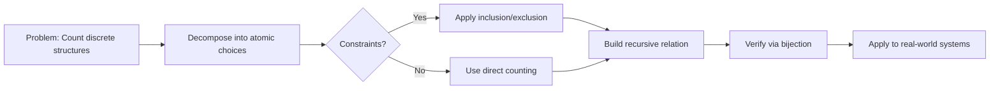

# Foundation: Combinatorics

## 1. Conceptual Mental Model (Core intuition, analogies, and first principles)

Combinatorics is the **science of counting and structuring discrete objects**—not about *what* exists, but *how many ways* things can be arranged, selected, or transformed under constraints. Think of it as the **logic of discrete choice**: when faced with a problem asking "how many possibilities exist?", combinatorics provides the framework to decompose the problem into atomic decisions and count them without enumeration.

**Core intuition**:  
> *Counting is a form of structural reasoning*.  
> When you ask "how many 3-digit numbers use digits 1–5 without repetition?", you’re not listing all 120 possibilities (5×4×3). Instead, you decompose the problem into **three sequential choices** (hundreds, tens, units place), each constrained by prior selections. This is the essence of combinatorial *construction*.

**Analogy**:  
Imagine building a house from Lego blocks. Combinatorics asks: *"How many distinct houses can be built using 10 red blocks and 5 blue blocks?"*  
- **First principle**: *Each block placement is a discrete choice* (e.g., "place red block at base").  
- **Second principle**: *Constraints propagate* (e.g., "only 3 blue blocks can be used in the roof").  
- **Third principle**: *Counting is iterative* (e.g., "choose base → choose roof → count combinations").

**Why this matters**:  
Combinatorics bridges **logic** (proving existence via counting) and **computation** (algorithm design). It answers *existence questions* (e.g., "Does a valid 5x5 Sudoku exist?") by counting valid configurations.

---

## 2. Essential Terminology & Taxonomy

| Term              | Definition & Core Purpose                                                                 | Example                                  |
|--------------------|----------------------------------------------------------------------------------------|-------------------------------------------|
| **Permutation**     | Arrangement of distinct objects where **order matters**. Counts *ordered* selections.      | `P(n,k) = n! / (n-k)!` (e.g., 3! = 6 ways to order 3 books) |
| **Combination**     | Selection of objects where **order does not matter**. Counts *unordered* subsets.         | `C(n,k) = n! / (k!(n-k)!)` (e.g., 3C2 = 3 ways to choose 2 books) |
| **Set**             | Fundamental discrete structure: unordered collection of distinct elements.                | `{1,2,3}` (no duplicates, no order)       |
| **Subset**          | A set whose elements are all contained within another set.                              | `{1,2} ⊂ {1,2,3}`                       |
| **Partition**       | A division of a set into **disjoint, non-empty subsets** whose union is the original set. | `{ {1}, {2,3} }` is a partition of `{1,2,3}` |
| **Recurrence**      | A relation defining a sequence via previous terms (e.g., `C(n,k) = C(n-1,k) + C(n-1,k-1)`). | Pascal’s triangle for combinations       |

> 💡 **Key distinction**: Permutations count *arrangements* (order matters); combinations count *selections* (order irrelevant). This dichotomy arises from whether the problem’s constraints treat sequences as distinct.

---

## 3. Architecture & Core Workflow

**Workflow Explanation**:  
1. **Problem decomposition**: Break the problem into sequential choices (e.g., "choose first element → choose second element").  
2. **Constraint handling**: Address restrictions (e.g., no repetition, fixed subsets) via inclusion-exclusion or recursion.  
3. **Recursive construction**: Use recurrence relations (e.g., `C(n,k) = C(n-1,k) + C(n-1,k-1)`) to build solutions from smaller cases.  
4. **Bijection verification**: Confirm the count is exact by establishing a one-to-one correspondence with a known structure (e.g., subsets ↔ binary strings).  
5. **Application**: Translate to real systems (e.g., network paths, cryptographic keys).

> This workflow ensures combinatorial arguments are *constructive*—not just theoretical but *buildable*.

---

## 4. Common Misconceptions & Mental Traps

| Misconception                          | Why It Happens                                                                 | How to Avoid It                                  |
|----------------------------------------|------------------------------------------------------------------------------|--------------------------------------------------|
| **"Permutations and combinations are the same"** | Confusing *order* in selection (e.g., thinking `P(3,2)=6` equals `C(3,2)=3`). | Ask: *"Does the problem care about sequence?"* (e.g., "Who wins the race?" → permutation; "Who is on the team?" → combination). |
| **"Recurrences always solve problems faster"** | Overreliance on recursion without checking base cases (e.g., `C(n,0)=1` but `C(0,0)` is undefined). | Always verify edge cases (e.g., `n=0`, `k=0`) before recursion. |
| **"Counting subsets ignores empty sets"** | Forgetting that `∅` is a valid subset (e.g., `C(n,0)=1` but students often skip it). | Explicitly state: *"All subsets, including the empty set."* |

> ⚠️ **Critical trap**: **Overcounting** occurs when choices are *not independent* (e.g., counting "teams" where team members are chosen *without* considering team order). Always check for *independent selection*.

---

## 5. Socratic Discussion Starters

1. **Why do combinatorial proofs often rely on bijections rather than direct counting?**  
   *(Probe: How does a bijection ensure the count is exact? What happens if the mapping isn’t one-to-one?)*

2. **If permutations count ordered selections, why do we need combinations for unordered selections? Can you construct a problem where *only* permutations would apply?**  
   *(Probe: What makes "order" meaningful in the problem? How does this relate to real-world constraints?)*

3. **How does recursion in combinatorics (e.g., Pascal’s triangle) mirror mathematical induction?**  
   *(Probe: What is the base case? How does the recurrence step validate the next case?)*

These questions force deep engagement with the *why* behind combinatorial mechanics—not just the "how" of counting. They connect combinatorics to the broader philosophy of formal logic: **counting is a form of structural proof**.
