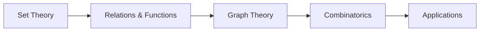

# Beginner Foundation: Discrete Mathematics
=====================================================

## 1. Everyday Intuition & First Principles
------------------------------------------

Discrete mathematics is the study of mathematical structures that are fundamentally discrete, meaning they are made up of individual, distinct elements rather than continuous values. Think of it like a game where you have a set of rules, and each rule applies to a specific, countable situation.

Imagine you're planning a party. You have a list of guests, each with their own preferences and dietary restrictions. You need to decide who to invite, what food to serve, and how to arrange the seating. This is a discrete problem because you're dealing with individual guests, not a continuous spectrum of people.

Discrete math helps us understand and solve problems like this by providing a framework for reasoning about individual elements and their relationships.

## 2. Foundational Vocabulary & Glossary
-----------------------------------------

### 2.1 Set Theory

*   **Set**: A collection of unique elements, denoted by curly braces `{ }`.
*   **Element**: A single item within a set.
*   **Subset**: A set whose elements are all contained within another set.
*   **Union**: The combination of two or more sets, eliminating duplicates.
*   **Intersection**: The set of elements common to two or more sets.

Example: `{1, 2, 3}` is a set with three elements. `{2, 3}` is a subset of `{1, 2, 3}`.

### 2.2 Relations & Functions

*   **Relation**: A set of ordered pairs that describe a connection between elements.
*   **Function**: A relation where each input corresponds to exactly one output.
*   **Domain**: The set of input values for a function.
*   **Range**: The set of output values for a function.

Example: The relation `{(1, 2), (2, 3), (3, 1)}` describes a connection between elements. The function `f(x) = x^2` has a domain of `{1, 2, 3}` and a range of `{1, 4, 9}`.

### 2.3 Graph Theory

*   **Graph**: A collection of nodes (vertices) connected by edges.
*   **Vertex**: A node in a graph.
*   **Edge**: A connection between two vertices.
*   **Path**: A sequence of edges connecting vertices.

Example: A social network can be represented as a graph, where each person is a vertex and friendships are edges.

### 2.4 Combinatorics

*   **Permutation**: An arrangement of elements in a specific order.
*   **Combination**: A selection of elements without regard to order.
*   **Binomial Coefficient**: The number of ways to choose k elements from a set of n.

Example: There are 6 permutations of the set `{1, 2, 3}`: `{1, 2, 3}`, `{1, 3, 2}`, `{2, 1, 3}`, `{2, 3, 1}`, `{3, 1, 2}`, and `{3, 2, 1}`.

## 3. Visual System Flow
-------------------------

Here's a high-level overview of the basic workflow in discrete mathematics:

This flowchart illustrates how the different areas of discrete math are interconnected and build upon one another.

## 4. Common Beginner Misconceptions & Mental Traps
---------------------------------------------------

*   **Confusing discrete with continuous**: Remember that discrete math deals with individual, countable elements, not continuous values.
*   **Overlooking the importance of notation**: Use clear, consistent notation to avoid confusion and ensure accurate communication.
*   **Failing to visualize problems**: Use diagrams and flowcharts to help you understand and solve problems.

## 5. Socratic Discussion Starters
---------------------------------

*   What is the difference between a set and a relation?
*   Can you think of a real-world example of a function?
*   How would you represent a social network using graph theory?
*   What is the significance of the binomial coefficient in combinatorics?

These discussion starters will help you explore the basics of discrete mathematics and develop a deeper understanding of the subject.
