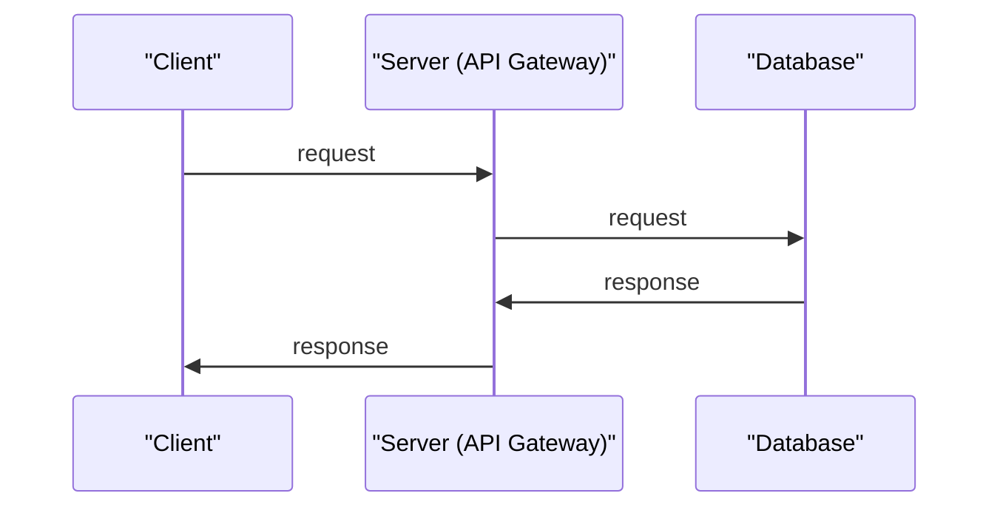

# Intermediate Foundation: Discrete Mathematics
==============================================

## 1. Architectural Mental Model
-----------------------------

### 1.1. Set Theory and Relations

*   **Set Operations**: Understand the implications of set union, intersection, and difference on data structures and algorithms.
*   **Relations and Functions**: Formalize the concept of relations and functions, and how they are used to model real-world systems.
*   **Equivalence Relations and Partitions**: Apply equivalence relations to partition sets and understand the resulting equivalence classes.

### 1.2. Graph Theory

*   **Graph Representations**: Understand the trade-offs between adjacency matrix and adjacency list representations.
*   **Graph Traversal**: Implement depth-first search (DFS) and breadth-first search (BFS) algorithms.
*   **Graph Algorithms**: Familiarize yourself with Dijkstra's algorithm, Bellman-Ford algorithm, and Prim's algorithm.

### 1.3. Combinatorics

*   **Permutations and Combinations**: Understand the difference between permutations and combinations, and how to calculate them.
*   **Recurrence Relations**: Learn to solve recurrence relations using the master theorem and other techniques.
*   **Generating Functions**: Familiarize yourself with generating functions and their applications in combinatorics.

## 2. Systems Taxonomy & Component Protocols
------------------------------------------

### 2.1. Data Structures

*   **Arrays and Linked Lists**: Understand the trade-offs between arrays and linked lists, and how to implement them efficiently.
*   **Stacks and Queues**: Implement stacks and queues using arrays and linked lists.
*   **Trees and Graphs**: Understand the properties and operations of trees and graphs.

### 2.2. Algorithms

*   **Sorting Algorithms**: Implement bubble sort, selection sort, and insertion sort.
*   **Searching Algorithms**: Implement linear search and binary search.
*   **Graph Algorithms**: Familiarize yourself with graph traversal algorithms and shortest path algorithms.

### 2.3. Formal Taxonomies

*   **Category Theory**: Understand the basics of category theory, including functors, natural transformations, and limits.
*   **Type Theory**: Familiarize yourself with type theory, including type systems and type inference.

## 3. Multi-Component Interaction Flow
--------------------------------------

### 3.1. ASCII Sequence Diagram

```
+---------------+
|  Client      |
+---------------+
      |
      |  request
      v
+---------------+
|  Server      |
|  (API Gateway)|
+---------------+
      |
      |  response
      v
+---------------+
|  Database    |
+---------------+
```

### 3.2. Mermaid Sequence Diagram



## 4. Architectural Trade-offs & Production Pitfalls
---------------------------------------------------

*   **Scalability**: Understand the trade-offs between horizontal and vertical scaling.
*   **Performance**: Learn to optimize database queries and API responses.
*   **Security**: Familiarize yourself with common security vulnerabilities and how to mitigate them.

## 5. Socratic Discussion Starters
----------------------------------

*   **How would you design a system to handle high concurrency?**
*   **What are the trade-offs between using a relational database versus a NoSQL database?**
*   **How would you implement a caching layer to improve system performance?**

These discussion starters are designed to encourage critical thinking and exploration of real-world systems. They can be used to facilitate Socratic discussions and debates among engineers and practitioners.
