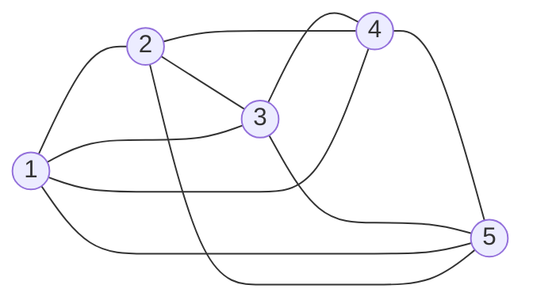

# Lesson 4: Graph Theory, Connectivity, Trees

## 1. First-Principles Intuition & Invariants

Few mathematical structures have proven as universally generative as the graph. At first encounter, a graph appears almost embarrassingly simple: a collection of objects, some of which are related to one another. Yet this apparent simplicity conceals a combinatorial richness that underlies the routing of internet packets, the scheduling of university examinations, the synthesis of chemical compounds, and the analysis of social influence networks. The power of graph theory lies precisely in this abstraction: by stripping a problem down to its relational skeleton, we expose structure that would remain invisible inside any domain-specific representation.

We define a graph formally as an ordered pair $G = (V, E)$, where $V$ is a nonempty set of vertices (also called nodes) and $E \subseteq \binom{V}{2}$ is a set of edges, each of which is a two-element subset $\{u, v\}$ of $V$. This definition captures undirected graphs. When direction matters, we instead allow $E \subseteq V \times V$, producing a directed graph or digraph, in which each edge $(u, v)$ carries an arrow from $u$ to $v$ and is distinct from $(v, u)$. When edges carry numerical values representing cost, capacity, or distance, we obtain a weighted graph via a weight function $w : E \to \mathbb{R}$.

### The Handshaking Lemma and Degree Sequences

Every vertex $v \in V$ has a degree, written $\deg(v)$, equal to the number of edges incident to it. In a digraph, we distinguish the in-degree $\deg^-(v)$ from the out-degree $\deg^+(v)$. One of the most elementary but structurally significant results in graph theory is the Handshaking Lemma, which states that for any undirected graph $G = (V, E)$,

$$\sum_{v \in V} \deg(v) = 2|E|.$$

The proof is immediate: each edge $\{u, v\}$ contributes exactly $1$ to $\deg(u)$ and $1$ to $\deg(v)$, so it is counted exactly twice in the global degree sum. The corollary that follows is of constant practical use: in any graph, the number of vertices of odd degree must be even. No combinatorial reasoning can produce a degree sequence that violates this parity constraint, and any algorithm purporting to build a graph with an odd number of odd-degree vertices contains a logical error.

A sequence of nonnegative integers $(d_1, d_2, \ldots, d_n)$ is called graphic if there exists a simple graph (no loops, no multiple edges) realizing it as a degree sequence. The Erdős–Gallai theorem provides a necessary and sufficient condition: the sequence $d_1 \ge d_2 \ge \cdots \ge d_n$ is graphic if and only if the sum $\sum_{i=1}^n d_i$ is even and for each $k \in \{1, \ldots, n\}$,

$$\sum_{i=1}^k d_i \le k(k-1) + \sum_{i=k+1}^n \min(d_i, k).$$

The left side counts the total degree contributed by the $k$ highest-degree vertices; the right side bounds how many edges those vertices can accommodate among themselves (at most $k(k-1)$, since the $k$ vertices form a clique of size $k$ with at most $k(k-1)/2$ edges among them) and toward the remaining $n - k$ vertices (each of which can supply at most $\min(d_i, k)$ edges into the first group).

### Walks, Trails, Paths, and Cycles

A walk of length $\ell$ in $G$ is a sequence $v_0, e_1, v_1, e_2, v_2, \ldots, e_\ell, v_\ell$ in which each $e_i = \{v_{i-1}, v_i\} \in E$. Vertices and edges may repeat freely in a walk. A trail is a walk in which no edge is repeated. A path is a trail in which no vertex is repeated, making it the strongest of the three notions. A closed walk where the final vertex equals the initial vertex is a circuit; if no edge repeats, it is a closed trail or cycle. When the first and last vertex coincide and no internal vertex repeats, we have a simple cycle.

The distinction between paths and walks is not pedantic: many algorithmic questions that are tractable on paths become hard, or change their character entirely, when rephrased for general walks. Computing the shortest path between two vertices in a weighted graph is solvable in polynomial time by Dijkstra's algorithm, but counting all distinct simple paths between two vertices is $\#P$-hard.

### Connectivity

A graph $G$ is connected if for every pair of vertices $u, v \in V$ there exists a path from $u$ to $v$. The maximally connected subgraphs of a disconnected graph are its connected components. For digraphs the notion bifurcates: $G$ is strongly connected if every vertex is reachable from every other vertex via directed paths, and weakly connected if the underlying undirected graph (obtained by ignoring edge directions) is connected. The strongly connected components (SCCs) of a digraph partition $V$ into equivalence classes under mutual reachability; Kosaraju's and Tarjan's algorithms each compute the SCC decomposition in linear time $O(|V| + |E|)$.

Connectivity has a quantitative refinement. The vertex connectivity $\kappa(G)$ is the minimum number of vertices whose removal disconnects $G$ or leaves a single vertex. The edge connectivity $\lambda(G)$ is the minimum number of edges whose removal disconnects $G$. Whitney's theorem establishes the fundamental inequality

$$\kappa(G) \le \lambda(G) \le \delta(G),$$

where $\delta(G) = \min_{v \in V} \deg(v)$ is the minimum degree. The inequality is tight: for any triple $(a, b, c)$ with $a \le b \le c$ there exists a graph realizing $\kappa = a$, $\lambda = b$, $\delta = c$.

A vertex $v$ is a cut vertex (or articulation point) if its removal increases the number of connected components. An edge $e$ is a bridge if its removal increases the component count. Bridges and cut vertices mark the structural fragility of a network, and their detection is a primary step in robustness analysis of communication or transportation graphs.

---

## 2. Core Architecture & Mechanics

### Graph Representations

The computational treatment of graphs begins with a choice of data structure, and no choice is neutral. The two canonical representations are the adjacency matrix and the adjacency list, each carrying distinct trade-offs that ripple through every algorithm built on top of them.

The adjacency matrix of a graph $G = (V, E)$ with $|V| = n$ is an $n \times n$ matrix $A$ where $A[i][j] = 1$ if $\{i, j\} \in E$ and $A[i][j] = 0$ otherwise. For a weighted graph, $A[i][j] = w(i, j)$ when the edge exists and $\infty$ (or $0$, by convention) when it does not. The matrix $A$ is symmetric for undirected graphs and need not be for digraphs. Edge queries run in $O(1)$ time, and the matrix formulation opens the door to linear-algebraic methods: the entry $A^k[i][j]$ counts the number of walks of length exactly $k$ from vertex $i$ to vertex $j$. This follows from induction, using the matrix multiplication rule and the observation that any walk of length $k$ from $i$ to $j$ passes through some intermediate vertex $m$ via a walk of length $k-1$ and a single edge $\{m, j\}$.

The adjacency list representation stores, for each vertex $v$, the list of its neighbors $N(v) = \{u \in V : \{u, v\} \in E\}$. Total storage is $O(|V| + |E|)$, which makes it vastly more economical for sparse graphs where $|E| \ll |V|^2$. The penalty is edge queries, which now require scanning the neighbor list of a vertex and cost $O(\deg(v))$ in the worst case. For the dense graphs of linear programming relaxations or algebraic topology, the matrix wins; for the sparse internet graphs, social networks, and dependency DAGs that characterize most applied problems, the adjacency list dominates.

A third representation, the incidence matrix $B$, is an $|V| \times |E|$ matrix where $B[v][e] = 1$ if vertex $v$ is incident to edge $e$ and $0$ otherwise (the signed incidence matrix, used for directed graphs, has entries $\pm 1$ and satisfies $B B^\top = D - A$). The graph Laplacian is defined as $L = D - A$, where $D$ is the diagonal degree matrix — this combination, an object central to spectral graph theory, random walks, and the analysis of electrical resistor networks.

```text
Adjacency Matrix (G on 4 vertices: edges {1,2},{1,3},{2,4},{3,4})

      1   2   3   4
  1 [ 0   1   1   0 ]
  2 [ 1   0   0   1 ]
  3 [ 1   0   0   1 ]
  4 [ 0   1   1   0 ]

Adjacency List

  1 → [2, 3]
  2 → [1, 4]
  3 → [1, 4]
  4 → [2, 3]
```

### Eulerian Graphs and the Seven Bridges of Königsberg

The question that inaugurated graph theory as a discipline was posed over the city of Königsberg in 1736: could one walk across all seven bridges of the Pregel River exactly once and return to the starting point? Euler demonstrated that no such walk exists, and in doing so identified the structural invariant responsible.

An Eulerian circuit in a graph $G$ is a closed trail that visits every edge exactly once. An Eulerian path is a trail (not necessarily closed) that visits every edge exactly once. The characterization of Eulerian graphs is complete and elegant.

**Theorem (Euler, 1736).** A connected graph $G$ has an Eulerian circuit if and only if every vertex has even degree. It has an Eulerian path (but not a circuit) if and only if it has exactly two vertices of odd degree, and the path must begin at one odd-degree vertex and end at the other.

*Proof (necessity for circuits).* Suppose $G$ has an Eulerian circuit $C$. Whenever $C$ enters a vertex $v$ via some edge, it must leave via a different edge (since $C$ is a trail and every edge is used at most once). Thus edges incident to $v$ are paired into entry–exit pairs, implying $\deg(v)$ is even for every $v$.

*Proof (sufficiency for circuits).* We proceed constructively via Hierholzer's algorithm. Since $G$ is connected and all degrees are even, pick any vertex $v_0$ and begin walking along unused edges, never repeating an edge. We claim this walk must eventually return to $v_0$. Suppose it does not, terminating instead at some vertex $u \ne v_0$. The walk entered $u$ as many times as it left minus one, so $u$ has used an odd number of its incident edges, leaving an even number unused. But $\deg(u)$ is even and the used count is odd, so the remaining count is odd — contradiction, since we assumed the walk is stuck with no unused exit. Hence the walk closes at $v_0$. If this closed walk uses all edges, we are done. Otherwise, since $G$ is connected, some vertex $w$ on the closed walk has unused incident edges; begin a new closed walk from $w$ using only unused edges, and splice it into the original walk at $w$. Repeat until all edges are exhausted. The result is an Eulerian circuit. $\blacksquare$

The Königsberg graph has four vertices of odd degree (3, 3, 3, 5 respectively), far exceeding the allowance of two, so no Eulerian path exists. The constructive proof above yields Hierholzer's algorithm, which runs in $O(|E|)$ time.

### Hamiltonian Graphs

A Hamiltonian cycle visits every vertex exactly once and returns to its origin; a Hamiltonian path visits every vertex exactly once without the return. Despite the superficial resemblance to the Eulerian problem — replace "every edge" with "every vertex" — the two problems sit in entirely different complexity classes. No clean necessary-and-sufficient characterization of Hamiltonian graphs is known, and determining whether a given graph is Hamiltonian is NP-complete (the Traveling Salesman Problem subsumes it).

What we have instead are sufficient conditions. Dirac's theorem (1952) states that if $G$ is a simple graph on $n \ge 3$ vertices and every vertex satisfies $\deg(v) \ge n/2$, then $G$ is Hamiltonian. The proof constructs a longest path, then shows the degree condition forces a cycle covering all vertices. Ore's theorem (1960) generalizes this: if for every pair of nonadjacent vertices $u, v$ we have $\deg(u) + \deg(v) \ge n$, then $G$ is Hamiltonian. Both conditions are sufficient but not necessary; the Petersen graph, with $n = 10$ vertices all of degree 3, is non-Hamiltonian despite being highly symmetric and regular.


*The Petersen graph, realized here as $K_5$ plus a pentagram, has no Hamiltonian cycle.*

### Trees: Structure and Characterization

A tree is a connected graph with no cycles. Trees occupy a privileged position in graph theory because they are, in a precise sense, the minimally connected graphs: they have exactly $|V| - 1$ edges, and removing any single edge disconnects the graph while adding any edge between existing vertices creates a unique cycle.

**Theorem.** For a simple graph $G = (V, E)$ with $|V| = n$, the following are equivalent:

1. $G$ is a tree (connected and acyclic).
2. $G$ is connected and $|E| = n - 1$.
3. $G$ is acyclic and $|E| = n - 1$.
4. Any two distinct vertices are connected by a unique path.
5. $G$ is connected, but removing any single edge disconnects it.
6. $G$ is acyclic, but adding any edge between two nonadjacent vertices creates exactly one cycle.

*Proof of the equivalence chain (sketch with key steps).* We prove the cycle $1 \Rightarrow 4 \Rightarrow 2 \Rightarrow 3 \Rightarrow 1$.

For $1 \Rightarrow 4$: Since $G$ is connected, a path between any two vertices exists. If two distinct paths $P_1, P_2$ existed from $u$ to $v$, let $w$ be the first vertex at which they diverge and $x$ be the first subsequent vertex where they reconverge. The portion of $P_1$ from $w$ to $x$ concatenated with the reverse of the portion of $P_2$ from $w$ to $x$ forms a cycle, contradicting acyclicity.

For $4 \Rightarrow 2$: Unique paths imply connectivity. We prove $|E| = n - 1$ by induction on $n$. The base case $n = 1$ is trivial. For $n > 1$, let $\ell$ be a leaf (a vertex of degree 1; at least one must exist, as we prove below). The graph $G - \ell$ is a tree on $n - 1$ vertices and so has $n - 2$ edges by induction. Adding $\ell$ back contributes exactly one more edge, giving $n - 1$ total.

That a tree with $n \ge 2$ vertices has at least one leaf: if every vertex had degree $\ge 2$, then by the Handshaking Lemma $2|E| \ge 2n$, so $|E| \ge n$. But we will show $|E| = n - 1 < n$, a contradiction. Hence at least one vertex has degree $1$.

For $2 \Rightarrow 3$: We need to show that a connected graph on $n$ vertices with $n - 1$ edges must be acyclic. Suppose it contains a cycle $C$. Removing any edge of $C$ leaves the graph connected (since the cycle provides alternate routing) with $n - 2$ edges. A connected graph on $n$ vertices requires at least $n - 1$ edges, so $n - 2 \ge n - 1$, a contradiction. Hence $G$ is acyclic.

For $3 \Rightarrow 1$: An acyclic graph on $n$ vertices with $n - 1$ edges. Each connected component that is a tree on $k$ vertices contributes $k - 1$ edges. If there are $c$ components with $n_1, \ldots, n_c$ vertices respectively, then $|E| = \sum_{i=1}^c (n_i - 1) = n - c$. Setting $n - c = n - 1$ gives $c = 1$, so the graph is connected. $\blacksquare$

A rooted tree designates one vertex as the root, inducing a hierarchical parent–child structure. The depth of a vertex is its distance from the root; the height of the tree is the maximum depth over all vertices. A binary tree is a rooted tree where every node has at most two children; in a complete binary tree every internal node has exactly two children. These structures are the backbone of heap-based priority queues, binary search, Huffman encoding, and decision trees in machine learning.

### Spanning Trees and Their Construction

A spanning tree of a connected graph $G = (V, E)$ is a subgraph that is a tree and includes every vertex of $V$. It therefore has exactly $|V| - 1$ edges and is a skeleton of $G$ that preserves connectivity at minimum edge cost. Two classical algorithms construct minimum spanning trees (MSTs) in weighted graphs.

**Kruskal's algorithm** operates greedily on edges. Sort all edges in nondecreasing order of weight. Initialize each vertex as its own component (a union-find data structure supports this efficiently). Process edges in sorted order; include an edge if its two endpoints lie in different components (and merge those components), skip it if they are already connected. Terminate when $|V| - 1$ edges have been selected.

*Proof of correctness (Cut Property).* At each step, the algorithm selects the minimum-weight edge crossing some cut (a partition of $V$ into two nonempty sets $S$ and $V \setminus S$). The cut property states: if $e$ is the unique minimum-weight edge crossing some cut, then every MST contains $e$. This follows because any spanning tree not containing $e$ can be improved by swapping in $e$ and removing the unique path edge that crosses the same cut, reducing total weight. Kruskal's greedy selection respects this property at every step, so the resulting tree is an MST.

The time complexity is $O(|E| \log |E|)$ dominated by the initial sort; with a union-find structure employing path compression and union by rank, each of the subsequent $O(|E|)$ union/find operations costs $O(\alpha(|V|))$ amortized, where $\alpha$ is the inverse Ackermann function, effectively constant.

**Prim's algorithm** grows the MST outward from a designated start vertex. Maintain a priority queue of edges crossing the boundary between the current tree $T$ and the rest of $V$. At each step, extract the minimum-weight boundary edge, add its non-tree endpoint to $T$, and push all new boundary edges into the queue.

```text
Prim's Algorithm on a 5-vertex weighted graph:

V = {A, B, C, D, E}
Edges (with weights):
  A–B: 2    A–C: 3
  B–C: 1    B–D: 4
  C–D: 2    C–E: 5
  D–E: 1

Step 1: Start at A. Frontier: {A–B:2, A–C:3}
Step 2: Add B (edge A–B, w=2). Frontier: {A–C:3, B–C:1, B–D:4}
Step 3: Add C (edge B–C, w=1). Frontier: {A–C:3*, B–D:4, C–D:2, C–E:5}
        (* A–C now internal, skip)
Step 4: Add D (edge C–D, w=2). Frontier: {B–D:4*, C–E:5, D–E:1}
Step 5: Add E (edge D–E, w=1). MST complete.

MST edges: {A–B:2, B–C:1, C–D:2, D–E:1}  Total weight: 6
```

With a Fibonacci heap, Prim's algorithm achieves $O(|E| + |V| \log |V|)$; with a binary heap, $O(|E| \log |V|)$.

The number of distinct spanning trees of a graph is computed exactly by the Matrix-Tree Theorem (Kirchhoff's theorem): the number of spanning trees equals any cofactor of the Laplacian matrix $L = D - A$, equivalently the product of the nonzero eigenvalues of $L$ divided by $n$. For the complete graph $K_n$, Cayley's formula gives $n^{n-2}$ spanning trees, which follows from the Matrix-Tree Theorem since all nonzero eigenvalues of $L(K_n)$ equal $n$.

### Planarity and Kuratowski's Theorem

A graph is planar if it can be drawn in the plane such that no two edges cross. Planarity is a topological property with deep algorithmic consequences: planar graphs admit $O(n)$-time algorithms for problems that require $O(n^2)$ or more in the general case, and they model the interconnects in VLSI circuit layouts and geographic maps.

For any connected planar graph embedded in the plane, Euler's formula establishes a relation between the number of vertices $n$, edges $m$, and faces $f$ (regions of the plane, including the unbounded outer face):

$$n - m + f = 2.$$

*Proof by induction on $m$.* If $m = 0$, then $G$ consists of isolated vertices; connectivity forces $n = 1$, $f = 1$, and indeed $1 - 0 + 1 = 2$. For $m \ge 1$, let $e$ be any edge. If $e$ is a bridge, it bounds no face. Contracting it reduces $n$ by 1 and $m$ by 1 while $f$ remains unchanged; the formula is preserved by induction. If $e$ is not a bridge, removing it merges two faces into one, reducing $f$ by 1 and $m$ by 1, while $n$ is unchanged; again the formula is preserved. $\blacksquare$

From Euler's formula we extract a crucial sparsity bound. In a simple connected planar graph with $n \ge 3$, every face is bounded by at least 3 edges, and each edge borders at most 2 faces, so $3f \le 2m$. Substituting $f = 2 - n + m$ gives $3(2 - n + m) \le 2m$, hence

$$m \le 3n - 6.$$

This immediately proves that $K_5$ (5 vertices, 10 edges) is nonplanar, since $10 > 3(5) - 6 = 9$. For bipartite graphs every face is bounded by at least 4 edges, strengthening the bound to $m \le 2n - 4$; this excludes $K_{3,3}$ (6 vertices, 9 edges) since $9 > 2(6) - 4 = 8$.

**Kuratowski's Theorem (1930).** A graph is planar if and only if it contains no subdivision of $K_5$ or $K_{3,3}$ as a subgraph. A subdivision of a graph $H$ is obtained by replacing each edge of $H$ with a path of one or more edges; this operation preserves planarity since we can route the path along the same curve in the plane. Wagner's equivalent formulation replaces subdivision by the graph minor relation (contracting edges rather than subdividing them): a graph is planar if and only if it has neither $K_5$ nor $K_{3,3}$ as a minor.

The Hopcroft–Tarjan planarity algorithm tests planarity in $O(n)$ time using DFS-based ear decomposition, computing an explicit planar embedding when one exists.

### Graph Coloring

A proper $k$-coloring of a graph $G = (V, E)$ assigns a color from a set of $k$ colors to each vertex such that no two adjacent vertices share a color. The chromatic number $\chi(G)$ is the minimum $k$ for which such a coloring exists.

The relationship between graph structure and chromatic number is subtle and deep. Cliques provide a lower bound: if $G$ contains a clique $K_r$ as a subgraph, then $\chi(G) \ge r$, since all $r$ vertices of the clique are mutually adjacent and require distinct colors. The clique number $\omega(G)$ is thus a lower bound on $\chi(G)$. The gap between $\omega(G)$ and $\chi(G)$ can be arbitrarily large (Mycielski's construction produces triangle-free graphs with arbitrarily high chromatic number), so the clique bound alone does not characterize $\chi$.

**Brooks' Theorem.** For a connected graph $G$ that is neither a complete graph nor an odd cycle, $\chi(G) \le \Delta(G)$, where $\Delta(G) = \max_{v \in V} \deg(v)$ is the maximum degree. The greedy coloring algorithm (order vertices and assign each the smallest color not used by its already-colored neighbors) always achieves $\chi(G) \le \Delta(G) + 1$; Brooks' theorem sharpens this by one for the stated class of graphs.

The Four Color Theorem states that every planar graph satisfies $\chi(G) \le 4$, equivalently that any map drawn in the plane can be colored with four colors such that adjacent regions receive distinct colors. First conjectured in 1852 and proved in 1976 by Appel and Haken via a computer-assisted analysis of 1,936 reducible configurations, the Four Color Theorem remains the most famous instance of a proof whose correctness humans cannot verify by hand.

The chromatic polynomial $P(G, k)$ counts the number of proper $k$-colorings of $G$. It satisfies the deletion-contraction recurrence:

$$P(G, k) = P(G - e, k) - P(G / e, k),$$

where $G - e$ is $G$ with edge $e$ deleted and $G / e$ is $G$ with $e$ contracted (its endpoints identified). For a tree on $n$ vertices, $P(T, k) = k(k-1)^{n-1}$; for the complete graph, $P(K_n, k) = k(k-1)(k-2)\cdots(k-n+1)$.

Edge coloring assigns colors to edges such that no two edges sharing an endpoint receive the same color. The edge chromatic number $\chi'(G)$ satisfies $\Delta(G) \le \chi'(G) \le \Delta(G) + 1$ by Vizing's theorem, one of the deepest results in classical combinatorics. Graphs achieving the lower bound are Class 1; those requiring $\Delta + 1$ colors are Class 2. Determining which class a graph belongs to is NP-complete in general.

### Matching Theory

A matching $M$ in a graph $G$ is a set of edges with no two sharing an endpoint. A maximum matching has the largest possible $|M|$; a perfect matching covers all vertices (requires $|V|$ even and $|M| = |V|/2$). Matching theory is the combinatorial foundation of assignment problems, stable allocation, and scheduling.

**König's Theorem.** In any bipartite graph, the size of a maximum matching equals the size of a minimum vertex cover (a set $C \subseteq V$ such that every edge has at least one endpoint in $C$). This is a minimax duality result: optimizing over matchings (a maximization) equals optimizing over covers (a minimization).

**Hall's Marriage Theorem.** A bipartite graph $G = (X \cup Y, E)$ has a matching that saturates every vertex of $X$ (a perfect matching from $X$'s perspective) if and only if for every subset $S \subseteq X$, the neighborhood $N(S) \subseteq Y$ satisfies $|N(S)| \ge |S|$. The condition $|N(S)| \ge |S|$ for all $S \subseteq X$ is Hall's condition.

*Proof (necessity).* If a matching $M$ saturates all of $X$, then for any $S \subseteq X$ each vertex of $S$ is matched to a distinct neighbor in $Y$, so $|N(S)| \ge |S|$.

*Proof (sufficiency, by induction on $|X|$).* Base case $|X| = 1$: since $|N(\{x\})| \ge 1$, vertex $x$ has a neighbor; match it there. For $|X| > 1$, we consider two cases. If for all proper nonempty $S \subsetneq X$ we have $|N(S)| \ge |S| + 1$ (strict surplus), pick any $x \in X$, match it to any neighbor $y \in N(x)$, remove $x$ and $y$, and verify that Hall's condition holds in the residual graph (it does, by the strict surplus). If instead there exists a "tight" set $S \subsetneq X$ with $|N(S)| = |S|$, apply induction to find a matching saturating $S$ within the subgraph induced by $S \cup N(S)$. Then show that Hall's condition holds in the graph induced by $(X \setminus S) \cup (Y \setminus N(S))$ and apply induction again to find a matching saturating $X \setminus S$. The union of these two matchings saturates all of $X$. $\blacksquare$

The Hopcroft-Karp algorithm finds a maximum bipartite matching in $O(\sqrt{|V|} \cdot |E|)$ time using alternating BFS phases that augment along multiple shortest augmenting paths simultaneously.

---

## 3. High-Performance Optimization & Failure Modes

### Algorithmic Complexity Boundaries and the NP Divide

The practitioner's most important graph-theoretic skill is recognizing where polynomial-time algorithms end and NP-hardness begins. This boundary is not arbitrary: it reflects genuine structural divides. Problems defined by local or matroidal structure (connectivity, MSTs, shortest paths, bipartite matching, planar graph recognition) admit polynomial-time exact algorithms. Problems defined by global combinatorial constraints (Hamiltonian cycles, graph coloring with $k \ge 3$, maximum clique, minimum vertex cover in general graphs) are NP-hard.

The coloring problem illustrates this precisely. Deciding $\chi(G) \le 2$ (i.e., bipartiteness) is solvable in $O(|V| + |E|)$ by BFS: a graph is bipartite if and only if it contains no odd cycle, detectable by attempting a 2-coloring during BFS and checking for monochromatic edges. Deciding $\chi(G) \le 3$ is NP-complete. The transition between tractability and intractability occurs at exactly $k = 3$.

For spanning tree problems, the MST is efficiently computable but several variants are not. The minimum spanning tree with the constraint that some specific vertex has degree at most $d$ (the degree-constrained MST) is NP-hard for general $d$; the $k$-MST problem (minimum-weight tree spanning exactly $k$ vertices) is NP-hard and admits only approximations.

### Shortest Path Algorithms and Their Failure Modes

Dijkstra's algorithm computes single-source shortest paths in a weighted graph in $O((|V| + |E|) \log |V|)$ with a binary heap. Its critical correctness assumption is that all edge weights are nonneg­ative. When this assumption fails, the greedy relaxation argument breaks down: a vertex whose shortest-path estimate appears final can later be improved via a negative-weight edge discovered from a different direction.

The Bellman-Ford algorithm removes the nonnegativity restriction by relaxing all $|E|$ edges exactly $|V| - 1$ times, running in $O(|V| \cdot |E|)$. Shortest paths in a graph without negative cycles have at most $|V| - 1$ edges (since any longer path would revisit a vertex and the revisited subpath could be removed). A $|V|$-th relaxation pass that still finds improvements signals a negative-weight cycle reachable from the source, since such a cycle permits indefinite path-weight reduction.

For all-pairs shortest paths, Floyd-Warshall computes a matrix of shortest distances via dynamic programming in $O(|V|^3)$. Its recurrence is

$$d^{(k)}[i][j] = \min\bigl(d^{(k-1)}[i][j],\; d^{(k-1)}[i][k] + d^{(k-1)}[k][j]\bigr),$$

interpreted as: the shortest path from $i$ to $j$ using only intermediate vertices from $\{1, \ldots, k\}$ is either the best path using only $\{1, \ldots, k-1\}$ or the concatenation of the best path from $i$ to $k$ with the best path from $k$ to $j$, both using only $\{1, \ldots, k-1\}$.

The initialization sets $d^{(0)}[i][j] = w(i,j)$ if $\{i,j\} \in E$, $d^{(0)}[i][i] = 0$, and $d^{(0)}[i][j] = \infty$ otherwise. After $|V|$ iterations the matrix contains all-pairs shortest path distances, with the diagonal $d[i][i] < 0$ indicating a negative cycle passing through $i$.

### Spectral Graph Theory and the Laplacian

The eigenvalues of the graph Laplacian $L = D - A$ encode global connectivity properties with remarkable fidelity. The smallest eigenvalue is always $\lambda_1 = 0$, with eigenvector the all-ones vector $\mathbf{1}$; its multiplicity equals the number of connected components. The second-smallest eigenvalue $\lambda_2$, called the algebraic connectivity or Fiedler value, measures how well-connected the graph is: $\lambda_2 > 0$ iff $G$ is connected, and larger $\lambda_2$ implies greater robustness to vertex or edge removal.

The Cheeger inequality relates $\lambda_2$ to the edge expansion (or isoperimetric number) $h(G)$, defined as

$$h(G) = \min_{\emptyset \ne S \subseteq V,\, |S| \le |V|/2} \frac{|\partial S|}{|S|},$$

where $\partial S$ is the set of edges with one endpoint in $S$ and one in $V \setminus S$. The inequality states

$$\frac{\lambda_2}{2} \le h(G) \le \sqrt{2 \Delta \lambda_2},$$

where $\Delta$ is the maximum degree. This provides a polynomial-time spectral approximation to the minimum bisection problem: the Fiedler eigenvector (the eigenvector corresponding to $\lambda_2$) gives a balanced partition whose edge boundary is controlled by both sides of the Cheeger inequality.

### Practical Failure Modes in Tree and Graph Algorithms

Union-Find implementations for Kruskal's algorithm require both path compression and union by rank to achieve near-linear total cost. Using union by rank without path compression gives $O(\log n)$ per operation; using path compression without union by rank gives $O(\log n)$ amortized; both together reduce this to $O(\alpha(n))$ amortized. Implementations that perform naive union (always attaching the second tree to the root of the first regardless of size) degrade to $O(n)$ per find in the worst case, turning Kruskal's algorithm from $O(|E| \log |E|)$ to $O(|E| \cdot |V|)$.

In Prim's algorithm, failing to update the priority queue when a shorter path to a frontier vertex is discovered produces an incorrect MST. This is the classic lazy versus eager Prim distinction: lazy Prim pushes duplicate entries for the same vertex with different priorities and filters stale entries upon extraction; eager Prim uses a decrease-key operation to maintain a single entry per vertex. Lazy Prim uses $O(|E|)$ space for the priority queue; eager Prim with a Fibonacci heap achieves the optimal $O(|E| + |V| \log |V|)$ time but at the cost of significant implementation complexity.

Planarity algorithms are robust in theory but treacherous to implement. The Hopcroft-Tarjan algorithm requires careful maintenance of biconnected components, DFS numbering, and the interlacement graph structure. A common error is handling bridges incorrectly: a bridge belongs to no biconnected component with more than one edge, so it must be treated as a degenerate component during the embedding phase. Libraries implementing the Boyer-Myrvold algorithm (a later, cleaner linear-time planarity test) are preferred in practice precisely because they handle these degenerate cases more cleanly.

For graph coloring, greedy approaches are fast but order-dependent. The same graph can receive colorings of wildly different quality depending on vertex ordering. The smallest-last ordering (iteratively remove the minimum-degree vertex, color in reverse removal order) guarantees $\chi(G) \le 1 + \max_H \delta(H)$ where the maximum is over all subgraphs, a bound called the degeneracy. The degeneracy $d$ of a graph satisfies $d \le \Delta$ and can be much smaller; for planar graphs $d \le 5$ by the sparsity bound $m \le 3n - 6$, explaining why planar graphs are always 6-colorable by this greedy strategy (and 4-colorable by the deeper theorem).

### The Erdős–Rényi Random Graph Model and Phase Transitions

The random graph $G(n, p)$ includes each of the $\binom{n}{2}$ possible edges independently with probability $p$. As $p$ increases from 0 to 1, $G(n, p)$ undergoes a dramatic structural phase transition at the threshold $p = 1/n$.

For $p = c/n$ with $c < 1$, the graph consists almost surely of trees and unicyclic components, each of size $O(\log n)$. At $c = 1$, a giant component of size $\Theta(n^{2/3})$ begins to emerge. For $c > 1$, the giant component has size $\Theta(n)$ and absorbs a constant fraction of all vertices; the remaining vertices belong to components of size $O(\log n)$.

This phase transition is sharp: the width of the transition window in $p$ is $O(n^{-4/3})$. It has direct implications for the analysis of random graph algorithms and for the study of percolation, epidemic spreading, and network resilience. The connectivity threshold is higher: the graph becomes connected almost surely when $p = (\ln n + \omega(1))/n$, approximately $p = \ln n / n$. Beyond this threshold the probability of an isolated vertex drops below $1/n$ and the graph is connected with high probability.

### Matching in Practice: The Augmenting Path Framework

The correctness of Berge's theorem undergirds every practical matching algorithm: a matching $M$ is maximum if and only if $G$ contains no $M$-augmenting path. An augmenting path is a path whose endpoints are both unmatched and whose edges alternate between non-matching and matching edges. Flipping the matching status of all edges along such a path increases $|M|$ by exactly 1.

This principle drives the Hungarian algorithm for weighted bipartite matching, which solves the assignment problem (minimize total cost of a perfect matching) in $O(|V|^3)$ using the duality between matching and labeling. It also drives Edmonds' blossom algorithm for general (non-bipartite) matching in $O(|V|^3)$: the complication in non-bipartite graphs is that odd cycles (blossoms) can disrupt the alternating path structure, and the algorithm handles this by contracting blossoms into single vertices, finding augmenting paths in the contracted graph, and lifting them back to the original.

The Hopcroft-Karp improvement for bipartite graphs achieves $O(\sqrt{|V|} \cdot |E|)$ by augmenting along all shortest augmenting paths simultaneously in each BFS phase, reducing the number of phases to $O(\sqrt{|V|})$. Each phase runs BFS to find the layer structure of shortest augmenting paths and DFS to find a maximal set of vertex-disjoint augmenting paths within that layer structure. The analysis relies on showing that after $\sqrt{|V|}$ phases, all remaining augmenting paths have length greater than $2\sqrt{|V|} + 1$, and each such path covers a vertex not covered by the current matching, bounding the number of remaining augmentations by $\sqrt{|V|}$ and the remaining cost by $O(\sqrt{|V|} \cdot |E|)$.

These results collectively constitute the structural and algorithmic core of graph theory as a practitioner discipline. Mastering them means internalizing not just the theorems and their proofs but the invariants they expose: degree parity, edge sparsity in planar graphs, the minimax duality of matchings and covers, the spectral proxy for expansion, and the sharp threshold between polynomial-time tractability and NP-hardness. Each of these invariants is a diagnostic instrument: given a new graph-theoretic problem, knowing which invariant governs its behavior is the first and most decisive step in its analysis.
