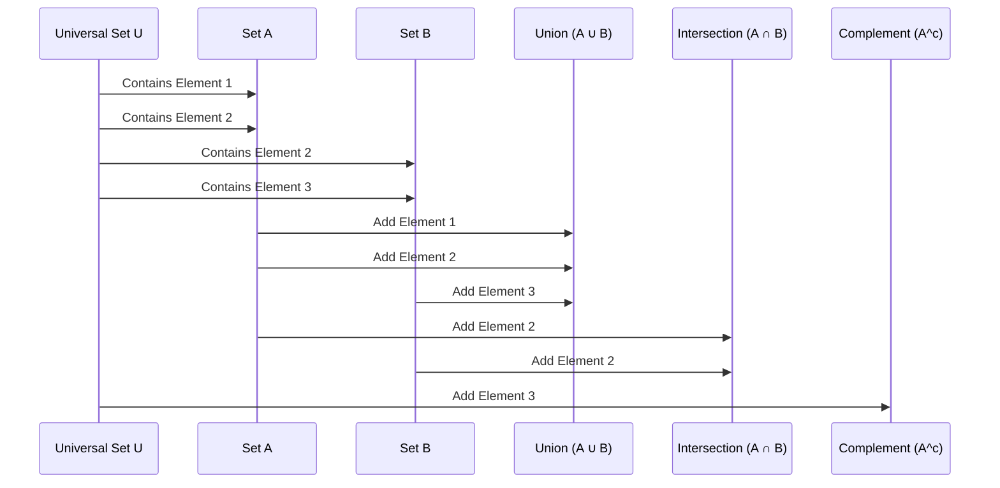

# Foundation: Set Theory

## 1. Conceptual Mental Model

### First Principles
Set theory is a fundamental branch of mathematics that studies collections of objects, known as sets. The concept of a set is intuitive: a set is simply a well-defined collection of distinct objects. The objects in a set are called elements or members. The primary operations on sets include union, intersection, and complement, which allow us to combine and manipulate sets in various ways.

### Historical Context
The origins of set theory can be traced back to the work of Georg Cantor in the late 19th century. Cantor was motivated by his work in analysis, particularly in the study of trigonometric series. He introduced the concept of infinite sets and developed a theory of cardinality, which allowed him to compare the sizes of infinite sets. This work was revolutionary and led to the development of modern set theory. However, it also sparked controversy, particularly with the discovery of paradoxes such as Russell's Paradox, which highlighted the need for a more rigorous foundation for set theory.

### Fundamental Paradigm Shifts
One of the most significant paradigm shifts in set theory was the development of axiomatic set theory, which aimed to provide a rigorous foundation for mathematics. The most widely accepted system of axioms is the Zermelo-Fraenkel set theory with the Axiom of Choice (ZFC). ZFC provides a formal framework for constructing sets and avoids paradoxes by carefully specifying the conditions under which sets can be formed.

## 2. Essential Terminology & Taxonomy

### Set
A set is a well-defined collection of distinct objects. The objects in a set are called elements or members. We denote a set by listing its elements within curly braces, e.g., \( A = \{1, 2, 3\} \).

### Element
An element is an object that belongs to a set. We denote that an element \( x \) belongs to a set \( A \) by writing \( x \in A \).

### Empty Set
The empty set, denoted by \( \emptyset \), is the set that contains no elements. It is a unique set, meaning that there is only one empty set.

### Subset
A set \( A \) is a subset of a set \( B \), denoted by \( A \subseteq B \), if every element of \( A \) is also an element of \( B \).

### Proper Subset
A set \( A \) is a proper subset of a set \( B \), denoted by \( A \subset B \), if \( A \subseteq B \) and \( A \neq B \).

### Union
The union of two sets \( A \) and \( B \), denoted by \( A \cup B \), is the set of all elements that are in \( A \), in \( B \), or in both. Formally, \( A \cup B = \{x \mid x \in A \text{ or } x \in B\} \).

### Intersection
The intersection of two sets \( A \) and \( B \), denoted by \( A \cap B \), is the set of all elements that are in both \( A \) and \( B \). Formally, \( A \cap B = \{x \mid x \in A \text{ and } x \in B\} \).

### Complement
The complement of a set \( A \) with respect to a universal set \( U \), denoted by \( A^c \) or \( U \setminus A \), is the set of all elements in \( U \) that are not in \( A \). Formally, \( A^c = \{x \in U \mid x \notin A\} \).

## 3. Architecture & Core Workflow

### Detailed ASCII Diagram

```
+-------------------+
| Universal Set U   |
| +---------------+ |
| | Set A         | |
| | +-----------+ | |
| | | Element 1 | | |
| | +-----------+ | |
| | +-----------+ | |
| | | Element 2 | | |
| | +-----------+ | |
| +---------------+ |
| +---------------+ |
| | Set B         | |
| | +-----------+ | |
| | | Element 2 | | |
| | +-----------+ | |
| | +-----------+ | |
| | | Element 3 | | |
| | +-----------+ | |
| +---------------+ |
+-------------------+
```

### Mermaid Sequence Diagram



## 4. Common Misconceptions & Mental Traps

### Misconception: The Empty Set is Not a Subset of Any Set
The empty set is a subset of every set, including itself. This is because the definition of a subset requires that every element of the subset is also an element of the set. Since the empty set has no elements, this condition is vacuously true.

### Misconception: The Union of Two Sets is Always Larger than Either Set
The union of two sets is not necessarily larger than either set. If the two sets have no elements in common, the union will have more elements than either set. However, if the two sets have elements in common, the union will have the same number of elements as the larger of the two sets.

### Misconception: The Complement of a Set is Always the Empty Set
The complement of a set is not always the empty set. The complement of a set \( A \) with respect to a universal set \( U \) is the set of all elements in \( U \) that are not in \( A \). If \( A \) is a proper subset of \( U \), then the complement of \( A \) will have elements. If \( A \) is equal to \( U \), then the complement of \( A \) will be the empty set.

## 5. Socratic Discussion Starters

### Question 1
How does the concept of a set differ from the concept of a class in set theory, and why is this distinction important?

### Question 2
Can you provide an example of a paradox in set theory and explain how it was resolved?

### Question 3
How does the Axiom of Choice play a role in set theory, and what are some of its controversial implications?
