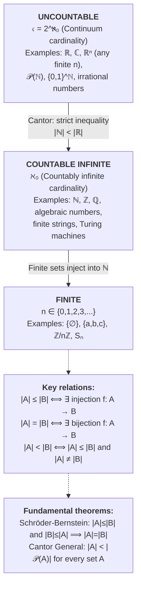

# Lesson 4: Cardinality, Countability, Continuum

## 1. First-Principles Intuition & Invariants

The question of *how many* predates formal mathematics by millennia, yet its rigorous answer arrived only in the 1870s through the work of Georg Cantor, who transformed a child's notion of counting into one of the most intellectually explosive theories in the history of human thought. Before Cantor, infinity was a single, monolithic concept: the endless, the unbounded, the unreachable limit. After him, infinity fractured into an inexhaustible hierarchy of distinct sizes, each separated from the next by an unbridgeable chasm of magnitude. The instrument that makes this hierarchy precise is the concept of **cardinality**, and understanding it requires that we return to the most elementary act in mathematics: the act of matching.

When a child lines up five apples and five oranges and pairs each apple with exactly one orange, the child has performed a **bijection**. No formal arithmetic is needed. The child does not count to five and then count again; the child simply matches, and the matching tells them everything. This act of one-to-one correspondence is not merely a convenience for small children; it is the only coherent definition of "same size" that extends from the finite into the infinite. Two sets $A$ and $B$ are said to have the **same cardinality**, written $|A| = |B|$, if and only if there exists a bijection $f: A \to B$. This definition, stripped of all arithmetic, is the axiom from which the entire theory of cardinality is derived.

For finite sets, this definition agrees perfectly with ordinary counting. A set $A$ has cardinality $n \in \mathbb{N}$ if there exists a bijection from $A$ to the set $\{1, 2, 3, \ldots, n\}$. The finiteness of a set is then equivalent to the statement that no proper subset of $A$ can be placed in bijection with $A$ itself. This last condition, known as the **Dedekind-finiteness** condition, turns out to be precisely the property that infinite sets violate. An **infinite set**, under Dedekind's formulation, is a set that *is* in bijection with one of its own proper subsets. The natural numbers $\mathbb{N} = \{0, 1, 2, 3, \ldots\}$ exhibit this immediately: the function $f: \mathbb{N} \to \mathbb{N} \setminus \{0\}$ defined by $f(n) = n + 1$ is a bijection from $\mathbb{N}$ onto its proper subset of positive integers. Far from being a paradox, this self-similarity is the defining signature of the infinite.

The smallest infinite cardinality is denoted $\aleph_0$ (aleph-null), which is the cardinality of the natural numbers $\mathbb{N}$. Any set whose cardinality equals $\aleph_0$ is called **countably infinite**, and together with the finite sets, these form the class of **countable sets**. A set $S$ is countable if and only if there exists an injection $f: S \to \mathbb{N}$, which is equivalent to saying that the elements of $S$ can be exhaustively listed in a (possibly terminating) sequence $s_0, s_1, s_2, \ldots$ without repetition. This sequential-enumerability criterion is the workhorse tool of practical countability arguments: to prove a set is countable, exhibit the list; to prove it is uncountable, show that no such list can exist.

The integers $\mathbb{Z}$ provide the first non-trivial test case. At first glance $\mathbb{Z}$ seems larger than $\mathbb{N}$, since it extends in both directions. The resolution is an explicit bijection. Define $f: \mathbb{N} \to \mathbb{Z}$ by

$$f(n) = \begin{cases} n/2 & \text{if } n \text{ is even} \\ -(n+1)/2 & \text{if } n \text{ is odd} \end{cases}$$

This maps $0 \mapsto 0$, $1 \mapsto -1$, $2 \mapsto 1$, $3 \mapsto -2$, $4 \mapsto 2$, and so forth, threading through the integers in the interleaved sequence $0, -1, 1, -2, 2, \ldots$. Every integer appears exactly once, so $f$ is a bijection and $|\mathbb{Z}| = |\mathbb{N}| = \aleph_0$. The integers, despite their bilateral extension, are no more numerous than the natural numbers. This is the first hint that infinite arithmetic does not obey the intuitions formed in the finite realm.

The rational numbers $\mathbb{Q}$ push the intuition harder still. Between any two distinct rationals, there are infinitely many others; the rationals are **dense** in the real line in a way the integers are not. Surely, one feels, there must be more of them. Yet $\mathbb{Q}$ is also countable, and the proof proceeds through a beautiful geometric argument due to Cantor himself. Consider the doubly-indexed array in which position $(p, q)$ holds the fraction $p/q$ for $p \in \mathbb{Z}$ and $q \in \mathbb{N}^+$. This array is infinite in two directions, yet it can be traversed by a diagonal sweep: enumerate along anti-diagonals of increasing sum $|p| + q$, skipping fractions that have already appeared in reduced form. The resulting sequence lists every rational number exactly once, establishing a bijection from $\mathbb{N}$ to $\mathbb{Q}$ and confirming $|\mathbb{Q}| = \aleph_0$.

More generally, the **countable union of countable sets is countable**. If $\{A_i\}_{i \in \mathbb{N}}$ is a countable collection of countable sets, then $\bigcup_{i \in \mathbb{N}} A_i$ is countable. The proof uses exactly the diagonal enumeration trick: index elements as $a_{i,j}$ where $a_{i,j}$ is the $j$-th element of $A_i$, and sweep the diagonals of the resulting matrix. This theorem has decisive practical consequences for theoretical computer science: the set of all finite strings over a finite alphabet is countable (since it is a countable union of finite sets, one per string length), which means the set of all programs in any programming language is countable.

The collision between this observation and analysis is what makes uncountability so surprising. The real numbers $\mathbb{R}$ are not countable. This is Cantor's central theorem, and its proof by **diagonalization** is among the most elegant arguments in all of mathematics.

**Theorem (Cantor, 1874/1891):** $|\mathbb{R}| > \aleph_0$.

**Proof.** It suffices to show that the interval $[0, 1) \subset \mathbb{R}$ is uncountable, since $[0,1)$ injects into $\mathbb{R}$. Suppose, for contradiction, that $[0,1)$ is countable. Then there exists a surjection $f: \mathbb{N} \to [0,1)$, and we may list every element of $[0,1)$ as a sequence:

$$r_0 = 0.d_{00}\, d_{01}\, d_{02}\, d_{03} \cdots$$
$$r_1 = 0.d_{10}\, d_{11}\, d_{12}\, d_{13} \cdots$$
$$r_2 = 0.d_{20}\, d_{21}\, d_{22}\, d_{23} \cdots$$
$$\vdots$$

where each $d_{ij} \in \{0, 1, 2, \ldots, 9\}$ is the $j$-th decimal digit of $r_i$. We now construct a real number $x = 0.x_0 x_1 x_2 \cdots$ by reading down the main diagonal and changing each digit: set

$$x_i = \begin{cases} 5 & \text{if } d_{ii} \neq 5 \\ 6 & \text{if } d_{ii} = 5 \end{cases}$$

By construction, $x \in [0,1)$ (since we used only digits 5 and 6, avoiding the degenerate $.999\ldots$ identification issue). But $x$ differs from $r_i$ in its $i$-th decimal digit for every $i \in \mathbb{N}$. Therefore $x \neq r_i$ for all $i$, which contradicts our assumption that $f$ was a surjection. No such enumeration can exist, so $[0,1)$—and hence $\mathbb{R}$—is uncountable. $\blacksquare$

The cardinality of the continuum, $|\mathbb{R}|$, is denoted $\mathfrak{c}$ (Gothic c) and is also written $2^{\aleph_0}$, a notation whose meaning will become clear when we examine power sets. The strict inequality $\aleph_0 < \mathfrak{c}$ places the real numbers in a genuinely larger infinite universe than the natural numbers. The gap between these two infinities is not a matter of degree but of kind; no process of enumeration, however clever, can bridge it.

The diagonalization argument is not merely a trick for the reals. It is a **meta-theorem generator**. The same diagonal construction proves that the set of all functions $f: \mathbb{N} \to \{0,1\}$ is uncountable. It underpins Turing's proof that the Halting Problem is undecidable: the set of all Turing machines is countable (since machines are described by finite strings), but the set of all decision problems, identified with subsets of $\mathbb{N}$, has cardinality $2^{\aleph_0} = \mathfrak{c}$; therefore most decision problems cannot be solved by any Turing machine. Gödel's incompleteness theorems trace a parallel path through arithmetization of syntax. In each case, the diagonal construction produces a witness object that defeats any presumed complete enumeration, and the impossibility result follows. Cantor's diagonalization is thus not a curiosity of pure mathematics but the fundamental mechanism underlying the boundary conditions of computation and formal proof.

---

## 2. Core Architecture & Mechanics

Having absorbed the intuitive landscape, we now dissect the precise machinery through which cardinalities are compared, ordered, and computed. The central tools are injections, surjections, bijections, and the remarkable theorem that closes the gap between them when both directions are present simultaneously.

**Defining the Cardinality Order.** We write $|A| \leq |B|$ to mean there exists an injection $f: A \to B$. We write $|A| = |B|$ to mean there exists a bijection. The natural question is whether these relations are well-behaved: in particular, is it the case that $|A| \leq |B|$ and $|B| \leq |A|$ together imply $|A| = |B|$? The answer is yes, and this is the content of the **Schröder-Bernstein Theorem**, one of the foundational structural results of set theory.

**Theorem (Schröder-Bernstein).** If there exist injections $f: A \to B$ and $g: B \to A$, then there exists a bijection $h: A \to B$.

The theorem's proof is constructive and elegant. The idea is to partition $A$ into two pieces: those elements whose ancestry under iterated application of $g \circ f$ eventually traces back to an element not in the image of $g$ (call these the "A-originated" elements), and all remaining elements. On the first piece, $h$ uses $f$ directly; on the second, $h$ uses $g^{-1}$. We now carry this out precisely.

**Proof.** Define the sequence of sets $A_0, A_1, A_2, \ldots$ by setting $A_0 = A \setminus g(B)$ and $A_{n+1} = g(f(A_n))$ for each $n \geq 0$. Let $C = \bigcup_{n=0}^{\infty} A_n$. Define $h: A \to B$ by

$$h(x) = \begin{cases} f(x) & \text{if } x \in C \\ g^{-1}(x) & \text{if } x \in A \setminus C \end{cases}$$

We must verify three things: that $g^{-1}$ is well-defined on $A \setminus C$, that $h$ is injective, and that $h$ is surjective.

For the first point, suppose $x \in A \setminus C$. Then $x \notin A_0 = A \setminus g(B)$, so $x \in g(B)$, meaning $x = g(b)$ for some $b \in B$. Since $g$ is injective, this $b$ is unique, so $g^{-1}(x) = b$ is well-defined on $A \setminus C$.

For injectivity, we consider three cases. If $x, y \in C$, then $h(x) = f(x)$ and $h(y) = f(y)$, and since $f$ is injective, $h(x) = h(y)$ implies $x = y$. If $x, y \in A \setminus C$, then $h(x) = g^{-1}(x)$ and $h(y) = g^{-1}(y)$, and since $g^{-1}$ is injective on its domain, the same conclusion follows. For the mixed case, suppose $x \in C$ and $y \in A \setminus C$ with $h(x) = h(y)$, meaning $f(x) = g^{-1}(y)$. Then $g(f(x)) = y$. Since $x \in C = \bigcup_{n} A_n$, there exists some $n$ such that $x \in A_n$, and therefore $y = g(f(x)) \in g(f(A_n)) = A_{n+1} \subseteq C$. But we assumed $y \in A \setminus C$, a contradiction. So no mixed collision can occur, and $h$ is injective.

For surjectivity, let $b \in B$ be arbitrary. Either $b \in f(C)$ or $b \notin f(C)$. If $b = f(x)$ for some $x \in C$, then $h(x) = f(x) = b$ and we are done. If $b \notin f(C)$, we claim $g(b) \in A \setminus C$ and $g^{-1}(g(b)) = b$, so $h(g(b)) = b$. To see that $g(b) \notin C$, suppose for contradiction that $g(b) \in A_n$ for some $n$. Since $g(b) \in g(B)$, we have $g(b) \notin A_0$, so $n \geq 1$ and $g(b) \in A_n = g(f(A_{n-1}))$. The injectivity of $g$ then gives $b = f(a)$ for some $a \in A_{n-1} \subseteq C$, contradicting $b \notin f(C)$. Therefore $g(b) \notin C$, and $h(g(b)) = g^{-1}(g(b)) = b$. This establishes surjectivity, completing the proof that $h$ is a bijection. $\blacksquare$

The Schröder-Bernstein theorem is a workhorse of cardinality computation because it allows us to prove $|A| = |B|$ without constructing a bijection directly. We only need to find injections in both directions, which is typically much easier.

**Applying Schröder-Bernstein: The Cardinality of $\mathbb{R}$ and $\mathbb{R}^2$.** A striking application is the fact that the plane $\mathbb{R}^2$ has the same cardinality as the line $\mathbb{R}$. The injection from $\mathbb{R}$ to $\mathbb{R}^2$ is obvious: $x \mapsto (x, 0)$. For the reverse injection, take any $(x, y) \in \mathbb{R}^2$ and interleave their decimal expansions (using canonical representations that avoid terminating ambiguity) to produce a single real number. Schröder-Bernstein then gives $|\mathbb{R}^2| = |\mathbb{R}| = \mathfrak{c}$. The same argument extends to $\mathbb{R}^n$ for any finite $n$, and even to countably infinite products. Geometric dimension, so fundamental to analysis and topology, is entirely invisible to cardinality.

**Power Sets and the General Cantor Theorem.** The diagonalization argument that proved $|\mathbb{R}| > \aleph_0$ is a special case of a vastly more general result. For any set $A$, its **power set** $\mathcal{P}(A) = \{S : S \subseteq A\}$ has strictly greater cardinality.

**Theorem (Cantor's General Theorem).** For any set $A$, $|A| < |\mathcal{P}(A)|$.

**Proof.** The injection $a \mapsto \{a\}$ from $A$ into $\mathcal{P}(A)$ establishes $|A| \leq |\mathcal{P}(A)|$. It remains to show there is no surjection from $A$ onto $\mathcal{P}(A)$, which will exclude the possibility of a bijection. Suppose $g: A \to \mathcal{P}(A)$ is any function. Define the set

$$D = \{a \in A : a \notin g(a)\}$$

Since $D \subseteq A$, we have $D \in \mathcal{P}(A)$. Suppose $D = g(c)$ for some $c \in A$. Then:

$$c \in D \iff c \notin g(c) \iff c \notin D$$

This is a contradiction, so $D$ is not in the range of $g$. Therefore $g$ is not surjective, and since $g$ was arbitrary, no surjection from $A$ to $\mathcal{P}(A)$ can exist. $\blacksquare$

The notation $2^{\aleph_0} = \mathfrak{c}$ is explained by this theorem: there is a natural bijection between $\mathcal{P}(\mathbb{N})$ and $\{0,1\}^{\mathbb{N}}$ (the set of all infinite binary sequences), given by associating each subset $S \subseteq \mathbb{N}$ with its characteristic function $\mathbf{1}_S$. Since each such binary sequence can be read as a real number in $[0,1]$ in binary notation, the cardinality of $\mathcal{P}(\mathbb{N})$ equals $\mathfrak{c}$.

Cantor's general theorem generates an inexhaustible tower of infinite cardinalities:

$$\aleph_0 = |\mathbb{N}| < |\mathcal{P}(\mathbb{N})| = \mathfrak{c} = 2^{\aleph_0} < 2^{\mathfrak{c}} < 2^{2^{\mathfrak{c}}} < \cdots$$

There is no largest cardinality, and no cardinality at the top of the hierarchy. This tower is well-ordered by the $\leq$ relation on cardinalities, and the **aleph function** $\aleph: \text{Ord} \to \text{Card}$ enumerates the infinite cardinal numbers: $\aleph_0$ is the smallest infinite cardinal, $\aleph_1$ is the next, $\aleph_2$ after that, and so on through the transfinite ordinals.

The structural picture of cardinality comparison can be summarized through the following diagram, which traces the principal sets encountered in discrete mathematics and analysis:

**Countability in the Theory of Formal Languages.** The practical import of countability theory for theoretical computer scientists deserves detailed attention. Fix a finite alphabet $\Sigma = \{0, 1\}$ for concreteness. The set $\Sigma^* = \bigcup_{n=0}^{\infty} \Sigma^n$ of all finite binary strings is countable: $\Sigma^n$ is finite with exactly $2^n$ elements, and a countable union of finite sets is countable. We can exhibit the bijection from $\mathbb{N}$ to $\Sigma^*$ explicitly by interpreting each positive integer $n$ in binary and stripping its leading 1-bit to recover a canonical string of length $\lfloor \log_2 n \rfloor$:

$$\epsilon \leftrightarrow 1, \quad 0 \leftrightarrow 2, \quad 1 \leftrightarrow 3, \quad 00 \leftrightarrow 4, \quad 01 \leftrightarrow 5, \quad 10 \leftrightarrow 6, \quad 11 \leftrightarrow 7, \ldots$$

Since every Turing machine is encoded by a finite description string, the set of all Turing machines is countable. However, the set of all **languages** over $\Sigma$—that is, all subsets $L \subseteq \Sigma^*$—is exactly $\mathcal{P}(\Sigma^*)$. Because $\Sigma^*$ is countably infinite, $|\mathcal{P}(\Sigma^*)| = 2^{\aleph_0} = \mathfrak{c}$. The cardinality gap is therefore categorical and irreparable: there are uncountably many languages but only countably many Turing machines. The **vast majority** of languages, in a precise cardinality-theoretic sense, are not computable by any algorithm. This is not an accident of a particular model of computation; it is an arithmetic fact about infinity that applies to any countable model of computation.

---

## 3. High-Performance Optimization & Failure Modes

Mastery of cardinality theory requires not merely knowing the main theorems but navigating their edge cases, recognizing where standard intuitions break down, and deploying the right proof strategy given the problem structure. This section addresses the boundary conditions, common errors, and sophisticated techniques that separate fluent practitioners from those who know only the standard curriculum.

**The Continuum Hypothesis and What It Means for Practice.** Having established $\aleph_0 < \mathfrak{c}$, the natural question is whether these two cardinals are *adjacent* in the aleph hierarchy. Is $\mathfrak{c} = \aleph_1$, the very next infinite cardinal after $\aleph_0$? Or does some intermediate cardinal exist, with $\aleph_0 < \kappa < \mathfrak{c}$ for some infinite $\kappa$? This is Cantor's **Continuum Hypothesis (CH)**:

$$\text{CH}: \quad \mathfrak{c} = 2^{\aleph_0} = \aleph_1$$

Cantor spent years attempting to resolve CH and failed. The resolution, when it came in the twentieth century, was more radical than anyone had anticipated. Kurt Gödel proved in 1938 that CH is **consistent** with the standard axioms of set theory (ZFC): no contradiction arises if we simply assume it is true. Paul Cohen proved in 1963, using the revolutionary technique of **forcing**, that the negation of CH is also consistent with ZFC: no contradiction arises if we assume it is false. Together, these results establish that CH is **independent** of ZFC: neither provable nor disprovable from the standard axioms. This is not a limitation of Gödel's and Cohen's methods; it is a theorem about ZFC itself. Any attempt to settle CH within ZFC is provably futile.

For the working mathematician, the independence of CH has the following concrete interpretation: in any argument that does not rely on extra set-theoretic axioms beyond ZFC, one may neither use CH nor refute it. If your proof of a theorem about the real numbers implicitly assumes that there is no set of intermediate cardinality between $\aleph_0$ and $\mathfrak{c}$, your proof is incomplete unless you have stated CH as a hypothesis. The Generalized Continuum Hypothesis (GCH), which asserts $2^{\aleph_\alpha} = \aleph_{\alpha+1}$ for every ordinal $\alpha$, is similarly independent.

**Failure Mode: The Non-Measurability Trap.** A set $S \subseteq \mathbb{R}$ is called **Lebesgue measurable** if it can be assigned a consistent notion of length. Almost all sets one constructs explicitly are measurable. However, using the Axiom of Choice, one can construct the **Vitali set**, a subset of $[0,1]$ that is not Lebesgue measurable. The construction selects one representative from each equivalence class of $\mathbb{R}/\mathbb{Q}$ (the cosets of the rationals in the additive group of reals) within $[0,1]$. This set has cardinality $\mathfrak{c}$ (there are $\mathfrak{c}$-many such cosets), yet cannot be assigned any consistent measure. The error mode this creates for theorists is assuming that every injection from $\mathbb{R}$ into itself produces a "geometric" or "measure-theoretically sensible" copy of $\mathbb{R}$. It need not. Cardinality says nothing about measure, topology, or algebraic structure unless those properties are explicitly preserved by the bijection in question. A bijection is merely a size-matching; it carries no additional mathematical structure unless it is also a homeomorphism, an isomorphism, a measure isomorphism, or some other structure-preserving map.

**Failure Mode: Misapplying Schröder-Bernstein.** The Schröder-Bernstein theorem requires injections in both directions, not merely surjections or partial functions. A common error is to conflate "$A$ surjects onto $B$" with "$A$ has at least the cardinality of $B$." In fact, the existence of a surjection $f: A \to B$ implies $|B| \leq |A|$, since under the Axiom of Choice one can select, for each $b \in B$, a representative element of $f^{-1}(b)$ to construct an injection from $B$ into $A$. Without the Axiom of Choice, however, surjectivity does not guarantee the existence of a right inverse, and this direction of the argument can fail in choiceless set theory. For ZFC-based work, the equivalence holds, but practitioners should be explicit: when you construct a surjection, you are using the axiom of choice to extract the injection.

A second error with Schröder-Bernstein is assuming it applies when the injections are only partial or approximate. In computational settings where one approximates infinite sets by finite truncations, there is a temptation to invoke cardinality arguments for finite structures. But finite sets do have strict cardinality arithmetic: if $|A| = m$ and $|B| = n$ with $m \neq n$, no bijection exists, and Schröder-Bernstein says nothing interesting because the two cardinalities simply are not equal. The theorem's power is exclusively in the infinite setting.

**Optimization: Proving Countability via Algebraic Closure.** When confronted with a set $S$ whose countability is not immediately obvious, a systematic strategy is to express $S$ as the closure of a countable base set under a countable sequence of finitary operations. The **algebraic numbers** $\overline{\mathbb{Q}}$ illustrate this perfectly. An algebraic number is a root of a nonzero polynomial with integer coefficients. The set of all nonzero polynomials with integer coefficients is countable, since each is determined by a finite sequence of integers and the set of such sequences is countable (a finite product of countable sets is countable, and a countable union of such products is countable). Each polynomial of degree $d$ has at most $d$ roots. Therefore the algebraic numbers form a countable union of finite sets, one per polynomial, giving $|\overline{\mathbb{Q}}| = \aleph_0$. Since $|\mathbb{R}| = \mathfrak{c} > \aleph_0$, the **transcendental numbers** (those real numbers that are not algebraic) form an uncountable set. Explicitly exhibiting transcendental numbers requires work (Liouville's 1851 construction, or Hermite's 1873 proof that $e$ is transcendental), but their *abundance* in a cardinality-theoretic sense is an immediate consequence of this arithmetic.

**Optimization: Cantor-Schröder-Bernstein as a Reduction Framework.** In complexity theory and computability, cardinality arguments are used to establish the existence of complete problems, sparse sets, and oracles. The pattern is always the same: identify the cardinality of the set of "resources" (machines, programs, proofs) and the cardinality of the set of "problems" or "objects" to be handled, and compare. When resources are countable and objects are uncountable, an exact coverage is impossible and a gap theorem follows. When both are countable or both have cardinality $\mathfrak{c}$, the cardinality argument alone does not resolve the question, and finer structural analysis (computability, definability, logical complexity) is required.

**The Continuum Hypothesis as a Precision Instrument.** In analysis and topology, CH and its negation have concrete consequences. Under ZFC + CH, the first uncountable ordinal $\omega_1$ has cardinality $\aleph_1 = \mathfrak{c}$, which allows the construction of counterexamples to certain topological statements that hold in models where $\mathfrak{c} > \aleph_1$. The **Suslin Hypothesis**, which asserts that every complete dense linear order without endpoints that satisfies the countable chain condition is order-isomorphic to $\mathbb{R}$, is also independent of ZFC, and its status is linked to CH in subtle ways. For topological applications in theoretical computer science (domain theory, denotational semantics, the topology of powerdomains), the distinction between $\aleph_1$ and $\mathfrak{c}$ can affect whether certain completeness theorems hold in their expected generality.

**Cantor's Paradox and the Proper Class Boundary.** A final, deeper failure mode deserves attention: the apparent paradox that arises when Cantor's general theorem is applied to the "set of all sets." Cantor's theorem says $|A| < |\mathcal{P}(A)|$ for every set $A$. If $V$ were the set of all sets, then $\mathcal{P}(V) \subseteq V$ (since every subset of $V$ is itself a set, hence an element of $V$), which would give $|\mathcal{P}(V)| \leq |V|$, directly contradicting the strict inequality. The resolution in ZFC is that $V$ is not a set; it is a **proper class**. The axioms of ZFC are carefully designed to prevent the formation of "too large" objects as sets: the Axiom of Separation only permits taking subsets of existing sets, not arbitrary comprehensions. Cantor's paradox is therefore not a theorem about the inconsistency of set theory but a theorem about where the boundary between sets and proper classes must be drawn. For the working theorist, the lesson is precise: cardinality arguments apply only to sets, and before invoking them, one must verify that the objects in question are genuinely sets within the ambient formal framework and not proper class-sized collections.

The discipline of reasoning about cardinality is, in this sense, inseparable from the discipline of reasoning about the axioms that define what counts as a set in the first place. The theorems of this lesson—countability, diagonalization, Schröder-Bernstein, Cantor's general theorem, the continuum hypothesis—are not isolated facts but a coherent architecture, each result illuminating the boundaries of the others, together constituting one of the most powerful and intellectually demanding frameworks in the entire mathematical canon.
