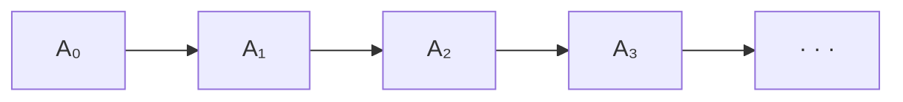
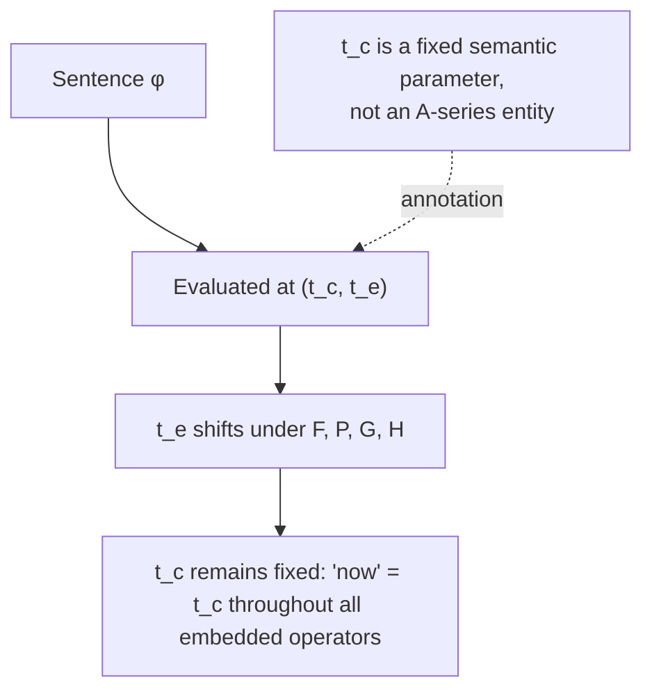

# Lesson 1: The Ontology of Time

## 1. First-Principles Intuition & Invariants

Time is the most intimate of all formal objects, and yet it resists formalization with a stubbornness that has occupied philosophers, logicians, and mathematicians for over two millennia. Before we can build temporal logics, reason about causality, or model concurrent systems, we must ask the foundational question that every serious practitioner eventually confronts: what, precisely, is the formal object we are reasoning *about* when we reason about time? This is not an idle metaphysical question. The answer determines which mathematical structures are legitimate models, which inference rules are sound, and which intuitions about past, present, and future can be trusted when they are encoded into a formal system.

The two dominant ontological positions are **presentism** and **eternalism**, and they carve the mathematical landscape in fundamentally different ways. The presentist holds that only the present moment exists; past and future are not merely absent from our perception but absent from reality altogether. Time, on this view, is not a dimension to be indexed into but a moving spotlight that illuminates the single slice of reality that currently *is*. The eternalist, by contrast, holds that all moments of time exist with equal ontological standing. The year 1687 and the year 2200 are as real as the present moment; they simply stand in different temporal relations to one another, the way two cities stand in different spatial relations. On the eternalist picture, time is a dimension, and the universe is a four-dimensional block — the so-called **block universe** — in which every event occupies a fixed coordinate.

This disagreement is not academic decoration. The presentist is committed to a formal ontology in which the domain of quantification shifts from moment to moment. When we write $\exists x\, P(x)$ in a presentist framework, the domain over which $x$ ranges is the set of presently existing objects, and that domain is constantly changing. This makes standard classical first-order logic an uncomfortable fit: the law of the excluded middle applied to sentences about past events becomes problematic if past entities genuinely no longer exist. The eternalist, by contrast, can employ a fixed domain across all time points. The sentence $\exists x\, P(x, t)$ ranges over a time-independent domain, and $t$ is simply a parameter indexing into the block. This is precisely the structure exploited by **possible-worlds semantics** and the relational frames of modal and temporal logic, where worlds (or time points) are fixed nodes in a graph, and the domain is held constant across them. The formal consequence is sharp: presentism pressures us toward **free logics** or **varying-domain semantics**, while eternalism licenses the cleaner, constant-domain Kripke frames that underlie almost all standard temporal reasoning systems.

### McTaggart's A-Series and B-Series

The most penetrating internal analysis of temporal structure came from J.M.E. McTaggart in his 1908 paper *The Unreality of Time*, and its influence on formal temporal ontology is so pervasive that any serious curriculum must derive its key moves in full detail.

McTaggart distinguished two ways of ordering events in time. The **B-series** orders events by the permanent, relational predicates *earlier than*, *simultaneous with*, and *later than*. These relations are fixed and eternal: the signing of the Magna Carta is earlier than the publication of the *Principia Mathematica*, and this relational fact does not change. If $e_1$ and $e_2$ are events and $e_1 < e_2$ in the B-series ordering, then this ordering is a permanent feature of the structure of time, not dependent on any observer or on what moment is presently occurring. Formally, the B-series corresponds to a **strict total order** $(T, <)$, where $T$ is a set of time points (or events) and $<$ is irreflexive, asymmetric, transitive, and total.

The **A-series**, by contrast, characterizes events by the properties *past*, *present*, and *future*. These are not relations between two events but monadic properties that each event instantiates. Crucially, they are **dynamic**: an event that is now future becomes present and then recedes into the past. The A-series is what gives time its felt character of *flow* — the sense that moments are coming toward us, arriving, and then departing into the fixed record of the past. For the formal theorist, the A-series corresponds roughly to the **temporal operators** of tense logic: the operators $P$ (*it was the case that*), $H$ (*it has always been the case that*), $F$ (*it will be the case that*), and $G$ (*it will always be the case that*) introduced by Arthur Prior in his foundational development of tense logic. These operators shift the evaluation point along the temporal order, tracking the movement of "now" through the B-series structure.

McTaggart's argument proceeds in two stages, and the formal logician should trace each stage carefully because the argument is in fact a reductio that reveals a deep structural tension any temporal formalism must resolve.

**Stage One** establishes that the A-series is more fundamental than the B-series. McTaggart's claim is that the B-series alone cannot account for the *passage* of time — it describes an ordering, but an ordering is a static structure. A spatial ordering of cities does not constitute motion; similarly, a B-series ordering of events does not, by itself, constitute temporal flow. Time essentially *passes*, so whatever grounds the reality of time must include something A-serial. If this argument is accepted, the formal implication is that any adequate temporal model cannot reduce entirely to a static relational structure $(T, <)$ without somehow also representing the dynamic shift of the present.

**Stage Two** then argues that the A-series is itself formally incoherent, using the following reductio. The A-series predicates — past, present, future — are mutually exclusive and jointly exhaustive of every moment. No single event can be simultaneously past, present, and future. Yet every event *is* all three: what is now present was future and will be past. The standard reply is that this is not a simultaneous instantiation but a temporal one — the event is future *at* earlier times, present *at* the moment of its occurrence, and past *at* later times. But McTaggart observes that this reply quantifies over times, and those times must themselves be ordered by an A-series to be genuinely temporal. We have not escaped the original structure; we have merely regressed into it. The resolution at stage $n$ requires an A-series at stage $n+1$, generating an **infinite regress** that McTaggart regards as vicious.

Formally, we can represent this regress precisely. Let $A_0$ be the A-series of events, with the predicate $\text{Pres}_0(e)$ meaning "$e$ is present." To disambiguate the apparent contradiction that $e$ is past, present, and future, we introduce a meta-time level $A_1$ and write $\text{Pres}_0(e)$ holds at $t_1 \in A_1$. But now $t_1$ itself must be characterized as past, present, or future relative to a meta-meta-time $A_2$, yielding the predicate $\text{Pres}_1(t_1)$ holding at some $t_2 \in A_2$. For every ordinal $\alpha$, we require a series $A_\alpha$ to ground the A-determinations of $A_{\alpha - 1}$. No finite iteration terminates the regress, and the resulting structure is not a well-founded hierarchy — the grounding condition never reaches a base case.

Whether McTaggart's argument is ultimately sound is a matter of ongoing debate. What matters for the formal theorist is the **diagnostic precision** of the argument: it identifies a genuine structural tension between the static relational character of the B-series and the dynamic indexical character of the A-series, and it shows that any formalism must take a deliberate stance on how "now" is treated. This is exactly the tension that Prior's tense logic, two-dimensional temporal semantics, and hybrid logics each address in different ways, as we will develop in later lessons.

### Formal Commitments and Their Downstream Consequences

The ontological positions above encode into formal systems through a small number of definite commitments. It is worth making these explicit because they determine the mathematical structures we will use throughout this course.

The first commitment concerns the **topology of the temporal order**. Is time discrete or dense? Is it bounded or unbounded? Does it branch toward the future, branch toward both past and future, or form a single linear chain? Each choice selects a different class of Kripke frames. A discrete, unbounded, linear order corresponds to the natural numbers $(\mathbb{N}, <)$ or the integers $(\mathbb{Z}, <)$. A dense, unbounded linear order corresponds to the rationals $(\mathbb{Q}, <)$ or the reals $(\mathbb{R}, <)$. Branching time — in which the past is fixed but the future is an open tree of possibilities — corresponds to a partial order $(T, <)$ where for any $t \in T$, the set $\{s \in T : s < t\}$ is linearly ordered, but the set $\{s \in T : t < s\}$ may not be.

The second commitment concerns the **semantics of temporal operators**. If we adopt a B-series-only ontology, the operators $F\phi$ and $P\phi$ are simply quantifiers over the relational structure: $F\phi$ holds at $t$ if and only if there exists $t' > t$ such that $\phi$ holds at $t'$. This is clean, well-understood model theory, identical in structure to the semantics of modal logic $\Diamond\phi$ over accessibility relations. If we wish to give formal content to the A-series notion of *flow* or *passage*, we require additional machinery: either a designated "now" constant in the language (as in hybrid logic, where nominals name specific time points), or a two-dimensional evaluation structure in which formulas are evaluated at both an **utterance time** and a **context time**, allowing the indexical shift of "now" to be represented without the McTaggartian regress.

The third commitment concerns the relationship between **temporal existence and quantification**. A presentist formal system requires that the domain $D(t)$ associated with each time point $t$ may differ, that quantifiers are evaluated over $D(t)$ at the current evaluation point, and that the **Barcan formula** $\forall x\, \Box \phi(x) \to \Box \forall x\, \phi(x)$ may fail — since an object existing at all times accessible from $t$ need not be in $D(t)$ if domains shrink between time points. The eternalist system, using a constant domain, validates the Barcan formula and its converse, simplifying the proof theory considerably.

These are not abstract choices. They are decisions that propagate through every subsequent construction in temporal logic, database theory, formal verification, and the semantics of natural language. Making them consciously, with full awareness of their philosophical grounding, is the mark of a practitioner who understands the foundations rather than merely manipulating symbols.

---

## 2. Core Architecture & Mechanics

Having established the ontological landscape, we now turn to the formal structures through which temporal ontology is mechanically realized. The central object is the **temporal frame**, the semantic substrate on which all temporal reasoning is interpreted.

### The Temporal Frame as a Formal Object

A temporal frame is a pair $\mathcal{F} = (T, <)$ where $T$ is a nonempty set (the **time points**) and $<$ is a binary relation on $T$ (the **temporal precedence relation**). Different ontological commitments impose different first-order conditions on $<$:

**Irreflexivity:** $\forall t\, \neg(t < t)$. No moment precedes itself.

**Transitivity:** $\forall t_1, t_2, t_3\, (t_1 < t_2 \wedge t_2 < t_3 \to t_1 < t_3)$. Precedence chains compose.

**Linearity (totality):** $\forall t_1, t_2\, (t_1 < t_2 \vee t_1 = t_2 \vee t_2 < t_1)$. Any two moments are comparable. This encodes the B-series assumption that time does not branch.

**Density:** $\forall t_1, t_2\, (t_1 < t_2 \to \exists t_3\, (t_1 < t_3 \wedge t_3 < t_2))$. Between any two moments, there is another. This rules out discrete time.

**No endpoints:** $\forall t\, \exists t_1\, (t_1 < t) \wedge \exists t_2\, (t < t_2)$. Time has no first or last moment.

The conjunction of irreflexivity, transitivity, linearity, density, and no-endpoints axiomatizes the theory of the rational order $(\mathbb{Q}, <)$, up to isomorphism. Add a completeness axiom (every nonempty bounded set has a least upper bound) and you recover $(\mathbb{R}, <)$. The formal theorist's task when modeling a physical or computational system is to determine which of these conditions are appropriate, and the philosophical analysis of the previous section is what makes that determination principled rather than arbitrary.

A **temporal model** extends the frame by adding a valuation: a function $V : \text{Prop} \to \mathcal{P}(T)$ that assigns to each atomic proposition $p$ the set of time points at which $p$ holds. The evaluation of a formula $\phi$ at a time point $t$ in model $\mathcal{M} = (T, <, V)$ is then defined recursively. We write $\mathcal{M}, t \models \phi$ to mean "$\phi$ is true at $t$ in $\mathcal{M}$":

$$\mathcal{M}, t \models p \iff t \in V(p)$$

$$\mathcal{M}, t \models \neg\phi \iff \mathcal{M}, t \not\models \phi$$

$$\mathcal{M}, t \models \phi \wedge \psi \iff \mathcal{M}, t \models \phi \text{ and } \mathcal{M}, t \models \psi$$

$$\mathcal{M}, t \models F\phi \iff \exists t' \in T\, (t < t' \text{ and } \mathcal{M}, t' \models \phi)$$

$$\mathcal{M}, t \models P\phi \iff \exists t' \in T\, (t' < t \text{ and } \mathcal{M}, t' \models \phi)$$

$$\mathcal{M}, t \models G\phi \iff \forall t' \in T\, (t < t' \Rightarrow \mathcal{M}, t' \models \phi)$$

$$\mathcal{M}, t \models H\phi \iff \forall t' \in T\, (t' < t \Rightarrow \mathcal{M}, t' \models \phi)$$

The operators $F$ and $P$ are the **existential** future and past operators: $F\phi$ asserts that $\phi$ holds at some future time, and $P\phi$ asserts that $\phi$ held at some past time. The operators $G$ and $H$ are their **universal** duals: $G\phi$ asserts that $\phi$ holds at all future times, and $H\phi$ asserts that $\phi$ has held at all past times. These four operators are the generators of **Prior's basic tense logic $\text{K}_t$**, the temporal analogue of the modal system $\text{K}$.

The duality relations hold exactly as in modal logic. Because $G\phi$ means $\neg F \neg\phi$ and $H\phi$ means $\neg P \neg\phi$, the system is determined by just two primitive operators, with $G$ and $H$ definable as abbreviations. This algebraic economy reflects the deep structural parallel between temporal logic and modal logic: the temporal precedence relation $<$ plays exactly the role of the accessibility relation $R$ in a Kripke frame, with $F$ corresponding to $\Diamond$ (over the forward relation) and $P$ corresponding to $\Diamond$ (over the backward relation).

### Structural Correspondence: Frame Conditions and Axioms

The correspondence between first-order conditions on $<$ and validities of the tense logic is a central theorem of the field, and the practitioner must understand it mechanically. The following table records the core correspondences, each of which can be proved by a standard "bulldozing" argument (also called the standard translation technique) in which the frame condition is extracted from the validity of the axiom by a first-order unraveling.

| Frame condition on $(T, <)$ | Corresponding tense axiom schema |
|---|---|
| Transitivity | $F F\phi \to F\phi$ and $P P\phi \to P\phi$ |
| Linearity (no branching future) | $F\phi \to G(P\phi \vee \phi \vee F\phi)$ |
| Density | $F\phi \to FF\phi$ |
| No last moment | $\top \to F\top$ |
| No first moment | $\top \to P\top$ |
| Discreteness (successor exists) | $\phi \to GP\phi \vee G(\neg P\phi \wedge P\phi)$ |

Each row encodes a theorem of the form: axiom schema $\alpha$ is valid over all frames satisfying condition $\sigma$ if and only if $\sigma$ holds. The proof strategy is uniform. To show validity ($\Rightarrow$): assume $\sigma$ holds, take any model $\mathcal{M}$ on that frame and any evaluation point $t$, and show $\mathcal{M}, t \models \alpha$ by direct semantic calculation. To show necessity ($\Leftarrow$): assume $\sigma$ fails at some $t_0, t_1, \ldots$ in a frame, construct a countermodel by assigning $V(p)$ to exactly the times where the antecedent of $\alpha$ forces truth, and verify that the consequent fails at the designated point.

For instance, the correspondence between transitivity and $FF\phi \to F\phi$ is derived as follows. Suppose $\mathcal{M}, t \models FF\phi$. Then there exists $t_1 > t$ such that $\mathcal{M}, t_1 \models F\phi$, and there exists $t_2 > t_1$ such that $\mathcal{M}, t_2 \models \phi$. By transitivity of $<$, $t_2 > t$, so $\mathcal{M}, t \models F\phi$. The argument is four lines of direct semantic calculation, and every correspondence proof has the same character.

### The McTaggart Regress as a Non-Well-Founded Grounding Graph

The McTaggart regress admits a precise graph-theoretic representation that clarifies why it is vicious rather than merely infinite. Define a directed graph $\mathcal{G} = (V, E)$ where the nodes are **grounding levels** and an edge $A_\alpha \to A_{\alpha+1}$ represents the dependence of level $\alpha$ on level $\alpha+1$ for the resolution of its A-determinations. A well-founded grounding structure would be a directed acyclic graph (DAG) in which every node has a path of finite length to a node with no outgoing edges — a base level that is self-grounding.

The viciousness of the regress is precisely the absence of a sink in this grounding graph. A vicious regress, in the technical sense introduced by Clark and Hasker and formalized in grounding theory, is a regress in which the existence of the grounding relation at level $\alpha$ is *constitutively dependent* on the existence of a further grounding relation at level $\alpha + 1$, with no level being self-grounding. The graph has no sink, so the grounding relation is never discharged. This is distinct from a *benign* infinite regress (such as the infinite divisibility of the real line), where existence at one level does not depend on the infinite chain being completed.

The two-dimensional semantic response to McTaggart — evaluating sentences at a pair $(t_c, t_e)$ of context time and event time, where "now" refers to $t_c$ and temporal operators shift $t_e$ — breaks the regress precisely by providing a **base level**: the context parameter $t_c$ is not itself in need of A-determination within the object language. It is a semantic parameter, not an entity in the domain. The grounding graph now has a sink, and the regress terminates.

This architecture is the core of Kaplan's two-dimensional semantics for indexicals, applied to the temporal case. It is also, as we will see in later lessons, the structure underlying the semantics of *now*-operators and **hybrid temporal logic**, where nominals explicitly name time points and the satisfaction operator $@_i \phi$ evaluates $\phi$ at the time named by nominal $i$ regardless of the current evaluation point.

---

## 3. High-Performance Optimization & Failure Modes

Formal ontology is not merely a matter of philosophical preference; the wrong ontological commitments generate specific, diagnosable failures in formal systems. This section catalogs the principal failure modes that arise when the ontological grounding is not sufficiently careful, and describes the theoretical instruments used to detect and correct them.

### Failure Mode 1: Conflating the A-Series and B-Series in Formal Specification

The most common failure in applied temporal reasoning occurs when a system specification conflates B-series relational statements with A-series indexical statements. Consider a database that records temporal facts in a relational schema. A statement like "event $e$ occurred at time $t = 1708329600$" is a B-series fact: it records a permanent relation between an event and a coordinate in an abstract temporal order. A statement like "event $e$ is recent" is an A-series statement: it is implicitly relative to the present moment and will change truth value as time passes. If a formal specification treats "recent" as a time-independent predicate stored in a database column, it conflates these two ontological categories.

The formal diagnosis: B-series predicates are **eternal sentences** in the sense of Quine — their truth value is not relative to a time of evaluation but is permanent once facts about the temporal order are fixed. A-series predicates are **non-eternal sentences** whose truth value is a function of the evaluation time $t$. In temporal database theory, this distinction maps precisely onto the distinction between **snapshot semantics** (where a database state represents a single moment and queries are evaluated relative to that moment) and **temporal data models** (where the database explicitly records the full temporal extent of facts, allowing B-series queries that are independent of query time). Systems that mix these without formal discipline produce queries whose answers silently depend on when the query is posed — a failure mode that is notoriously difficult to debug because it manifests intermittently rather than systematically.

The resolution is to enforce a **semantic typing discipline**: every predicate in the formal specification is explicitly typed as either time-independent (B-series) or time-relative (A-series), and time-relative predicates are always evaluated with an explicit temporal parameter. In temporal logic terms, every A-series predicate $P(x)$ is replaced by a two-argument predicate $P(x, t)$ or, equivalently, by a formula in the language of tense logic $P(x)$ evaluated at a designated time, where the evaluation time is always explicit in the proof state.

### Failure Mode 2: Frame Incompleteness

A tense logic is **complete** with respect to a class of frames $\mathcal{C}$ if every formula valid over all frames in $\mathcal{C}$ is derivable from the axioms of the logic. Incompleteness means that there are frame-valid formulas that the proof system cannot derive — the logic is too weak to capture its intended semantics. This failure mode arises specifically when the frame condition corresponding to a desired property is not first-order axiomatizable.

Transitivity, linearity, and density are all first-order conditions, and the tense logics axiomatized by their corresponding schemas are complete with respect to the appropriate frame classes. However, consider the condition of **Dedekind completeness**: every nonempty subset of $T$ that is bounded above has a supremum. This condition is *not* first-order expressible (it requires second-order quantification over subsets of $T$), and no tense logic axiomatized by a set of propositional schemas can be complete with respect to the class of Dedekind-complete linear orders. The standard tense logic over $(\mathbb{R}, <)$ is therefore a genuinely harder completeness problem than the logic over $(\mathbb{Q}, <)$.

Practitioners who specify formal requirements using $(\mathbb{R}, <)$ as the intended temporal model — common in hybrid systems and control theory — must be aware that their proof system may be unable to derive all valid properties of that model using only propositional tense axioms. The resolution is either to work with a **complete metric temporal logic** that includes real-valued distance operators, or to use a two-sorted first-order language in which both time points and sets of time points are quantifiable, recovering the expressive power needed for Dedekind completeness at the cost of losing decidability.

### Failure Mode 3: Validity Collapse under Branching vs. Linear Time

A logical system designed for linear time can produce **unsound conclusions** when applied to a branching-time model, and the failure is not always immediately visible. Consider the formula:

$$\phi \to GP\phi$$

This formula asserts: if $\phi$ is true now, then at every future time, $\phi$ was true at some past time (specifically, now). This is valid over any linear temporal order because every future moment lies on the unique path extending the present. In a branching model, however, a future branch $b_2$ may not contain the present moment on its history if the branching structure is such that $b_2$ diverges before the present. The formula fails, and any proof system that includes $\phi \to GP\phi$ as an axiom while operating over a branching frame will derive false conclusions.

This is not a contrived edge case. It is precisely the failure that occurs in **concurrent system verification** when a linear-time specification language is applied to a nondeterministic system whose execution semantics is a branching tree of possible runs. The resolution is a strict discipline of matching the temporal logic to the frame class: **Linear Temporal Logic (LTL)** for systems whose specifications concern a single execution path, and **Computation Tree Logic (CTL)** or **CTL*** for systems whose specifications must quantify over multiple paths from a single state. The axiom $\phi \to GP\phi$, valid in LTL, has no counterpart in CTL because CTL path quantifiers $A$ (all paths) and $E$ (some path) explicitly signal which kind of claim is being made.

### Failure Mode 4: The McTaggart Regress in Operational Semantics

A subtle instance of the McTaggart regress arises in the operational semantics of programming languages with **dynamic binding of "now"**. Consider a language in which the expression `now` evaluates to the current time of execution. If the language also supports **time-shift operators** that change the evaluation context, then the semantics of a nested expression like `at(t₁, now + at(t₂, f(now)))` requires care about which "now" each subexpression refers to.

If the semantics naively treats "now" as a free variable that is substituted by the runtime clock, the two occurrences of `now` in the above expression will refer to different times depending on how the `at` operator is implemented — a direct instance of the A-series indexicality problem. If the semantics uses a **static time parameter** threaded through the evaluation (analogous to the two-dimensional $(t_c, t_e)$ structure), then `now` in the outer context always refers to $t_c$, while the temporal operators shift $t_e$, and the semantics is unambiguous.

The correct resolution — mirroring the two-dimensional semantic response to McTaggart — is to implement time-shift operators as shifting only the **evaluation time** $t_e$ while leaving the **context time** $t_c$ fixed, and to interpret `now` as $t_c$ throughout. This design is embodied in the semantics of the `@` operator in hybrid automata and in the `now` function in SQL's snapshot isolation model, where "now" is bound at transaction start and held constant for the duration of the transaction regardless of when individual operations within the transaction are physically executed.

### Optimization: Choosing the Minimal Ontological Commitment

A practitioner designing a formal temporal system should adopt the **minimal ontological commitment** that is sufficient for the expressiveness required by the application. This principle is a form of Ockham's razor applied to temporal foundations, and it has concrete formal consequences.

If the application requires only B-series reasoning — ordering events, checking precedence, detecting cycles — then a simple strict total order $(T, <)$ with no designated present is sufficient, and the appropriate logic is a fragment of first-order logic over that order, without temporal operators. Adding the full apparatus of tense logic (with its implicit A-series "now") introduces unnecessary complexity and potential sources of the ontological failures described above.

If the application additionally requires indexical reasoning about "now" — query languages, event-driven specifications, natural language interfaces — then the two-dimensional structure $(t_c, t_e)$ is the minimal extension that handles this correctly. The context parameter $t_c$ is treated as a constant of evaluation, not a variable in the domain, grounding the A-series without regress.

If the application requires reasoning about possibility and necessity across different temporal futures — planning under uncertainty, concurrent program verification, game-theoretic temporal specifications — then branching time with explicit path quantifiers is required, and the frame must be a tree rather than a chain.

Each step up this ontological ladder adds expressiveness and adds complexity, both in the proof theory and in the computational cost of model checking. The disciplined practitioner resists the temptation to adopt the most expressive framework by default, because maximum expressiveness typically comes with undecidability or non-elementary complexity. The formal ontology of time is not a background assumption to be settled once and forgotten; it is an active design parameter that must be matched, with precision and intention, to the requirements of the system being reasoned about.

This concludes the first lesson. The formal structures of temporal frames, the semantic evaluation rules for tense operators, the correspondence between frame conditions and axiom schemas, and the failure modes arising from ontological misalignment are the invariant substrate on which every subsequent construction in this course rests. In Lesson 2, we will develop the proof theory of tense logic in full — natural deduction systems, sequent calculi, and the completeness theorem for the basic tense logics — building directly on the semantic foundations established here.
