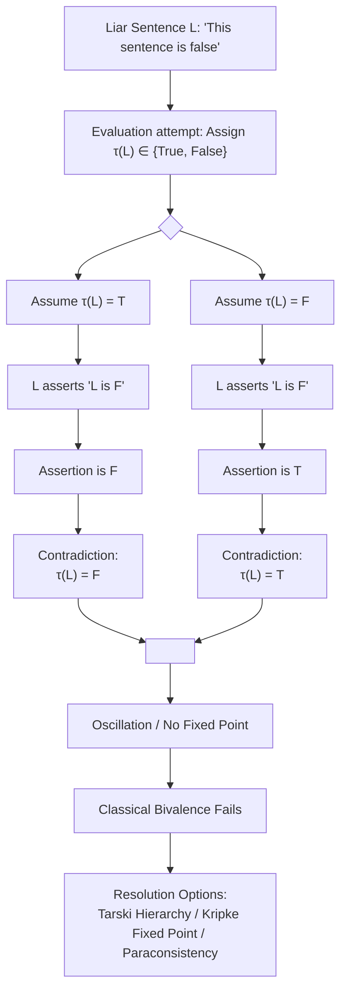

# Lesson 1: Foundational Paradoxes of Self-Reference

## 1. First-Principles Intuition & Invariants

The foundational crisis of self-reference in formal logic emerges not from mathematical obscurity but from the collision between natural language expressiveness and the demand for consistent truth valuations. When we construct a sentence that speaks about its own truth status, we invoke a strange loop that threatens the stability of any formal system attempting to model it. The classical paradoxes of self-reference—the Liar, the Epimenides, the Grelling-Nelson, and Quine's paradox—are not mere curiosities or philosophical puzzles. They are structural invariants that expose fundamental limitations in naive truth theories, demonstrate the necessity of type hierarchies in semantic frameworks, and prefigure the incompleteness results that Gödel would later formalize through arithmetization.

The Liar paradox in its canonical form presents the sentence $L$: "This sentence is false." If we attempt to assign a classical truth value to $L$, we encounter immediate oscillation. Suppose $L$ is true. Then what $L$ asserts—that $L$ is false—must be the case, forcing us to conclude that $L$ is false. Conversely, if $L$ is false, then the assertion it makes is incorrect, which means $L$ is not false, and therefore must be true. The truth value assignment oscillates indefinitely, never stabilizing. This is not a failure of reasoning but a structural feature of self-referential negation within a bivalent truth framework.

The oscillation mechanism reveals a deeper invariant: self-reference combined with negation creates a fixed-point equation with no classical solution. Formally, if we denote the truth value of $L$ as $\tau(L)$ and the negation operator as $\neg$, the sentence asserts $\tau(L) = \neg \tau(L)$. In classical two-valued logic where $\tau(L) \in \{\text{True}, \text{False}\}$, no value satisfies this equation. The equation demands that the truth value be its own negation, an impossible constraint in Boolean algebra.

The Epimenides paradox, attributed to the Cretan poet Epimenides who allegedly stated "All Cretans are liars," introduces contextual self-reference. If Epimenides is a Cretan and all statements by Cretans are false, then Epimenides' own statement—being uttered by a Cretan—must be false. But if his statement is false, then not all Cretans are liars, which means at least one Cretan speaks truly, potentially including Epimenides himself. The paradox differs subtly from the pure Liar because it involves quantification over a class (Cretans and their statements) rather than direct self-reference. The formal structure requires interpreting "liar" as one who always speaks falsely, transforming the statement into a universal quantification: $\forall x \in \text{Cretans}, \forall p \in \text{Statements}(x), \neg \tau(p)$. When Epimenides' own statement is included in this quantification domain, the contradiction emerges.

The Grelling-Nelson paradox, formulated in 1908, shifts the domain from sentences to predicates and their semantic properties. We define a predicate as **heterological** if it does not apply to itself, and **autological** if it does apply to itself. The word "short" is autological because "short" is a short word. The word "polysyllabic" is autological because "polysyllabic" is itself polysyllabic. Conversely, "long" is heterological because "long" is not a long word (it has only four letters). The paradox emerges when we ask: Is "heterological" heterological? If "heterological" is heterological, then by definition it does not apply to itself, which means "heterological" is not heterological. If "heterological" is not heterological, then it does apply to itself, making it heterological. We encounter the same oscillation structure as the Liar, but now instantiated in the metalinguistic realm of predicate self-application.

Quine's paradox, presented in 1953, achieves self-reference through quotation and concatenation rather than indexical reference. Consider the schema: "yields falsehood when appended to its own quotation." Let $Q$ be the full sentence formed by appending this schema to its own quotation: "yields falsehood when appended to its own quotation" yields falsehood when appended to its own quotation. The sentence $Q$ asserts that applying the operation described in the quoted phrase to that very phrase yields a false sentence. But $Q$ itself is the result of that operation. Thus $Q$ asserts its own falsehood, reproducing the Liar paradox without using demonstratives like "this sentence." The formal innovation lies in constructing self-reference through linguistic operations (quotation and concatenation) that can be modeled syntactically, prefiguring Gödel's technique of coding syntax within arithmetic.

The invariant across all these paradoxes is the formation of a truth-value fixed-point equation with no classical solution. Each paradox constructs a sentence $S$ such that $\tau(S) = f(\tau(S))$ where $f$ is a function that inverts or negates its input. In classical logic, such equations have no solution in the two-element Boolean algebra. The oscillation we observe when attempting to evaluate these sentences is not a bug in our reasoning process but a signal that the sentence structure violates the well-foundedness assumptions required for stable truth-value assignment.

Tarski's resolution, articulated in his 1933 monograph on truth, introduces a metalinguistic hierarchy. Truth predicates cannot be applied to sentences within the same language; instead, we must stratify into an object language $L_0$ and a metalanguage $L_1$ that contains the truth predicate $\text{True}_{L_0}$ applicable to sentences of $L_0$. The Liar sentence "This sentence is false" cannot be formulated in $L_0$ because $L_0$ contains no truth predicate. If we attempt to formulate it in $L_1$ as "This sentence is not true in $L_0$," the sentence is expressed in $L_1$, but the truth predicate applies only to $L_0$ sentences. The self-reference is broken because the sentence and the truth predicate it invokes live at different hierarchical levels. This stratification mirrors the type hierarchies in Russell and Whitehead's *Principia Mathematica*, where predicates are assigned types and can only apply to entities of strictly lower type.

The Tarskian hierarchy, while resolving the paradoxes, imposes costs. We lose the ability to express a universal truth predicate applicable to all sentences, including those containing the truth predicate itself. Natural language appears to violate this restriction routinely—we say "Everything I just said is true" without triggering paradox in ordinary discourse. This gap between formal and natural language semantics motivates alternative approaches: Kripke's fixed-point construction in 1975, which allows partially defined truth predicates and three-valued logic; paraconsistent logics that tolerate contradictions without explosion; and revision theories that model truth-value assignment as a process converging over stages.

The formal mechanism underlying self-referential paradoxes can be modeled through diagonal constructions. Given a language $\mathcal{L}$ with Gödel numbering (a coding of syntactic objects as natural numbers), a formula $\phi(x)$ with one free variable can be diagonalized to produce a sentence $\delta(\phi)$ that asserts $\phi(\ulcorner \delta(\phi) \urangle)$, where $\ulcorner \cdot \urangle$ denotes the Gödel number of the enclosed expression. The diagonal sentence essentially says "$\phi$ holds of my own Gödel number." If $\phi(x)$ expresses "$x$ is not true," then $\delta(\phi)$ reproduces the Liar paradox within arithmetic. This diagonalization technique is the engine of Gödel's incompleteness theorems: the undecidable sentence $G$ constructed in the proof asserts its own unprovability through diagonal self-reference.

Understanding these paradoxes requires distinguishing between semantic and syntactic self-reference. Semantic self-reference involves a sentence making claims about its own truth, satisfaction, or denotation—properties defined in a semantic metatheory. Syntactic self-reference, as in Quine's paradox or Gödel's diagonal lemma, constructs sentences that refer to their own syntactic structure (Gödel numbers, quotations) without invoking semantic notions directly. The syntactic route allows self-reference to be formalized within arithmetic, enabling metamathematical results about formal systems themselves.

## 2. Core Architecture & Mechanics

The internal architecture of a self-referential paradox consists of three functional components: a self-referential mechanism, a negation or inversion operator, and a truth-evaluation framework. The interaction of these components generates the characteristic oscillation or fixed-point failure. We dissect each component and trace the logical signal path through a complete evaluation cycle.

**Self-Referential Mechanism.** Self-reference in formal languages is achieved through indexicals (like "this sentence"), explicit naming and predication, or diagonal constructions. In informal presentations, the Liar paradox uses the indexical "this sentence" to close the referential loop. Formally, we require a method to construct a sentence that provably refers to itself. The diagonal lemma provides this: given a theory $T$ containing sufficient arithmetic (Robinson arithmetic $Q$ suffices) and a formula $\phi(x)$ with one free variable, there exists a sentence $\psi$ such that $T \vdash \psi \leftrightarrow \phi(\ulcorner \psi \urangle)$. The sentence $\psi$ is provably equivalent in $T$ to the assertion that $\phi$ holds of $\psi$'s own Gödel number.

The proof of the diagonal lemma proceeds by constructing a formula $\text{diag}(x)$ that computes the diagonalization operation: given the Gödel number of a formula $\theta(x)$ with one free variable, $\text{diag}$ outputs the Gödel number of $\theta(\ulcorner \theta \urangle)$, the formula with its own Gödel number substituted for the free variable. We then define $\psi$ as $\phi(\text{diag}(\ulcorner \phi \urangle))$. The formula $\psi$ asserts that $\phi$ holds of the diagonalization of $\phi$'s Gödel number. By the properties of the $\text{diag}$ function, $\text{diag}(\ulcorner \phi \urangle)$ computes to $\ulcorner \psi \urangle$, yielding the equivalence $\psi \leftrightarrow \phi(\ulcorner \psi \urangle)$.

```
Self-Reference Construction Pipeline:

Formula φ(x) with free variable
         ↓
Gödel encoding: ⌈φ⌉
         ↓
Diagonalization function: diag(⌈φ⌉) = ⌈φ(⌈φ⌉)⌉
         ↓
Construct ψ ≡ φ(diag(⌈φ⌉))
         ↓
Fixed-point property: T ⊢ ψ ↔ φ(⌈ψ⌉)
```

This construction is syntactic and does not depend on semantic notions like truth. However, when $\phi(x)$ is chosen to express "$x$ is not true" (formalized as $\neg \text{True}(x)$ in a language containing a truth predicate), the diagonal sentence $\psi$ asserts $\neg \text{True}(\ulcorner \psi \urangle)$, yielding the Liar paradox.

**Negation and Inversion Operators.** The paradoxes require an operation that inverts or negates the truth value. In the Liar, this is explicit negation: the sentence asserts its own falsehood. In the Grelling-Nelson paradox, the inversion is embedded in the definition of "heterological," which applies to predicates that do not apply to themselves—a metalinguistic negation. The general schema is a functional dependency $\tau(S) = f(\tau(S))$ where $f$ has no fixed point in the truth-value domain. For Boolean negation, $f(v) = \neg v$ has no fixed point in $\{\text{True}, \text{False}\}$ because $\text{True} \neq \neg \text{True}$ and $\text{False} \neq \neg \text{False}$.

The oscillation behavior emerges from iterative evaluation. Starting from an arbitrary initial guess $v_0$ for $\tau(S)$, we compute $v_{n+1} = f(v_n)$. For the Liar with $f(v) = \neg v$, the sequence alternates: $v_0, \neg v_0, v_0, \neg v_0, \ldots$. The sequence never converges, reflecting the absence of a fixed point. In Kripke's fixed-point semantics, we relax the requirement that all sentences have classical truth values. The Liar sentence is assigned neither True nor False but remains undefined in the minimal fixed point. The valuation is partial, defined on a subset of sentences, and the paradoxical sentences live in the gap.

**Truth-Evaluation Framework.** Classical two-valued logic assigns every well-formed sentence exactly one of two values: True or False. This bivalence principle, combined with the law of excluded middle ($p \lor \neg p$) and non-contradiction ($\neg(p \land \neg p)$), forbids the existence of sentences that are neither true nor false, or both true and false. The paradoxes force us to question whether these principles can be maintained universally. 

Kripke's construction begins with a classical model $\mathcal{M}$ and extends the language with a truth predicate $\text{True}(x)$. We define a partial interpretation $I$ that assigns truth values to a subset of sentences. A sentence containing $\text{True}$ can be evaluated in $\mathcal{M}$ relative to $I$ using strong Kleene three-valued logic: $\text{True}(\ulcorner \phi \urangle)$ is evaluated as True if $\phi$ is in the extension of $I$ (the set of sentences $I$ deems true), False if $\phi$ is in the anti-extension of $I$ (the set of sentences $I$ deems false), and undefined otherwise. We then construct a monotone operator $\Phi(I)$ that, given an interpretation $I$, produces a new interpretation by evaluating all sentences in the extended language relative to $I$. A fixed point $I^*$ of $\Phi$ satisfies $\Phi(I^*) = I^*$, meaning the truth-value assignments are stable under the evaluation process. By the Knaster-Tarski theorem, since $\Phi$ is monotone on the complete lattice of partial interpretations, a least fixed point exists. In the least fixed point, the Liar sentence is assigned no classical truth value; it remains in the undefined gap, neither true nor false.

The formal semantics of the Liar in Kripke's framework can be traced through stages. At stage 0, no sentences are assigned truth values: $I_0 = \emptyset$. At stage $\alpha + 1$, we apply $\Phi$ to $I_\alpha$: sentences that can be evaluated using $I_\alpha$ are added to the extension or anti-extension of $I_{\alpha+1}$. For limit ordinals $\lambda$, we take the union $I_\lambda = \bigcup_{\alpha < \lambda} I_\alpha$. The Liar sentence $L$ asserts $\neg \text{True}(\ulcorner L \urangle)$. At stage 0, $L$ is undefined in $I_0$. To evaluate $L$ at stage 1, we check whether $L$ is true in $I_0$. Since $I_0$ is empty, $L$ is not in the extension of $I_0$, but nor is it in the anti-extension. Using strong Kleene semantics, $\text{True}(\ulcorner L \urangle)$ is undefined, so $\neg \text{True}(\ulcorner L \urangle)$ is also undefined. Thus $L$ remains undefined at stage 1. By induction, $L$ remains undefined at all stages, and in the least fixed point, $L$ is neither true nor false.

This resolution preserves classical logic for all sentences not involving the truth predicate while allowing paradoxical sentences to lack classical truth values. The cost is the rejection of bivalence: we admit a third status, "undefined" or "gappy," for certain sentences. Alternative approaches include paraconsistent logics, which reject the principle of explosion (that contradictions entail everything) and permit sentences to be both true and false; and revision theories, which model truth-value assignment as a dynamic process that may converge, cycle, or diverge.

**Diagrammatic Signal Flow.** We model the evaluation cycle for the Liar paradox as a feedback loop:



The signal path demonstrates that both classical truth-value assignments lead to contradictions, forcing the conclusion that the sentence cannot be accommodated within a bivalent framework.

**Grelling-Nelson Formal Structure.** The Grelling-Nelson paradox involves second-order predication: predicates applied to predicates. Let $H$ be the predicate "heterological," defined by $H(P) \leftrightarrow \neg P(P)$. We instantiate this definition with $P = H$: $H(H) \leftrightarrow \neg H(H)$. This is logically equivalent to the Liar paradox, with predicate self-application replacing sentence self-reference. Type theory resolves this by assigning predicates to types based on the type of their arguments. A first-order predicate $P$ applies to individuals and has type $\iota \to o$ (mapping individuals to truth values). A second-order predicate like $H$ applies to first-order predicates and has type $(\iota \to o) \to o$. The definition of $H$ as $H(P) \leftrightarrow \neg P(P)$ is ill-typed because it requires $P$ to apply to itself, which is only possible if $P$ has type $\tau \to o$ and simultaneously type $\tau$ for some type $\tau$, a circularity prohibited in simple type theory. By enforcing type stratification, we prevent the formation of $H(H)$, blocking the paradox at the syntactic level.

**Quine's Paradox and Syntactic Self-Reference.** Quine's construction uses quotation and concatenation to achieve self-reference without indexicals. Let $q(x)$ denote the quotation operation, producing a linguistic expression representing $x$. Let $\text{concat}(x, y)$ denote concatenation. Define the operation $Q[\phi]$ as $\text{concat}(\phi, q(\phi))$. The paradox phrase is $\phi = \text{"yields falsehood when appended to its own quotation"}$. The full sentence is $Q[\phi]$, which yields $\text{concat}(\phi, q(\phi))$. The sentence asserts that $Q[\phi]$ is false. Thus $Q[\phi]$ asserts its own falsehood, replicating the Liar.

The formal analysis reveals that Quine's method constructs a fixed-point sentence through purely syntactic operations. This technique generalizes: any computable operation on syntactic representations can be diagonalized. Gödel's proof exploits this by coding syntactic operations as arithmetic functions, enabling the construction of a sentence asserting its own unprovability within the formal system.

## 3. High-Performance Optimization & Failure Modes

The practical relevance of self-referential paradoxes extends beyond foundational crises to the design of logical systems, proof assistants, and automated reasoning tools. Understanding the failure modes and boundary conditions of self-reference enables the construction of robust formal systems that avoid inconsistency while maximizing expressiveness. We examine optimization strategies for metalinguistic hierarchies, performance trade-offs in fixed-point semantics, and failure modes in naive truth theories.

**Metalinguistic Hierarchy Optimization.** Tarski's stratification resolves the paradoxes by restricting truth predicates to apply only to sentences at lower levels. The immediate consequence is a proliferation of truth predicates: $\text{True}_0$ for the object language $L_0$, $\text{True}_1$ for sentences of $L_1$ including those using $\text{True}_0$, and so on. In principle, this hierarchy is infinite, with each level containing a truth predicate for the level below. Implementing such a system in a proof assistant requires managing an infinite hierarchy of types and predicates, which is computationally infeasible without some compression or laziness strategy.

One optimization is to implement truth predicates on demand using dependent types. A truth predicate $\text{True}_n$ is generated only when needed to evaluate sentences at level $n$. The type system tracks the level of each sentence and ensures that truth predicates are applied only to sentences of strictly lower level. In proof assistants like Coq or Agda, this can be encoded using universe levels: each proposition lives in a universe $\text{Prop}_i$, and the truth predicate for $\text{Prop}_i$ lives in $\text{Prop}_{i+1}$. The system automatically manages universe levels, ensuring stratification without explicit user annotation in most cases. However, universe polymorphism introduces complexity: functions and theorems must be parameterized by universe levels, increasing the verbosity and cognitive load.

An alternative is to restrict the language to a finite hierarchy sufficient for the intended applications. Most mathematical reasoning does not require arbitrary levels of self-reference. A three-level hierarchy—object language, metalanguage, and meta-metalanguage—suffices for formalizing most of classical mathematics and standard model theory. This pragmatic restriction sacrifices generality for simplicity and computational tractability.

**Kripke Fixed-Point Scaling and Iteration Complexity.** Kripke's construction iterates the operator $\Phi$ transfinitely, potentially requiring stages indexed by ordinals beyond the first few infinite ordinals. The computational cost of reaching the least fixed point depends on the complexity of the language and the initial model. For languages with only first-order quantifiers and a truth predicate, the least fixed point is reached by stage $\omega$ (the first infinite ordinal). For languages with higher-order quantifiers or more complex constructions, the fixed point may require stages indexed by larger ordinals such as $\omega^\omega$ or beyond.

Implementing Kripke semantics in automated reasoning systems requires truncating the iteration at a finite stage or using heuristics to approximate the fixed point. In practice, most sentences of interest stabilize within the first few finite stages. Sentences that remain undefined in the least fixed point—like the Liar—are detected by checking for instability: if the truth value of a sentence oscillates between stages, it is marked as paradoxical and assigned an undefined status. This detection can be implemented using cycle-checking algorithms similar to those used in graph traversal.

The strong Kleene evaluation scheme used in Kripke's framework has computational implications. Three-valued logic requires evaluating compound formulas with truth tables extended to handle the undefined value. For conjunction, $\text{True} \land \text{Undefined} = \text{Undefined}$, $\text{False} \land \text{Undefined} = \text{False}$, and $\text{Undefined} \land \text{Undefined} = \text{Undefined}$. The evaluation proceeds compositionally, with the undefined value propagating through connectives unless a definite value can be determined (as in $\text{False} \land \text{Undefined} = \text{False}$). The computational cost increases compared to classical two-valued evaluation, but remains polynomial in the size of the formula.

**Boundary Conditions and Edge Cases in Self-Reference.** Not all self-referential sentences are paradoxical. The Truthteller, "This sentence is true," presents a dual to the Liar. If $T$ asserts $\text{True}(\ulcorner T \urangle)$, then both $\tau(T) = \text{True}$ and $\tau(T) = \text{False}$ are consistent assignments: if $T$ is true, then what it asserts—that $T$ is true—is the case; if $T$ is false, then what it asserts is not the case, which is also consistent. The Truthteller has two classical fixed points, unlike the Liar which has none. In Kripke's least fixed point, the Truthteller is undefined because no information forces it into the extension or anti-extension. However, in maximal fixed points or other variants, the Truthteller can be assigned a definite truth value.

Contingent Liars involve additional empirical conditions. Consider "This sentence is false or snow is white." If snow is white, the disjunction is true regardless of the truth value of the first disjunct, avoiding paradox. If snow is not white, we have "This sentence is false or False," equivalent to "This sentence is false," reproducing the Liar. The paradox is contingent on external facts. Automated systems must track these dependencies and evaluate truth values relative to models of the external world.

Revenge paradoxes target the metalinguistic solutions themselves. The strengthened Liar asserts "This sentence is not true at any level of the Tarski hierarchy" or "This sentence is undefined in the Kripke fixed point." If we attempt to formalize these, we invoke semantic notions (truth-at-level, undefinedness) that themselves require metalinguistic treatment. The strengthened Liar for Kripke semantics states $L_K$: "This sentence is not in the extension of the least fixed point." If $L_K$ is in the extension, then what it asserts—that it is not in the extension—is true, contradiction. If $L_K$ is not in the extension, then what it asserts is correct, suggesting it should be in the extension. The paradox reappears at the meta-level.

Revenge paradoxes demonstrate that no single formal framework fully insulates us from self-referential pathology. Each resolution strategy—type hierarchies, partial truth predicates, paraconsistency—has its own limitations and blind spots. The pragmatic approach is to choose a framework suited to the specific application domain and remain aware of the boundary conditions where the framework breaks down. For metamathematical applications like Gödel's theorems, syntactic self-reference via Gödel numbering suffices and avoids semantic paradoxes. For natural language semantics and philosophical analysis, Kripke's framework or revision semantics provides richer models at the cost of increased complexity.

**Proof Assistant Implementation Considerations.** Modern proof assistants like Coq, Lean, and Isabelle implement type hierarchies to prevent self-referential paradoxes. In Coq, the universe hierarchy ensures that $\text{Prop} : \text{Type}_0$, $\text{Type}_0 : \text{Type}_1$, and so on, with no type containing itself. This prevents the Russell paradox (the set of all sets not containing themselves) and its variants. Universe polymorphism allows definitions and theorems to be parameterized by universe levels, increasing generality at the cost of more complex type checking.

Dependent type systems enable the encoding of predicates and propositions as types, with proofs as terms inhabiting those types. A truth predicate can be encoded as a family of types indexed by propositions: $\text{True}(P)$ is the type of proofs of $P$. The Liar paradox cannot be formulated directly because the type system prevents the formation of $\text{True}(\text{True}(\ldots))$ cycles. However, Gödel numbering and coding techniques allow the formalization of syntax within the object language (arithmetic), enabling the construction of self-referential sentences about provability rather than truth. The Gödel sentence $G$ asserts $\neg \text{Provable}(\ulcorner G \urangle)$, where $\text{Provable}$ is a syntactic predicate on Gödel numbers, avoiding the semantic notion of truth. This suffices for the incompleteness proof while remaining within the syntactic type system.

**Failure Mode Catalog.** Systems that naively admit unrestricted self-reference and full truth predicates are inconsistent. A naive truth theory satisfying the T-schema $\text{True}(\ulcorner \phi \urangle) \leftrightarrow \phi$ for all sentences $\phi$ in a language containing the truth predicate is inconsistent by the Liar paradox. The failure mode is trivial inconsistency: every sentence becomes provable, rendering the system useless.

Restricting the T-schema to a subset of sentences (those not involving the truth predicate) yields Tarski's compositional truth theory, which is consistent but incomplete: the truth predicate cannot be applied to sentences containing the truth predicate. The failure mode here is expressive incompleteness: natural language constructions like "Everything the witness said is true" cannot be formalized directly.

Kripke's fixed-point semantics allows the T-schema to hold for grounded sentences (those whose truth value is determined by non-semantic facts) but admits gaps for paradoxical sentences. The failure mode is non-bivalence: not all well-formed sentences have classical truth values. This complicates logical inference: the law of excluded middle $p \lor \neg p$ fails for undefined $p$.

Paraconsistent logics like LP (Logic of Paradox) assign the Liar sentence both True and False simultaneously. The failure mode is dialetheism: some sentences are true contradictions. Classical reasoning breaks down: from $p \land \neg p$, we cannot infer every sentence (explosion is blocked), but intuitive inference patterns like reductio ad absurdum may fail.

Each framework trades consistency, completeness, and classical inference principles differently. The choice depends on the application: foundational mathematics favors consistency and classical logic (Tarski hierarchy); natural language semantics favors expressiveness (Kripke fixed points); and philosophical investigations of truth and paradox may explore paraconsistency. Understanding the trade-offs and failure modes enables informed selection of logical infrastructure for formal systems and automated reasoning tools.
