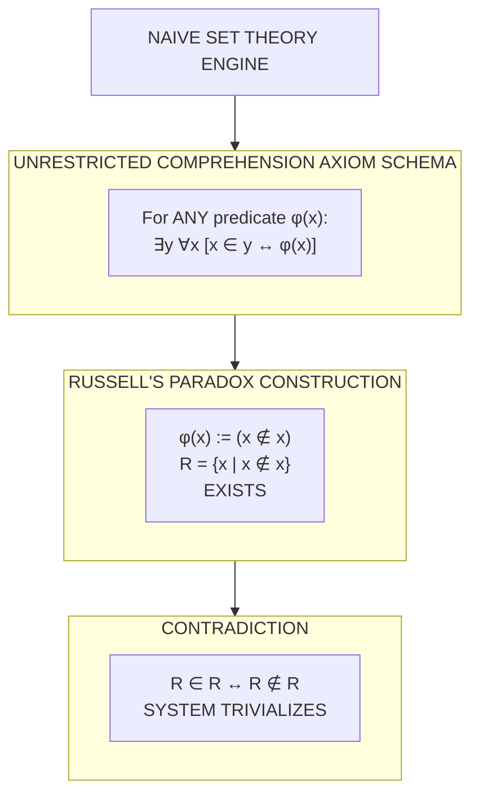
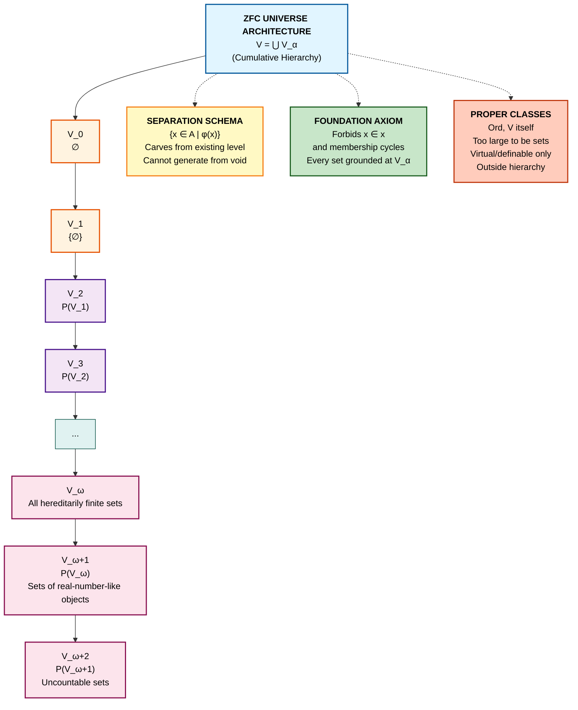

# Lesson 2: Set-Theoretic Paradoxes

## 1. First-Principles Intuition & Invariants

The history of modern mathematics contains no more instructive episode than its near-collapse at the hands of a postcard. In June 1902, Bertrand Russell wrote to Gottlob Frege, who had just completed the second volume of his *Grundgesetze der Arithmetik*, informing him that the system underlying the entire work admitted a contradiction derivable in a single paragraph. Frege's response, written in the shadow of a life's work unraveling, is among the most honest admissions in intellectual history: "Hardly anything more unwelcome can befall a scientific writer than to have one of the foundations of his edifice shaken after the work is finished." What Russell had discovered was not an obscure technicality but a wound in the logical body of mathematics so deep that it forced a complete reconstruction of the foundations. Understanding why requires following the original reasoning from its naive origins to its paradoxical conclusion, and then tracing the precise axiomatic surgery required to repair the damage.

The intellectual tradition that Russell interrupted was one of extraordinary ambition. Cantor's set theory, developed through the 1870s and 1880s, had transformed mathematics by providing a universal language in which every mathematical object could be expressed as a set. Numbers were sets. Functions were sets of ordered pairs. Geometric points were sets. The natural numbers could be constructed from the empty set alone through Zermelo's later encoding, and infinite cardinals formed a coherent hierarchy extending beyond any finite bound. The appeal of this framework was precisely its generality: given any property $P$ whatsoever, one could form the set of all things satisfying $P$. This principle, called *unrestricted comprehension*, was the engine of naive set theory, and it seemed as self-evident as any principle in logic. If you can describe a collection precisely, the collection exists as a mathematical object.

Frege had encoded unrestricted comprehension as his Basic Law V, which asserts that the extension of the concept $F$ equals the extension of the concept $G$ if and only if $F$ and $G$ apply to exactly the same objects. In modern notation, this is the claim that for any predicate $\varphi(x)$, the set $\{x \mid \varphi(x)\}$ exists. The deceptive power of this axiom is that it feels analytic. How could a well-defined predicate fail to pick out a collection? Russell's answer is that some predicates are *self-referential in a way that generates contradiction*, and the predicate "is not a member of itself" is the canonical case.

### Russell's Paradox: The Derivation

Define the Russell set $R$ by unrestricted comprehension as follows:

$$R = \{x \mid x \notin x\}$$

This is a perfectly syntactically well-formed predicate in the language of set theory. The set $R$ is intended to collect every set that does not contain itself as a member. Under naive set theory, $R$ must exist because the predicate $x \notin x$ is a legitimate condition. We now ask the binary question: does $R$ belong to itself?

**Case 1:** Suppose $R \in R$. Then $R$ satisfies the membership condition for $R$, which requires $R \notin R$. This is an immediate contradiction.

**Case 2:** Suppose $R \notin R$. Then $R$ satisfies the predicate $x \notin x$, which means by the definition of $R$ that $R \in R$. This is again an immediate contradiction.

Since $R \in R$ and $R \notin R$ are the only two possibilities and both yield contradictions, the system is inconsistent. In formal terms, from an inconsistent theory one can derive any statement whatsoever (by the principle of explosion, *ex contradictione quodlibet*), which means naive set theory proves every proposition simultaneously true and false. The theory is not merely incomplete; it is trivially consistent in the degenerate sense that it proves everything, which is logically equivalent to proving nothing of value.

The structure of the paradox is worth examining at the level of its logical form before proceeding, because Russell's paradox is not an isolated curiosity but an instance of a general *diagonal argument* that recurs throughout logic and computability theory. Define any binary relation $\sim$ on a domain $D$, and ask whether there is an element $d \in D$ such that for all $x \in D$, $d \sim x$ if and only if $x \not\sim x$. If such a $d$ exists, then substituting $d$ for $x$ yields $d \sim d \iff d \not\sim d$, an immediate contradiction. The Russell paradox arises when $\sim$ is $\in$ and $D$ is the universe of all sets. Cantor's diagonal argument for the uncountability of $\mathbb{R}$ is a *productive* deployment of the same structure: the constructed diagonal object is not a member of any enumerated set, but its existence is not forbidden by the ambient theory. Gödel's incompleteness theorem deploys the same diagonal mechanism at the level of provability predicates. This family resemblance is not coincidental; it reflects a deep structural fact about self-reference in formal systems, which we will examine in Lesson 4.

### Cantor's Paradox: The Set of All Sets

Before Russell's letter, Cantor himself had encountered related contradictions in the highest reaches of his own transfinite hierarchy, though he regarded them less as paradoxes than as confirmation that certain collections were too large to be sets at all. The argument now called Cantor's paradox strikes at the universal set $\mathcal{U} = \{x \mid x = x\}$, the purported set of absolutely everything.

Cantor's theorem, proved in 1891 through the same diagonal argument mentioned above, states that for any set $A$, the power set $\mathcal{P}(A)$ has strictly greater cardinality than $A$ itself. The formal statement requires establishing an injection from $A$ into $\mathcal{P}(A)$ (the map $a \mapsto \{a\}$ suffices) and showing that no surjection from $A$ onto $\mathcal{P}(A)$ can exist.

**Theorem (Cantor):** For any set $A$, there is no surjection $f: A \to \mathcal{P}(A)$.

**Proof:** Suppose for contradiction that $f: A \to \mathcal{P}(A)$ is surjective. Define the set

$$D = \{a \in A \mid a \notin f(a)\}$$

Since $f$ is surjective and $D \subseteq A$, there exists some $d \in A$ with $f(d) = D$. We now ask whether $d \in D$. If $d \in D$, then by definition of $D$ we have $d \notin f(d) = D$, a contradiction. If $d \notin D$, then since $d \in A$ and $d \notin f(d)$, the definition of $D$ requires $d \in D$, again a contradiction. Therefore no surjection from $A$ to $\mathcal{P}(A)$ exists. $\blacksquare$

Now apply this theorem to the universal set $\mathcal{U}$. Since $\mathcal{U}$ contains everything, it contains $\mathcal{P}(\mathcal{U})$ as a subset, which means $|\mathcal{P}(\mathcal{U})| \leq |\mathcal{U}|$. But Cantor's theorem guarantees $|\mathcal{U}| < |\mathcal{P}(\mathcal{U})|$. These two inequalities, $|\mathcal{P}(\mathcal{U})| \leq |\mathcal{U}|$ and $|\mathcal{U}| < |\mathcal{P}(\mathcal{U})|$, are mutually contradictory, so the universal set $\mathcal{U}$ cannot exist as a set within any consistent theory that validates Cantor's theorem.

### The Burali-Forti Paradox: The Ordinal of All Ordinals

The third foundational paradox, discovered by Cesare Burali-Forti in 1897 and predating Russell's formulation by five years, operates in the theory of ordinal numbers. Ordinals generalize the notion of counting position into the transfinite: after all finite ordinals $0, 1, 2, \ldots$ comes the first infinite ordinal $\omega$, then $\omega + 1$, $\omega + 2$, $\ldots$, $\omega \cdot 2$, and so on through an inexhaustible transfinite hierarchy. Each ordinal $\alpha$ can be identified, in the von Neumann encoding, with the set of all smaller ordinals: $\alpha = \{\beta \mid \beta < \alpha\}$. Under this encoding, $0 = \emptyset$, $1 = \{0\}$, $2 = \{0, 1\}$, and $\omega = \{0, 1, 2, \ldots\}$.

The class of all ordinals is well-ordered by the membership relation, meaning any nonempty subcollection has a least element. A fundamental property of the ordinal system is that every well-ordered set is order-isomorphic to a unique ordinal. If we denote by $\Omega$ the collection of all ordinals, then $\Omega$ is itself well-ordered by $\in$, and it must therefore be order-isomorphic to some ordinal $\alpha$. But the ordinal isomorphic to a well-ordered set is unique, and the ordinals less than $\alpha$ are exactly the members of $\alpha$. This means $\Omega$ is order-isomorphic to $\alpha$, so $\Omega$ must consist of exactly the ordinals less than $\alpha$, which forces $\Omega = \alpha$. But $\alpha$ is an ordinal, so $\alpha \in \Omega = \alpha$, meaning $\alpha \in \alpha$. This contradicts the well-foundedness of the ordinal ordering, under which no ordinal can be a member of itself, since the membership relation on ordinals is irreflexive. Therefore $\Omega$ cannot be a set.

Each of these three paradoxes has a distinct logical structure, but they share a common etiology: they arise when an *unrestricted* or *self-encompassing* collection is treated as a completed set subject to the same rules as ordinary sets. The resolution demanded by each paradox is the same in spirit, though different in technical detail: some collections are too large or too self-referential to be sets, and the foundational framework must enforce this distinction rigorously.

---

## 2. Core Architecture & Mechanics

The response to these paradoxes was not a single unified remedy but a family of competing foundational programs, each diagnosing the pathology differently and prescribing a different cure. The two most historically significant responses are Zermelo-Fraenkel set theory with the Axiom of Choice (ZFC) and Russell's own type-theoretic stratification. Understanding their internal architecture requires following the precise axiomatic mechanisms by which each one blocks the paradoxical derivations.

### The Architecture of Naive Set Theory and Its Failure Point

The deductive structure of naive set theory can be represented as a system with a single powerful schema that licenses set formation from any predicate. The flow of a paradox-generating derivation looks like this:

The failure is precisely localized: the unrestricted comprehension schema allows predicates that quantify over the very collection being defined, enabling circular self-reference of a destructive kind. Any repair must either restrict the predicates allowed in comprehension, stratify the universe so that self-membership is syntactically ill-formed, or introduce a size limitation that segregates paradox-generating collections from legitimate sets.

### ZFC: Stratified Comprehension and the Iterative Universe

Ernst Zermelo's 1908 axiomatization, later extended by Fraenkel, Skolem, and von Neumann into what we now call ZFC, takes the first path. The core insight, articulated most clearly by Zermelo, is that set formation must always proceed *relative to an already-existing set*. You cannot form the set of all $x$ satisfying $\varphi(x)$ from nothing; you can only separate out from an existing set $A$ those members that satisfy $\varphi$. This is the Axiom Schema of Separation (also called Restricted Comprehension or the Aussonderungsaxiom):

$$\forall A \, \exists B \, \forall x \, [x \in B \iff (x \in A \land \varphi(x))]$$

Under this schema, the Russell set cannot be formed in a vacuum. To apply the predicate $x \notin x$, one needs a pre-existing set $A$ to separate from, yielding only $R_A = \{x \in A \mid x \notin x\}$. This set exists for any $A$, but the paradoxical question $R_A \in R_A$ now has a definite, non-contradictory answer: $R_A \notin A$ (which can be proved directly), so $R_A$ simply does not qualify for membership in itself through the predicate, and the derivation halts without contradiction.

The full ZFC system consists of nine axiom schemas and axioms. The ones most directly responsible for the paradox-blocking architecture are worth examining in their logical form:

The **Axiom of Extensionality** establishes that sets are determined by membership alone:
$$\forall A \, \forall B \, [\forall x \, (x \in A \iff x \in B) \implies A = B]$$

The **Axiom of Foundation** (also called Regularity) is the structural axiom that eliminates self-membership and circular membership chains entirely. It asserts that every nonempty set $A$ contains an element disjoint from $A$:
$$\forall A \, [A \neq \emptyset \implies \exists x \, (x \in A \land x \cap A = \emptyset)]$$

This axiom has the consequence that $\forall x \, (x \notin x)$, proved as follows: suppose $x \in x$ for some $x$. Apply Foundation to the singleton $\{x\}$: there must exist a member $m \in \{x\}$ with $m \cap \{x\} = \emptyset$. The only member of $\{x\}$ is $x$ itself, so we need $x \cap \{x\} = \emptyset$. But $x \in x$ means $x \in x \cap \{x\}$, contradicting disjointness. Therefore $x \in x$ is false for all $x$.

The **Axiom Schema of Replacement** ensures the universe is closed under definable functions, while the **Axiom of Power Set** and **Axiom of Union** build new sets from old ones without introducing unrestricted collection. The resulting universe is the *von Neumann cumulative hierarchy* $V$, defined transfinitely as:

$$V_0 = \emptyset, \quad V_{\alpha+1} = \mathcal{P}(V_\alpha), \quad V_\lambda = \bigcup_{\alpha < \lambda} V_\alpha \text{ for limit ordinals } \lambda, \quad V = \bigcup_{\alpha \in \text{Ord}} V_\alpha$$

The deductive flow through ZFC looks fundamentally different from naive set theory:

In this architecture, the Russell set $R$ cannot be formed at all, because there is no universal set $V$ that is itself a set within the hierarchy. The collection of all sets exists only as a *proper class*, a virtual collection that can be quantified over in formulas but cannot appear as a member of anything, cannot be manipulated as a completed object, and does not satisfy the axioms governing sets. The Burali-Forti paradox is resolved analogously: $\text{Ord}$, the class of all ordinals, is a proper class, not a set, so the argument that $\Omega$ must be an ordinal and therefore $\Omega \in \Omega$ never gets off the ground. Cantor's paradox dissolves because the universal set does not exist; Cantor's theorem applies to sets, and there is no set of all sets whose power set could exceed it.

### Type Theory: Russell's Own Resolution

Russell's response to his paradox was structurally different from Zermelo's. Rather than restricting the domain of set formation, Russell proposed stratifying the universe into a hierarchy of *types* in which the predicate $x \in y$ is well-formed only when $y$ has type exactly one higher than $x$. In Russell and Whitehead's *Principia Mathematica* (1910–1913), the Simple Theory of Types (STT) is built on the following principle: every object belongs to a unique type, written $x : \tau$. Individuals are of type $0$, sets of individuals are of type $1$, sets of sets of individuals are of type $2$, and so forth. The membership predicate $x \in y$ is *syntactically meaningful* only when $\text{type}(y) = \text{type}(x) + 1$.

Under this stratification, the Russell predicate $x \notin x$ is not a falsehood — it is a *type error*. The expression $R = \{x \mid x \notin x\}$ cannot be written at all, because for any $x : \tau$, the formula $x \in x$ would require $x : \tau$ and $x : \tau + 1$ simultaneously, which the type discipline forbids. The paradox is blocked not by a semantic restriction on what sets exist, but by a syntactic restriction on what expressions are well-formed.

The connection between type theory and contemporary foundations runs deep. Per Martin-Löf's Intuitionistic Type Theory (1972–1984) and the subsequent development of the Calculus of Constructions undergirding Coq and Lean reformulate this idea in a *dependent* type system, where types can depend on terms. The Curry-Howard correspondence identifies propositions with types and proofs with terms, so that the logical consistency of the system corresponds directly to the normalization (termination) of its type-checking algorithm. In this setting, Russell's paradox reappears as the type-theoretic question of whether one can form a type $\mathcal{U}$ such that $\mathcal{U} : \mathcal{U}$, a *type-in-type* axiom. Girard's paradox (1972) shows that adding type-in-type to a dependent type theory makes it inconsistent by encoding the Burali-Forti paradox at the level of types. The resolution in modern proof assistants is a universe hierarchy $\mathcal{U}_0 : \mathcal{U}_1 : \mathcal{U}_2 : \cdots$, an exact structural mirror of von Neumann's cumulative hierarchy in ZFC.

The correspondence between ZFC's cumulative levels and type theory's universe stratification is not coincidental; both are implementations of the same underlying principle that the universe of mathematical objects must be built up in stages, with each stage's membership determined only from objects at lower stages, so that no collection can be a member of itself or of any collection at the same or lower level.

---

## 3. High-Performance Optimization & Failure Modes

For the working logician, mathematician, or theoretical computer scientist, the foregoing is not merely history. The paradoxes encode precise failure modes that reappear in formal verification, proof assistant design, type-theoretic programming languages, and the foundations of large cardinal arithmetic. Knowing exactly where naive reasoning breaks, and what axiomatic machinery prevents the break, is a practitioner skill of the first order.

### Working in ZFC: Avoiding Proper Class Errors

The most common foundational error in mathematical practice is treating a proper class as though it were a set. This error rarely produces an explicit derivation of $0 = 1$ in ordinary mathematical work, because most mathematicians operate far below the set-theoretic stratosphere where classes live, but it does produce subtle mistakes in category theory, model theory, and algebra.

The canonical case is the category **Set** of all sets. In naive category theory, one defines **Set** to have as its objects all sets and as its morphisms all functions between sets. But the collection of all sets is not a set in ZFC; it is the proper class $V$. If you treat **Set** as a set-sized object and apply set-theoretic constructions to it (forming the set of all functors out of **Set**, taking its power set, applying Cantor's theorem), you immediately enter paradox territory. The standard resolution is Grothendieck's universe axiom: fix an *inaccessible cardinal* $\kappa$ and work with $V_\kappa$ as your ambient "universe" of sets. Within $V_\kappa$, the category **Set$_\kappa$** of $\kappa$-small sets is a legitimate set-sized object, and all categorical constructions are safe. The price is an axiom (the existence of an inaccessible cardinal) that is not provable in ZFC but is consistent with it assuming ZFC is consistent.

In formal terms, a cardinal $\kappa$ is *inaccessible* if it is uncountable, a strong limit ($\alpha < \kappa \implies 2^\alpha < \kappa$), and regular (not the supremum of fewer than $\kappa$ smaller cardinals). These conditions ensure that $V_\kappa$ is itself a model of ZFC, so the internal category theory within $V_\kappa$ has the same closure properties you would expect from the full universe.

A parallel resolution arises in model theory. The completeness theorem asserts that every consistent first-order theory has a model. If you attempt to form "the set of all models of ZFC," you are attempting to collect a proper class into a set, since models of ZFC can have arbitrarily large cardinality. The standard practice is to either relativize to models below some bound, or use the Löwenheim-Skolem theorem to work with countable or $\kappa$-sized models depending on the application.

### Restricted Comprehension as a Formal Proof Obligation

When deriving results in ZFC, every set-formation step is implicitly a proof obligation that the constructed collection falls within the separation or replacement schema. This becomes explicit in machine-verified formalization. In Lean 4 or Coq, every definition of a set $\{x \in A \mid \varphi(x)\}$ requires:

1. The base set $A$ must already be in scope as a term of type `Set α` (or the appropriate universe level).
2. The predicate $\varphi$ must be a function of type `α → Prop`, making the comprehension `{x : α // φ x}` a well-typed subtype.
3. If $\varphi$ quantifies over a universe, the universe level must be strictly lower than the universe of the resulting set, enforcing the cumulative hierarchy syntactically.

The proof-assistant formulation makes the paradox-blocking mechanism not just a semantic guarantee but a *type-checking invariant*. Any attempt to form a type `{x : U // x ∉ x}` where `U` is the ambient universe fails at elaboration time with a universe inconsistency error, not at runtime and not at the level of a semantic proof.

### The Diagonal Lemma as a Precision Instrument

The practitioner's view of the Russell paradox is that the diagonal construction $D = \{x \in A \mid x \notin f(x)\}$ is not to be feared but to be *weaponized*. Every proof that uses a diagonal argument is in some sense a controlled, productive version of the same mechanism that produces Russell's paradox when uncontrolled. The key distinction is whether the diagonal argument is used to demonstrate the *non-existence* of a function (Cantor's theorem, the undecidability of the halting problem, Gödel's first incompleteness theorem) or is applied in an unrestricted domain where the diagonal object itself exists and generates a contradiction.

Cantor's theorem in its precise form is the statement:

$$\forall A, \quad |A| < |\mathcal{P}(A)|$$

which we proved above by constructing the diagonal set $D = \{a \in A \mid a \notin f(a)\}$ and showing $D \notin \text{im}(f)$ for any $f: A \to \mathcal{P}(A)$. The same argument, applied to the function $f: \mathbb{N} \to \{0,1\}^\mathbb{N}$ mapping each natural number to a binary sequence, yields the uncountability of the continuum. Applied to the function $f: \mathbb{N} \to \{\text{Turing machines}\}$ enumerating all Turing machines, it yields a function not computable by any Turing machine, which is the undecidability of the halting problem in its combinatorial core.

The practitioner's discipline, then, is to verify at each diagonal application that the domain and predicate satisfy the ambient theory's well-formedness conditions. When $A$ is a set within ZFC and $f$ is a definable function, the construction is safe and the conclusion is a theorem. When $A$ is a proper class or the construction violates type constraints, the diagonal argument produces a contradiction that signals a faulty assumption upstream.

### Failure Mode: Impredicative Definitions and Their Boundaries

A subtler failure mode than outright paradox is *impredicativity*, a form of circularity where a set or object is defined by reference to a totality of which it is itself a member. The Axiom of Separation in ZFC allows impredicative definitions: $\{x \in \mathbb{R} \mid \forall S \supseteq x, P(S)\}$ quantifies over all sets $S$ containing $x$, including the set being defined itself. ZFC permits this, and impredicative definitions are essential to mathematical analysis (the least upper bound of a subset of $\mathbb{R}$ is defined as the infimum over all upper bounds, an impredicative construction). The consistency of impredicativity in ZFC is guaranteed by the axioms, but it has a computational cost: impredicatively-defined objects generally cannot be computed by a finitary algorithm, because their definition has no finite unfolding.

Constructive and predicative foundations — Weyl's predicative analysis, Bishop's constructive mathematics, and Martin-Löf type theory without the impredicative universe — restrict comprehension further to predicative definitions, where the defined object cannot appear in its own defining predicate. This eliminates certain existence proofs (notably, the existence of the least upper bound of arbitrary bounded sets of reals) but yields a computationally meaningful mathematics in which every proof is simultaneously an algorithm. The trade-off is real: predicativity gives computation, impredicativity gives full classical analysis.

For the theoretical computer scientist, this trade-off maps directly to the distinction between *system $F$* (Girard's polymorphic lambda calculus, which is impredicative and cannot be assigned a simple proof-theoretic ordinal) and *system $F_\omega$* (impredicative) or *Martin-Löf type theory* (predicative, with a well-understood computational interpretation). Girard's paradox, mentioned above, shows that adding the impredicative axiom $\mathcal{U} : \mathcal{U}$ to a dependent type theory collapses the predicativity barrier and reintroduces a type-theoretic version of the Burali-Forti paradox. In Coq, this means `Set : Set` is disabled and replaced by an infinite universe hierarchy `Type_0 : Type_1 : Type_2 : ...`, with universe polymorphism providing the flexibility needed for practical formalization without sacrificing consistency.

### Consistency Strength and the Hierarchy of Axioms

A final, technically important perspective on the paradoxes is what they reveal about *consistency strength*. The fact that naive set theory is inconsistent is a proof of its inconsistency within any extension of propositional logic, since the derivation of $R \in R \iff R \notin R$ requires nothing beyond the comprehension axiom and elementary logical rules. ZFC, by contrast, is widely believed consistent but Gödel's second incompleteness theorem establishes that ZFC cannot prove its own consistency. This creates a strict hierarchy of axiomatic systems ordered by consistency strength, in which each system can prove the consistency of all weaker systems but not its own.

Adding large cardinal axioms to ZFC — measurable cardinals, Woodin cardinals, supercompact cardinals — produces systems of strictly increasing consistency strength. Each such axiom asserts the existence of a cardinal $\kappa$ so large that $V_\kappa$ is a model of ZFC (or of ZFC plus lower large cardinals), and each one is therefore unprovable in ZFC by the second incompleteness theorem. The resolution of the paradoxes by ZFC can thus be understood as occupying a specific position in this hierarchy: ZFC is powerful enough to do virtually all of modern mathematics, strong enough to refute the specific contradictions of naive set theory, and weak enough that its own consistency must be postulated, not proved. The paradoxes of Russell, Cantor, and Burali-Forti are not anomalies eventually cleaned up and forgotten; they are the precise fault lines that define the boundary between mathematical systems that are consistent but potentially limited and those that are more powerful but whose foundations rest on additional axiomatic faith.
