# Lesson 3: Semantic Paradoxes of Definability

## 1. First-Principles Intuition & Invariants

Language has an uncomfortable relationship with itself. When a formal or natural language attempts to speak about its own expressions — assigning meanings, lengths, and ordering to its own sentences — it courts a class of contradictions that are neither syntactic puzzles nor mere logical typos. They are deep structural wounds, and understanding them precisely is not optional for anyone who works with formal systems. The semantic paradoxes of definability are the clearest evidence we have that the naive identification of a language with its own metalanguage is not merely imprecise but demonstrably incoherent.

To appreciate why, begin with the most elementary invariant at stake. A language $\mathcal{L}$ is a collection of expressions — terms, formulas, sentences — built from a fixed alphabet according to explicit formation rules. The *semantics* of $\mathcal{L}$ is a separate layer: a mapping from syntactic expressions to objects in some domain of interpretation. The critical error in naive semantics is to assume that this mapping can itself be expressed inside $\mathcal{L}$. When we let $\mathcal{L}$ speak about the truth or reference of its own sentences without restriction, we give the language the power to form expressions that refer to their own semantic properties, and from that power the paradoxes follow immediately.

The three paradoxes examined in this lesson — Berry's, Richard's, and König's — each exploit a different facet of unrestricted definability. Berry's paradox concerns the *length* of definitions; Richard's concerns the *diagonal enumeration* of real numbers defined in English; König's concerns the *least ordinal* that escapes every finite description. What unites them is a single architectural fault: they each embed a metalinguistic predicate — "is definable by," "is nameable by," "is describable in fewer than $n$ syllables" — directly into the object language, and then apply that predicate self-referentially to produce a contradiction.

**Berry's Paradox.** G.H. Hardy attributed this observation to Bertrand Russell, who had it from G.G. Berry, an Oxford librarian with a gift for subversion. The setup is disarmingly simple. Consider all natural numbers that can be described in English using fewer than thirteen words. This is a finite set, since the number of English phrases of fewer than thirteen words is finite. Because the natural numbers form an infinite set, there must therefore exist natural numbers that *cannot* be described in fewer than thirteen words. Among these, there is a least element. We now have a twelve-word phrase: "the least natural number not describable in fewer than thirteen words." This phrase succeeds in describing, in twelve words, a number that by its own definition cannot be described in fewer than thirteen. We have derived a contradiction from the seemingly innocent concept of *describability in fewer than $n$ words*.

The formal reconstruction is instructive. Let $D$ be the predicate "is describable by an English phrase of fewer than thirteen words," and let $n_0 = \min\{n \in \mathbb{N} \mid \neg D(n)\}$. The paradox is precisely the derivation:

$$D(n_0) \iff \neg D(n_0)$$

The phrase "the least natural number not describable in fewer than thirteen words" is in $\mathcal{L}$ (English), and $D$ is treated as a predicate of $\mathcal{L}$. This is the structural error. $D$ is a *metalinguistic* predicate — it quantifies over expressions of $\mathcal{L}$ and assigns to them semantic properties — and the moment we treat it as an object-level predicate applicable to its own host language's terms, contradiction is guaranteed.

**Richard's Paradox.** Jules Richard published his version in 1905, two years after Berry's formulation reached Russell. Richard's construction targets the real numbers directly and anticipates both Cantor's diagonal argument and Gödel's arithmetization of syntax. Consider all finite English phrases that define a unique real number in $[0, 1]$. Because English is finitely alphabetic, these phrases can be lexicographically ordered and enumerated: $e_1, e_2, e_3, \ldots$, with associated real numbers $r_1, r_2, r_3, \ldots$ where $r_i$ is the real number defined by phrase $e_i$.

We now construct the Richard number $R$ by a diagonal procedure. For each $i$, let the $i$-th decimal digit of $R$ differ from the $i$-th decimal digit of $r_i$ by the rule: if the $i$-th digit of $r_i$ is $5$, let the $i$-th digit of $R$ be $4$; otherwise, let it be $5$. Formally:

$$R = 0.d_1 d_2 d_3 \cdots \quad \text{where} \quad d_i = \begin{cases} 4 & \text{if the } i\text{-th digit of } r_i = 5 \\ 5 & \text{otherwise} \end{cases}$$

By construction, $R$ differs from every $r_i$ in at least one decimal digit, so $R \notin \{r_1, r_2, r_3, \ldots\}$. Yet the sentence defining $R$ is itself a finite English phrase — the one you just read — and therefore $R$ should appear in our enumeration as some $r_k$. But then $R \neq r_k$ by the diagonal construction applied at position $k$. Contradiction.

The paradox mirrors the structure of Cantor's proof almost exactly, but with a critical difference. Cantor's diagonal argument is not paradoxical because it operates entirely within the metalanguage: Cantor enumerates *functions* and proves a function exists outside the enumeration, never conflating the enumerator with the enumerated. Richard's construction becomes paradoxical only because the phrase "the number defined by the following diagonal procedure applied to the enumeration of all English-definable reals" is itself in English and thus claims membership in the enumeration it was constructed to escape. The object language consumes its own metalanguage.

**König's Paradox.** Julius König stated his paradox in 1905 in direct response to Cantor's work on ordinals. The ordinal numbers, in the Cantorian framework, form a proper class well-ordered by the relation $\in$. Some ordinals are *finitely definable*: they can be uniquely specified by a finite English phrase. The collection of finitely definable ordinals is, like any set of finite descriptions, countable — there are only countably many finite strings over a finite alphabet. The class of all ordinals is not. Therefore there exist ordinals that are not finitely definable, and among these there is a least one, call it $\kappa_0$. But "the least ordinal that is not finitely definable in English" is itself a finite English phrase — it defines $\kappa_0$ uniquely. So $\kappa_0$ *is* finitely definable, contradicting its definition.

Schematically, with $F$ denoting the predicate "is finitely definable in English" and $\text{Ord}$ the class of all ordinals:

$$\kappa_0 = \min\{\alpha \in \text{Ord} \mid \neg F(\alpha)\} \implies F(\kappa_0) \iff \neg F(\kappa_0)$$

This is structurally identical to Berry's paradox, but with ordinals replacing natural numbers and the well-ordering of ordinals making the minimum uniquely defined — which eliminates one potential escape route and sharpens the contradiction.

**The Shared Invariant.** What all three paradoxes establish, taken together, is a fundamental *stratification constraint* on semantic predicates. Any predicate that quantifies over expressions of a language and attributes semantic properties to them — definability, naming, description — is not itself a predicate of that language. It belongs to a metalanguage that stands above the object language. The price of violating this stratification is not ambiguity or vagueness but outright logical contradiction. The formal discipline required to avoid this price is the subject of the remaining sections.

---

## 2. Core Architecture & Mechanics

### The Language-Metalanguage Hierarchy

The resolution of the definability paradoxes requires not a clever trick but a principled architectural reform: the strict stratification of linguistic levels. Alfred Tarski, whose 1933 monograph *The Concept of Truth in Formalized Languages* remains the definitive treatment, showed that truth — and by extension definability — cannot be a predicate of the language it evaluates. It must always be a predicate of a richer, encompassing metalanguage.

The architecture is as follows. We distinguish:

- An **object language** $\mathcal{L}_0$: a formal language with a fixed syntax and vocabulary, capable of expressing mathematical statements about some domain $\mathfrak{M}$.
- A **metalanguage** $\mathcal{L}_1$: a language that contains $\mathcal{L}_0$ as a sublanguage (or at least contains a syntactic description of $\mathcal{L}_0$), and that additionally contains semantic predicates such as $\text{True}_{\mathcal{L}_0}(\ulcorner \phi \urcorner)$, where $\ulcorner \phi \urcorner$ denotes the Gödel number of the formula $\phi$.
- A **meta-metalanguage** $\mathcal{L}_2$: a language that contains $\mathcal{L}_1$ and can define $\text{True}_{\mathcal{L}_1}$, and so on.

This generates a countably infinite hierarchy, often called the **Tarskian truth hierarchy**:

$$\mathcal{L}_0 \subset \mathcal{L}_1 \subset \mathcal{L}_2 \subset \cdots$$

where the containment is strict at each level. The semantics of $\mathcal{L}_n$ — including definability and truth for $\mathcal{L}_n$ — are expressible only in $\mathcal{L}_{n+1}$ or above, never in $\mathcal{L}_n$ itself.

The Mermaid diagram below renders the signal flow of a semantic evaluation request and shows precisely where the category error occurs in the naive case versus the stratified case:

```mermaid
flowchart TD
    subgraph Naive["Naive (Paradox-Generating) Architecture"]
        OL0["Object Language 𝓛₀\nContains: formulas, terms, sentences"]
        SEM0["Semantic Predicate\nTrue₀(⌈φ⌉), Definable₀(⌈t⌉)"]
        OL0 -- "defines its own semantics" --> SEM0
        SEM0 -- "evaluates expressions of" --> OL0
        CONTRA["⚡ CONTRADICTION\nSelf-Reference Closes the Loop"]
        SEM0 --> CONTRA
        OL0 --> CONTRA
    end

    subgraph Stratified["Stratified (Tarskian) Architecture"]
        L0["Object Language 𝓛₀\nArithmetic / First-Order Syntax"]
        L1["Metalanguage 𝓛₁\nContains syntax of 𝓛₀ as data\nDefines True₀(⌈φ⌉), Def₀(⌈t⌉)"]
        L2["Meta-Metalanguage 𝓛₂\nDefines True₁(⌈φ⌉), Def₁(⌈t⌉)"]
        L0 -- "object of study for" --> L1
        L1 -- "object of study for" --> L2
        L2 -- "... ℒₙ → ℒₙ₊₁ ..." --> Lomega["ω-Hierarchy\nComplete semantic coverage\nno single level self-applies"]
    end
```

The key observation encoded in the diagram is that in the naive architecture, the semantic predicate and the object language occupy the same level, allowing a closed evaluative loop. In the stratified architecture, evaluation always flows *upward*, and no level can serve as its own semantic interpreter.

### Tarski's Undefinability Theorem: Full Derivation

Tarski's Undefinability Theorem is the precise mathematical statement of why the naive architecture generates contradiction. It is not merely a philosophical observation but a theorem provable from the resources of first-order logic and elementary facts about Gödel numbering.

**Setup.** Let $\mathcal{L}$ be the first-order language of arithmetic, with the standard model $\mathfrak{N} = (\mathbb{N}, +, \times, 0, S)$. We work within Peano Arithmetic $\mathsf{PA}$ as a base theory. For each formula $\phi(x)$ of $\mathcal{L}$ with one free variable $x$, write $\ulcorner \phi \urcorner$ for its Gödel number — a natural number encoding the syntactic structure of $\phi$ via a fixed, computable injection $\ulcorner \cdot \urcorner : \text{Form}(\mathcal{L}) \to \mathbb{N}$.

**The Diagonal Lemma.** The engine of Tarski's proof — and of Gödel's incompleteness theorems — is the Diagonal Lemma, also called the Fixed-Point Lemma. Its proof is worth working through in full because it is the precise formal mechanism that replaces the intuitive self-reference in the natural-language paradoxes.

*Lemma (Diagonal / Fixed-Point):* For any formula $\Psi(x)$ of $\mathcal{L}$ with one free variable $x$, there exists a sentence $\sigma$ of $\mathcal{L}$ such that $\mathsf{PA} \vdash \sigma \leftrightarrow \Psi(\ulcorner \sigma \urcorner)$.

*Proof.* The proof exploits the fact that the substitution operation is representable in arithmetic. Define the *substitution function* $\text{sub} : \mathbb{N} \times \mathbb{N} \to \mathbb{N}$ by $\text{sub}(m, n) = \ulcorner \phi(\bar{n}) \urcorner$ when $m = \ulcorner \phi(x) \urcorner$ for some formula $\phi(x)$ with one free variable, and $m$ is not such a code otherwise. Here $\bar{n}$ denotes the numeral for $n$ — the term $S^n(0)$ in the language. This function is primitive recursive and therefore representable in $\mathsf{PA}$ by some formula $\text{Sub}(x, y, z)$ satisfying $\mathsf{PA} \vdash \text{Sub}(\bar{m}, \bar{n}, \bar{k}) \leftrightarrow k = \text{sub}(m,n)$.

Now, given $\Psi(x)$, define the formula $\Theta(y) \equiv \exists z\, (\text{Sub}(y, y, z) \land \Psi(z))$. Set $m = \ulcorner \Theta(y) \urcorner$ and $\sigma = \Theta(\bar{m})$. Then:

$$\ulcorner \sigma \urcorner = \ulcorner \Theta(\bar{m}) \urcorner = \text{sub}(m, m) = \text{sub}(\ulcorner \Theta \urcorner, \ulcorner \Theta \urcorner)$$

Working within $\mathsf{PA}$:

$$\sigma \equiv \Theta(\bar{m}) \equiv \exists z\,(\text{Sub}(\bar{m}, \bar{m}, z) \land \Psi(z))$$

Since $\text{Sub}(\bar{m}, \bar{m}, \bar{k})$ holds in $\mathfrak{N}$ if and only if $k = \text{sub}(m, m) = \ulcorner \sigma \urcorner$, we have:

$$\mathsf{PA} \vdash \sigma \leftrightarrow \exists z\,(\text{Sub}(\bar{m}, \bar{m}, z) \land \Psi(z)) \leftrightarrow \Psi(\ulcorner \sigma \urcorner)$$

This completes the proof of the Diagonal Lemma. $\square$

The lemma is the formal backbone. It shows that any property $\Psi$ expressible in $\mathcal{L}$ has a sentence $\sigma$ that "says of itself" that it has property $\Psi$. This is the controlled, arithmetic form of the self-reference that in natural language produces Berry's and König's paradoxes uncontrollably.

**Tarski's Undefinability Theorem.** *There is no formula $\text{True}(x)$ of $\mathcal{L}$ such that for every sentence $\phi$ of $\mathcal{L}$:*

$$\mathfrak{N} \models \text{True}(\ulcorner \phi \urcorner) \iff \mathfrak{N} \models \phi \tag{T}$$

*Proof.* Suppose for contradiction that such a formula $\text{True}(x)$ exists. Apply the Diagonal Lemma to the formula $\Psi(x) \equiv \neg\,\text{True}(x)$. The lemma yields a sentence $\lambda$ such that:

$$\mathsf{PA} \vdash \lambda \leftrightarrow \neg\,\text{True}(\ulcorner \lambda \urcorner) \tag{1}$$

Now evaluate in the standard model $\mathfrak{N}$. First, suppose $\mathfrak{N} \models \lambda$. By the assumed property (T) of $\text{True}$:

$$\mathfrak{N} \models \text{True}(\ulcorner \lambda \urcorner)$$

But by (1) and the assumption $\mathfrak{N} \models \lambda$:

$$\mathfrak{N} \models \neg\,\text{True}(\ulcorner \lambda \urcorner)$$

Contradiction. Second, suppose $\mathfrak{N} \models \neg\lambda$. Then $\mathfrak{N} \not\models \lambda$, so by (T), $\mathfrak{N} \not\models \text{True}(\ulcorner \lambda \urcorner)$, meaning $\mathfrak{N} \models \neg\,\text{True}(\ulcorner \lambda \urcorner)$. By (1), $\mathfrak{N} \models \lambda$. Contradiction again. Since both cases lead to contradiction, the assumption that $\text{True}(x)$ exists as a formula of $\mathcal{L}$ is false. $\square$

The sentence $\lambda$ constructed in this proof is the formal analogue of the Liar sentence "This sentence is not true." The Diagonal Lemma gives it rigorous arithmetic content, and Tarski's theorem shows that the existence of a truth predicate within $\mathcal{L}$ forces exactly the contradiction that the natural-language version produces informally. The difference is that here the proof is entirely precise: we know exactly what assumption fails and exactly why.

### Definability in a Formal Language: The Mechanics

With the theorem established, we can now articulate precisely what *definability* means in the stratified framework and how it differs at each level of the hierarchy.

A term $t$ of $\mathcal{L}_0$ *defines* a natural number $n$ in model $\mathfrak{N}$ if $t$ is a closed term and $t^{\mathfrak{N}} = n$. A formula $\phi(x)$ with one free variable *defines the number $n$* if $\phi(x)$ is satisfied uniquely by $n$ in $\mathfrak{N}$: $\mathfrak{N} \models \phi(\bar{n})$ and for all $m \neq n$, $\mathfrak{N} \not\models \phi(\bar{m})$. The set of $\mathcal{L}_0$-definable natural numbers is then:

$$\text{Def}(\mathcal{L}_0, \mathfrak{N}) = \{n \in \mathbb{N} \mid \exists \phi(x) \in \text{Form}_1(\mathcal{L}_0) : \mathfrak{N} \models \phi(\bar{n}) \land \forall m \neq n, \mathfrak{N} \not\models \phi(\bar{m})\}$$

Since $\mathcal{L}_0$ has only countably many formulas, $\text{Def}(\mathcal{L}_0, \mathfrak{N})$ is at most countable. If $\mathfrak{N} = \mathfrak{N}_{\text{std}}$ (the standard model of arithmetic), then in fact $\text{Def}(\mathcal{L}_0, \mathfrak{N}_{\text{std}})$ is a proper subset of $\mathbb{N}$: there exist natural numbers not definable in $\mathcal{L}_0$. König's paradox is the naive attempt to name the least such number *from within $\mathcal{L}_0$*, which Tarski's theorem forbids.

The predicate "$n$ is $\mathcal{L}_0$-definable" is a predicate about expressions of $\mathcal{L}_0$, hence a predicate of $\mathcal{L}_1$. Within $\mathcal{L}_1$, this predicate is entirely coherent and well-defined: $\mathcal{L}_1$ can express the formula $\text{Def}_{\mathcal{L}_0}(n) \equiv \exists e\,(e \text{ is a Gödel code of an } \mathcal{L}_0\text{-formula uniquely satisfied by } n)$, because $\mathcal{L}_1$ has the resources to quantify over Gödel numbers and evaluate the semantic relation $\mathfrak{N} \models \phi(\bar{n})$ for $\mathcal{L}_0$-formulas $\phi$. The least $\mathcal{L}_0$-undefinable ordinal is a coherent concept in $\mathcal{L}_1$ — it simply cannot be expressed as an $\mathcal{L}_0$-term, which is precisely the point. No contradiction arises because "is $\mathcal{L}_0$-definable" is a predicate of $\mathcal{L}_1$, not of $\mathcal{L}_0$.

### Arithmetizing Definability: A Worked Computation

To ground this in explicit mechanics, consider a minimal first-order language $\mathcal{L}_0 = \{0, S, +, \times\}$ and work through a concrete stratification. We want to verify that the number $2$ is $\mathcal{L}_0$-definable, that the predicate confirming this lives in $\mathcal{L}_1$, and that the diagonal lemma does not generate a paradox at level $\mathcal{L}_0$.

First, $2 = S(S(0))$ is defined by the $\mathcal{L}_0$-formula $\phi(x) \equiv (x = S(S(0)))$. This is a formula of $\mathcal{L}_0$ uniquely satisfied by $2$ in $\mathfrak{N}$. So $2 \in \text{Def}(\mathcal{L}_0, \mathfrak{N})$.

Second, the statement "there exists an $\mathcal{L}_0$-formula uniquely satisfied by $2$" is a statement of $\mathcal{L}_1$. Its formal expression requires:

1. A formula of $\mathcal{L}_1$ encoding the property "is a Gödel number of an $\mathcal{L}_0$-formula with one free variable," call it $\text{Form}_1^0(e)$.
2. The satisfaction predicate $\text{Sat}_0(e, n)$: "the formula with Gödel number $e$ is satisfied in $\mathfrak{N}$ by $n$." By Tarski's theorem, $\text{Sat}_0$ is not an $\mathcal{L}_0$-formula; it is an $\mathcal{L}_1$-formula.
3. Combining: $\text{Def}_0(n) \equiv \exists e\,(\text{Form}_1^0(e) \land \text{Sat}_0(e, n) \land \forall m \neq n\,\neg \text{Sat}_0(e, m))$, which is an $\mathcal{L}_1$-formula.

Third, the Diagonal Lemma applied within $\mathcal{L}_0$ to the $\mathcal{L}_1$-formula $\neg\text{Def}_0(x)$ cannot be executed, because $\neg\text{Def}_0(x)$ is not a formula of $\mathcal{L}_0$. The diagonal construction requires the formula to live in the same language as the sentence it produces. Since $\text{Def}_0$ is not an $\mathcal{L}_0$-predicate, the Berry-König self-reference cannot be constructed at level $\mathcal{L}_0$. At level $\mathcal{L}_1$, applying the Diagonal Lemma to $\neg\text{Def}_0$ produces an $\mathcal{L}_1$-sentence $\sigma$ such that $\mathcal{L}_1 \vdash \sigma \leftrightarrow \neg\text{Def}_0(\ulcorner \sigma \urcorner)$, but this generates no contradiction: $\text{Def}_0$ is a predicate about $\mathcal{L}_0$-definability, and $\sigma$ is an $\mathcal{L}_1$-sentence, so $\sigma$ is simply *not in the domain* of $\text{Def}_0$. The predicate evaluates to false for $\sigma$, and $\sigma$ truly is not $\mathcal{L}_0$-definable, consistently.

This is the precise mechanism by which stratification defuses paradox. The apparent self-reference in Berry, Richard, and König arises only when the defining language and the defined domain are conflated into a single level.

---

## 3. High-Performance Optimization & Failure Modes

### Working Correctly with the Hierarchy: Practitioner Discipline

For a logician or theoretical computer scientist working with formal systems, the stratification architecture is not merely a philosophical safeguard but a practical constraint on proof construction. The most common failure mode in formal semantic work is *level confusion* — inadvertently using a semantic predicate of level $n+1$ as though it were a predicate of level $n$, either by omitting level subscripts or by conflating syntactic representability with semantic definability.

A disciplined practice requires maintaining explicit bookkeeping of linguistic level for every predicate in a derivation. When you write a satisfaction clause $\mathfrak{M} \models \phi[\bar{a}]$, you are writing in the metalanguage of $\phi$'s language. If $\phi \in \mathcal{L}_n$, then this satisfaction statement lives in $\mathcal{L}_{n+1}$ at minimum. If you need to quantify over satisfaction — asserting "for all $\mathcal{L}_n$-sentences $\phi$, if $\mathfrak{M} \models \phi$ then $\ldots$" — you are working in $\mathcal{L}_{n+1}$, and any further semantics applied to *that* universally quantified statement requires $\mathcal{L}_{n+2}$.

One high-value optimization in this bookkeeping is the observation that many standard mathematical results, while *stated* at a high metalinguistic level, can be *proven* using only a bounded fragment of the hierarchy. For instance, the completeness theorem for first-order logic ($\mathsf{PA}$ is complete for its standard model if and only if every $\mathsf{PA}$-consistent set has a model) is a theorem of $\mathcal{L}_1$, not requiring more than one metalinguistic ascent. Keeping proofs as low in the hierarchy as possible reduces the risk of inadvertent level confusion and keeps the proof's foundational commitments transparent.

### The Richard Paradox and Diagonal Arguments: Distinguishing Good from Bad Diagonalization

The Richard paradox is the most instructive because it most closely mimics a legitimate mathematical construction — Cantor's diagonalization. The practitioner must be able to identify, with precision, what makes Cantor's argument valid and Richard's argument paradoxical, since the two are superficially nearly identical.

Cantor's proof that $\mathbb{R}$ is uncountable proceeds as follows. Assume for contradiction that there is a surjection $f : \mathbb{N} \to [0,1]$. Construct $R \in [0,1]$ by the diagonal rule: the $n$-th decimal digit of $R$ differs from the $n$-th decimal digit of $f(n)$. Then $R \neq f(n)$ for all $n$, contradicting surjectivity. The construction of $R$ takes place entirely in the metalanguage of real analysis — we are constructing a real number *from outside any enumeration* by a rule stated in the metalanguage. The enumeration $f$ is an object in the mathematical universe, and the diagonal procedure is applied to it from without.

Richard's argument attempts the same diagonal procedure but collapses the distinction between the construction and the enumeration. The enumeration $e_1, e_2, \ldots$ consists of English phrases that *define* real numbers, and the diagonal construction is itself an English phrase. So the construction is simultaneously *inside the enumeration* (as an English phrase) and *outside it* (as a diagonal escape). This is precisely the level confusion: the diagonal procedure, to avoid paradox, must be carried out in a language that does not appear in the enumeration. In Cantor's proof, the metalanguage of real analysis is *not* itself being enumerated. In Richard's paradox, the metalanguage (English) *is* the object language (English), and the enumeration claims to cover all of it.

The diagnostic test for a valid diagonal argument versus a Richard-type paradox is therefore: does the language in which the diagonal construction is described appear as an item in the enumeration? If yes, the argument is paradox-generating. If no — if the construction is stated in a language that strictly contains but is not contained in the enumerated language — the argument is valid. Cantor passes this test because real-analytic metalanguage is not being enumerated; Richard fails because English is being enumerated by English.

### Failure Mode: Attempting Uniform Truth Definitions

The most common technical failure in constructing formal semantic theories is attempting to define a *uniform* truth predicate — one that applies to all sentences of an entire language simultaneously — within that same language. This is precisely what Tarski's theorem forbids, but the temptation arises repeatedly in different forms.

One form of the failure is the attempt to define truth in $\mathsf{PA}$ by induction on formula complexity. The base case for atomic formulas is straightforward: define $\text{True}(s = t)$ as "$s$ and $t$ denote the same number," which is an arithmetically definable relation on numerals. For boolean connectives: $\text{True}(\neg\phi) \equiv \neg\text{True}(\phi)$ and $\text{True}(\phi \land \psi) \equiv \text{True}(\phi) \land \text{True}(\psi)$. For quantifiers: $\text{True}(\exists x\,\phi(x)) \equiv \exists n\,\text{True}(\phi(\bar{n}))$. This inductive definition appears perfectly coherent at each step, and indeed for any *fixed* quantifier depth $k$, it succeeds: we can define $\text{True}_k$ as the truth predicate for formulas with at most $k$ nested quantifiers, and $\text{True}_k$ is a $\Sigma_{k+1}$ formula of arithmetic.

The failure occurs when we attempt to close the induction and define $\text{True} = \bigcup_k \text{True}_k$ as a uniform predicate. Such a predicate would be $\Sigma_\omega$ — it would not belong to any finite level of the arithmetical hierarchy $\Sigma_n$ or $\Pi_n$. And indeed, the arithmetical truth predicate for the standard model is not arithmetically definable at all: it is complete for $\text{Th}(\mathfrak{N})$, which sits outside the arithmetical hierarchy entirely. This is the content of Tarski's theorem restated in terms of definability complexity.

The correct resolution, adopted in practice, is to work with the *partial* truth predicates $\text{Tr}_n$ for $\Sigma_n$-formulas, where $\text{Tr}_n$ is itself $\Sigma_n$-definable. The partial truth predicates satisfy the Tarski biconditionals for their respective levels:

$$\mathsf{PA} \vdash \text{Tr}_n(\ulcorner \phi \urcorner) \leftrightarrow \phi \quad \text{for all } \phi \in \Sigma_n \cup \Pi_n$$

but no single formula satisfies the biconditional uniformly across all levels. This hierarchy of partial truth predicates is the working tool in proof complexity, reverse mathematics, and the analysis of formal theories stronger than $\mathsf{PA}$.

### Failure Mode: Misapplying the Compactness Theorem Across Levels

A subtler failure mode arises in model theory when applying the compactness theorem to theories formulated at a level where definitional resources have been implicitly elevated. The compactness theorem states that a set $T$ of $\mathcal{L}$-sentences has a model if and only if every finite subset of $T$ has a model. The theorem is a theorem *of the metalanguage* of $\mathcal{L}$; it quantifies over models of $\mathcal{L}$, which are set-theoretic objects in the metalanguage.

The failure occurs when $T$ is specified using predicates that implicitly presuppose a richer language than $\mathcal{L}$. For example, suppose one attempts to formulate within first-order arithmetic $\mathcal{L}_0$ a theory $T$ that "includes all true statements of $\mathcal{L}_0$" — the complete diagram of $\mathfrak{N}$. The complete diagram is not a first-order theory in $\mathcal{L}_0$; it is a theory in $\mathcal{L}_1$ (since specifying "all true statements" requires the truth predicate, which is a metalinguistic object). Applying compactness to such a $T$ as though it were an $\mathcal{L}_0$-theory conflates levels and produces reasoning that cannot be validated within any single formal system.

The discipline required here is to verify, before applying any metalinguistic theorem — compactness, completeness, Löwenheim-Skolem — that the theory and language involved are uniformly specified at a single stratification level. If a theory is defined using semantic criteria ("all sentences true in $\mathfrak{N}$"), it is a $\mathcal{L}_1$-object and must be treated as such in all subsequent reasoning.

### Hierarchical Semantics in Type Theory and Constructive Logic

The Tarskian hierarchy has a direct and practically important descendant in type theory, specifically in the treatment of universes in dependent type theories such as Martin-Löf Type Theory (MLTT) and its descendants Coq and Agda. In these systems, types are themselves terms, and the type of all types — if unrestricted — produces Girard's paradox, the type-theoretic analogue of Russell's paradox and of the definability paradoxes.

The resolution is a *universe hierarchy* $\mathcal{U}_0 : \mathcal{U}_1 : \mathcal{U}_2 : \cdots$ where each universe $\mathcal{U}_i$ contains the types definable at level $i$ and is itself a member of $\mathcal{U}_{i+1}$ but not of $\mathcal{U}_i$. This directly mirrors the Tarskian stratification: the type of all $\mathcal{U}_i$-types is not a $\mathcal{U}_i$-type; it lives strictly at the next level. In Coq, this is enforced automatically by the kernel's universe checker, which tracks universe levels for every type judgment and rejects derivations that would require a universe to contain itself.

For the theoretical computer scientist, the practical implication is that any proof assistant based on a stratified type theory is implementing, in its kernel, a computational enforcement of Tarski's undefinability theorem. The error message "universe inconsistency" is the system detecting an attempted level collapse — a machine-verified refusal to allow the Richard or Berry construction at the type-theoretic level. Understanding the semantic paradoxes is therefore not merely historical background but direct foundational knowledge for work in proof assistants, formal verification, and the metatheory of programming languages.

The lesson of definability paradoxes, carried from Berry's twelve-word phrase through Tarski's arithmetic proof to the universe hierarchies of modern proof assistants, is constant: a language that speaks about its own semantic properties without restriction is a language that contradicts itself. Stratification is not a limitation imposed from outside but a structural necessity emerging from within logic itself — the minimum architecture a language must have to remain both expressive and consistent.
