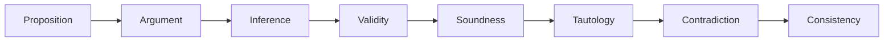

# Beginner Foundation: Mathematical Logic
=====================================================

## 1. Everyday Intuition & First Principles

Mathematical logic is the study of reasoning and argumentation using mathematical symbols and techniques. It's like a game of chess, where you use rules and strategies to win. Just as chess players must understand the rules of the game, mathematicians use logic to understand the rules of reasoning.

Imagine you're trying to decide whether to go to the movies or stay home. You might think:

* "If it's raining, I won't go to the movies."
* "But if it's not raining, I will go to the movies."
* "And if I'm tired, I won't go to the movies, regardless of the weather."

This is a simple example of a logical argument. We use rules (if-then statements) to reason about our decision.

## 2. Foundational Vocabulary & Glossary

Here are 8 fundamental terms in mathematical logic, defined simply with examples:

### 1. Proposition

A statement that is either true or false. Example: "The sky is blue."

### 2. Argument

A series of statements that lead to a conclusion. Example: "If it's raining, I won't go to the movies. It's raining. Therefore, I won't go to the movies."

### 3. Inference

The process of drawing a conclusion from a set of premises. Example: "All humans are mortal. Socrates is human. Therefore, Socrates is mortal."

### 4. Validity

The property of an argument that makes it impossible for the conclusion to be false if the premises are true. Example: "If it's raining, I won't go to the movies. It's raining. Therefore, I won't go to the movies" is a valid argument.

### 5. Soundness

The property of an argument that makes it impossible for the premises to be true and the conclusion to be false. Example: "All humans are mortal. Socrates is human. Therefore, Socrates is mortal" is a sound argument.

### 6. Tautology

A statement that is always true. Example: "All bachelors are unmarried."

### 7. Contradiction

A statement that is always false. Example: "All bachelors are married."

### 8. Consistency

The property of a set of statements that makes it impossible for them to be all true and all false at the same time. Example: "I am either in the library or I am not in the library. I am not in the library. Therefore, I am not in the library" is a consistent set of statements.

## 3. Visual System Flow

Here is a clean ASCII diagram and Mermaid flowchart of the basic workflow in mathematical logic:

## 4. Common Beginner Misconceptions & Mental Traps

* **The fallacy of affirming the consequent**: assuming that if a statement is true, then its conclusion must also be true.
* **The fallacy of denying the antecedent**: assuming that if a statement is false, then its conclusion must also be false.
* **The assumption of excluded middle**: assuming that a statement is either true or false, without considering other possibilities.

## 5. Socratic Discussion Starters

* What is the difference between a valid and sound argument?
* Can you think of a situation where a tautology is useful?
* How can you use mathematical logic to improve your critical thinking skills?
* What are some common fallacies in everyday reasoning, and how can you avoid them?
