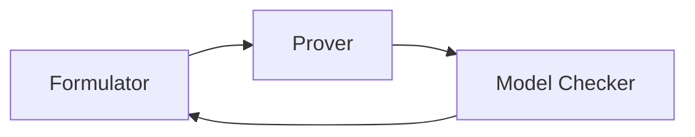

# Intermediate Foundation: Mathematical Logic
==============================================

## 1. Architectural Mental Model
-----------------------------

### 1.1. Formal System Components

A formal system in mathematical logic consists of:

*   **Language**: A set of symbols, including variables, constants, and logical operators.
*   **Semantics**: A mapping of the language to a set of possible interpretations or models.
*   **Inference Rules**: A set of rules governing the derivation of new formulas from existing ones.

### 1.2. System Design Patterns

Common design patterns in mathematical logic include:

*   **Propositional Calculus**: Deals with statements that can be either true or false.
*   **Predicate Calculus**: Extends propositional calculus to include quantifiers (e.g., ∀, ∃).
*   **Modal Logic**: Studies modalities such as necessity and possibility.

### 1.3. Formal System Taxonomy

Formal systems can be classified based on their:

*   **Completeness**: Whether the system can derive all valid formulas.
*   **Consistency**: Whether the system avoids contradictions.
*   **Decidability**: Whether there exists an algorithm to determine the validity of a formula.

## 2. Systems Taxonomy & Component Protocols
------------------------------------------

### 2.1. Logical Connectives

Common logical connectives include:

*   **Conjunction** (∧): A ∧ B is true if both A and B are true.
*   **Disjunction** (∨): A ∨ B is true if either A or B is true.
*   **Negation** (¬): ¬A is true if A is false.

### 2.2. Quantifiers

Quantifiers are used to express universal and existential statements:

*   **Universal Quantification** (∀): ∀x P(x) means P(x) is true for all x.
*   **Existential Quantification** (∃): ∃x P(x) means there exists an x such that P(x) is true.

### 2.3. Formal System Protocols

Formal systems often involve protocols for:

*   **Inference**: Deriving new formulas from existing ones.
*   **Model Checking**: Verifying the validity of a formula in a given model.

## 3. Multi-Component Interaction Flow
--------------------------------------

### 3.1. ASCII Sequence Diagram

```
A -> B: P(x)
B --> C: ∃x P(x)
C --> A: ∀x P(x)
```

### 3.2. Mermaid Sequence Diagram



## 4. Architectural Trade-offs & Production Pitfalls
---------------------------------------------------

### 4.1. Completeness vs. Consistency

Formal systems often trade off between completeness and consistency:

*   **Completeness**: Derive all valid formulas.
*   **Consistency**: Avoid contradictions.

### 4.2. Decidability vs. Undecidability

Formal systems can be either decidable or undecidable:

*   **Decidability**: Existence of an algorithm to determine validity.
*   **Undecidability**: No algorithm can determine validity.

## 5. Socratic Discussion Starters
----------------------------------

### 5.1. Bridging Architecture to Implementation

*   How do you ensure the completeness of your formal system?
*   What are the trade-offs between decidability and undecidability in your system?
*   How do you verify the consistency of your formal system?

These discussion starters can help bridge the gap between architectural design and low-level implementation.
