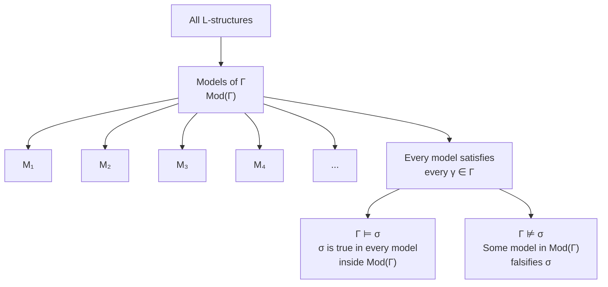

# Lesson 3: First-Order Predicate Logic — Quantifiers, Structures, Satisfaction

## 1. First-Principles Intuition & Invariants

Propositional logic, for all its elegance, is a language without memory. It can say that some proposition $P$ is true or that $Q$ implies $R$, but it cannot say that *every* natural number greater than one has a prime divisor, or that *there exists* a graph with no Hamiltonian cycle. The moment you need to reason about objects, their properties, and the relationships between them, propositional logic falls silent. First-order predicate logic is the language invented to fill that silence. It is the foundational language of modern mathematics, the substrate on which Peano arithmetic, Zermelo-Fraenkel set theory, and the axiom systems for groups and fields are all constructed. Understanding it deeply is not merely a matter of academic completeness — it is the prerequisite for understanding Gödel's Incompleteness Theorems, the semantics of programming languages, database query theory, and automated theorem proving.

The central conceptual leap from propositional to first-order logic is the introduction of two orthogonal mechanisms: *terms*, which name or denote objects in some domain, and *quantifiers*, which make claims ranging over all or some of those objects. The universal quantifier $\forall$ asserts that a property holds for every element of the domain; the existential quantifier $\exists$ asserts that at least one element satisfies some condition. These two symbols, combined with predicate symbols, function symbols, variables, and the logical connectives inherited from propositional logic, generate a language of extraordinary expressive power.

### The Architecture of a First-Order Language

A first-order language $\mathcal{L}$ is not a single fixed thing but a parametric family. Each instance of $\mathcal{L}$ is determined by its *non-logical signature*, which specifies three ingredient types. First, a set of *constant symbols* $c_1, c_2, \ldots$ — these are nullary terms intended to name specific individuals in the domain. Second, a set of *function symbols* $f, g, h, \ldots$, each with a fixed *arity* $n \geq 1$, used to build compound terms from simpler ones. Third, a set of *predicate symbols* (also called *relation symbols*) $P, Q, R, \ldots$, each again with a fixed arity, used to express properties of and relations among individuals.

On top of this signature sits the fixed *logical vocabulary*: an infinite supply of individual variables $x, y, z, x_1, x_2, \ldots$, the Boolean connectives $\neg, \land, \lor, \to, \leftrightarrow$, the quantifiers $\forall$ and $\exists$, the equality symbol $=$ (when the language includes equality), and parentheses for grouping. This separation between logical vocabulary, which is universal, and non-logical vocabulary, which varies by application domain, is a crucial architectural choice. It allows the same syntactic and semantic machinery to serve group theory, arithmetic, graph theory, and topology simultaneously.

### Terms and Their Formation

The *terms* of $\mathcal{L}$ are defined inductively, capturing the class of expressions that can denote objects. Every variable $x_i$ is a term. Every constant symbol $c_i$ is a term. If $f$ is an $n$-ary function symbol and $t_1, t_2, \ldots, t_n$ are terms, then $f(t_1, t_2, \ldots, t_n)$ is a term. No other expression is a term. This inductive definition is not merely notational tidiness; it provides the recursive structure on which inductive proofs and recursive definitions over terms are grounded. For example, in the language of arithmetic with signature $\{0, 1, +, \times\}$, the expression $+(×(x_1, x_1), 1)$ — written more naturally as $x_1^2 + 1$ — is a term of three levels of nesting, and every step of its construction is witnessed by one application of the formation rule above.

### Atomic and Compound Formulas

From terms, we build *atomic formulas*. If $P$ is an $n$-ary predicate symbol and $t_1, \ldots, t_n$ are terms, then $P(t_1, \ldots, t_n)$ is an atomic formula. If $=$ is in the signature, then $t_1 = t_2$ is also atomic for any two terms. These are the basic sentences about objects: they assert that a tuple of objects stands in some relation.

Compound formulas are built by the following inductive clauses. If $\varphi$ and $\psi$ are formulas, then so are $\neg\varphi$, $(\varphi \land \psi)$, $(\varphi \lor \psi)$, $(\varphi \to \psi)$, and $(\varphi \leftrightarrow \psi)$. If $\varphi$ is a formula and $x$ is a variable, then $\forall x\, \varphi$ and $\exists x\, \varphi$ are formulas. These last two clauses are what distinguishes first-order from propositional logic. The result of prefixing $\forall x$ or $\exists x$ to a formula $\varphi$ is to *bind* occurrences of $x$ within $\varphi$, transforming free object-level variables into quantified placeholders.

### Free and Bound Variables

The distinction between *free* and *bound* occurrences of a variable is one of the most practically important subtleties in first-order syntax, because it determines the semantic meaning of a formula and the conditions under which substitution is valid.

An occurrence of a variable $x$ in a formula $\varphi$ is *bound* if it falls within the scope of a $\forall x$ or $\exists x$ quantifier in $\varphi$. Otherwise, it is *free*. The scope of a quantifier $\forall x$ in $\forall x\, \varphi$ is the subformula $\varphi$ immediately following it. When a variable has a free occurrence in $\varphi$, the formula's truth value depends on what that variable is assigned as a value. A formula with no free variables is a *sentence* — its truth value is entirely determined by the structure it is interpreted in, without reference to any assignment of variables. A formula with free variables behaves more like a predicate: it is a condition that may or may not be satisfied by a given tuple of elements.

Consider the formula $\varphi(x) \equiv \exists y\, (y > x)$ in the language of arithmetic. Here, $y$ is bound by the existential quantifier, while $x$ is free. The formula says "there exists something greater than $x$," and whether this is true depends on what $x$ is assigned and in what structure we evaluate it. Over $\mathbb{N}$, it is true for every assignment to $x$. Over a finite ordered set with a maximum element, it fails for that maximum.

The same variable can have both free and bound occurrences in a single formula. In $P(x) \land \exists x\, Q(x)$, the first occurrence of $x$ in $P(x)$ is free, while the $x$ in $Q(x)$ is bound by the $\exists x$ immediately preceding it. This situation is legal but highly inadvisable in practice, since it creates syntactic ambiguity that obscures mathematical intent. Any such formula can be *renamed* (by $\alpha$-renaming bound variables) to an equivalent formula with clearly separated free and bound variables.

### Substitution and Its Hazards

Substitution is the operation of replacing free occurrences of a variable $x$ in a formula $\varphi$ with a term $t$, written $\varphi[t/x]$. The substitution must be performed *simultaneously* on all free occurrences of $x$. The critical correctness condition is that the substitution be *free for $x$ in $\varphi$*: no variable occurring in $t$ should become bound after the substitution. For example, suppose $\varphi \equiv \exists y\, (x < y)$ and we wish to substitute the term $y + 1$ for $x$. If we naively produce $\exists y\, (y + 1 < y)$, the free $y$ in the term $y + 1$ has been captured by the quantifier $\exists y$, and the result is a formula with entirely different meaning — in fact, a false arithmetic statement in $\mathbb{N}$. The fix is to first $\alpha$-rename the bound variable: replace $\exists y\, (x < y)$ with $\exists z\, (x < z)$, and then substitute to get $\exists z\, (y + 1 < z)$, which correctly asserts that $y + 1$ has a strict upper bound. This seemingly technical issue becomes essential in proof theory, where substitution underpins the elimination rules for quantifiers, and in formal verification, where capture-avoiding substitution is a core algorithmic operation.

---

## 2. Core Architecture & Mechanics

### First-Order Structures

Syntax alone is a purely formal game — strings of symbols manipulated by rules. What gives first-order logic its power and its connection to mathematics is *semantics*: the assignment of meaning to syntactic expressions. The vehicle for this meaning is a *first-order structure* (also called an *interpretation* or a *model*).

A first-order structure $\mathcal{M}$ for a language $\mathcal{L}$ consists of two components. The first is a non-empty set $M$, called the *domain* (or *universe*) of $\mathcal{M}$. This is the set of objects that the quantifiers $\forall$ and $\exists$ range over. The second is an *interpretation function* that assigns meaning to each non-logical symbol of $\mathcal{L}$:

$$\mathcal{M} = (M,\, \{c^{\mathcal{M}}\}_{c \in \mathcal{L}},\, \{f^{\mathcal{M}}\}_{f \in \mathcal{L}},\, \{P^{\mathcal{M}}\}_{P \in \mathcal{L}})$$

For each constant symbol $c$, the interpretation $c^{\mathcal{M}}$ is a specific element of $M$. For each $n$-ary function symbol $f$, the interpretation $f^{\mathcal{M}}$ is a total function $f^{\mathcal{M}} : M^n \to M$. For each $n$-ary predicate symbol $P$, the interpretation $P^{\mathcal{M}}$ is a subset of $M^n$ — the set of $n$-tuples on which the predicate is declared to hold.

To make this concrete, consider the language of *ordered fields*, with signature $\{0, 1, +, \times, \leq\}$ where $0, 1$ are constants, $+$ and $\times$ are binary function symbols, and $\leq$ is a binary predicate. The structure $\mathcal{R} = (\mathbb{R}, 0, 1, +_{\mathbb{R}}, \times_{\mathbb{R}}, \leq_{\mathbb{R}})$ is a first-order structure for this language, with domain $\mathbb{R}$, constants interpreted as the real numbers zero and one, function symbols interpreted as ordinary addition and multiplication, and $\leq$ interpreted as the standard real ordering. The structure $\mathcal{Q} = (\mathbb{Q}, 0, 1, +_{\mathbb{Q}}, \times_{\mathbb{Q}}, \leq_{\mathbb{Q}})$ is a *different* structure for the same language, with domain $\mathbb{Q}$. In both structures, the axioms of ordered fields are satisfied, but the sentence $\exists x\, (x \times x = 1 + 1)$ — asserting the existence of $\sqrt{2}$ — is true in $\mathcal{R}$ and false in $\mathcal{Q}$. This elementary observation illustrates the fundamental point: the truth value of a sentence is not an intrinsic property of the sentence alone but of the sentence together with a structure.

### Variable Assignments

Sentences have a fixed truth value in a given structure, but *formulas with free variables* require an additional ingredient: a *variable assignment* (or *valuation*), which is a function $s : \text{Var} \to M$ mapping each variable to an element of the domain. We write the evaluation of term $t$ under structure $\mathcal{M}$ and assignment $s$ as $t^{\mathcal{M}}[s]$, defined recursively:

For a variable $x$, the value is $x^{\mathcal{M}}[s] = s(x)$. For a constant $c$, the value is $c^{\mathcal{M}}[s] = c^{\mathcal{M}}$. For a compound term $f(t_1, \ldots, t_n)$, the value is $f^{\mathcal{M}}(t_1^{\mathcal{M}}[s], \ldots, t_n^{\mathcal{M}}[s])$. The function $f^{\mathcal{M}}$ is applied to the values of the subterms, recursively computed. This compositional evaluation is the semantic counterpart of the inductive syntactic definition of terms, and it is what makes the semantics *compositional*: the meaning of a complex expression is fully determined by the meanings of its parts.

For the modified assignment that maps $x$ to element $a \in M$ and agrees with $s$ on all other variables, we write $s[x \mapsto a]$. This notation is used pervasively in the satisfaction clauses for quantified formulas.

### Tarski's Definition of Truth

Alfred Tarski's 1935 definition of truth in formal languages — published in Polish as *Pojęcie prawdy w językach nauk dedukcyjnych* and later in German as *Der Wahrheitsbegriff in den formalisierten Sprachen* — resolved a central crisis in the foundations of mathematics. Prior to Tarski, the concept of "truth" was philosophically contested and mathematically ill-defined. Tarski showed how to give a rigorous, model-theoretic definition of truth for first-order languages, one that is both intuitively correct (the formula $P(a)$ is true in $\mathcal{M}$ precisely when $a$ stands in the relation $P^{\mathcal{M}}$) and mathematically tractable. The definition proceeds by structural induction on formulas.

We write $\mathcal{M} \models \varphi[s]$ to mean "formula $\varphi$ is *satisfied* in structure $\mathcal{M}$ under assignment $s$," read "$\mathcal{M}$ satisfies $\varphi$ under $s$" or "$\varphi$ is true in $\mathcal{M}$ under $s$." The full inductive definition is:

**Atomic case.** For a predicate $P$ and terms $t_1, \ldots, t_n$:
$$\mathcal{M} \models P(t_1, \ldots, t_n)[s] \iff (t_1^{\mathcal{M}}[s], \ldots, t_n^{\mathcal{M}}[s]) \in P^{\mathcal{M}}$$

For equality:
$$\mathcal{M} \models (t_1 = t_2)[s] \iff t_1^{\mathcal{M}}[s] = t_2^{\mathcal{M}}[s]$$

**Negation:**
$$\mathcal{M} \models \neg\varphi[s] \iff \mathcal{M} \not\models \varphi[s]$$

**Conjunction and disjunction:**
$$\mathcal{M} \models (\varphi \land \psi)[s] \iff \mathcal{M} \models \varphi[s] \text{ and } \mathcal{M} \models \psi[s]$$
$$\mathcal{M} \models (\varphi \lor \psi)[s] \iff \mathcal{M} \models \varphi[s] \text{ or } \mathcal{M} \models \psi[s]$$

**Universal quantifier:**
$$\mathcal{M} \models \forall x\, \varphi[s] \iff \text{for every } a \in M,\; \mathcal{M} \models \varphi[s[x \mapsto a]]$$

**Existential quantifier:**
$$\mathcal{M} \models \exists x\, \varphi[s] \iff \text{there exists some } a \in M \text{ such that } \mathcal{M} \models \varphi[s[x \mapsto a]]$$

The quantifier clauses are where Tarski's definition delivers its deepest insight. To verify $\forall x\, \varphi$, one must check every possible assignment of $x$ to elements of $M$. If $M$ is infinite, this is an infinite conjunction — the semantics does not require that the proof be finite; it only requires that the truth-condition be mathematically well-defined, which it is by the axiom of choice or simply by set-theoretic quantification over $M$. The existential clause is an infinite disjunction: $\exists x\, \varphi$ is satisfied if and only if at least one element of $M$ witnesses the formula.

A critical structural lemma follows immediately from this definition.

**Lemma (Coincidence Lemma).** The truth value of $\mathcal{M} \models \varphi[s]$ depends only on the values $s(x)$ assigns to the *free variables* of $\varphi$. Formally, if $s$ and $s'$ agree on all variables free in $\varphi$ — that is, $s(x) = s'(x)$ for every $x$ with a free occurrence in $\varphi$ — then:
$$\mathcal{M} \models \varphi[s] \iff \mathcal{M} \models \varphi[s']$$

*Proof.* The proof proceeds by structural induction on $\varphi$. For atomic formulas, the truth value depends only on the values of the terms appearing in them, and term evaluation depends only on the variables occurring in those terms, all of which are free in the atomic formula. The Boolean connective cases are immediate from the inductive hypothesis. For the quantifier case, suppose $\varphi \equiv \forall x\, \psi$ and $s, s'$ agree on all variables free in $\varphi$. The free variables of $\varphi$ are the free variables of $\psi$ except $x$. For any $a \in M$, the assignments $s[x \mapsto a]$ and $s'[x \mapsto a]$ agree on all variables free in $\psi$ (they agree on all variables other than $x$, and they both map $x$ to $a$). By the inductive hypothesis applied to $\psi$:
$$\mathcal{M} \models \psi[s[x \mapsto a]] \iff \mathcal{M} \models \psi[s'[x \mapsto a]]$$
Since this holds for every $a \in M$, we conclude $\mathcal{M} \models \forall x\, \psi[s] \iff \mathcal{M} \models \forall x\, \psi[s']$. The existential case is symmetric. $\square$

An immediate corollary: for a *sentence* $\sigma$ (a formula with no free variables), the truth value $\mathcal{M} \models \sigma[s]$ does not depend on $s$ at all. We may therefore write simply $\mathcal{M} \models \sigma$ and speak of sentences as being true or false in a structure, without reference to any assignment.

### A Worked Model: The Language of Graphs

Let $\mathcal{L}_G$ be the first-order language with a single binary predicate symbol $E$, intended to represent the edge relation of a graph. Consider the formula expressing that $E$ is *symmetric* (an undirected edge):

$$\sigma_{\text{sym}} \equiv \forall x\, \forall y\, (E(x,y) \to E(y,x))$$

And the formula expressing that no vertex has a self-loop:

$$\sigma_{\text{no-loop}} \equiv \forall x\, \neg E(x, x)$$

Take the structure $\mathcal{G} = (\{1, 2, 3\},\, E^{\mathcal{G}})$ where $E^{\mathcal{G}} = \{(1,2),(2,1),(2,3),(3,2),(1,3),(3,1)\}$ — the complete graph $K_3$. We verify $\mathcal{G} \models \sigma_{\text{sym}}$. By Tarski's universal quantifier clause, we must check that for every $a, b \in \{1,2,3\}$, if $(a,b) \in E^{\mathcal{G}}$ then $(b,a) \in E^{\mathcal{G}}$. Inspection of $E^{\mathcal{G}}$ confirms this for all nine pairs. We verify $\mathcal{G} \models \sigma_{\text{no-loop}}$ by checking that $(a,a) \notin E^{\mathcal{G}}$ for $a \in \{1,2,3\}$, which holds. The formula expressing that the graph has *at least two vertices*,

$$\sigma_{\geq 2} \equiv \exists x\, \exists y\, \neg(x = y)$$

is satisfied in $\mathcal{G}$ by the witness $(a,b) = (1,2)$, since $(1^{\mathcal{G}}, 2^{\mathcal{G}})$ satisfies $\neg(x = y)$ under the assignment $s[x \mapsto 1, y \mapsto 2]$.

This example illustrates the workflow a logician follows when checking satisfaction: unpack the formula's structure inductively, reduce quantifiers to checks over domain elements, and evaluate predicates by consulting the structure's interpretation of the predicate symbol.

### The Satisfaction Relation and Semantic Consequence

Having defined satisfaction for formulas and sentences in a single structure, we now scale to sets of sentences — the natural setting for axiom systems. If $\Gamma$ is a set of $\mathcal{L}$-sentences and $\sigma$ is an $\mathcal{L}$-sentence, we say that $\sigma$ is a *semantic consequence* of $\Gamma$, written $\Gamma \models \sigma$, if every structure $\mathcal{M}$ that satisfies every sentence in $\Gamma$ also satisfies $\sigma$:

$$\Gamma \models \sigma \iff \text{for every } \mathcal{M},\; (\forall \gamma \in \Gamma,\; \mathcal{M} \models \gamma) \implies \mathcal{M} \models \sigma$$

This is the central notion of *logical validity* for first-order logic, and it generalizes the propositional notion of tautological consequence. The quantification is over *all* structures for the language — an enormously broad class. When $\Gamma = \emptyset$, the condition simplifies to: $\sigma$ is true in every $\mathcal{L}$-structure, and we call $\sigma$ *logically valid* or a *tautology* of first-order logic, written $\models \sigma$.

For example, the sentence $\forall x\, (P(x) \to P(x))$ is logically valid: in any structure, for any $a$ in the domain, $P^{\mathcal{M}}(a) \to P^{\mathcal{M}}(a)$ holds by the propositional tautology $p \to p$. By contrast, $\forall x\, P(x) \to \exists x\, P(x)$ is also logically valid, because if $P$ holds universally then it holds for at least one element (the domain is non-empty by the convention that structures have non-empty domains). The non-emptiness convention is essential here and is a deliberate design decision: allowing empty domains would invalidate this and several other desirable logical laws.

The structure of the semantic consequence relation can be visualized as follows, illustrating how a set of axioms $\Gamma$ carves out a class of models, and how consequence propagates from that class:

A *theory* $T$ in first-order logic is a deductively closed set of sentences: if $T \models \sigma$ then $\sigma \in T$. The theory of a structure $\mathcal{M}$, written $\text{Th}(\mathcal{M})$, is the set of all sentences true in $\mathcal{M}$, and it is always a complete theory — for every sentence $\sigma$, either $\sigma \in \text{Th}(\mathcal{M})$ or $\neg\sigma \in \text{Th}(\mathcal{M})$, by the law of excluded middle applied at the semantic level. The theory of the standard natural numbers, $\text{Th}(\mathbb{N}, 0, s, +, \times)$ — known as *true arithmetic* — is a paradigmatic example of a complete, semantically defined theory that, by Gödel's First Incompleteness Theorem, is not recursively axiomatizable.

---

## 3. High-Performance Optimization & Failure Modes

### Common Errors in Model Construction and Verification

The working logician encounters a surprisingly consistent set of failure modes when constructing or verifying first-order structures. Each corresponds to a gap between syntactic intuition and the precise semantic definition.

The most pervasive error is *domain-blindness* — constructing a formula that is intuitively correct but technically false in a structure because the domain contains unexpected elements. Consider the axiom system for a *dense linear order without endpoints*, consisting of sentences that assert transitivity, totality, density ($\forall x\, \forall y\, (x < y \to \exists z\, (x < z \land z < y))$), and the absence of minimum and maximum elements. The theory $\text{DLO}$ is well-known to be complete and, by Cantor's theorem, to be the theory of $(\mathbb{Q}, <)$. A student might believe that the formula $\exists x\, \exists y\, (x < y \land \neg \exists z\, (x < z \land z < y))$ — asserting adjacent elements — is false in every model of $\text{DLO}$. This is correct, since $\text{DLO} \models \neg\sigma$ where $\sigma$ is this formula. But the correctness of the claim must be verified against *all* models of $\text{DLO}$, not just $(\mathbb{Q}, <)$. Since DLO is complete, this amounts to verifying it in any single infinite model, but the logical step — that completeness licenses checking one model — requires explicit justification.

A second failure mode is *quantifier scope confusion*, which produces syntactically valid but semantically ill-formed reasoning. Consider attempting to prove $\forall x\, \varphi(x) \to \varphi(t)$ for an arbitrary term $t$. This *universal instantiation* principle is semantically valid when $t$ is free for $x$ in $\varphi$. If $t$ contains a variable $y$ that would become captured by a quantifier in $\varphi$, the naive application fails. Concretely, in the formula $\varphi(x) \equiv \exists y\, (x + y = 0)$ over integer arithmetic, $\varphi(x)$ is true for all $x$ (every integer has an additive inverse). But substituting the term $y$ for $x$ yields $\exists y\, (y + y = 0)$, which asserts that $2y = 0$, true only for $y = 0$ in $\mathbb{Z}$ — not the universally quantified statement we intended. The substitution was not free, and the instantiation was therefore illegitimate.

A third failure mode is the conflation of *logical consequence* and *truth in a specific intended model*. Many students argue that a sentence $\sigma$ follows from an axiom set $\Gamma$ on the basis that $\sigma$ is true in the "natural" or "standard" model for $\Gamma$. This argument is insufficient. For the axioms of Peano arithmetic, the standard model is $\mathbb{N}$. But the semantic consequence relation $\Gamma_{\text{PA}} \models \sigma$ requires $\sigma$ to hold in *every* model of $\Gamma_{\text{PA}}$, including the non-standard models that the Compactness and Löwenheim-Skolem theorems guarantee to exist. A sentence provable in $\mathbb{N}$ but not provable from $\Gamma_{\text{PA}}$ is not a logical consequence of $\Gamma_{\text{PA}}$; it may be true in $\mathbb{N}$ while failing in some non-standard model.

### Satisfiability Checking: Systematic Construction of Falsifying Structures

When asked to determine whether a set of sentences $\Gamma$ is satisfiable — whether some structure $\mathcal{M}$ exists in which every sentence of $\Gamma$ is true — the most reliable method is to attempt to construct such a structure directly, following the *Henkin construction* strategy in miniature.

The first step is to determine the domains demanded by the existential sentences in $\Gamma$. Each sentence of the form $\exists x\, \psi$ requires at least one witness in the domain. Universal sentences impose constraints on all domain elements. If $\Gamma$ contains $\forall x\, (P(x) \to Q(x))$ and $P(c)$, then any model must have $Q(c^{\mathcal{M}})$. Building the model means choosing a domain and interpreting symbols to satisfy all these constraints simultaneously, checking for contradictions.

To show $\Gamma$ is *unsatisfiable*, it suffices to derive a contradiction from $\Gamma$ using a sound proof system — but semantically, it means showing that no structure can satisfy all sentences. The *compactness theorem* provides a critical tool here: $\Gamma$ is unsatisfiable if and only if some *finite* subset $\Gamma_0 \subseteq \Gamma$ is unsatisfiable. This means that when searching for a falsifying structure, one need only examine finite subsets of a potentially infinite axiom system — a result of immense practical and theoretical importance.

### Definability and the Expressive Limits of First-Order Logic

Part of mastering first-order logic as a practitioner is knowing what the language *cannot* express — recognizing the ceiling of its expressive power so as not to mistake the absence of a proof for a failure of ingenuity. First-order logic cannot directly express *finiteness*: there is no first-order sentence $\sigma$ that is satisfied by exactly the finite structures. This follows from the compactness theorem by a standard argument: if $\sigma$ were satisfied by all and only finite structures, then adding sentences $\exists x_1 \exists x_2 \cdots \exists x_{n} \bigwedge_{i \neq j} \neg(x_i = x_j)$ asserting "at least $n$ distinct elements" to $\{\sigma\}$ would yield a finitely satisfiable set of sentences, hence satisfiable by compactness, whose models include an infinite structure satisfying $\sigma$ — contradiction.

Similarly, first-order logic over graphs cannot express *connectivity*: "this graph is connected" is not first-order expressible. The model-theoretic witness is again compactness or, more precisely, the Ehrenfeucht-Fraïssé games that characterize elementary equivalence. A connected and a disconnected graph can be made to agree on all first-order sentences up to quantifier depth $k$ by ensuring they look locally identical. The logician working on database theory or formal verification must know these limits, since they demarcate when first-order logic (SQL, essentially, is a first-order language over relational structures) is insufficient and when richer formalisms — monadic second-order logic, least fixed-point logic, or infinitary languages — become necessary.

### The Relationship Between Syntactic Proof and Semantic Consequence

The semantic consequence relation $\Gamma \models \sigma$ and the syntactic provability relation $\Gamma \vdash \sigma$ (in a Hilbert-style system or sequent calculus) are related by the two most important metatheorems in classical first-order logic. *Soundness* states that if $\Gamma \vdash \sigma$ then $\Gamma \models \sigma$: every provable sentence is semantically valid. *Completeness*, proved by Gödel in 1929 (not to be confused with the later incompleteness theorems), states the converse: if $\Gamma \models \sigma$ then $\Gamma \vdash \sigma$. Together, they establish that the proof system is an exact syntactic characterization of semantic consequence.

Gödel's Completeness Theorem should be appreciated at full depth. It says that the proof system — a finite, recursively enumerable set of inference rules — captures all of semantic consequence over the uncountable class of all first-order structures. This is a profound non-trivial fact: there is no semantic consequence that "slips through the cracks" of the proof system. The proof proceeds by constructing a canonical model from maximally consistent sets of sentences (the Lindenbaum construction), showing that any consistent set of sentences is satisfiable. As an immediate corollary, one obtains the Compactness Theorem: if every finite subset of $\Gamma$ is satisfiable, then $\Gamma$ itself is satisfiable.

What Gödel's 1929 Completeness Theorem gives, the 1931 Incompleteness Theorems constrain from a different angle. The completeness theorem guarantees that provability and semantic consequence coincide. The incompleteness theorems show that for any consistent, recursively axiomatized theory $T$ extending Peano arithmetic, there exist true sentences in the standard model $\mathbb{N}$ that are not provable from $T$ — equivalently, there exist sentences that are *true in $\mathbb{N}$* but are *not semantic consequences of $T$*, because they fail in some non-standard model. The completeness theorem is not violated: the sentence is a semantic consequence of $\text{Th}(\mathbb{N})$, the full theory of arithmetic, but $T$ is a strictly weaker theory than $\text{Th}(\mathbb{N})$, and $\text{Th}(\mathbb{N})$ itself is not recursively axiomatizable. The apparent paradox dissolves once one is careful to specify *with respect to which theory* semantic consequence is being computed.

The practitioner who internalizes this distinction — between truth in a specific structure, logical validity, semantic consequence from a theory, and syntactic provability — has achieved genuine fluency in first-order logic. These four notions coincide in special circumstances and diverge in precisely the ways that the structure of mathematical logic demands. Working with that divergence, rather than against it, is what separates the sophisticated logician from the student who learned the syntax but not the semantics.
