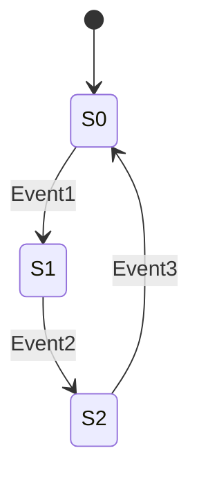

# Advanced Foundation: Model Theory
## 1. Theoretical Invariants & Formal Frameworks (Formal proofs, kernel or physical invariants)

Model Theory is a branch of mathematical logic that investigates the relationship between formal languages and their interpretations, or models. In the context of formal frameworks and theoretical invariants, we are particularly interested in understanding how mathematical structures can be described and analyzed through logical models.

### Formal Proofs and Invariants

A **formal proof** in model theory is a sequence of well-formed formulas, each of which is either an axiom or follows from previous formulas by rules of inference. The concept of invariants in model theory is closely tied to the idea of properties that remain unchanged under certain transformations or interpretations.

**Example: The Compactness Theorem**

The Compactness Theorem is a fundamental result in model theory that states that a set of first-order sentences has a model if and only if every finite subset of it has a model. This theorem is crucial for establishing the existence of models with specific properties, which can be seen as invariants in the context of logical structures.

\[
\text{If } \Gamma \text{ is a set of first-order sentences and every finite subset of } \Gamma \text{ has a model, then } \Gamma \text{ has a model.}
\]

### Kernel or Physical Invariants

In the realm of computer science, particularly in the context of operating systems and hardware, **kernel invariants** are conditions that must always hold true during the execution of the kernel. These invariants are critical for ensuring the stability and security of the system.

**Example: Memory Management Invariants**

In a memory management system, a key invariant is that the memory allocator never returns overlapping regions of memory to different processes. This can be formally expressed as:

\[
\forall \text{ processes } p_1, p_2, \forall \text{ regions } r_1, r_2: (p_1 \neq p_2 \land r_1 \cap r_2 \neq \emptyset) \rightarrow \text{False}
\]

## 2. Low-Level Invariant Taxonomy (Deep registers, memory models, hardware constraints, or axiomatic definitions)

Understanding the low-level invariants of a system is crucial for designing robust and secure systems. This section explores the taxonomy of invariants at the hardware and low-level software layers.

### Deep Registers and Memory Models

**Deep Registers:**

Deep registers are low-level storage locations within a processor that are used to store intermediate results during computation. Invariants related to deep registers often involve ensuring that the values stored in these registers remain consistent with the expected state of the computation.

**Memory Models:**

Memory models define the rules for how memory operations are ordered and executed. A key invariant in memory models is the **sequential consistency** property, which ensures that all memory operations appear to have occurred in a single, global order.

\[
\forall \text{ memory operations } o_1, o_2: (o_1 \text{ happens-before } o_2) \rightarrow (\text{all processors see } o_1 \text{ before } o_2)
\]

### Hardware Constraints and Axiomatic Definitions

**Hardware Constraints:**

Hardware constraints are physical limitations imposed by the architecture of a system. For example, a constraint might be that a certain instruction can only be executed if a specific register is in a particular state.

**Axiomatic Definitions:**

Axiomatic definitions provide a formal basis for reasoning about the behavior of a system. In model theory, axioms are used to define the properties of the logical structures being studied.

\[
\text{Axiom of Choice: } \forall \mathcal{F} \subseteq \mathcal{P}(X) \setminus \{\emptyset\}, \exists f: \mathcal{F} \rightarrow X \text{ such that } \forall A \in \mathcal{F}, f(A) \in A
\]

## 3. Micro-Architecture & Concurrency Dynamics (Mermaid and ASCII state machines / cache / race condition diagrams)

Understanding the micro-architecture and concurrency dynamics of a system is essential for identifying potential failure modes and optimizing performance. This section uses Mermaid and ASCII diagrams to illustrate these concepts.

### State Machines and Cache Dynamics

**State Machines:**

State machines are used to model the behavior of systems that transition between a finite number of states. In the context of micro-architecture, state machines can be used to model the behavior of the processor's control unit.



**Cache Dynamics:**

Cache dynamics involve the behavior of the cache memory in a system. A key invariant in cache dynamics is that the data stored in the cache is consistent with the data stored in main memory.

```
+-------------------+
| Main Memory       |
+-------------------+
| Address 0: Data A |
| Address 1: Data B |
+-------------------+
          |
          v
+-------------------+
| Cache             |
+-------------------+
| Address 0: Data A |
+-------------------+
```

### Concurrency Dynamics and Race Conditions

**Concurrency Dynamics:**

Concurrency dynamics involve the behavior of systems that execute multiple threads or processes simultaneously. In the context of micro-architecture, concurrency dynamics can be modeled using state machines or other formalisms.

**Race Conditions:**

A race condition occurs when the behavior of a system depends on the relative timing of events. Race conditions can lead to subtle and difficult-to-diagnose bugs.

```
+-------------------+
| Thread 1          |
+-------------------+
| Read X            |
| Write X           |
+-------------------+
          |
          v
+-------------------+
| Thread 2          |
+-------------------+
| Read X            |
| Write X           |
+-------------------+
```

## 4. Subtle Failure Modes & Boundary Conditions

Identifying subtle failure modes and boundary conditions is crucial for designing robust and reliable systems. This section explores some of the most challenging failure modes and boundary conditions in model theory and computer science.

### Subtle Failure Modes

**Subtle Failure Modes:**

Subtle failure modes are errors that are difficult to detect and diagnose. In the context of model theory, subtle failure modes can occur when a model does not accurately capture the behavior of the system being studied.

**Example: Non-Standard Models:**

Non-standard models are models of a theory that contain elements that do not exist in the standard model. Non-standard models can lead to subtle failure modes if they are not properly accounted for.

### Boundary Conditions

**Boundary Conditions:**

Boundary conditions are the values of a function on the boundary of its domain. In the context of computer science, boundary conditions can lead to failure modes if they are not properly handled.

**Example: Integer Overflow:**

Integer overflow occurs when an arithmetic operation results in a value that is outside the range of the data type being used. Integer overflow can lead to subtle failure modes if it is not properly detected and handled.

## 5. Master Socratic Inquiries (Research-grade discussion questions)

Master Socratic inquiries are designed to promote deep and critical thinking about the concepts and principles of model theory and computer science. This section provides a set of research-grade discussion questions.

### Research-grade Discussion Questions

**Question 1:**

How can model theory be used to analyze the behavior of complex systems, such as operating systems or distributed systems?

**Question 2:**

What are the key challenges in identifying and handling subtle failure modes in model theory and computer science?

**Question 3:**

How can formal methods, such as model checking or theorem proving, be used to ensure the correctness of low-level invariants in hardware and software systems?

**Question 4:**

What are the implications of non-standard models in the context of computer science and formal logic?

**Question 5:**

How can the principles of model theory be applied to the design and analysis of secure and reliable systems?
