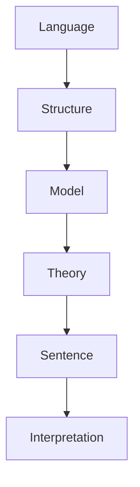

# Beginner Foundation: Model Theory
## 1. Everyday Intuition & First Principles

Imagine you have a set of rules for a game, like chess. These rules define how the pieces move, how the game is won, and what constitutes a valid move. Now, think of model theory as a way to study these rules and understand all the possible ways the game could be played according to those rules. Just as chess has many possible games, a set of rules (or a theory) in model theory can have many different models (or interpretations). Model theory helps us explore these different possibilities and understand the structure of the rules themselves.

## 2. Foundational Vocabulary & Glossary

- **Language:** A formal language consists of symbols and rules for forming sentences. Think of it as the set of rules for your game.
  - **Example:** In first-order logic, a language might include symbols for variables, predicates, and logical connectives.
  
- **Structure:** A structure is an interpretation of a language. It assigns meaning to the symbols in the language.
  - **Example:** For a language with a predicate symbol \(P\), a structure might interpret \(P\) as "is even" in the domain of natural numbers.
  
- **Model:** A model of a theory is a structure that satisfies all the sentences in the theory.
  - **Example:** The set of natural numbers with the usual interpretation of addition and multiplication is a model of the Peano axioms.
  
- **Theory:** A theory is a set of sentences in a language. It represents a collection of rules or axioms.
  - **Example:** The Peano axioms form a theory in the language of arithmetic.
  
- **Sentence:** A sentence is a well-formed formula in a language that can be evaluated as true or false in a structure.
  - **Example:** \( \forall x (x + 0 = x) \) is a sentence in the language of arithmetic.
  
- **Interpretation:** An interpretation assigns meaning to the symbols of a language in a structure.
  - **Example:** In the structure of natural numbers, the symbol \(+\) is interpreted as the usual addition operation.
  
- **Validity:** A sentence is valid if it is true in every possible structure.
  - **Example:** The sentence \( \forall x (x = x) \) is valid in any structure.
  
- **Satisfiability:** A sentence is satisfiable if there is at least one structure in which it is true.
  - **Example:** The sentence \( \exists x (x > 0) \) is satisfiable in the structure of natural numbers.

## 3. Visual System Flow

### ASCII Diagram
```
+-------------------+
|    Language       |
+-------------------+
          |
          v
+-------------------+
|    Structure      |
+-------------------+
          |
          v
+-------------------+
|     Model         |
+-------------------+
          |
          v
+-------------------+
|     Theory        |
+-------------------+
          |
          v
+-------------------+
|    Sentence       |
+-------------------+
          |
          v
+-------------------+
|  Interpretation   |
+-------------------+
```

### Mermaid Flowchart


## 4. Common Beginner Misconceptions & Mental Traps

- **Misconception:** Model theory is only about mathematical structures.
  - **Clarification:** While model theory often deals with mathematical structures, it can be applied to any formal language and its interpretations, including logical and computational systems.
  
- **Misconception:** A model is a physical representation.
  - **Clarification:** In model theory, a model is an abstract interpretation of a theory, not a physical object or diagram.
  
- **Misconception:** All sentences in a theory must be true in every model.
  - **Clarification:** A theory is a set of sentences, and a model of the theory is a structure that satisfies all those sentences. However, not all sentences in a language need to be true in a model of a theory.
  
- **Misconception:** Model theory is about proving theorems.
  - **Clarification:** While model theory can involve proving theorems, its primary focus is on understanding the relationship between theories and their models.

## 5. Socratic Discussion Starters

- What is the difference between a language and a structure in model theory?
- Can you give an example of a language and a structure that interprets it?
- What does it mean for a structure to be a model of a theory?
- How can a sentence be valid but not satisfiable?
- What are some common applications of model theory outside of mathematics?
