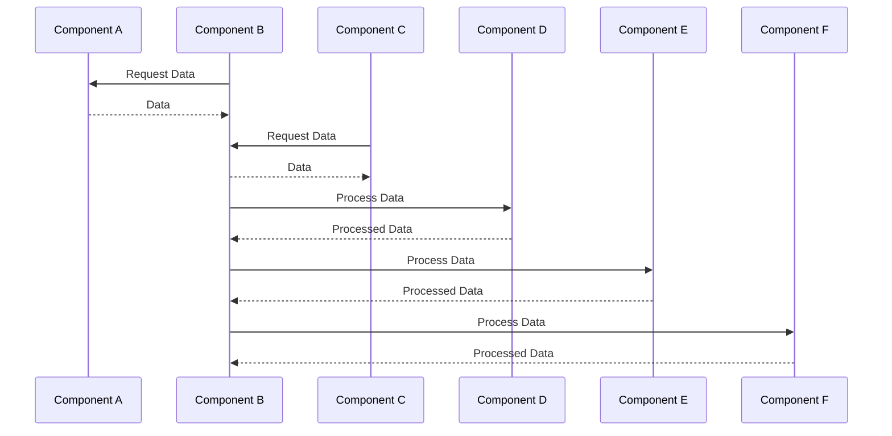

# Intermediate Foundation: Model Theory
## 1. Architectural Mental Model

Model Theory, a branch of mathematical logic, provides a framework for understanding the relationship between formal languages and their interpretations, or models. In the context of production architecture, we can think of model theory as a tool for defining and analyzing the structure and behavior of systems. Here, the "language" is the set of rules and symbols used to describe the system, and the "model" is the interpretation of these rules and symbols in a specific context.

### Key Concepts:
- **Formal Language:** A set of symbols and rules for forming sentences.
- **Structure:** An interpretation of a formal language, assigning meaning to the symbols.
- **Model:** A structure that satisfies a set of sentences in a formal language.

### Architectural Implications:
- **Modularity:** Structures can be designed to be modular, allowing for components to be replaced or modified without affecting the entire system.
- **Scalability:** By understanding the relationships between different components, systems can be scaled more effectively.
- **Interoperability:** Different systems can be designed to work together by ensuring that their models are compatible.

## 2. Systems Taxonomy & Component Protocols

In Model Theory, systems can be categorized based on the types of structures and models they use. This taxonomy helps in understanding the standard interfaces, protocols, and data models that are used in system design.

### Taxonomy:
- **First-Order Logic Models:** Used for systems where the properties of objects and the relationships between them can be expressed using first-order logic.
- **Second-Order Logic Models:** Used for systems where the properties of properties or functions can be expressed.
- **Higher-Order Logic Models:** Used for systems that require more complex logical expressions.

### Component Protocols:
- **Standard Interfaces:** Protocols that define how different components of a system interact. For example, in a database system, the SQL protocol is a standard interface for querying and manipulating data.
- **Data Models:** Models that define the structure of data in a system. For example, the Entity-Relationship Model is a data model used in database design.

### Example:
Consider a system that uses a first-order logic model to represent the properties of components and their relationships. The system might use SQL as a standard interface for querying and manipulating data, and the Entity-Relationship Model as a data model for defining the structure of data.

## 3. Multi-Component Interaction Flow

Understanding the interaction between different components in a system is crucial for designing efficient and effective architectures. Here, we use ASCII and Mermaid sequence diagrams to illustrate the interaction flow in a system.

### ASCII Diagram:
```
+-------------------+       +-------------------+       +-------------------+
| Component A       |<------>| Component B       |<------>| Component C       |
+-------------------+       +-------------------+       +-------------------+
          |                           |                           |
          |                           |                           |
          v                           v                           v
+-------------------+       +-------------------+       +-------------------+
| Component D       |------>| Component E       |------>| Component F       |
+-------------------+       +-------------------+       +-------------------+
```

### Mermaid Sequence Diagram:


## 4. Architectural Trade-offs & Production Pitfalls

Designing a system using model theory involves making trade-offs between different architectural considerations. Here, we discuss some of the key trade-offs and potential pitfalls.

### Trade-offs:
- **Complexity vs. Simplicity:** More complex models can capture more detailed information, but they can also be more difficult to understand and maintain.
- **Performance vs. Flexibility:** Systems that are optimized for performance may be less flexible, and vice versa.
- **Scalability vs. Cost:** Systems that are designed to be scalable may be more expensive to build and maintain.

### Pitfalls:
- **Overfitting:** A model that is too complex may fit the training data too closely, leading to poor performance on new data.
- **Underfitting:** A model that is too simple may not capture the relevant information, leading to poor performance.
- **Inconsistent Models:** If different components of a system use inconsistent models, it can lead to errors and inconsistencies in the system.

## 5. Socratic Discussion Starters

To deepen understanding and encourage critical thinking, here are some questions that bridge architecture to low-level implementation:

- **How can we ensure that the models used in our system are consistent and compatible with each other?**
- **What are the trade-offs between using a more complex model and a simpler model in our system?**
- **How can we design our system to be more scalable while also maintaining performance?**
- **What are some common pitfalls to avoid when designing a system using model theory?**
- **How can we use model theory to improve the interoperability of different systems?**

By exploring these questions, engineers and practitioners can gain a deeper understanding of model theory and its applications in system design.
