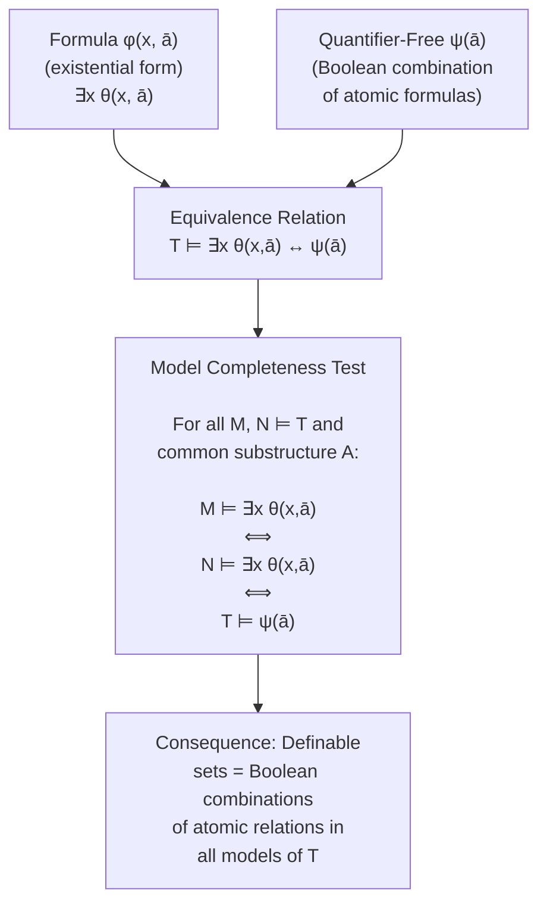

# Lesson 2: Elementary Equivalence, Theories, Definability

## 1. First-Principles Intuition & Invariants

There is a fundamental tension at the heart of mathematical logic: two structures can look entirely different as mathematical objects while being indistinguishable from the vantage point of first-order logic. A countable dense linear order without endpoints and an uncountable one satisfy exactly the same first-order sentences. The integers and the rationals, as ordered sets, do not. What separates these cases is not raw cardinality or set-theoretic complexity, but the expressive reach of the logical language you deploy. Model theory is the discipline that makes this tension precise, and elementary equivalence is its first great organizing concept.

To fix ideas, recall the setup. A *signature* $\sigma$ is a collection of function symbols, relation symbols, and constant symbols, each with a specified arity. A *$\sigma$-structure* $\mathcal{M}$ assigns to this data a universe $M$, concrete functions and relations on $M$, and interpretations of each constant. The first-order language $\mathcal{L}(\sigma)$ then generates formulas by applying logical connectives, quantifiers $\forall$ and $\exists$, and variable binding to atomic formulas built from $\sigma$. A *sentence* is a formula with no free variables, and the *theory* of $\mathcal{M}$, written $\mathrm{Th}(\mathcal{M})$, is the complete set of sentences true in $\mathcal{M}$:

$$\mathrm{Th}(\mathcal{M}) = \{ \varphi \in \mathcal{L}(\sigma) : \mathcal{M} \models \varphi, \ \varphi \text{ a sentence} \}.$$

Two structures $\mathcal{M}$ and $\mathcal{N}$ are *elementarily equivalent*, written $\mathcal{M} \equiv \mathcal{N}$, when $\mathrm{Th}(\mathcal{M}) = \mathrm{Th}(\mathcal{N})$, that is, when every sentence true in one is true in the other. This is a strictly coarser relation than isomorphism: isomorphic structures are always elementarily equivalent, but the converse fails dramatically. The ordered field $(\mathbb{R}, +, \cdot, <, 0, 1)$ and any non-Archimedean real-closed field are elementarily equivalent by the completeness of the theory of real-closed fields, yet they are manifestly non-isomorphic as ordered fields because one contains infinitesimals and the other does not. The model-theorist's task is to understand what first-order logic can and cannot see.

### Complete Theories and the Information They Encode

A *theory* $T$ in $\mathcal{L}(\sigma)$ is simply a set of sentences. We say $T$ is *satisfiable* if it has at least one model, *consistent* if it proves no contradiction, and by the Completeness Theorem of Gödel these notions coincide: $T$ is satisfiable if and only if it is consistent. A theory $T$ is *complete* if for every sentence $\varphi$, either $T \models \varphi$ or $T \models \neg\varphi$; there is no sentence about which $T$ is silent. Completeness in this sense means $T$ has a unique theory in the sense above: all models of $T$ are elementarily equivalent, and $T = \mathrm{Th}(\mathcal{M})$ for any model $\mathcal{M} \models T$.

The canonical example is the theory $\mathrm{DLO}$ of dense linear orders without endpoints, axiomatized by:

$$\forall x \forall y \, (x < y \to \exists z \, (x < z \wedge z < y)),$$
$$\neg \exists x \, \forall y \, (x < y), \quad \neg \exists x \, \forall y \, (y < x),$$

together with the axioms expressing that $<$ is a strict linear order. Cantor's back-and-forth argument shows that any two countable models of $\mathrm{DLO}$ are isomorphic, from which completeness follows: any sentence either follows from $\mathrm{DLO}$ or its negation does, since we can decide which holds in $(\mathbb{Q}, <)$. This style of argument, showing $\kappa$-categoricity for some cardinal $\kappa$ implies completeness (when $T$ has no finite models), is Vaught's theorem, and it is the first major tool for establishing completeness.

**Vaught's Theorem.** Let $T$ be a satisfiable theory with no finite models. If $T$ is $\kappa$-categorical for some infinite cardinal $\kappa$ (all models of cardinality $\kappa$ are isomorphic), then $T$ is complete.

*Proof.* Suppose $T$ is not complete. Then there exists a sentence $\varphi$ such that $T \not\models \varphi$ and $T \not\models \neg\varphi$, so both $T \cup \{\varphi\}$ and $T \cup \{\neg\varphi\}$ are satisfiable. By the Löwenheim-Skolem theorem, both have models of cardinality $\kappa$. But then $T$ has two models of cardinality $\kappa$ disagreeing on $\varphi$, contradicting $\kappa$-categoricity. Therefore $T$ is complete. $\blacksquare$

The theory of algebraically closed fields of characteristic $p$ (for $p$ prime or $0$), denoted $\mathrm{ACF}_p$, is $\kappa$-categorical for every uncountable $\kappa$ by a transcendence-degree argument: two algebraically closed fields of the same uncountable cardinality have the same transcendence degree over their prime subfield and are therefore isomorphic. Hence $\mathrm{ACF}_p$ is complete, and two algebraically closed fields of the same characteristic are elementarily equivalent regardless of their cardinality.

### Axiomatizability: When Does a Class Have a First-Order Description?

Not every mathematically natural class of structures is axiomatizable by a first-order theory. A class $\mathcal{K}$ of $\sigma$-structures is *axiomatizable* if there exists a theory $T$ such that $\mathcal{K} = \mathrm{Mod}(T)$, the class of all models of $T$. It is *finitely axiomatizable* if $T$ can be taken finite. The Compactness Theorem is the workhorse for proving non-axiomatizability: since every finitely satisfiable theory is satisfiable, any class that cannot be described by a theory closed under ultraproducts, or any class that fails to be closed under elementary equivalence, cannot be first-order axiomatizable.

The class of finite groups, for instance, is not axiomatizable. For each $n \geq 1$, the sentence $\varphi_n = \exists x_1 \cdots x_n \bigwedge_{i \neq j} x_i \neq x_j$ asserts the existence of $n$ distinct elements. Any theory containing all $\varphi_n$ has, by Compactness, an infinite model, so the class of finite groups is not the model class of any theory.

The class of infinite groups, by contrast, is axiomatizable: add $\{\varphi_n : n \geq 1\}$ to the group axioms. The class of Archimedean ordered fields is not axiomatizable, because the Archimedean property says $\forall x \exists n \in \mathbb{N} \, (n > x)$, and $\mathbb{N}$ is not a first-order definable set in the language of ordered fields; Compactness produces non-Archimedean elementary extensions of $\mathbb{R}$.

### Elementary Substructures and Elementary Embeddings

The gap between substructure and elementary substructure is precisely the gap between structural containment and logical transparency. A $\sigma$-structure $\mathcal{M}$ is a *substructure* of $\mathcal{N}$ if $M \subseteq N$ and all functions, relations, and constants of $\mathcal{M}$ are restrictions of those of $\mathcal{N}$. But a substructure can radically fail to reflect the first-order properties of the ambient structure. Consider $(\mathbb{Z}, <)$ as a substructure of $(\mathbb{Q}, <)$: the sentence $\exists y \, (1 < y \wedge y < 2)$ is true in $\mathbb{Q}$ but false in $\mathbb{Z}$. The quantifier $\exists y$ ranges over $\mathbb{Q}$ in one and over $\mathbb{Z}$ in the other.

An *elementary substructure*, written $\mathcal{M} \prec \mathcal{N}$, demands that for every formula $\varphi(x_1, \ldots, x_n)$ and every tuple $\bar{a} \in M^n$:

$$\mathcal{M} \models \varphi(\bar{a}) \iff \mathcal{N} \models \varphi(\bar{a}).$$

This condition is simultaneously far stronger and far more subtle. Quantifiers in $\mathcal{M}$ and $\mathcal{N}$ range over different universes, yet they reach the same truth values when the formula is evaluated at parameters from $M$. The Tarski-Vaught test gives a workable criterion: $\mathcal{M} \prec \mathcal{N}$ if and only if $\mathcal{M} \subseteq \mathcal{N}$ (as substructures) and for every formula $\varphi(x, \bar{y})$ and every $\bar{a} \in M^{|\bar{y}|}$, if $\mathcal{N} \models \exists x \, \varphi(x, \bar{a})$ then there exists $b \in M$ with $\mathcal{N} \models \varphi(b, \bar{a})$. In words: whenever the ambient structure witnesses an existential claim with parameters from $M$, a witness already exists inside $M$.

An *elementary embedding* $j : \mathcal{M} \to \mathcal{N}$ is an injective map such that $j(\mathcal{M}) \prec \mathcal{N}$, or equivalently, such that for all formulas $\varphi(\bar{x})$ and all $\bar{a} \in M^{|\bar{x}|}$:

$$\mathcal{M} \models \varphi(\bar{a}) \iff \mathcal{N} \models \varphi(j(\bar{a})).$$

Every elementary embedding is a homomorphism, an embedding, and preserves truth of all formulas, not merely quantifier-free ones. The identity on $M$ is an elementary embedding exactly when $\mathcal{M} \prec \mathcal{M}$, which is trivially true. Isomorphisms are always elementary embeddings. The interest lies in non-isomorphic cases: the Löwenheim-Skolem-Tarski theorem guarantees that every infinite structure $\mathcal{M}$ has elementary extensions of every larger cardinality, and elementary substructures of every infinite cardinality between $|\sigma| + \aleph_0$ and $|M|$.

---

## 2. Core Architecture & Mechanics

### The Diagram Method and Constructing Elementary Extensions

The machinery connecting elementary embeddings to formal theories runs through the concept of *diagrams*. Given a structure $\mathcal{M}$, expand the language by adding a new constant symbol $c_a$ for each element $a \in M$. The *atomic diagram* $\mathrm{Diag}(\mathcal{M})$ is the set of all atomic sentences and negated atomic sentences true in $\mathcal{M}$ under this expansion. The *elementary diagram* $\mathrm{Diag}^{\mathrm{el}}(\mathcal{M})$ extends this to all sentences of the expanded language true in $\mathcal{M}$:

$$\mathrm{Diag}^{\mathrm{el}}(\mathcal{M}) = \{ \varphi(\bar{c}_{\bar{a}}) : \varphi(\bar{x}) \in \mathcal{L}(\sigma), \ \bar{a} \in M^{|\bar{x}|}, \ \mathcal{M} \models \varphi(\bar{a}) \}.$$

The diagnostic power of the elementary diagram is captured cleanly:

**Theorem.** A structure $\mathcal{N}$ (expanded to interpret the constants $c_a$) is a model of $\mathrm{Diag}^{\mathrm{el}}(\mathcal{M})$ if and only if the map $a \mapsto c_a^{\mathcal{N}}$ is an elementary embedding of $\mathcal{M}$ into $\mathcal{N}$.

This converts the semantic question of finding elementary embeddings into the syntactic question of extending a theory, which Compactness can answer. To find an elementary extension of $\mathcal{M}$ with a new element satisfying some type $p(x)$ (a consistent set of formulas with the parameter $x$), one forms $\mathrm{Diag}^{\mathrm{el}}(\mathcal{M}) \cup p(x)$, checks finite satisfiability (each finite subset is satisfiable in $\mathcal{M}$ itself or a slight extension), and applies Compactness.

### Definable Sets: The Geometry of First-Order Logic

If elementary equivalence asks which sentences a structure satisfies, *definability* asks which subsets of the universe a structure can describe using the logical language. This is model theory's internal geometry.

A subset $D \subseteq M^n$ is *definable* (or *parameter-free definable*, or *$\emptyset$-definable*) if there exists a formula $\varphi(x_1, \ldots, x_n)$ with no free variables other than $x_1, \ldots, x_n$ and no parameters such that:

$$D = \{ \bar{a} \in M^n : \mathcal{M} \models \varphi(\bar{a}) \}.$$

We write $D = \varphi(\mathcal{M})$ and call $D$ the *definable set associated to $\varphi$ in $\mathcal{M}$*. When we allow parameters from a set $A \subseteq M$, that is, when $\varphi$ may contain elements of $A$ as constant terms, the resulting set is *$A$-definable* or *definable with parameters from $A$*:

$$D = \{ \bar{a} \in M^n : \mathcal{M} \models \varphi(\bar{a}, \bar{b}) \}, \quad \bar{b} \in A^k.$$

The collection of all $\emptyset$-definable sets forms a Boolean algebra under intersection, union, and complement, closed under projections (since $\exists$-quantification corresponds to projection) and inverse images under definable functions. This is the *definable algebra* of $\mathcal{M}$, and understanding its structure is a central occupation of model theory.

**Worked Example: Definable Sets in $(\mathbb{Z}, +, 0)$.** Consider the structure of integers under addition. The set of even integers is $\emptyset$-definable: use $\varphi(x) = \exists y \, (y + y = x)$. The set of multiples of $n$ is similarly definable by iterating this. By a theorem of Presburger (1929), the complete theory of $(\mathbb{Z}, +, 0, 1)$ — called Presburger arithmetic — is decidable and admits quantifier elimination down to a language that includes congruence predicates $x \equiv r \pmod{n}$. This means every definable set in Presburger arithmetic is a Boolean combination of linear arithmetic progressions. The set of prime numbers is *not* definable in $(\mathbb{Z}, +, 0, 1)$: its definition requires multiplication, which is unavailable, and Presburger arithmetic's quantifier elimination theorem confirms that no such definition exists in this language.

**Worked Example: Definable Sets in $(\mathbb{R}, +, \cdot, 0, 1, <)$.** The theory of real-closed fields $\mathrm{RCF}$ admits quantifier elimination (Tarski 1948): every formula is equivalent, modulo $\mathrm{RCF}$, to a quantifier-free formula. Because quantifier-free formulas are Boolean combinations of polynomial inequalities, the definable sets in $(\mathbb{R}, +, \cdot, 0, 1, <)$ are precisely the *semialgebraic sets*, finite unions of sets defined by finitely many polynomial equalities and strict inequalities. The definable subsets of $\mathbb{R}$ are therefore finite unions of points and intervals — in particular, every definable set has finitely many connected components. This is the beginning of *o-minimality*.

### Automorphisms and the Orbits of Definability

The relationship between automorphisms and definable sets is one of the most elegant invariance principles in all of logic. An *automorphism* of $\mathcal{M}$ is a bijection $\sigma : M \to M$ that is an elementary embedding of $\mathcal{M}$ into itself, equivalently, a structure-preserving bijection satisfying $\sigma(\mathcal{M}) = \mathcal{M}$.

**Automorphism Invariance Theorem.** If $D \subseteq M^n$ is $\emptyset$-definable in $\mathcal{M}$ and $\sigma \in \mathrm{Aut}(\mathcal{M})$, then $\sigma(D) = D$, where $\sigma$ acts coordinate-wise on $n$-tuples.

*Proof.* Let $D = \varphi(\mathcal{M})$ for a parameter-free formula $\varphi(\bar{x})$. Take any $\bar{a} \in D$, so $\mathcal{M} \models \varphi(\bar{a})$. Since $\sigma$ is an elementary embedding, $\mathcal{M} \models \varphi(\sigma(\bar{a}))$, hence $\sigma(\bar{a}) \in D$. Thus $\sigma(D) \subseteq D$. Applying the same argument to $\sigma^{-1}$ gives $D \subseteq \sigma(D)$. $\blacksquare$

The contrapositive is a powerful tool: if a subset $D$ is *not* invariant under some automorphism, then $D$ is not $\emptyset$-definable. In the structure $(\mathbb{Q}, <)$, the map $q \mapsto q + 1$ is an automorphism, so no finite nonempty set of rationals is $\emptyset$-definable. The rational number $0$ is not $\emptyset$-definable in $(\mathbb{Q}, <)$ because every order-preserving bijection of $\mathbb{Q}$ to itself is an automorphism, and such maps do not need to fix $0$.

For parametric definability, the relevant group is the *pointwise stabilizer*: a set $D$ is $A$-definable only if it is invariant under all automorphisms that fix $A$ pointwise. This is not an equivalence in general (definability implies invariance, but invariance does not always imply definability), though for sufficiently saturated and homogeneous structures the two conditions coincide. This correspondence is the beginning of Galois theory internal to model theory — the automorphism group of a monster model plays the role of the absolute Galois group, and type-definable sets fixed by appropriate subgroups correspond to definable extensions.

### Quantifier Elimination: Architecture and Verification

Quantifier elimination is the structural theorem that relates the complexity of definable sets to the syntactic complexity of formulas. A theory $T$ *admits quantifier elimination* if for every formula $\varphi(\bar{x})$ there exists a quantifier-free formula $\psi(\bar{x})$ such that $T \models \varphi(\bar{x}) \leftrightarrow \psi(\bar{x})$. When $T$ admits QE, the definable sets in any model of $T$ are exactly the sets definable by quantifier-free formulas, which are typically Boolean combinations of atomic relations — a dramatic structural simplification.

The standard method for proving QE is the *back-and-forth* or *model-completeness test*. A theory $T$ admits quantifier elimination if and only if for every pair of models $\mathcal{M}, \mathcal{N} \models T$ and every common substructure $\mathcal{A}$ of both, $\mathcal{M}$ and $\mathcal{N}$ satisfy the same existential sentences with parameters from $A$:

$$\mathcal{M} \models \exists x \, \varphi(x, \bar{a}) \iff \mathcal{N} \models \exists x \, \varphi(x, \bar{a}), \quad \bar{a} \in A, \ \varphi \text{ quantifier-free}.$$

We verify this for $\mathrm{DLO}$. Let $\mathcal{A}$ be a common substructure of two models $\mathcal{M}, \mathcal{N} \models \mathrm{DLO}$; the substructure is itself a linear order (possibly with endpoints, but dense except at those). The existential sentences with parameters from $A$ ask whether a point exists in a given position relative to the ordering on $A$: between two elements, below all elements, or above all elements. Because both $\mathcal{M}$ and $\mathcal{N}$ are dense without endpoints, any such position is realized in both. Hence $\mathrm{DLO}$ admits QE, and the definable sets in $(\mathbb{Q}, <)$ are precisely Boolean combinations of formulas $x < a$ and $x = a$ for parameters $a \in \mathbb{Q}$.

The flow of inference in a typical QE proof can be traced through the following diagram, which shows how the existence of a quantifier-free equivalent propagates through the layers of model-theoretic structure.

### Complete Types and Saturated Models

To understand what first-order logic can describe about individual elements, model theory introduces the concept of a *type*. Given a structure $\mathcal{M}$, a set $A \subseteq M$, and a tuple $\bar{a} \in M^n$, the *complete $n$-type of $\bar{a}$ over $A$*, written $\mathrm{tp}^{\mathcal{M}}(\bar{a}/A)$, is the set of all $\mathcal{L}(A)$-formulas satisfied by $\bar{a}$ in $\mathcal{M}$:

$$\mathrm{tp}^{\mathcal{M}}(\bar{a}/A) = \{ \varphi(\bar{x}) \in \mathcal{L}(A) : \mathcal{M} \models \varphi(\bar{a}) \}.$$

This is a maximally consistent set of formulas, hence the word "complete." Any consistent set of formulas over $A$ that is not maximally consistent is called a *partial type*. The *type space* $S_n(A)$ is the set of all complete $n$-types over $A$ consistent with $\mathrm{Th}(\mathcal{M})$, and it carries a natural Stone topology (the *Stone space* of the Boolean algebra of $A$-definable sets) where the basic clopen sets are $[\varphi] = \{p \in S_n(A) : \varphi \in p\}$.

A model $\mathcal{M}$ is $\kappa$-*saturated* if for every $A \subseteq M$ with $|A| < \kappa$ and every complete type $p(\bar{x}) \in S_n(A)$, there exists $\bar{a} \in M^n$ realizing $p$: $\mathcal{M} \models \varphi(\bar{a})$ for every $\varphi \in p$. Saturated models are the "universal" models for a theory at a given cardinality; they realize every type that could conceivably be realized, and two elementarily equivalent saturated models of the same cardinality are isomorphic. This gives model theory its own version of the classifying object.

---

## 3. High-Performance Optimization & Failure Modes

### Precision in Applying the Tarski-Vaught Test

The Tarski-Vaught test is conceptually simple but demands precision in practice. The failure mode is verifying the existential condition only for atomic formulas rather than all formulas. The correct application requires checking: for every *formula* $\varphi(x, \bar{y})$ (quantifier complexity included) and every $\bar{a} \in M^{|\bar{y}|}$, if $\mathcal{N} \models \exists x \, \varphi(x, \bar{a})$ then some witness lies in $M$.

In practice, one commonly reduces to existential formulas $\varphi(x, \bar{a}) = \theta(x, \bar{a})$ where $\theta$ is quantifier-free, by working bottom-up through the formula structure. If one has already established QE for the theory — meaning every formula is equivalent to a quantifier-free one — then checking the Tarski-Vaught condition for quantifier-free formulas suffices. This is the standard workflow: prove QE first, then apply Tarski-Vaught efficiently.

**Common Error:** Confusing $\mathcal{M} \subseteq \mathcal{N}$ (substructure) with $\mathcal{M} \prec \mathcal{N}$ (elementary substructure). The Skolem hull construction corrects this: given any $X \subseteq N$, the *Skolem hull* of $X$ in $\mathcal{N}$ is the smallest elementary substructure of $\mathcal{N}$ containing $X$ (when $\mathcal{N}$ has built-in Skolem functions). Working in Skolem expansions converts the problem of finding elementary substructures to one of taking closures under term functions.

### Automorphism Arguments: Scope and Limitations

Automorphism-invariance arguments are sharp tools but have a precise scope of validity. They establish that $\emptyset$-definable sets are automorphism-invariant; they do not establish the converse in general. The failure of the converse is pervasive. In the random graph (Rado graph) $\mathcal{R}$, the automorphism group acts transitively on vertices, so every individual vertex has the same orbit as every other. Yet each vertex is definable with a single parameter: the formula $x = c$ defines $\{c\}$ using the parameter $c$. The automorphism-invariance criterion speaks only to $\emptyset$-definability.

For countable $\omega$-categorical structures — structures whose countable model is unique up to isomorphism — the situation is different. By the Ryll-Nardzewski theorem, $T$ is $\omega$-categorical if and only if for each $n$, the automorphism group of the unique countable model has only finitely many orbits on $n$-tuples. In this setting, the $\emptyset$-definable sets in $M^n$ are exactly the automorphism-invariant sets, since orbits correspond precisely to quantifier-free types and the automorphism group determines the entire first-order theory.

### Failure Modes in Quantifier Elimination

The most common failure in a QE argument is an incomplete case analysis in the model-completeness test. When showing that an existential formula $\exists x \, \theta(x, \bar{a})$ has a quantifier-free equivalent, one must handle every possible configuration of the parameters $\bar{a}$ in the ordering or algebraic structure. For $\mathrm{ACF}$, the quantifier elimination theorem (van den Dries formulation, following Chevalley) requires proving that the projection of a constructible set is constructible: this is a nontrivial algebraic fact (Chevalley's theorem), and the failure to handle the case of repeated roots or zero leading coefficients in a polynomial system is a typical source of gaps.

For ordered structures, the failure mode often involves not distinguishing between strict and non-strict inequalities, or not accounting for the endpoint behavior when projecting an interval. Consider attempting QE for the theory of linear orders without the density axiom: the sentence $\exists x \, (a < x \wedge x < b)$ is not equivalent to any quantifier-free formula in the language $\{<\}$ alone (since it fails in the integers for consecutive integers $a = 0, b = 1$ while $a < b$ holds), confirming that the density axiom is necessary.

### Elementary Chains and Direct Limits

A powerful construction technique is the *elementary chain*: a sequence of structures $\mathcal{M}_0 \prec \mathcal{M}_1 \prec \mathcal{M}_2 \prec \cdots$ where each inclusion is elementary. The *union* $\mathcal{M}_\omega = \bigcup_{i < \omega} \mathcal{M}_i$ is an elementary extension of each $\mathcal{M}_i$. This follows from the elementary chain theorem:

**Elementary Chain Theorem.** If $(\mathcal{M}_i)_{i < \lambda}$ is an elementary chain (each $\mathcal{M}_i \prec \mathcal{M}_j$ for $i < j$), then $\mathcal{M}_i \prec \bigcup_{i < \lambda} \mathcal{M}_i$ for each $i$.

*Proof sketch.* By transfinite induction. For the successor case, verify the Tarski-Vaught condition: if $\bigcup_j \mathcal{M}_j \models \exists x \, \varphi(x, \bar{a})$ with $\bar{a} \in M_i^n$, then some $\mathcal{M}_k$ satisfies $\exists x \, \varphi(x, \bar{a})$ (since any witness lies in some $\mathcal{M}_k$), and by the elementary chain condition $\mathcal{M}_i \prec \mathcal{M}_k$, so $\mathcal{M}_i \models \exists x \, \varphi(x, \bar{a})$, giving a witness in $M_i$. $\blacksquare$

The practical use of elementary chains is in constructing saturated models. Starting from an arbitrary model $\mathcal{M}_0$, one iteratively realizes all types over subsets of size less than $\kappa$ by passing to elementary extensions, then takes the union. The result is $\kappa$-saturated, and by the elementary chain theorem it elementarily extends $\mathcal{M}_0$.

### Definability versus Interpretability, and the Boundaries of First-Order Logic

A sophisticated practitioner must keep sharp the distinction between *definability* (describing a set by a formula within the structure) and *interpretability* (encoding one structure inside another using definable sets and equivalence relations). The integers $\mathbb{Z}$ are not definable as a subset of $\mathbb{R}$ in $(\mathbb{R}, +, \cdot, 0, 1)$ — this is a consequence of the o-minimality of $\mathrm{RCF}$, since any definable subset of $\mathbb{R}$ is a finite union of intervals and points, while $\mathbb{Z}$ has infinitely many isolated points and is therefore not semialgebraic. However, $\mathbb{Z}$ can be *defined* in $(\mathbb{Z}, +, \cdot, 0, 1)$ trivially (as the whole universe), and in certain expansions of $\mathbb{R}$ such as $(\mathbb{R}, +, \cdot, 0, 1, \mathbb{Z})$ where $\mathbb{Z}$ is a predicate, undecidability returns.

This boundary — the edge at which definability brings undecidability — is one of the deepest in mathematical logic. Tarski showed $\mathrm{RCF}$ is decidable precisely because multiplication is present but integer structure is not first-order definable. Gödel showed that once a theory can define the integers with their full arithmetic, incompleteness and undecidability follow. The model-theorist's craft is knowing exactly where this boundary lies for each theory they study.

The interplay between elementary equivalence, complete theories, and definable sets constitutes a coherent analytical framework: elementary equivalence classifies structures by what sentences they satisfy, completeness ensures all models share the same definable algebra up to elementary equivalence, and automorphism analysis reveals the orbit structure of that algebra. These three threads, pulled together, make it possible to give precise answers to questions of the form: *what can first-order logic see?* The answer, as the next lesson will show through compactness and the Löwenheim-Skolem theorems, is simultaneously more and less than one might expect.
