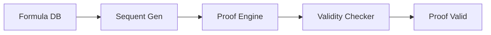

# Intermediate Foundation: Proof Theory
=====================================

## 1. Architectural Mental Model
-----------------------------

### 1.1. System Components

In proof theory, we have several key components that work together to establish the validity of a proof.

*   **Formulas**: These are the basic building blocks of a proof, representing statements or propositions.
*   **Sequents**: These are ordered pairs of formulas, used to represent the relationship between premises and conclusions.
*   **Inference Rules**: These are the rules that govern how formulas can be combined to form sequents.
*   **Proofs**: These are sequences of sequents that demonstrate the validity of a conclusion.

### 1.2. System Architecture

The architecture of a proof system can be visualized as follows:

*   **Formula Database**: Stores all the formulas used in the proof.
*   **Sequent Generator**: Takes formulas as input and generates sequents based on inference rules.
*   **Proof Engine**: Takes sequents as input and generates proofs based on inference rules.
*   **Validity Checker**: Verifies the validity of the proof.

## 2. Systems Taxonomy & Component Protocols
------------------------------------------

### 2.1. Proof Systems Taxonomy

There are several types of proof systems, including:

*   **Natural Deduction**: A system that uses inference rules to derive conclusions from premises.
*   **Sequent Calculus**: A system that uses sequents to represent the relationship between premises and conclusions.
*   **Tableau Systems**: A system that uses a tree-like structure to represent the proof.

### 2.2. Component Protocols

Each component in the proof system has its own protocol for interacting with other components.

*   **Formula Database Protocol**: The formula database stores and retrieves formulas based on their identifiers.
*   **Sequent Generator Protocol**: The sequent generator takes formulas as input and generates sequents based on inference rules.
*   **Proof Engine Protocol**: The proof engine takes sequents as input and generates proofs based on inference rules.
*   **Validity Checker Protocol**: The validity checker verifies the validity of the proof based on the sequents and inference rules.

## 3. Multi-Component Interaction Flow
--------------------------------------

### 3.1. ASCII Sequence Diagram

Here is an ASCII sequence diagram illustrating the interaction between components:

```
          +---------------+
          |  Formula DB  |
          +---------------+
                  |
                  |  Store Formula
                  v
          +---------------+
          |  Sequent Gen  |
          +---------------+
                  |
                  |  Generate Sequent
                  v
          +---------------+
          |  Proof Engine  |
          +---------------+
                  |
                  |  Generate Proof
                  v
          +---------------+
          |  Validity Checker|
          +---------------+
                  |
                  |  Verify Proof
                  v
```

### 3.2. Mermaid Sequence Diagram

Here is a Mermaid sequence diagram illustrating the interaction between components:



## 4. Architectural Trade-offs & Production Pitfalls
---------------------------------------------------

### 4.1. Trade-offs

When designing a proof system, there are several trade-offs to consider:

*   **Completeness vs. Efficiency**: A proof system can be either complete (guaranteeing a proof for any valid conclusion) or efficient (providing a proof quickly, but possibly not for all valid conclusions).
*   **Soundness vs. Completeness**: A proof system can be either sound (guaranteeing that a proof is valid) or complete (guaranteeing that a valid conclusion has a proof).

### 4.2. Pitfalls

When implementing a proof system, there are several pitfalls to avoid:

*   **Inference Rule Errors**: Incorrectly implementing inference rules can lead to invalid proofs.
*   **Sequent Generation Errors**: Incorrectly generating sequents can lead to invalid proofs.
*   **Proof Engine Errors**: Incorrectly implementing the proof engine can lead to invalid proofs.

## 5. Socratic Discussion Starters
-----------------------------------

### 5.1. Questions

Here are some discussion starters to help bridge the architecture to low-level implementation:

*   **How can we ensure the completeness of our proof system?**
*   **How can we optimize the efficiency of our proof system?**
*   **How can we guarantee the soundness of our proof system?**
*   **How can we handle errors in inference rules, sequent generation, and proof engine implementation?**
