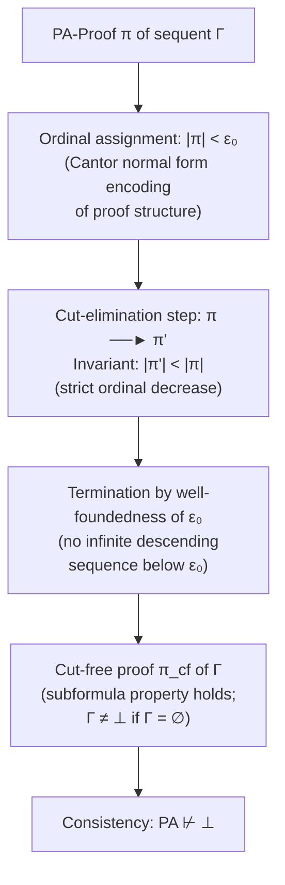

# Lesson 4: Ordinal Analysis of Formal Theories

## 1. First-Principles Intuition & Invariants

There is a question that sits at the boundary of mathematical ambition and philosophical honesty: when we write down the axioms of a formal theory and begin deriving theorems, how much logical power are we actually wielding? Two theories may prove the same elementary arithmetic facts yet differ profoundly in what they can and cannot establish. Ordinal analysis is the instrument that makes this difference precise. It assigns to each sufficiently strong formal theory a canonical ordinal — its *proof-theoretic ordinal* — that measures, in a rigorously defined sense, the transfinite inductive strength of the theory. Understanding this instrument means understanding what a formal theory is fundamentally capable of, not merely cataloguing the sentences it proves.

To appreciate why ordinals are the right measuring device, return to the foundational tension exposed by Gödel. His Second Incompleteness Theorem establishes that any consistent theory $T$ extending Robinson arithmetic $\mathsf{Q}$ cannot prove its own consistency: $T \not\vdash \mathrm{Con}(T)$. Yet Gödel's theorem does not say consistency is unprovable in every system — only that it is unprovable *from within* $T$ itself. A stronger theory $T'$ may well prove $\mathrm{Con}(T)$. The natural follow-up question becomes hierarchical: what exactly does the extra strength of $T'$ consist of, and can we quantify it without circularity?

Gentzen's 1936 answer introduced a construction of breathtaking elegance. He showed that the consistency of Peano Arithmetic $\mathsf{PA}$ is equivalent, over a weak base theory, to the well-foundedness of the ordinal $\varepsilon_0$. This was not merely a curiosity. It established a dictionary between *logical strength* and *transfinite induction*, and it opened a research program that now spans more than eight decades: ordinal analysis.

### Ordinals as Measures of Well-Founded Proof Search

The intuitive picture begins with an observation about cut elimination. When you prove a sequent in Gentzen's sequent calculus $\mathbf{LK}$ and then eliminate all cuts from that proof, the resulting cut-free proof may be astronomically longer, but it has a critical structural virtue: every formula appearing in the proof is a subformula of the endsequent. The cut elimination procedure terminates because the *complexity* of proofs decreases at every step of the reduction, and this decrease is well-founded. For propositional logic or first-order predicate logic without arithmetic, this termination argument lives entirely within finite combinatorics.

Arithmetic changes the situation qualitatively. Induction axioms in $\mathsf{PA}$ allow proofs of the form: establish a base case for $P(0)$, establish the inductive step $\forall n(P(n) \to P(n+1))$, and conclude $\forall n\, P(n)$. When such proofs contain cuts, eliminating them requires not just one pass but *iterated* unfolding of the induction. The number of unfolding steps needed cannot be bounded by any fixed finite number — it depends on the logical complexity of the formula $P$ in ways that require counting through successively larger transfinite ordinals.

Assign each proof $\pi$ in a suitable sequent calculus for $\mathsf{PA}$ an ordinal $|\pi|$ that measures this unfolding depth. Cut elimination becomes a terminating rewriting procedure not because each step reduces a natural number, but because each step reduces an ordinal in a well-ordered set. The claim that every proof can be cut-eliminated is thus equivalent to the claim that the ordinal assignment is well-founded: there is no infinite descending sequence $|\pi_0| > |\pi_1| > |\pi_2| > \cdots$ of such ordinals. Proving this well-foundedness *is*, in a precise sense, proving the consistency of the theory.

### The Ordinal $\varepsilon_0$ and Its Construction

Before we can state Gentzen's theorem rigorously, we need to build $\varepsilon_0$ from first principles. Recall that the ordinals are the canonical transfinite generalisation of the natural numbers: $0, 1, 2, \ldots, \omega, \omega+1, \ldots, \omega\cdot 2, \ldots, \omega^2, \ldots, \omega^\omega, \ldots$. Each ordinal is the well-ordered set of all smaller ordinals, and ordinal arithmetic extends addition, multiplication, and exponentiation to this transfinite domain.

Exponentiation based at $\omega$ generates an enormously rich hierarchy. Consider the tower of fixpoints of the map $\alpha \mapsto \omega^\alpha$. The natural numbers are fixed points of no such tower. The first infinite ordinal $\omega$ satisfies $\omega^\omega \neq \omega$, so it is not a fixpoint. Neither is $\omega^\omega$, nor $\omega^{\omega^\omega}$, nor any finite exponential tower. We define $\varepsilon_0$ to be the *least ordinal* satisfying $\omega^{\varepsilon_0} = \varepsilon_0$:

$$\varepsilon_0 = \sup\bigl\{\omega,\, \omega^\omega,\, \omega^{\omega^\omega},\, \omega^{\omega^{\omega^\omega}},\, \ldots\bigr\}$$

This supremum is a countable ordinal — $\varepsilon_0$ is a countable limit ordinal — but it is genuinely transfinite and cannot be reached by any finite iteration of $\omega$-exponentiation. Because $\varepsilon_0 = \omega^{\varepsilon_0}$, it is closed under ordinal exponentiation based at $\omega$, which is precisely the closure property that makes it the natural measure of $\mathsf{PA}$'s inductive strength.

Every ordinal $\alpha < \varepsilon_0$ admits a unique *Cantor normal form* representation in base $\omega$:

$$\alpha = \omega^{\beta_1} \cdot k_1 + \omega^{\beta_2} \cdot k_2 + \cdots + \omega^{\beta_n} \cdot k_n$$

where $\beta_1 > \beta_2 > \cdots > \beta_n$ are themselves ordinals below $\alpha$ (hence expressible recursively in Cantor normal form), and each $k_i \in \mathbb{N}_{>0}$. The well-foundedness of this representation — the fact that the Cantor normal form representation is a terminating, well-defined canonical form for each $\alpha < \varepsilon_0$ — is equivalent to the claim that $\varepsilon_0$ is well-ordered, and hence equivalent to the consistency of $\mathsf{PA}$.

### Proof-Theoretic Ordinals: The Formal Definition

With this groundwork, we can state the central definition precisely. Let $T$ be a formal theory extending $\mathsf{PA}$ (or at least extending the base theory $\mathsf{PRA}$, primitive recursive arithmetic, which is used as a metatheory). The *proof-theoretic ordinal* of $T$, written $|T|$, is defined as:

$$|T| = \sup\bigl\{\alpha : T \vdash \mathsf{WO}(\alpha)\bigr\}$$

where $\mathsf{WO}(\alpha)$ is the arithmetical sentence asserting that the standard ordinal notation system for $\alpha$ is well-founded — that there is no infinite descending sequence through the natural-number codes of ordinals below $\alpha$ under their natural ordering. More precisely, $\mathsf{WO}(\alpha)$ is the schema of transfinite induction up to $\alpha$: for every arithmetic predicate $P$,

$$\mathsf{TI}(\alpha, P):\quad \bigl[\forall \beta < \alpha\bigl(\forall \gamma < \beta\, P(\gamma) \to P(\beta)\bigr)\bigr] \to \forall \beta < \alpha\, P(\beta)$$

The proof-theoretic ordinal $|T|$ is thus the *supremum of the ordinals over which $T$ can prove transfinite induction* for all arithmetical predicates. This quantity captures exactly the inductive reach of $T$: it tells you how far into the transfinite the theory can confidently climb.

A foundational invariant of this definition is the *equivalence* between ordinal analysis and consistency strength. For the theories we consider, $|T| = \alpha$ if and only if two things hold simultaneously: first, $T$ proves transfinite induction up to every $\beta < \alpha$ for all arithmetical predicates; and second, $T$ *cannot* prove transfinite induction up to $\alpha$ itself without implicitly assuming more than $T$ can verify — in fact, $\mathsf{TI}(\alpha)$ over all arithmetical predicates implies $\mathrm{Con}(T)$ over the base theory. This double characterisation is what gives $|T|$ its bite as a measuring instrument.

---

## 2. Core Architecture & Mechanics

### Gentzen's Consistency Proof for $\mathsf{PA}$

Gentzen's proof that $|PA| = \varepsilon_0$ proceeds in two independent directions, and understanding each direction separately clarifies the logical architecture of ordinal analysis as a discipline.

**The upper bound direction** establishes that $\mathsf{PA}$ cannot prove $\mathsf{TI}(\varepsilon_0)$ for all arithmetical predicates. This follows from Gödel's Second Incompleteness Theorem together with the fact that $\mathsf{TI}(\varepsilon_0)$ implies $\mathrm{Con}(\mathsf{PA})$ over a weak base. Specifically, one proves in $\mathsf{PRA}$ that if transfinite induction holds up to $\varepsilon_0$ for all primitive recursive predicates, then every $\mathsf{PA}$-proof of $0 = 1$ can be transformed into an infinite descending sequence below $\varepsilon_0$, which $\mathsf{TI}(\varepsilon_0)$ excludes. Since $\mathsf{PA}$ cannot prove its own consistency, it cannot prove $\mathsf{TI}(\varepsilon_0)$.

**The lower bound direction** is the deep half of the theorem. Gentzen constructs a semantic assignment of ordinals below $\varepsilon_0$ to cut-free proofs in a sequent calculus for $\mathsf{PA}$, and he shows that the cut-elimination procedure strictly reduces this ordinal at every step. Let $\pi$ be a proof of a sequent $\Gamma$ in Gentzen's calculus $\mathbf{LK}_{\mathsf{PA}}$. Assign to $\pi$ an ordinal $|\pi| < \varepsilon_0$ as follows. For axioms (including arithmetic axioms and logical axioms), assign ordinal $0$ or small finite ordinals. For structural rules — weakening, contraction, exchange — the ordinal of the conclusion equals the ordinal of the premiss. For logical rules — the $\wedge$, $\vee$, $\neg$, $\forall$, $\exists$ introduction rules — the ordinal increases by finite amounts corresponding to the number of premisses and their ordinals. The critical rule is the induction rule:

If $\pi_0$ derives $\Gamma, P(0)$ with ordinal $|\pi_0| = \alpha_0$, and $\pi_1$ derives $\Gamma, \neg P(n), P(n+1)$ with ordinal $|\pi_1| = \alpha_1$, then the induction rule producing $\Gamma, P(t)$ receives ordinal $\omega^{\alpha_0 + \alpha_1}$.

This exponentiation is what forces the proof ordinals to live below $\varepsilon_0$ rather than below any smaller ordinal: iterated application of the induction rule stacks $\omega$-exponentials, producing ordinals of the form $\omega^{\omega^{\cdots}}$, which converge to $\varepsilon_0$ from below but never reach it.

The cut elimination procedure acts on pairs $(\pi_a, \pi_b)$ where $\pi_b$ contains a cut on a formula $A$ whose derivation $\pi_a$ uses the induction rule with principal formula $A$. Each reduction step replaces such a cut with a finite or transfinitely-indexed family of smaller cuts. Crucially, each smaller cut has strictly smaller ordinal — Gentzen proves this by induction on the ordinal structure of $|\pi_a|$ and $|\pi_b|$. The well-foundedness of ordinals below $\varepsilon_0$ then guarantees termination: since there is no infinite descending sequence of ordinals below $\varepsilon_0$, every cut-elimination sequence terminates in a cut-free proof.

Combining both directions: $\mathsf{PA}$ proves $\mathsf{TI}(\alpha)$ for every $\alpha < \varepsilon_0$ (lower bound), and $\mathsf{PA}$ cannot prove $\mathsf{TI}(\varepsilon_0)$ (upper bound). Therefore $|\mathsf{PA}| = \varepsilon_0$.

### The Architecture of Ordinal Notation Systems

Ordinal analysis depends on more than the existence of large ordinals in the abstract; it depends on *computable representations* of ordinals that the formal theory can reason about arithmetically. This is the role of ordinal notation systems.

An ordinal notation system for ordinals below some limit $\Lambda$ consists of a set $\mathcal{O} \subseteq \mathbb{N}$ of codes, a computable ordering relation $<_{\mathcal{O}}$ on $\mathcal{O}$, and a computable assignment of each $n \in \mathcal{O}$ to the ordinal it represents, such that every ordinal below $\Lambda$ is represented by at least one code. The key property is that $<_{\mathcal{O}}$ must be a well-ordering of $\mathcal{O}$ of order type $\Lambda$, and this well-ordering must be arithmetically representable so that $\mathsf{TI}(\alpha)$ can be expressed as an arithmetic sentence.

For ordinals below $\varepsilon_0$, the standard notation system uses Cantor normal form encoded as natural numbers by a computable pairing function. The ordinal $0$ is coded by $0$. A successor ordinal $\alpha + 1$ is coded as $\langle 1, \ulcorner\alpha\urcorner \rangle$ where $\ulcorner\alpha\urcorner$ is the code for $\alpha$. The ordinal $\omega^{\beta_1} \cdot k_1 + \cdots + \omega^{\beta_n} \cdot k_n$ is coded as the tuple $\langle \ulcorner\beta_1\urcorner, k_1, \ldots, \ulcorner\beta_n\urcorner, k_n \rangle$. The ordering $<_{\mathcal{O}}$ on these codes is defined recursively in the obvious way, mirroring the lexicographic ordering of Cantor normal forms.

The arithmetic formula $\mathsf{WO}_{<\varepsilon_0}(x)$ then says: "there is no primitive recursive function $f$ with $f(0) \in \mathcal{O}$ and $f(n+1) <_{\mathcal{O}} f(n)$ for all $n$." This is a $\Pi^1_1$ statement (quantifying over functions), but for each specific notation $<_\alpha$ with $\alpha < \varepsilon_0$, the statement $\mathsf{TI}(\alpha, P)$ for arithmetic $P$ is first-order arithmetic, expressible and provable within $\mathsf{PA}$.

The following diagram illustrates the layered architecture of Gentzen's consistency proof, from raw $\mathsf{PA}$-proofs through ordinal assignment to cut elimination and well-foundedness:

The critical structural invariant throughout this pipeline is that the ordinal assignment is *primitive recursively computable* from the proof tree, so the entire argument can be formalised in $\mathsf{PRA}$ augmented with $\mathsf{TI}(\varepsilon_0)$. This is not circular: the meta-theory is $\mathsf{PRA} + \mathsf{TI}(\varepsilon_0)$, which is strictly weaker than $\mathsf{PA}$ in many respects, yet strong enough to verify the termination of the cut-elimination rewriting system.

### The Ordinal Hierarchy for Stronger Systems

Once Gentzen established $|\mathsf{PA}| = \varepsilon_0$, the natural questions multiplied: what are the proof-theoretic ordinals of stronger systems, and what notation systems are needed to describe them? This inquiry drove the development of the Veblen hierarchy, the Bachmann-Howard ordinal, and ultimately the ordinal notation systems based on collapsing functions.

**The Veblen Hierarchy.** Peano Arithmetic extended with one additional axiom scheme — say, the axiom of $\Sigma^1_1$-induction, or equivalently a reflection principle for $\mathsf{PA}$ — requires ordinals beyond $\varepsilon_0$ to measure its strength. The Veblen function $\varphi_\alpha$ provides the necessary notation. Define $\varphi_0(\beta) = \omega^\beta$, so that the fixpoints of $\varphi_0$ are precisely the $\varepsilon$-numbers $\varepsilon_0, \varepsilon_1, \varepsilon_2, \ldots$. Then $\varphi_1(\beta) = \varepsilon_\beta$, enumerating the fixpoints of $\varphi_0$ in order. Continuing: $\varphi_2(\beta)$ enumerates the fixpoints of $\varphi_1$ (the so-called $\zeta$-numbers, satisfying $\zeta = \varepsilon_\zeta$), and so on transfinitely. The *Feferman-Schütte ordinal* is:

$$\Gamma_0 = \min\bigl\{\alpha : \varphi_\alpha(0) = \alpha\bigr\}$$

This is the least ordinal that is a fixpoint of $\alpha \mapsto \varphi_\alpha(0)$, meaning it is closed under all finitary Veblen functions simultaneously. Feferman and Schütte independently established that $\Gamma_0$ is the proof-theoretic ordinal of predicative analysis — specifically, of the system $\mathsf{ATR}_0$ minus the full strength of arithmetical transfinite recursion, corresponding to the Weyl-Feferman predicativist program. No predicatively justifiable notation system can reach $\Gamma_0$, making it a sharp boundary between predicative and impredicative mathematics.

**The Bachmann-Howard Ordinal.** To measure significantly stronger systems — in particular, $\mathsf{ATR}_0$ (arithmetic transfinite recursion) and the system $\Pi^1_1$-$\mathsf{CA}_0$ of one comprehension axiom for $\Pi^1_1$ predicates — ordinal analysis requires the introduction of *impredicative* ordinal notation systems. The key construction is Bachmann's ordinal collapsing function. Rather than enumerating fixpoints of functions already defined, Bachmann's approach uses a large ordinal (specifically, the first uncountable ordinal $\Omega = \omega_1$, or a formal analogue thereof) as a "collapsing" reservoir. Define the collapsing function $\psi : \mathrm{Ord} \to \mathrm{Ord}$ by:

$$\psi(\alpha) = \min\bigl\{\xi : C(\alpha, \xi) = \xi\bigr\}$$

where $C(\alpha, \xi)$ is the closure of $\{0, \Omega\} \cup \xi$ under the operations $+$, $\varphi$ (the two-argument Veblen function), and $\beta \mapsto \psi(\beta)$ for $\beta < \alpha$. The function $\psi$ collapses large ordinal-theoretic constructions down to countable ordinals, using $\Omega$ as a kind of ordinal "constant" that permits impredicative reference. The *Bachmann-Howard ordinal* $\psi(\Omega^{\Omega^\omega})$ (using a specific notation for the argument) is the proof-theoretic ordinal of $\mathsf{ID}_1$, the theory of one non-iterated inductive definition, and also of $\Pi^1_1$-$\mathsf{CA}_0$.

The table below summarises the correspondence between formal theories and their proof-theoretic ordinals, illustrating the calibration hierarchy:

| Formal Theory | Proof-Theoretic Ordinal $\|T\|$ | Ordinal Notation System Required |
|---|---|---|
| $\mathsf{PRA}$ (Primitive Recursive Arithmetic) | $\omega^\omega$ | Finite Cantor normal forms |
| $\mathsf{PA}$ (Peano Arithmetic) | $\varepsilon_0$ | Full Cantor normal forms below $\varepsilon_0$ |
| $\mathsf{PA} + \mathrm{TI}(\varepsilon_0)$ | $\varepsilon_1$ | $\varepsilon$-numbers, Veblen $\varphi_0$ |
| $\mathsf{ACA}_0$ (Arithmetical Comprehension) | $\varepsilon_{\varepsilon_{\cdots}}$ = $\varphi_1(0)$ | Veblen $\varphi_1$ |
| $\mathsf{ATR}_0$ (Arithmetical Transfinite Recursion) | $\Gamma_0$ | Binary Veblen $\varphi_{\alpha}(\beta)$ |
| $\mathsf{ID}_1$ / $\Pi^1_1$-$\mathsf{CA}_0$ | Bachmann-Howard ordinal | $\psi$-collapsing functions |
| $\mathsf{KP}$ (Kripke-Platek Set Theory) | Bachmann-Howard ordinal | Ordinal collapsing with $\Omega$ |
| $\Pi^1_2$-$\mathsf{CA}_0$ | $\psi(\omega_2)$ | Two-cardinal collapsing functions |
| $\mathsf{ZFC}$ (Full Set Theory) | Unknown; exceeds all standard notations | Open problem |

The progression in this table is not merely bookkeeping. Each step upward in the ordinal hierarchy corresponds to a qualitative expansion in what the theory can prove: stronger reflection principles, more complex inductive definitions, broader comprehension for second-order objects. The ordinal $|T|$ captures exactly this expansion in a single transfinite number.

### Embedding the Proof-Theoretic Ordinal in Arithmetic: The Fundamental Computation

To make the correspondence between $|\mathsf{PA}| = \varepsilon_0$ entirely explicit, we work through the proof that $\mathsf{PA}$ proves $\mathsf{TI}(\alpha)$ for each specific $\alpha < \varepsilon_0$. The argument proceeds by transfinite induction on $\alpha$ within the meta-theory.

**Base case:** $\alpha = 0$. The statement $\mathsf{TI}(0, P)$ is vacuously true since there are no ordinals below $0$. $\mathsf{PA}$ trivially proves this.

**Successor case:** $\alpha = \beta + 1$. Assume $\mathsf{PA} \vdash \mathsf{TI}(\beta, P)$ for all arithmetic $P$. Then $\mathsf{TI}(\beta+1, P)$ requires: if $P$ holds hereditarily up to every $\gamma < \beta+1$, then $P(\beta)$ holds. But $P$ holding hereditarily up to $\beta$ means $P(\gamma)$ for all $\gamma \leq \beta$, which is established by $\mathsf{TI}(\beta, P)$ plus the step at $\beta$ itself. So $\mathsf{PA} \vdash \mathsf{TI}(\beta+1, P)$.

**Limit case:** $\alpha = \lambda$ where $\lambda$ is a limit ordinal with $\lambda < \varepsilon_0$. Because $\lambda < \varepsilon_0$, its Cantor normal form is $\lambda = \omega^{\beta_1}\cdot k_1 + \cdots + \omega^{\beta_n} \cdot k_n$ with all $\beta_i < \lambda$. The key step uses the fact that every ordinal $\gamma < \lambda$ is below some specific $\omega^{\beta_i} \cdot k_i$ term, which is itself below $\lambda$ and within the inductive hypothesis. The $\omega$-rule — the fact that $\mathsf{PA}$ can prove $\forall n \, P(n)$ whenever it proves $P(n)$ for each specific numeral $n$ — handles the limit step arithmetically, using the computable structure of Cantor normal forms to reduce the transfinite induction to a finite number of instances of previously established transfinite inductions.

The critical observation is that the Cantor normal form representation of $\alpha$ is *primitive recursively decidable*: given codes for two ordinals below $\varepsilon_0$, one can computably determine which is larger. This decidability is exactly what allows $\mathsf{TI}(\alpha, P)$ to be an arithmetic sentence, and what allows $\mathsf{PA}$ to reason about ordinals below $\varepsilon_0$ through their codes rather than directly.

---

## 3. High-Performance Optimization & Failure Modes

### Calibrating Consistency Strength: The Practitioner's Toolkit

The principal application of ordinal analysis in mathematical logic is the precise *calibration* of consistency strength. When a logician wants to know whether two theories $T_1$ and $T_2$ are equiconsistent — whether $\mathrm{Con}(T_1) \leftrightarrow \mathrm{Con}(T_2)$ over a weak base — ordinal analysis often provides the decisive answer. If $|T_1| = |T_2|$, the theories have the same proof-theoretic ordinal and are therefore equiconsistent (modulo technical assumptions about the theories being $\omega$-consistent and axiomatised by a reasonable schema). This turns a philosophical question about the safety of axiomatic systems into a computational question about ordinal notation systems.

The practical workflow for a proof theorist conducting an ordinal analysis of a new theory $T$ proceeds through three phases. In the first phase — the *syntactic analysis* — one establishes a suitable sequent calculus or natural deduction system for $T$ and proves a cut elimination theorem. This is often the technically deepest phase, requiring careful handling of the interaction between the new axioms and the structural rules. The result is a cut elimination theorem of the form: every $T$-proof can be transformed into a cut-free proof, with the transformation terminating by well-founded induction on some ordinal $\alpha$.

In the second phase — the *ordinal assignment* — one defines, for each cut-free $T$-proof $\pi$, a canonical ordinal $|\pi| < \Lambda$ for some ordinal limit $\Lambda$. The definition must be computable from $\pi$, and the cut-elimination procedure must strictly decrease $|\pi|$ at each step. The upper bound $\Lambda$ is the candidate for $|T|$.

In the third phase — the *completeness argument* — one proves that every ordinal $\alpha < \Lambda$ is actually provably well-founded in $T$. This requires constructing, for each $\alpha < \Lambda$, an explicit $T$-proof of $\mathsf{TI}(\alpha, P)$ for all arithmetic (or second-order, depending on the theory) predicates $P$. The two phases together establish $|T| = \Lambda$.

### The Relationship Between Proof-Theoretic Ordinals and Consistency Hierarchy

A deep result that underlies the whole enterprise is the *Schütte Completeness Theorem*: for the theories in the reverse mathematics hierarchy (subsystems of second-order arithmetic), the proof-theoretic ordinal $|T|$ completely determines the consistency strength of $T$ among $\Pi^0_2$ consequences. More precisely, if $T_1$ and $T_2$ are both sound $\Pi^1_2$-axiomatisable extensions of $\mathsf{PRA}$ with $|T_1| = |T_2|$, then $T_1$ and $T_2$ prove exactly the same $\Pi^0_2$ sentences of arithmetic.

This result means that ordinal analysis is not merely a measurement tool but a *classification* tool: it partitions the space of arithmetically sound theories into equivalence classes based on what they can prove about the natural numbers. Two theories at the same ordinal level are, in a precise mathematical sense, equivalent in their arithmetic consequences, even if they differ dramatically in their set-theoretic or higher-order vocabulary.

The practitioner should, however, be alert to the limits of this equivalence. Proof-theoretic ordinals classify $\Pi^0_2$ consequences but are insensitive to differences at higher logical complexity. Two theories may share the same proof-theoretic ordinal yet differ in consequences of higher complexity. A classic example is $\mathsf{RCA}_0$ and $\mathsf{WKL}_0$ (Weak König's Lemma): both have proof-theoretic ordinal $\omega^\omega$, and $\mathsf{WKL}_0$ is even $\Pi^1_1$-conservative over $\mathsf{RCA}_0$, yet $\mathsf{WKL}_0$ proves the $\Pi^1_2$ statement Weak König's Lemma, which $\mathsf{RCA}_0$ does not. This shows that ordinal analysis, while powerful, captures only one dimension of logical strength — the inductive dimension — and must be supplemented by other tools (such as $\omega$-model analysis or model-theoretic techniques) for a complete picture.

### Failure Modes: When Ordinal Analysis Breaks Down

Several failure modes can derail an ordinal analysis in practice, and recognising them early saves substantial effort.

The most common failure mode is *notation system collapse*. When assigning ordinals to proofs in a strong theory, there may be no known well-ordering of the natural numbers of the right order type that is *arithmetically definable*. For theories beyond $\Pi^1_1$-$\mathsf{CA}_0$, the ordinal notation systems based on finitely many collapsing functions become insufficient, and one must work with notation systems based on higher-cardinal collapsing or even large cardinal axioms. For $\mathsf{ZFC}$ itself, no generally accepted ordinal notation system is known that could serve as the target of a Gentzen-style analysis. The proof-theoretic ordinal of $\mathsf{ZFC}$ remains unknown — not because set theorists have not tried, but because the requisite notation systems are not yet developed to sufficient precision. This is not a failure of the method but a reflection of genuine mathematical depth: constructing well-ordering notations for extremely strong systems is itself a major mathematical achievement.

A second failure mode is *cut elimination failure* — the possibility that a proposed sequent calculus for $T$ does not admit cut elimination, or admits it only under restrictions that invalidate the ordinal assignment. This can occur when the axioms of $T$ interact badly with the structural rules. The standard remedy is to pass to an *infinitary sequent calculus* — a calculus that permits proofs of infinite length (but of well-ordered depth) — where cut elimination becomes easier to establish at the cost of working with transfinite proof trees directly. Schütte's $\omega$-rule calculus and Buchholz's $\Omega$-rule systems are the standard examples of this approach. The infinitary setting is not merely a technical convenience; it is philosophically informative, since it makes explicit the connection between cut-free proofs and semantic validity.

A third failure mode is *soundness loss*. If the theory $T$ is not $\omega$-consistent — if it proves $\exists n \, P(n)$ yet proves $\neg P(n)$ for every specific numeral $n$ — then the proof-theoretic ordinal is ill-defined or trivially becomes the ordinal of the whole class of well-orderings, which is meaningless. All meaningful ordinal analyses assume $\omega$-consistency of the theory under analysis, and in practice this is verified by exhibiting an $\omega$-model or appealing to known consistency results for related theories.

### The Significance of $\varepsilon_0$ as a Cognitive Landmark

It is worth pausing to appreciate what Gentzen's theorem means for the epistemology of mathematics. The consistency of $\mathsf{PA}$ — the system in which virtually all of number theory, combinatorics, and elementary analysis can be formalised — reduces to the well-foundedness of a single countable ordinal $\varepsilon_0$. This ordinal is small by the standards of set theory (it is a countable ordinal, dwarfed by $\omega_1$ or any uncountable cardinal), yet it is inaccessible to finite iteration and genuinely transfinite. The proof-theoretic programme reveals that what we mean when we say "arithmetic is consistent" is precisely this: the specific transfinite induction to $\varepsilon_0$ is valid, and that validity cannot itself be justified within the system it validates.

This is not a deficiency of arithmetic. It is a structural truth about the relationship between formal systems and mathematical meaning. Each ascent to a stronger theory — from $\mathsf{PA}$ to $\mathsf{ACA}_0$ to $\mathsf{ATR}_0$ to $\Pi^1_1$-$\mathsf{CA}_0$ — corresponds to a genuine expansion of the ordinal horizon, requiring new notation systems and new combinatorial principles to describe the well-orderings whose validity the theory presupposes. Ordinal analysis makes this presupposition structure visible, explicit, and computable.

For the practitioner, the actionable consequence is this: when evaluating a new axiomatic system — whether a proposed foundation for a branch of mathematics, a type theory for a proof assistant, or a logical framework for program verification — computing its proof-theoretic ordinal, or at least locating it within the known hierarchy, provides a canonical and objective measure of how much inductive strength the system demands. It tells you not merely what the system can prove, but how deep into the transfinite it must reach to prove it, and therefore what commitments you are making when you adopt it as your foundation.
