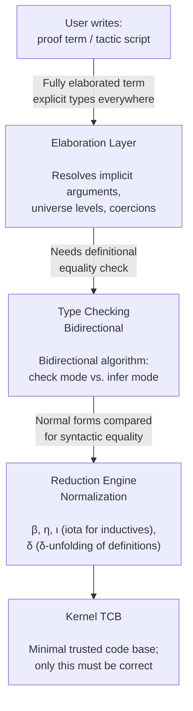

# Lesson 6: Dependent Types in Constructive Proof Theory

## 1. First-Principles Intuition & Invariants

### The Inadequacy of Simple Types

Classical logic and its type-theoretic correspondents operate under a tacit assumption of radical uniformity: a proposition either holds or it does not, and a type either classifies a term or it does not, independent of any particular value. This assumption serves well enough in Aristotelian syllogistics and in the simply typed lambda calculus, but it collapses the moment one tries to give a genuinely constructive account of mathematical statements that are *about* specific objects. Consider the proposition "the $n$-th Fibonacci number is even." This is not a bare propositional atom. It says something that varies parametrically in $n$, and a proof of it for $n = 6$ is an entirely different object from a proof of it for $n = 3$. Simple type theory has no mechanism to express this dependence. The type of the proof cannot mention the value $n$ because types and terms inhabit strictly separated strata.

Per Martin-Löf's foundational insight, articulated across his 1972 unpublished notes and subsequently in his landmark 1984 Bibliopolis monograph *Intuitionistic Type Theory*, the resolution is not a syntactic patch but a deep architectural change: **types must be allowed to depend on terms**. A dependent type is a family of types indexed by elements of another type. Writing $B : A \to \mathcal{U}$ where $\mathcal{U}$ is a universe of types, the expression $B(a)$ is a type for each $a : A$. The resulting system, Martin-Löf Type Theory (MLTT), dissolves the stratification between propositions and types, between predicates and families, and between proofs and programs, unifying them all into a single formal language.

This unification is not a mere convenience. It is a philosophical commitment to the view that mathematical objects and their correctness conditions are inseparable. When you give a function $f : \prod_{n : \mathbb{N}} \text{IsEven}(F_n)$, you are not making a bare universal claim and separately promising a proof. You are constructing a single computational object whose very type encodes the universally quantified statement. The proof *is* the program, and the program *is* the proof. This is the full strength of the Curry-Howard correspondence under dependent types, and it is a qualitative leap beyond the correspondence in simply typed systems.

### The BHK Interpretation in Full Generality

The Brouwer-Heyting-Kolmogorov interpretation is the semantic backbone of intuitionistic logic: a proposition is identified with the set of its proofs, and logical connectives are explained by what it means to construct a proof of a compound statement. Under simple propositional logic, the BHK clauses read cleanly. A proof of $A \wedge B$ is a pair $\langle p, q \rangle$ where $p$ proves $A$ and $q$ proves $B$. A proof of $A \to B$ is a construction that transforms any proof of $A$ into a proof of $B$. A proof of $\exists x.\, P(x)$ is a pair $\langle a, p \rangle$ where $a$ is a witness and $p$ is a proof of $P(a)$.

What MLTT does is give the BHK interpretation a precise *type-theoretic home* rather than leaving it as informal semantic guidance. The BHK clause for $A \wedge B$ becomes the formation of a dependent pair type $\sum_{x : A} B$ where $B$ does not depend on $x$; the clause for $A \to B$ becomes the function type $A \to B$, the degenerate case of a dependent product $\prod_{x : A} B$ where $B$ does not depend on $x$. In the full dependent setting, the existential quantifier $\exists x : A.\, P(x)$ becomes the dependent sum type $\sum_{x : A} P(x)$, whose terms are pairs $(a, p)$ with $a : A$ and $p : P(a)$. The universal quantifier $\forall x : A.\, P(x)$ becomes the dependent product type $\prod_{x : A} P(x)$, whose terms are functions $f$ such that for every $a : A$, the term $f(a)$ has type $P(a)$.

This is not an analogy. Under the propositions-as-types reading, these are definitional identifications. The formation rules, introduction rules, elimination rules, and computation rules for dependent products and sums are simultaneously the rules of intuitionistic predicate logic and the typing rules for dependent functions and dependent tuples. The computational content that the BHK interpretation promised informally is made explicit in the reduction behavior of the type theory: applying a proof of $\forall x.\, P(x)$ to a witness $a$ computes to a proof of $P(a)$ by $\beta$-reduction, exactly as function application reduces in the lambda calculus.

### The Dependent Product Type $\prod_{x : A} B(x)$

The dependent product, written $\prod_{x : A} B(x)$ or in Agda-influenced notation $\Pi (x : A),\, B(x)$, is the type of dependent functions. A term $f$ inhabiting this type satisfies: for each $a : A$, the application $f(a)$ has type $B(a)$. The type of the output depends on the specific input value, not merely its type. This is the decisive generalization over the simply typed function space $A \to B$.

Formally, the formation rule requires that $A$ is a type in context $\Gamma$ and that $B$ is a type in the extended context $\Gamma, x : A$:

$$\frac{\Gamma \vdash A : \mathcal{U} \qquad \Gamma, x : A \vdash B(x) : \mathcal{U}}{\Gamma \vdash \prod_{x : A} B(x) : \mathcal{U}}$$

Introduction is by $\lambda$-abstraction over the dependent body:

$$\frac{\Gamma, x : A \vdash t(x) : B(x)}{\Gamma \vdash \lambda x.\, t(x) : \prod_{x : A} B(x)}$$

Elimination is by application, with the crucial dependent typing of the result:

$$\frac{\Gamma \vdash f : \prod_{x : A} B(x) \qquad \Gamma \vdash a : A}{\Gamma \vdash f(a) : B(a)}$$

The $\beta$-reduction rule $(\lambda x.\, t)(a) \equiv t[a/x]$ gives the computation content. The $\eta$-rule $f \equiv \lambda x.\, f(x)$ gives the extensionality content, asserting that a dependent function is determined entirely by its values.

As a proposition, $\prod_{x : A} B(x)$ reads as "for all $x$ in $A$, $B(x)$ holds." As a data type, it reads as a family of values indexed over $A$. The same formal object serves both roles simultaneously. When $B$ is a constant family $B(x) = C$ for all $x$, the dependent product collapses to the ordinary function type $A \to C$, and the universal quantifier collapses to material implication. The dependent product is thus the common generalization of function space and universal quantification.

### The Dependent Sum Type $\sum_{x : A} B(x)$

Where the dependent product generalizes functions and universal quantification, the dependent sum $\sum_{x : A} B(x)$ generalizes pairs and existential quantification. A term of this type is a pair $(a, b)$ where $a : A$ and $b : B(a)$. The type of the second component depends on the value of the first. This is exactly the BHK clause for the existential: a witness together with a proof that the witness satisfies the predicate.

The formation, introduction, and elimination rules are:

$$\frac{\Gamma \vdash A : \mathcal{U} \qquad \Gamma, x : A \vdash B(x) : \mathcal{U}}{\Gamma \vdash \sum_{x : A} B(x) : \mathcal{U}}$$

$$\frac{\Gamma \vdash a : A \qquad \Gamma \vdash b : B(a)}{\Gamma \vdash (a, b) : \sum_{x : A} B(x)}$$

Elimination in MLTT takes the form of an induction principle. Given a motive $C : \sum_{x : A} B(x) \to \mathcal{U}$ and a proof that $C$ holds for all pairs, we can conclude $C$ holds for any element of the sum:

$$\frac{\Gamma \vdash p : \sum_{x : A} B(x) \qquad \Gamma, x : A, y : B(x) \vdash c(x, y) : C(x, y)}{\Gamma \vdash \text{ind}_\Sigma(p,\, \lambda x\, y.\, c(x, y)) : C(p)}$$

The $\beta$-reduction rule confirms that the induction principle computes correctly on pairs: $\text{ind}_\Sigma((a,b),\, \lambda x\, y.\, c(x,y)) \equiv c(a, b)$.

The projections $\pi_1(p) : A$ and $\pi_2(p) : B(\pi_1(p))$ are derivable from the elimination principle by choosing appropriate motives. The key point to observe is that $\pi_2(p)$ has type $B(\pi_1(p))$, not $B(x)$ for some free $x$. The type of the second projection is stated in terms of the first projection of the same pair, and this is only well-formed because the type system allows this kind of internal dependency.

When $B$ is a constant family, $\sum_{x : A} C$ degenerates to the ordinary Cartesian product $A \times C$. When $B(x) = P(x)$ for a predicate $P : A \to \text{Prop}$, the sum $\sum_{x : A} P(x)$ is the type of elements of $A$ satisfying $P$, playing the role of a *subtype* or *subset type*. This is how constructive mathematics internalizes set comprehension: the set $\{x \in A \mid P(x)\}$ of classical mathematics becomes the type $\sum_{x : A} P(x)$ in MLTT, and membership in the set is reinterpreted as the inhabitedness of $P(a)$ for a specific $a$.

### Identity Types and the Nature of Equality

Perhaps the most philosophically charged component of MLTT is its treatment of equality. Classical logic treats equality as an external predicate with a fixed meaning. Martin-Löf's theory internalizes equality as a type, making it subject to the same propositions-as-types analysis as every other proposition.

For any type $A$ and any two terms $a, b : A$, the **identity type** $\text{Id}_A(a, b)$, also written $a =_A b$, is the type of *proofs that $a$ equals $b$*. This is a dependent type: the proposition it encodes depends on the specific values $a$ and $b$. Its formation rule is:

$$\frac{\Gamma \vdash A : \mathcal{U} \qquad \Gamma \vdash a : A \qquad \Gamma \vdash b : A}{\Gamma \vdash a =_A b : \mathcal{U}}$$

Introduction is provided by the reflexivity term $\text{refl}_a : a =_A a$, which exists for every $a : A$. Crucially, this is the *only* constructor. There is no introduction rule that constructs a proof of $a = b$ for $a$ and $b$ that are not definitionally equal; proofs of non-trivial equalities must be derived from $\text{refl}$ by transport along the structure of the type.

Elimination for identity types is the **path induction** principle, also called the $J$-rule. Given any type family $C$ depending on a proof of equality, if we can show $C$ holds when the proof is $\text{refl}$, then $C$ holds for all equality proofs:

$$\frac{\Gamma, x : A, y : A, p : x =_A y \vdash C(x, y, p) : \mathcal{U} \qquad \Gamma, z : A \vdash d(z) : C(z, z, \text{refl}_z)}{\Gamma \vdash J(C, d) : \prod_{x, y : A} \prod_{p : x =_A y} C(x, y, p)}$$

The computation rule is $J(C, d, a, a, \text{refl}_a) \equiv d(a)$, confirming that path induction computes correctly on reflexivity.

The $J$-rule is immensely powerful. From it, one can derive symmetry of equality (if $p : a = b$ then there is a term of type $b = a$), transitivity (composition of paths), congruence (applying a function to both sides of an equality), and the transport lemma (if $p : a = b$ and $t : P(a)$ then there is a term of type $P(b)$). All of classical equational reasoning is reconstructed constructively from this single induction principle. This transport lemma is of particular importance: it formalizes the intuition that equal objects can be substituted for one another in any context, but now the substitution is a computational operation whose behavior is governed by the reduction rules of the type theory.

The philosophical depth of identity types emerged fully only with Voevodsky's Homotopy Type Theory (HoTT) program, in which identity types are interpreted as *paths* in a topological space, and the fact that $\text{Id}_A(a, b)$ can itself have multiple inhabitants is interpreted as the fact that there can be multiple distinct paths between two points. For the purposes of this lesson, we work in the intensional fragment of MLTT, where identity types have computational content and the distinction between *definitional equality* (judged by the type checker via reduction) and *propositional equality* (witnessed by a term of an identity type) is fundamental to the proof-theoretic analysis.

---

## 2. Core Architecture & Mechanics

### The Judgmental Structure of MLTT

Before examining the derivation mechanics in detail, it is essential to understand that MLTT is built on **four fundamental judgments**, not one. This multiplicity is not a notational accident; it is architecturally necessary because the propositions-as-types identification requires the same kind of definitional checking that computation requires. The four judgments are:

```text
Γ ⊢ A : 𝒰        (A is a type in context Γ)
Γ ⊢ a : A          (a is a term of type A in context Γ)
Γ ⊢ A ≡ B : 𝒰    (A and B are definitionally equal types)
Γ ⊢ a ≡ b : A     (a and b are definitionally equal terms of type A)
```

Definitional equality, written $\equiv$, is the equality that the type checker decides mechanically by running the reduction system. It is not provable or refutable inside the theory; it is *checked* by an external algorithm. Propositional equality, witnessed by a term of an identity type $a =_A b$, is the equality that must be explicitly proved inside the theory. This distinction runs through every mechanized proof assistant built on MLTT semantics: Agda, Coq, Lean, and Idris all implement some variant of this two-level equality architecture.

The derivation rules for definitional equality include $\beta$-reduction, $\eta$-expansion, and the computation rules for all inductive types. Two terms are definitionally equal if and only if they reduce to a common normal form under the reduction system. This gives the type checker its decision procedure: to verify that $f(a) : B(a)$, check that the inferred type of $f(a)$ reduces to the same normal form as $B(a)$ under $\beta\eta$-reduction.

### Derivation Mechanics: Building Dependent Proofs Step by Step

To make the mechanics concrete, we work through the derivation of a canonical dependent term: the proof that every natural number $n$ satisfies $n + 0 = n$. In MLTT, $\mathbb{N}$ is defined inductively with constructors $0 : \mathbb{N}$ and $S : \mathbb{N} \to \mathbb{N}$. Addition is defined by recursion on the first argument:

$$0 + m \equiv m \qquad S(n) + m \equiv S(n + m)$$

These are definitional equalities, established by the computation rules of the eliminator for $\mathbb{N}$. The statement $\forall n : \mathbb{N},\, n + 0 = n$ is the type $\prod_{n : \mathbb{N}} (n + 0 =_\mathbb{N} n)$. We construct an inhabitant by induction on $n$.

**Base case.** We must produce a term of type $0 + 0 =_\mathbb{N} 0$. By the first computation rule, $0 + 0 \equiv 0$, so $0 + 0 =_\mathbb{N} 0$ is definitionally equal to $0 =_\mathbb{N} 0$. Therefore $\text{refl}_0 : 0 + 0 =_\mathbb{N} 0$.

**Inductive step.** Assume the induction hypothesis $\text{ih} : n + 0 =_\mathbb{N} n$. We must produce a term of type $S(n) + 0 =_\mathbb{N} S(n)$. By the second computation rule, $S(n) + 0 \equiv S(n + 0)$, so the goal is definitionally equal to $S(n + 0) =_\mathbb{N} S(n)$. We apply the congruence lemma $\text{ap}_S : n + 0 =_\mathbb{N} n \to S(n + 0) =_\mathbb{N} S(n)$, which is derivable from $J$ by setting $C(a, b, p) = (S(a) =_\mathbb{N} S(b))$ and $d(z) = \text{refl}_{S(z)}$. Applying $\text{ap}_S$ to $\text{ih}$ gives a term of type $S(n + 0) =_\mathbb{N} S(n)$, which is what we needed.

The full term, written in the lambda notation of MLTT, is:

$$\text{add\_zero} \equiv \text{ind}_\mathbb{N}\!\left(\lambda n.\, (n + 0 =_\mathbb{N} n),\; \text{refl}_0,\; \lambda n\, \text{ih}.\, \text{ap}_S(\text{ih})\right)$$

This is a term of type $\prod_{n : \mathbb{N}} (n + 0 =_\mathbb{N} n)$. Its type carries the full content of the theorem. Its body is the proof, expressed as a structurally recursive function over $\mathbb{N}$.

### The Propositions-as-Types Correspondence: Full Table

The following table organizes the complete BHK identification at the level of dependent type theory, mapping logical connectives and quantifiers to their type-theoretic counterparts and specifying the computational meaning of each proof constructor.

| **Logic (Intuitionistic)** | **Type Theory (MLTT)** | **Proof/Program Constructor** |
|---|---|---|
| $A \wedge B$ (conjunction) | $A \times B$ (product type) | $\langle p, q \rangle$ : pair |
| $A \vee B$ (disjunction) | $A + B$ (sum type) | $\text{inl}(p)$ or $\text{inr}(q)$ |
| $A \to B$ (implication) | $A \to B$ (function type) | $\lambda x.\, t(x)$ |
| $\neg A$ (negation) | $A \to \bot$ | function into empty type |
| $\forall x : A.\, P(x)$ | $\prod_{x:A} P(x)$ | $\lambda x.\, t(x)$ |
| $\exists x : A.\, P(x)$ | $\sum_{x:A} P(x)$ | $(a, p)$ : dependent pair |
| $a = b$ (equality) | $a =_A b$ (identity type) | $\text{refl}_a$ (base case) |
| $\top$ (truth) | $\mathbf{1}$ (unit type) | $\star$ : trivial term |
| $\bot$ (falsehood) | $\mathbf{0}$ (empty type) | no constructor |

Each row is not merely an analogy but an identification. The type formation rule for $\prod_{x:A} P(x)$ is precisely the $\forall$-introduction rule of intuitionistic predicate logic, formulated as a typing judgment rather than a sequent.

### The Architecture of a Dependent Type Checker

The practical workflow of constructive proof theory lives inside a proof assistant. The architecture common to Agda, Coq (via its CIC kernel), and Lean (via its Calculus of Constructions with universes) follows a fixed pipeline that is worth making explicit, since the correctness of all mechanized mathematics depends on it.



The critical architectural principle is that the kernel is kept as small as possible. All syntactic sugar, tactic automation, and elaboration heuristics live in layers above the kernel and are therefore not part of the trusted computing base. When Coq's kernel rejects a term, the rejection is absolute. When a tactic fails, it only means the automation layer could not construct a term; the user can always bypass tactics and write the proof term directly.

The bidirectional type checking algorithm deserves particular attention. In *inference mode*, the checker infers the type of a term from its structure alone. In *check mode*, it verifies that a term has a given expected type. The power of the bidirectional approach is that it allows the expected type to propagate inward through a proof term, eliminating the need for explicit type annotations at every intermediate step. For a dependent function application $f(a)$, the checker infers the type of $f$ as $\prod_{x:A} B(x)$, infers the type of $a$ as $A$, and reports the output type as $B(a)$ by substitution. The definitional equality check then fires when two types must be compared: the checker normalizes both by running the reduction engine and compares the resulting normal forms syntactically.

### Universes and the Stratification Problem

One issue that any dependent type theory must confront is Russell's paradox. If we allow $\mathcal{U} : \mathcal{U}$, the type of all types is itself a type, which leads to Girard's paradox: an encoding of Russell's paradox that produces an inhabitant of the empty type, destroying consistency. MLTT resolves this through a *universe hierarchy*:

$$\mathcal{U}_0 : \mathcal{U}_1 : \mathcal{U}_2 : \cdots$$

Each universe $\mathcal{U}_i$ contains the types of the previous level and is itself an element of the next level. Formation rules for $\prod$ and $\sum$ specify which universe the resulting type inhabits: if $A : \mathcal{U}_i$ and $B : A \to \mathcal{U}_j$, then $\prod_{x:A} B(x) : \mathcal{U}_{\max(i,j)}$. This stratification is what proof assistants enforce when they report universe inconsistencies: a proof that attempts to quantify over all types simultaneously is flagged because there is no single universe that contains all universes.

---

## 3. High-Performance Optimization & Failure Modes

### Normalization and Its Proof-Theoretic Significance

The central metatheoretical theorem for dependent type theory is **strong normalization**: every well-typed term reduces to a unique normal form in a finite number of steps, regardless of the order in which reductions are applied. This is not a convenience; it is the very foundation of the decidability of type checking. The type checker can only decide definitional equality because it has a terminating, confluent reduction system. Were normalization to fail for even a single well-typed term, the type checker would diverge on that term's normal form computation, and the entire basis for mechanized verification would collapse.

The proof of strong normalization for dependent type theory is substantially harder than for the simply typed lambda calculus. The standard proof technique is *logical relations* (also called the *reducibility candidates* method, introduced by Girard for System F). The core idea is to define, by induction on types, a predicate $\text{Red}(A)$ that specifies which terms of type $A$ are "reducible," meaning they satisfy a strong normalization property with enough structural regularity to prove the fundamental lemma by induction. The proof proceeds in three stages.

First, one shows that every element of $\text{Red}(A)$ is strongly normalizing. Second, one shows that every neutral term (a term that cannot $\beta$-reduce, such as a free variable applied to arguments) of type $A$ whose arguments are all reducible is itself reducible; this is the "anti-reduction" direction, which prevents reducibility from being trivially empty. Third, the fundamental lemma asserts that every well-typed term in a substitution of reducible values is reducible. The conclusion that every well-typed term is strongly normalizing follows immediately.

For the dependent product type $\prod_{x:A} B(x)$, the reducibility predicate is defined as:

$$\text{Red}\!\left(\prod_{x:A} B(x)\right) = \left\{ f \;\middle|\; \forall a \in \text{Red}(A),\; f(a) \in \text{Red}(B(a)) \right\}$$

This recursive definition mirrors the structure of the type former exactly, and it is what makes the proof compositional: reducibility at higher types is built from reducibility at lower types by induction on the type structure. The proof that this definition is well-founded requires careful handling of the universe hierarchy, since $B(x)$ can itself be a family of types, and the predicate must be defined simultaneously at all universe levels.

The significance of normalization for the propositions-as-types interpretation is profound. Because every proof term normalizes, every constructive proof has an explicit computational content that can be extracted and executed. There are no "dead ends" in MLTT proofs, no reductions that cycle or diverge. This is the type-theoretic counterpart of Gentzen's cut-elimination theorem in sequent calculus: normalization of proof terms corresponds exactly to the elimination of cuts (the logical analog of function application to abstraction), and the normal form of a proof term corresponds to a cut-free proof.

### The Relationship Between Cut Elimination and $\beta$-Reduction

This correspondence is worth making precise because it bridges the structural proof theory of Lesson 3 with the type-theoretic machinery developed here. In the natural deduction formulation of intuitionistic predicate logic, a **cut** (or *detour*) occurs when an introduction rule is immediately followed by an elimination rule for the same connective. For the universal quantifier, this looks like:

$$\frac{\dfrac{\Pi, x : A \vdash t : B(x)}{\Pi \vdash \lambda x.\, t : \prod_{x:A} B(x)} \quad \Pi \vdash a : A}{\Pi \vdash (\lambda x.\, t)(a) : B(a)}$$

This is a $\forall$-introduction immediately followed by a $\forall$-elimination. The cut reduction step eliminates it by substituting $a$ for $x$ in $t$:

$$(\lambda x.\, t)(a) \;\longrightarrow_\beta\; t[a/x]$$

This is precisely the $\beta$-reduction rule of the lambda calculus. Cut elimination in natural deduction is therefore the same process as $\beta$-reduction in the type theory. Normalization of proof terms is cut elimination for constructive proofs. This identification was first recognized by Howard in his 1969 manuscript (circulated informally and published in 1980), which established the Curry-Howard correspondence as a precise theorem rather than an observation.

The implication for proof construction practice is that when a proof assistant reduces a goal by applying lemmas in sequence, the resulting proof term accumulates cuts (function applications to abstractions), and normalization removes them. The normal form proof term is the cut-free proof in the proof-theoretic sense. When a term's normal form is inspected in Agda or Coq via `C-c C-n` or `Eval compute in`, the proof assistant is running this cut-elimination process.

### Failure Modes in Dependent Type Theory

Working practitioners in MLTT-based systems encounter a characteristic set of failure modes that have direct proof-theoretic explanations. Understanding their root causes allows one to diagnose and resolve them efficiently.

**Failure mode: universe polymorphism and level errors.** When constructing generic proofs that must work at all universe levels, the naive approach of fixing a specific universe $\mathcal{U}_i$ fails because the proof cannot be applied to types at level $\mathcal{U}_j$ for $j \neq i$. The correct approach is universe polymorphism: the statement is parameterized by an implicit universe level variable $\ell$, and all type annotations use $\mathcal{U}_\ell$. In Agda, this is handled with `Level` and `Set ℓ`; in Lean 4, with `Sort u`. The failure mode appears as a universe inconsistency error when the checker infers that a universe must simultaneously satisfy $\mathcal{U}_i = \mathcal{U}_j$ for $i \neq j$. The fix is to introduce level variables rather than concrete universe levels and let the elaborator solve the constraints.

**Failure mode: non-termination of defined functions.** The normalization theorem guarantees normalization only for *well-typed* terms in systems without unrestricted recursion. When a proof assistant allows general recursion without a termination argument (as Agda does in its non-terminating fragment, or as Coq's `Fixpoint` with a structurally decreasing argument), the type checker can only run normalization safely if it verifies the structural termination condition. If a recursive function fails the structural recursion check, the type checker refuses it because normalizing applications of that function might not terminate, breaking the decidability of type checking. The correct resolution is to restructure the recursion to be structural, to use a well-founded recursion combinator with a measure, or to use Bove-Capretta method which separates the domain predicate from the function definition.

**Failure mode: the K axiom and proof irrelevance.** In intensional MLTT, the type $a =_A a$ has exactly one canonical inhabitant, $\text{refl}_a$. But in a richer setting, the question of whether $a =_A a$ has *only* $\text{refl}_a$ as an inhabitant, or whether it could have multiple distinct inhabitants, is left open by the $J$-rule alone. The **K axiom** of Streicher asserts that any proof of $a = a$ is propositionally equal to $\text{refl}_a$:

$$K : \prod_{A : \mathcal{U}} \prod_{a : A} \prod_{p : a =_A a} p =_{a=_Aa} \text{refl}_a$$

This axiom is consistent with intensional MLTT but inconsistent with the univalence axiom of Homotopy Type Theory, which allows identity types at higher types to have multiple distinct inhabitants (paths). In Agda, the `--without-K` flag disables K and enables univalence-compatible reasoning; without this flag, Agda accepts K by default. A common failure mode in HoTT-style developments in Agda is inadvertently using pattern matching that implicitly invokes K (specifically, dependent pattern matching on proofs of identity), which the `--without-K` flag correctly rejects. The fix is to use the $J$ eliminator explicitly rather than pattern matching directly on equality proofs.

**Failure mode: proof terms that are well-typed but computationally opaque.** This arises when a proof uses classical axioms such as the Law of Excluded Middle or Choice, postulated as opaque constants. The term $\text{LEM} : \prod_{A : \mathcal{U}} (A + \neg A)$ can be postulated as an axiom, and many theorems can be proved using it. However, any term that uses LEM in its derivation will not reduce past the application of LEM because LEM has no computation rule. Its normal form contains the LEM symbol as a stuck term. This means that program extraction from such proofs does not yield executable code, only terms with symbolic axiom applications. The proof-theoretic diagnosis is that postulated axioms are cuts that cannot be eliminated because they have no corresponding introduction rule. The resolution, when computational content matters, is to prove the theorem directly in the constructive fragment without LEM, or to use a *computational* witness even when the existence is known classically.

### Optimization: Proof Relevance, Propositional Truncation, and the Division of Labor

An important structural optimization in dependent type theory concerns the distinction between *proof-relevant* and *proof-irrelevant* propositions. In MLTT as described, all types are proof-relevant: two proofs of the same proposition are not necessarily equal, and the type theory distinguishes between them. This is correct from the BHK standpoint but can be computationally expensive, because functions must be shown to respect proof identity, and structures carrying proof components must track which proof is being used.

For many applications in formal mathematics, the specific proof of a proposition does not matter: what matters is merely that a proof exists. The correct tool here is **propositional truncation**, written $\|A\|$ or $\text{squash}(A)$. This is the type that collapses all proofs of $A$ into a single point: it has the introduction rule that any $a : A$ gives $|a| : \|A\|$, together with a coherence condition $p = q$ for all $p, q : \|A\|$. Under this structure, $\|A\|$ represents the mere fact of $A$'s inhabitation without tracking which inhabitant. The existential quantifier as a *mathematical statement* (asserting existence without caring about the witness) is then $\|\sum_{x:A} P(x)\|$, while the existential as a *computational type* (providing an extractable witness) is $\sum_{x:A} P(x)$ without truncation.

This distinction has a direct proof-theoretic analog in the proof theory of linear logic and the distinction between the additive and multiplicative connectives, but its most practically important manifestation in MLTT is in formal library design. The Lean 4 mathlib library and the Agda standard library both systematically use propositional truncation for the logical connectives that appear in mathematical statements, reserving the proof-relevant $\Sigma$-types for algorithmic contexts where the witness must be extracted. A practitioner building formal mathematics should decide at the outset whether a construction requires a witness or merely proof of existence, and choose the appropriately truncated or untruncated type accordingly. Getting this wrong in the direction of under-truncation forces one to prove that all subsequent constructions respect propositional equality between proofs; getting it wrong in the direction of over-truncation destroys computational content that may be needed later.

The deepest optimization principle in dependent proof theory is therefore a *discipline of type granularity*: state propositions at the most precise type that reflects exactly the information content they carry, neither inflating proof-relevant data into logically weaker propositions nor collapsing computationally necessary witnesses into mere existential claims. This discipline is what separates fluent practitioners of constructive type theory from those who fight the proof assistant. The type of a statement is its specification, and specifying correctly is the primary intellectual work of constructive mathematics.
