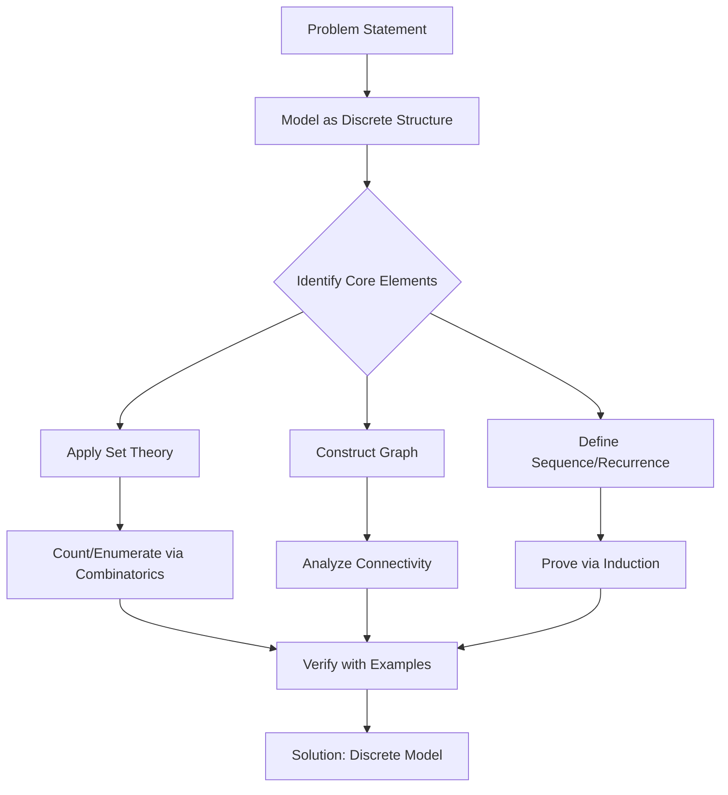

# Foundation: Discrete Math

## 1. Conceptual Mental Model (Core intuition, analogies, and first principles)

Discrete mathematics is the study of **countable, distinct structures** that form the backbone of computational systems and logical reasoning. At its core, it addresses problems where entities exist in *discrete units* rather than continuous spectra—like counting steps on a ladder, connections in a network, or truth values in logic circuits.

**Core intuition**:  
Discrete structures are *atomic* and *well-defined*. Each element has a distinct identity, and relationships between elements follow precise rules (not smooth transitions). This contrasts with continuous mathematics (e.g., calculus), where quantities change fluidly.

**Key analogies**:  
- **Digital vs. Analog**: Like a digital clock (discrete ticks) vs. an analog clock (continuous time)  
- **Logic circuits**: Boolean gates (AND, OR, NOT) operate on discrete inputs (0/1) to produce discrete outputs  
- **Networks**: Social connections (friends) form discrete relationships, not continuous influence fields

**First principles**:  
1. **Countability**: Structures must be finite or countably infinite (e.g., natural numbers)  
2. **Atomicity**: Elements are distinct and non-overlapping  
3. **Rule-based relationships**: Connections follow explicit, deterministic patterns (e.g., graph edges, set operations)  
4. **Combinatorial focus**: Solutions emerge from counting, arranging, and combining discrete units  

> 💡 *Why this matters*: Discrete math is the *foundation of computer science*, cryptography, and algorithm design—where real-world systems operate in discrete steps.

---

## 2. Essential Terminology & Taxonomy

| Term                | Definition                                                                 | Foundational Role                                  |
|---------------------|---------------------------------------------------------------------------|----------------------------------------------------|
| **Set**             | Collection of distinct objects (elements) with no order or repetition       | Basic building block for all discrete structures    |
| **Graph**           | Pair `(V, E)` where `V` = vertices, `E` = edges connecting vertices        | Models relationships between discrete entities      |
| **Sequence**        | Ordered list of elements (e.g., `a₁, a₂, ..., aₙ`)                         | Represents step-by-step evolution of discrete systems |
| **Function**        | Rule mapping each element in domain `D` to exactly one element in codomain `C` | Defines transformations between discrete structures |
| **Proof by Induction** | Method to prove properties for all natural numbers (or well-ordered sets) | Establishes truth for infinite discrete structures  |
| **Combinatorics**   | Study of counting, arrangement, and selection of discrete objects           | Solves enumeration problems in finite structures    |

> 🔑 *Why these terms matter*: These 6 terms form the *minimal vocabulary* for constructing rigorous discrete mathematical models. Each term enables precise reasoning about countable systems without ambiguity.

---

## 3. Architecture & Core Workflow

**Workflow explanation**:  
1. **Problem Statement**: Start with a real-world question (e.g., "How many paths exist between two cities?")  
2. **Model as Discrete Structure**: Translate into sets, graphs, or sequences (e.g., cities → graph nodes)  
3. **Identify Core Elements**: Determine which discrete constructs apply (sets, graphs, sequences)  
4. **Apply Core Tools**:  
   - *Set theory* for membership/operations  
   - *Graph theory* for connectivity/path analysis  
   - *Combinatorics* for counting arrangements  
   - *Induction* for proving properties of infinite sequences  
5. **Verify with Examples**: Test solutions against small cases to ensure correctness  

> 💡 *Why this workflow works*: It systematically transforms vague problems into *exact* discrete models, avoiding continuous approximations and enabling computational tractability.

---

## 4. Common Misconceptions & Mental Traps

| Misconception/Mental Trap                     | Reality & Why It Matters                                                                 |
|-----------------------------------------------|---------------------------------------------------------------------------------------|
| "Discrete math is just about counting"        | Discrete math encompasses *logic*, *graph theory*, *algorithms*, and *proof techniques*—counting is only one application. |
| "Induction only works for natural numbers"    | Induction applies to **any well-ordered set** (e.g., integers, trees, finite sets). The natural numbers are the *simplest* case. |
| "All discrete structures are small/finite"    | Discrete structures can be *infinite* (e.g., natural numbers) while still being countable. |
| "Graphs are only for social networks"         | Graphs model *any* relational system: circuits, file systems, molecular bonds, decision trees. |
| **Critical trap**: Assuming intuition = proof | In discrete math, *intuition* can lead to errors (e.g., assuming a graph is connected without verification). Rigorous proof is mandatory. |

> ⚠️ *Why this matters*: These traps cause students to overlook the *universality* of discrete structures and the *necessity* of formal proof—key to avoiding errors in computer science and cryptography.

---

## 5. Socratic Discussion Starters

1. **How does the concept of a *well-ordered set* generalize mathematical induction beyond natural numbers, and why is this critical for proving properties of infinite discrete structures?**  
   *(Explores the abstraction of induction and its role in infinite systems)*

2. **In what ways can graph theory model *non-physical* systems (e.g., decision-making processes or information flow in social media), and what discrete properties must be preserved to ensure the model remains computationally tractable?**  
   *(Connects graph theory to real-world systems and computational constraints)*

3. **Why is combinatorial reasoning more efficient than brute-force enumeration for solving problems involving large discrete structures (e.g., 1000-bit keys), and what fundamental properties of discrete systems enable this efficiency?**  
   *(Highlights the power of combinatorial principles in cryptography and algorithm design)*
