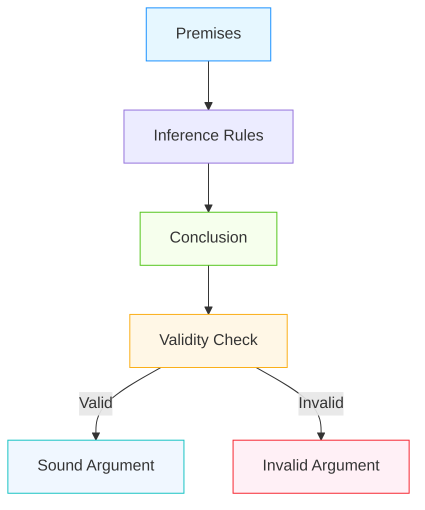

# Foundation: Logic

## 1. Conceptual Mental Model (Core intuition, analogies, and first principles)

At its essence, logic is the **systematic study of valid inference patterns**—the rules that govern how we can move from known truths to new truths with certainty. Think of it as the *grammar of thought*: just as grammar structures sentences without ambiguity, logic structures reasoning without collapse. 

**Core intuition**:  
Truth is not an absolute state but a *relationship* between statements and the world. Validity is the *structural guarantee* that if premises are true, the conclusion must follow. This distinction is foundational: logic doesn't judge truth values (e.g., "the sky is blue"), but *how* we can infer truth from other truths.

**Key analogies**:  
- **Grammar of Thought**: Like language rules, logic provides constraints for constructing meaningful inferences without contradiction.  
- **Engineering Scaffolding**: Logic is the framework that supports complex reasoning without collapsing under the weight of assumptions.  
- **Molecular Assembly**: Logical connectives (e.g., "and", "if-then") act as molecular bonds that fuse propositions into coherent structures.

**First principles**:  
1. **Truth preservation**: Valid inferences must maintain truth—conclusions are true *if* premises are true.  
2. **Formal structure**: Reasoning is governed by rules of form (e.g., modus ponens), not content.  
3. **Consistency**: Systems must avoid contradictions (e.g., `P ∧ ¬P` is impossible).  
4. **Completeness**: Every valid inference must be derivable within the system.

---

## 2. Essential Terminology & Taxonomy

| Term                | Definition                                                                 | Foundational Role                                  |
|---------------------|---------------------------------------------------------------------------|----------------------------------------------------|
| **Proposition**     | A statement that is either true or false (e.g., "2 + 2 = 4")               | Atomic unit of logical analysis                     |
| **Premise**         | A statement accepted as true within an argument                            | Input to inference                                 |
| **Conclusion**      | The statement inferred from premises                                       | Output of inference                                |
| **Validity**        | An argument is valid if the conclusion *necessarily* follows from premises  | Structural guarantee of inference                  |
| **Soundness**       | An argument is sound if it is *valid* **and** all premises are true        | Combines validity with factual truth                |
| **Inference Rule**  | A rule that transforms premises into conclusions (e.g., modus ponens)       | Mechanism for valid deduction                      |
| **Contradiction**   | A statement that is always false (e.g., `P ∧ ¬P`)                          | Systemic failure point                             |
| **Tautology**       | A statement that is always true (e.g., `P ∨ ¬P`)                           | Fundamental truth in logical systems               |

---

## 3. Architecture & Core Workflow

**Workflow Explanation**:  
1. **Premises** (input statements) are processed through a set of **Inference Rules** (e.g., modus ponens, disjunctive syllogism).  
2. The rules generate a **Conclusion** (output statement).  
3. The system performs a **Validity Check**: Does the conclusion *necessarily* follow from the premises?  
4. If valid *and* premises are true → **Sound Argument** (truth-preserving).  
5. If valid but premises false → **Invalid Argument** (structurally sound but factually unsound).

---

## 4. Common Misconceptions & Mental Traps

| Misconception                          | Why It Traps Reasoning                                                                 | Correct Insight                                                                 |
|----------------------------------------|-------------------------------------------------------------------------------------|--------------------------------------------------------------------------------|
| "Logic is about truth values"          | Confuses *validity* (structural) with *truth* (factual). Logic doesn't determine truth—it governs *how* truth propagates. | Validity is a *formal relationship*; truth is a *real-world property*.          |
| "All valid arguments are true"         | Ignores that valid arguments can have false premises (e.g., "All birds fly. Penguins are birds. Therefore, penguins fly"). | Validity ≠ soundness. Soundness requires *both* validity *and* true premises. |
| "Logic is purely symbolic"             | Overlooks logic's role in natural language reasoning (e.g., "If it rains, the ground gets wet" → intuitive inference). | Logic bridges symbolic systems and human cognition through *formal patterns*. |

**Critical Trap**:  
> *Assuming that because an argument is valid, it must be true in reality.*  
> **Why it fails**: Validity is a *structural property*—it doesn't guarantee factual accuracy. A valid argument with false premises can yield a false conclusion (e.g., "All swans are white. Australia has swans. Therefore, Australia has white swans" → false if Australia has black swans).

---

## 5. Socratic Discussion Starters

1. **How does the distinction between *validity* and *soundness* reveal a deeper tension between formal systems and empirical reality?**  
   *Why it works*: Forces confrontation between abstract rules and concrete truth—critical for understanding why logic alone cannot resolve real-world disputes.

2. **Can intuition ever produce a *valid* inference that formal logic would reject? If so, what does this imply about the relationship between human cognition and logical systems?**  
   *Why it works*: Challenges the assumption that intuition is "logical" by exposing where human reasoning diverges from formal rules (e.g., fallacies of relevance).

3. **Suppose you discover a contradiction in a logical system (e.g., `P ∧ ¬P`). How would you resolve it without abandoning the system? What does this say about the limits of formal reasoning?**  
   *Why it works*: Tests understanding of consistency and the *practical* consequences of contradictions—revealing why logic must be carefully constructed.
