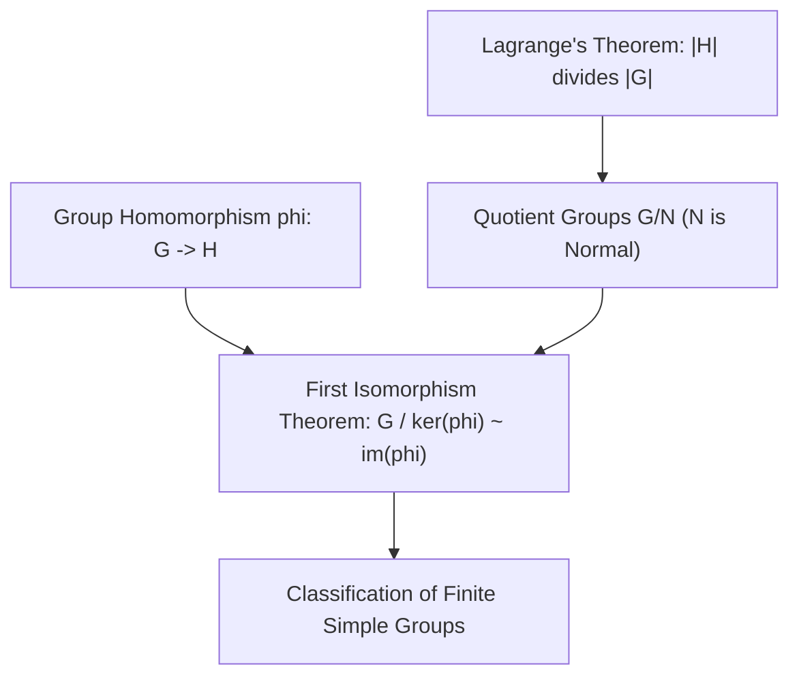

# Foundation: Abstract Algebra & Structural Symmetry

## 1. Conceptual Mental Model

### Beyond Arithmetic: The Study of Structure
In elementary algebra, variables ($x, y$) represent numbers, and operations ($+, \times$) represent conventional arithmetic. You learn rules like $x + y = y + x$ and $x(y + z) = xy + xz$, but the numbers themselves are the primary focus.

**Abstract Algebra abstracts away the numbers entirely.**
It studies **sets equipped with operations** that satisfy designated structural axioms. Rather than asking *"what is $x$?"*, abstract algebra asks:
> *"What mathematical guarantees hold purely by virtue of how elements interact under an operation?"*

```
The Hierarchy of Algebraic Structures
=====================================

             MAGMA (Closure: a * b in S)
               |
               v
            SEMIGROUP (Associativity: (a * b) * c = a * (b * c))
               |
               v
             MONOID (Identity: \exists e, e * a = a * e = a)
               |
               v
             GROUP (Inverses: \exists a^{-1}, a * a^{-1} = e)
               |
         +-----+-----+
         |           | (Add second operation +, *)
         v           v
    ABELIAN GROUP  RING (Abelian under +, Monoid under *, Distributive)
                     |
                     v
             COMMUTATIVE RING (a * b = b * a)
                     |
                     v
             INTEGRAL DOMAIN (No zero divisors: a * b = 0 => a=0 or b=0)
                     |
                     v
              FIELD (Every non-zero element has a multiplicative inverse)
```

### The Symmetries of Nature
The most profound mental model for group theory is **Symmetry**. A symmetry of an object (a geometric polygon, a crystal lattice, a differential equation, or a subatomic particle quantum state) is a transformation that leaves the object invariant.
* If you rotate an equilateral triangle by $120^\circ$, it appears unchanged.
* If you flip it across an altitude axis, it appears unchanged.
The collection of these 6 symmetries forms the **Dihedral Group $D_3$** (isomorphic to the Symmetric Group $S_3$). Group theory is the formal calculus of symmetry.

---

## 2. Essential Terminology & Taxonomy

| Structure | Axiomatic Requirements | Canonical Examples |
| :--- | :--- | :--- |
| **Group $(G, \cdot)$** | 1. **Closure**: $\forall a,b \in G, a \cdot b \in G$<br/>2. **Associativity**: $(a \cdot b) \cdot c = a \cdot (b \cdot c)$<br/>3. **Identity**: $\exists e \in G, a \cdot e = e \cdot a = a$<br/>4. **Inverses**: $\forall a \in G, \exists a^{-1}, a \cdot a^{-1} = e$ | $(\mathbb{Z}, +)$, $(\mathbb{R}^*, \times)$, Matrix Group $GL_n(\mathbb{R})$, Symmetric Group $S_n$ |
| **Abelian Group** | A group where the operation is commutative: $a \cdot b = b \cdot a$ for all $a, b \in G$. | $(\mathbb{Q}, +)$, Cyclic groups $\mathbb{Z}/n\mathbb{Z}$ |
| **Normal Subgroup ($N \triangleleft G$)** | A subgroup invariant under conjugation: $g n g^{-1} \in N$ for all $g \in G, n \in N$. Crucial because only normal subgroups yield well-defined **quotient groups** $G/N$. | Kernels of homomorphisms, Alternating Group $A_n \triangleleft S_n$ |
| **Ring $(R, +, \cdot)$** | Abelian group under $+$, monoid/semigroup under $\cdot$, and multiplication distributes over addition: $a \cdot (b + c) = a \cdot b + a \cdot c$. | Polynomial ring $\mathbb{R}[x]$, Integers $\mathbb{Z}$, $n \times n$ matrices $M_n(\mathbb{R})$ |
| **Ideal ($I \subseteq R$)** | A subring that "absorbs" multiplication: $\forall r \in R, x \in I \implies rx \in I$ and $xr \in I$. Analogous to normal subgroups in ring theory. | $n\mathbb{Z} \subseteq \mathbb{Z}$, Principal ideal $\langle x \rangle \subseteq \mathbb{R}[x]$ |
| **Field $(F, +, \cdot)$** | A commutative ring where every non-zero element $a \ne 0$ possesses a multiplicative inverse $a^{-1} \in F$. | Rational numbers $\mathbb{Q}$, Reals $\mathbb{R}$, Complex numbers $\mathbb{C}$, Finite fields $\mathbb{F}_p$ |

---

## 3. The Cornerstone Theorems of Group Theory



### 1. Lagrange's Theorem (1770)
* **Statement:** If $G$ is a finite group and $H \le G$ is a subgroup, then the order (cardinality) of $H$ divides the order of $G$:
  $$|G| = [G : H] \cdot |H|$$
  Where $[G : H]$ is the number of distinct cosets of $H$ in $G$.
* **Immediate Consequence:** The order of any element $g \in G$ must divide $|G|$. Thus, if $|G| = p$ where $p$ is prime, $G$ must be cyclic ($G \cong \mathbb{Z}/p\mathbb{Z}$).

### 2. The First Isomorphism Theorem
* **Statement:** Let $\phi: G \to H$ be a group homomorphism. Then the kernel $\ker(\phi)$ is a normal subgroup of $G$, and the quotient group $G / \ker(\phi)$ is naturally isomorphic to the image $\text{im}(\phi)$:
  $$G / \ker(\phi) \cong \text{im}(\phi)$$

---

## 4. Common Misconceptions & Mental Traps

### Misconception 1: "Subgroups can always be used to factor a group into a quotient group."
* **Reality:** You **cannot** form a quotient group $G/H$ unless $H$ is a **Normal Subgroup** ($gHg^{-1} = H$). If $H$ is not normal, the operation on cosets $(aH)(bH) = (ab)H$ is not well-defined because different representatives of the coset produce different results.

### Misconception 2: "Every ring is commutative and has a multiplicative identity."
* **Reality:** Matrix rings $M_n(\mathbb{R})$ for $n \ge 2$ are strictly **non-commutative** ($AB \ne BA$). Furthermore, some definitions admit rings without an identity (often termed *rngs* or pseudo-rings, such as $2\mathbb{Z}$).

### Misconception 3: "All vector spaces are just $\mathbb{R}^n$."
* **Reality:** Vector spaces are modules over a field $F$. While finite-dimensional vector spaces over $\mathbb{R}$ are isomorphic to $\mathbb{R}^n$, abstract algebra studies vector spaces over finite fields $\mathbb{F}_q$ (used in cryptography and error-correcting codes) and infinite-dimensional function spaces.

---

## 5. Socratic Discussion Starters

1. **The Insolvability of the Quintic:** Why did Abel and Galois prove that no general algebraic formula using radicals ($\sqrt[n]{\cdot}$) exists for roots of degree 5 polynomials? What is it about the Symmetric Group $S_5$ and its Alternating Subgroup $A_5$ that fundamentally prevents root extraction?
2. **Coset Partitioning:** How does Lagrange's Theorem prove Fermat's Little Theorem ($a^{p-1} \equiv 1 \pmod p$) as a trivial one-line corollary using the multiplicative group $(\mathbb{Z}/p\mathbb{Z})^*$?
3. **Ideals vs. Normal Subgroups:** Why are ideals defined to absorb multiplication from the whole ring ($r \cdot i \in I$), whereas normal subgroups only absorb conjugation ($g \cdot n \cdot g^{-1} \in N$)? How does this structural difference reflect the two operations of a ring?
