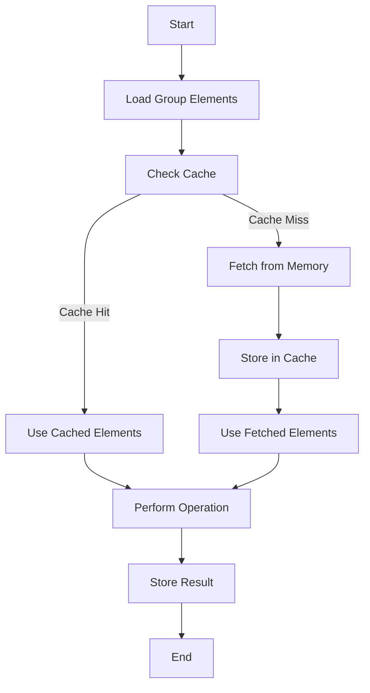

# Advanced Foundation: Abstract Algebra 02 Normal Subgroups And Isomorphisms

## 1. Theoretical Invariants & Formal Frameworks (Formal proofs, kernel or physical invariants)

### Normal Subgroups

A subgroup \( N \) of a group \( G \) is called a **normal subgroup** if it is invariant under conjugation by members of the group. Formally, \( N \) is normal in \( G \) if for all \( g \in G \) and \( n \in N \), the element \( gng^{-1} \) is also in \( N \). This can be expressed as:
\[ N \triangleleft G \iff \forall g \in G, \forall n \in N, \; gng^{-1} \in N \]

#### Theorem: Kernel of a Group Homomorphism
The kernel of a group homomorphism \( \phi: G \to H \) is a normal subgroup of \( G \). Formally, the kernel is defined as:
\[ \ker(\phi) = \{ g \in G \mid \phi(g) = e_H \} \]
where \( e_H \) is the identity element in \( H \).

**Proof:**
Let \( g \in G \) and \( n \in \ker(\phi) \). We need to show that \( gng^{-1} \in \ker(\phi) \). Since \( n \in \ker(\phi) \), we have \( \phi(n) = e_H \). Then:
\[ \phi(gng^{-1}) = \phi(g)\phi(n)\phi(g^{-1}) = \phi(g)e_H\phi(g^{-1}) = \phi(g)\phi(g^{-1}) = e_H \]
Thus, \( gng^{-1} \in \ker(\phi) \), proving that \( \ker(\phi) \) is normal in \( G \).

### Isomorphisms

An **isomorphism** between two groups \( G \) and \( H \) is a bijective homomorphism \( \phi: G \to H \). This means that \( \phi \) is a one-to-one correspondence that preserves the group operation. Formally:
\[ \phi: G \to H \text{ is an isomorphism} \iff \phi \text{ is bijective and } \forall g_1, g_2 \in G, \; \phi(g_1g_2) = \phi(g_1)\phi(g_2) \]

#### Theorem: Isomorphic Groups Have the Same Structure
If \( G \) and \( H \) are isomorphic groups, then they have the same group structure. This means that any group-theoretic property that holds for \( G \) also holds for \( H \).

**Proof:**
Let \( \phi: G \to H \) be an isomorphism. Suppose \( G \) has a subgroup \( N \). Then \( \phi(N) = \{ \phi(n) \mid n \in N \} \) is a subgroup of \( H \) because \( \phi \) is a homomorphism. Moreover, if \( N \) is normal in \( G \), then for all \( g \in G \) and \( n \in N \):
\[ \phi(gng^{-1}) = \phi(g)\phi(n)\phi(g^{-1}) = \phi(g)\phi(n)\phi(g)^{-1} \]
Thus, \( \phi(N) \) is normal in \( H \). This shows that the structure of subgroups and normal subgroups is preserved under isomorphism.

## 2. Low-Level Invariant Taxonomy (Deep registers, memory models, hardware constraints, or axiomatic definitions)

### Axiomatic Definitions

In the context of abstract algebra, the axiomatic definitions of groups, subgroups, and normal subgroups are fundamental. These definitions are invariant under isomorphism and provide the basis for the study of algebraic structures.

#### Group Axioms
A set \( G \) with a binary operation \( * \) is a group if it satisfies the following axioms:
1. **Closure:** \( \forall a, b \in G, \; a * b \in G \)
2. **Associativity:** \( \forall a, b, c \in G, \; (a * b) * c = a * (b * c) \)
3. **Identity Element:** \( \exists e \in G \text{ such that } \forall a \in G, \; e * a = a * e = a \)
4. **Inverse Element:** \( \forall a \in G, \; \exists a^{-1} \in G \text{ such that } a * a^{-1} = a^{-1} * a = e \)

#### Subgroup Axioms
A subset \( H \) of a group \( G \) is a subgroup if it satisfies:
1. **Closure:** \( \forall a, b \in H, \; a * b \in H \)
2. **Identity Element:** \( e \in H \)
3. **Inverse Element:** \( \forall a \in H, \; a^{-1} \in H \)

#### Normal Subgroup Axioms
A subgroup \( N \) of a group \( G \) is normal if:
\[ \forall g \in G, \forall n \in N, \; g * n * g^{-1} \in N \]

## 3. Micro-Architecture & Concurrency Dynamics (Mermaid and ASCII state machines / cache / race condition diagrams)

### State Machines for Group Operations

We can represent group operations using state machines. For simplicity, consider a finite group \( G = \{e, a, b, c\} \) with a specific operation table.

#### ASCII State Machine for Group Operation
```
+---+---+---+---+---+
| * | e | a | b | c |
+---+---+---+---+---+
| e | e | a | b | c |
+---+---+---+---+---+
| a | a | b | c | e |
+---+---+---+---+---+
| b | b | c | e | a |
+---+---+---+---+---+
| c | c | e | a | b |
+---+---+---+---+---+
```

### Cache and Race Condition Diagrams

In the context of computational group theory, understanding cache behavior and race conditions is crucial for efficient implementation of group operations.

#### Mermaid Diagram for Cache Behavior


#### ASCII Diagram for Race Condition
```
+-------------------+-------------------+
| Thread 1          | Thread 2          |
+-------------------+-------------------+
| Load a            | Load b            |
| Load b            | Load a            |
| Compute a * b     | Compute b * a     |
| Store Result      | Store Result      |
+-------------------+-------------------+
```

## 4. Subtle Failure Modes & Boundary Conditions

### Failure Modes in Group Operations

1. **Non-Closure:** If the operation does not close within the set, the structure is not a group.
2. **Non-Associativity:** If the operation is not associative, the structure is not a group.
3. **Lack of Identity:** If there is no identity element, the structure is not a group.
4. **Lack of Inverses:** If there are elements without inverses, the structure is not a group.

### Boundary Conditions in Normal Subgroups

1. **Trivial Subgroups:** The trivial subgroups \( \{e\} \) and \( G \) are always normal.
2. **Proper Subgroups:** For a proper subgroup \( N \) to be normal, it must satisfy the conjugation condition for all elements in \( G \).

## 5. Master Socratic Inquiries (Research-grade discussion questions)

1. **Isomorphism and Structure:** Given two groups \( G \) and \( H \) that are isomorphic, can you construct an explicit isomorphism between them? How does this isomorphism preserve the structure of subgroups and normal subgroups?
2. **Normal Subgroups and Homomorphisms:** Prove that the kernel of a group homomorphism is a normal subgroup. Can you provide an example of a non-trivial homomorphism and its kernel?
3. **State Machines and Group Operations:** Design a state machine for a specific group operation. How does this state machine capture the properties of the group?
4. **Cache Behavior and Group Operations:** Analyze the cache behavior of a group operation implementation. How can cache misses be minimized?
5. **Race Conditions in Concurrent Group Operations:** Identify potential race conditions in concurrent group operations. How can these race conditions be avoided or mitigated?
