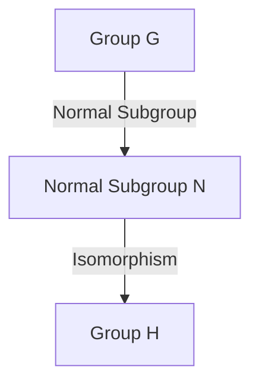

# Beginner Foundation: Abstract Algebra 02 Normal Subgroups And Isomorphisms

## 1. Everyday Intuition & First Principles

Imagine you have a group of friends who like to play different musical instruments. This group can be thought of as a **group** in the mathematical sense, where each member (or element) has a specific role (or operation) they perform. Now, suppose some of your friends only play string instruments. This subset of string players can be seen as a **subgroup**. 

A **normal subgroup** is like a subgroup that plays so well together that no matter how the whole group rearranges itself, the string players always remain a cohesive unit. They don't get mixed up with the other musicians in a way that disrupts their internal structure.

An **isomorphism** is like having two different groups of friends who play the same music but in different ways. If you can match each member of one group with a member of the other group such that their musical roles correspond perfectly, then these two groups are isomorphic. They are essentially the same group, just dressed up differently.

## 2. Foundational Vocabulary & Glossary

- **Group**: A set equipped with an operation that combines any two of its elements to form a third element in such a way that four conditions called group axioms are satisfied.
- **Subgroup**: A subset of a group that is itself a group under the same operation.
- **Normal Subgroup**: A subgroup \(N\) of a group \(G\) is normal if for every element \(g\) in \(G\) and every element \(n\) in \(N\), the element \(gng^{-1}\) is also in \(N\).
- **Isomorphism**: A bijective homomorphism between two groups, meaning a one-to-one correspondence between the elements of the groups that preserves the group operation.
- **Homomorphism**: A function between two groups that preserves the group operation.
- **Kernel**: The set of elements of a group that are mapped to the identity element of another group under a homomorphism.

### Examples

- **Group**: The set of integers \(\mathbb{Z}\) under addition.
- **Subgroup**: The set of even integers \(2\mathbb{Z}\) is a subgroup of \(\mathbb{Z}\).
- **Normal Subgroup**: The set of even integers \(2\mathbb{Z}\) is a normal subgroup of \(\mathbb{Z}\) because adding or subtracting any integer to an even number results in another even number.
- **Isomorphism**: The function \(f: \mathbb{Z} \to \mathbb{Z}\) defined by \(f(x) = 2x\) is not an isomorphism, but the function \(g: \mathbb{Z} \to \mathbb{Z}\) defined by \(g(x) = x\) is an isomorphism.
- **Homomorphism**: The function \(h: \mathbb{Z} \to \mathbb{Z}_2\) defined by \(h(x) = x \mod 2\) is a homomorphism.
- **Kernel**: The kernel of the homomorphism \(h: \mathbb{Z} \to \mathbb{Z}_2\) is the set of even integers \(2\mathbb{Z}\).

## 3. Visual System Flow

### ASCII Diagram

```
Group G
  |
  | (Normal Subgroup)
  v
Normal Subgroup N
  |
  | (Isomorphism)
  v
Group H
```

### Mermaid Flowchart



## 4. Common Beginner Misconceptions & Mental Traps

- **Misconception**: All subgroups are normal. **Trap**: Not all subgroups are normal. A subgroup is normal if it remains unchanged under conjugation by any element of the group.
- **Misconception**: Isomorphisms are just bijections. **Trap**: Isomorphisms are bijections that also preserve the group operation.
- **Misconception**: The kernel of a homomorphism is always the entire group. **Trap**: The kernel is the set of elements mapped to the identity, which can be smaller than the entire group.

## 5. Socratic Discussion Starters

- What is the difference between a subgroup and a normal subgroup? Can you give an example of a subgroup that is not normal?
- How does an isomorphism differ from a homomorphism? Can you provide an example of a homomorphism that is not an isomorphism?
- What is the kernel of a homomorphism, and why is it important in understanding the structure of groups?
- Can you think of a real-world analogy for a normal subgroup and an isomorphism? How do these analogies help in understanding the mathematical concepts?
