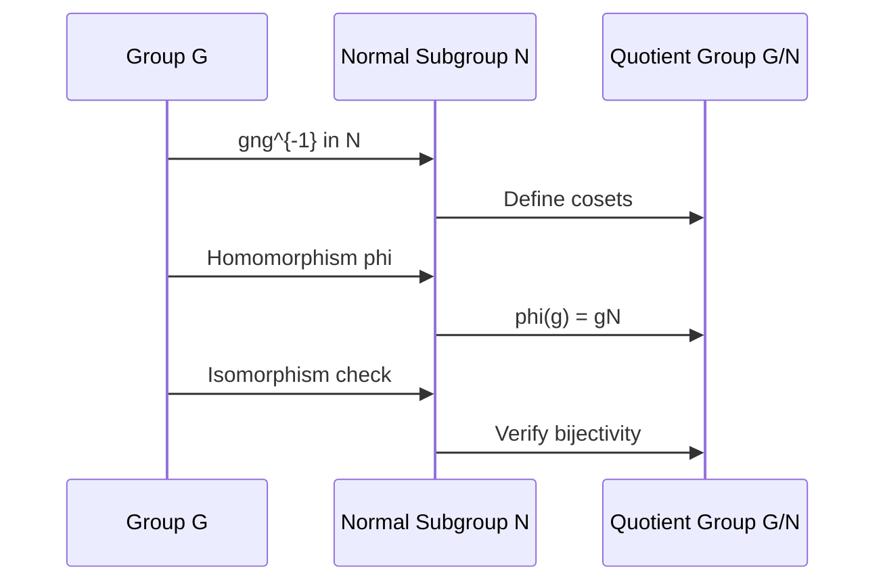

# Intermediate Foundation: Abstract Algebra 02 Normal Subgroups And Isomorphisms

## 1. Architectural Mental Model

In the realm of Abstract Algebra, the concept of a group serves as the foundational structure, encapsulating the essence of symmetry and transformation. Building upon this, normal subgroups and isomorphisms introduce deeper architectural layers that enable the construction of more complex algebraic systems. 

### Normal Subgroups as Structural Components

A **normal subgroup** \( N \) of a group \( G \) is a subgroup that is invariant under conjugation by elements of \( G \). Formally, \( N \) is normal if for every \( g \in G \) and \( n \in N \), the element \( gng^{-1} \) is also in \( N \). This property ensures that the quotient group \( G/N \) is well-defined, allowing us to construct new algebraic structures from existing ones.

### Isomorphisms as Interface Protocols

An **isomorphism** between two groups \( G \) and \( H \) is a bijective homomorphism \( \phi: G \to H \). This means that \( \phi \) preserves the group operation, i.e., \( \phi(g_1g_2) = \phi(g_1)\phi(g_2) \) for all \( g_1, g_2 \in G \). Isomorphisms serve as interface protocols that allow us to equate two groups in terms of their algebraic properties, facilitating the interchangeability of components in a system.

## 2. Systems Taxonomy & Component Protocols

### Standard Interfaces

- **Normal Subgroup Interface**: A component that adheres to the normal subgroup interface must satisfy the condition \( gng^{-1} \in N \) for all \( g \in G \) and \( n \in N \).
- **Isomorphism Interface**: A component that implements the isomorphism interface must provide a bijective homomorphism between two groups, ensuring that the algebraic structure is preserved.

### Protocols

- **Conjugation Protocol**: Ensures that the action of conjugation by elements of \( G \) on \( N \) results in elements within \( N \).
- **Homomorphism Protocol**: Ensures that the group operation is preserved under the mapping defined by the isomorphism.

### Data Models

- **Group Data Model**: Represents a set equipped with a binary operation satisfying the group axioms.
- **Subgroup Data Model**: Represents a subset of a group that is closed under the group operation and contains the identity element.
- **Quotient Group Data Model**: Represents the set of cosets of a normal subgroup, equipped with a well-defined group operation.

## 3. Multi-Component Interaction Flow

### ASCII Sequence Diagram

```
+-------------------+       +-------------------+       +-------------------+
|     Group G       |       |   Normal Subgroup |       |  Quotient Group   |
|                   |       |         N         |       |       G/N         |
+-------------------+       +-------------------+       +-------------------+
          |                           |                           |
          |  gng^{-1} in N            |                           |
          |-------------------------->|                           |
          |                           |  Define cosets            |
          |                           |-------------------------->|
          |                           |                           |
          |  Homomorphism phi         |                           |
          |-------------------------->|                           |
          |                           |  phi(g) = gN              |
          |                           |-------------------------->|
          |                           |                           |
          |  Isomorphism check        |                           |
          |-------------------------->|                           |
          |                           |  Verify bijectivity       |
          |                           |-------------------------->|
          |                           |                           |
```

### Mermaid Sequence Diagram



## 4. Architectural Trade-offs & Production Pitfalls

### Trade-offs

- **Complexity vs. Simplicity**: Introducing normal subgroups and isomorphisms can simplify the analysis of complex systems by reducing them to simpler quotient structures. However, this abstraction can also introduce complexity in understanding the underlying relationships.
- **Performance vs. Accuracy**: Efficient computation of cosets and isomorphisms is crucial for performance, but it must be balanced with the need for accurate representation of algebraic structures.

### Pitfalls

- **Misinterpretation of Normality**: Failing to verify the normality condition can lead to incorrect conclusions about the structure of quotient groups.
- **Incorrect Isomorphism Mapping**: An improperly defined isomorphism can result in loss of important algebraic properties, leading to erroneous system behavior.

## 5. Socratic Discussion Starters

1. **How does the concept of normal subgroups facilitate the construction of quotient groups, and what are the implications for system design?**
2. **In what ways can isomorphisms be used to optimize the performance of algebraic computations in production systems?**
3. **What are the potential pitfalls of relying on isomorphisms to simplify complex algebraic structures, and how can these be mitigated?**
4. **How can the architectural mental model of normal subgroups and isomorphisms be applied to the design of modular and scalable software systems?**
5. **What are the key differences between normal subgroups and other types of subgroups, and how do these differences impact system design and implementation?**

By delving into these intermediate concepts, engineers and practitioners can gain a deeper understanding of the architectural principles underlying abstract algebra, enabling them to design more robust and efficient systems.
