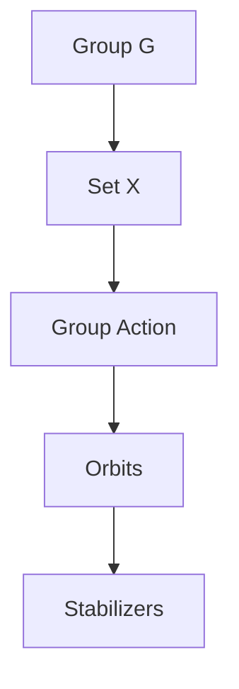

# Beginner Foundation: Abstract Algebra 03 Group Actions And Sylow Theorems

## 1. Everyday Intuition & First Principles

**Intuition Behind Group Actions:**
Imagine you have a set of colored blocks, and you can rotate or flip them in various ways. Each rotation or flip can be thought of as an action that rearranges the blocks. Group actions formalize this idea by studying how a group (a set of operations) can act on a set (the blocks), transforming it in different ways while preserving certain properties.

**Intuition Behind Sylow Theorems:**
Consider a group of people attending a party. The Sylow Theorems help us understand how smaller groups of friends (subgroups) can exist within the larger group of attendees. Specifically, they tell us that certain subgroups of specific sizes must exist, and they provide information about how these subgroups can be arranged and interact within the larger group.

## 2. Foundational Vocabulary & Glossary

1. **Group Action:** A way of describing how a group acts on a set, transforming its elements. Formally, a group action of a group \( G \) on a set \( X \) is a function \( G \times X \to X \) that satisfies certain properties.
   - **Example:** Rotations of a square form a group, and this group acts on the set of vertices of the square.

2. **Orbit:** The set of elements to which a given element can be mapped by the elements of the group. Formally, the orbit of an element \( x \in X \) under the action of a group \( G \) is \( \{ g \cdot x \mid g \in G \} \).
   - **Example:** The orbit of a vertex of a square under the group of rotations is the set of all vertices.

3. **Stabilizer:** The set of elements of the group that leave a given element of the set unchanged. Formally, the stabilizer of an element \( x \in X \) under the action of a group \( G \) is \( \{ g \in G \mid g \cdot x = x \} \).
   - **Example:** The stabilizer of a vertex of a square under the group of rotations is the identity rotation.

4. **Sylow Subgroup:** A subgroup of a group whose order is a power of a prime number. The Sylow Theorems provide information about the existence and properties of such subgroups.
   - **Example:** In the symmetric group \( S_4 \), the subgroup generated by the 4-cycle (1 2 3 4) is a Sylow 2-subgroup.

5. **Normal Subgroup:** A subgroup that is invariant under conjugation by members of the group. Formally, a subgroup \( N \) of a group \( G \) is normal if \( gNg^{-1} = N \) for all \( g \in G \).
   - **Example:** The alternating group \( A_n \) is a normal subgroup of the symmetric group \( S_n \) for \( n \geq 3 \).

6. **Conjugacy Class:** A set of elements in a group that are conjugate to each other. Formally, the conjugacy class of an element \( g \in G \) is \( \{ hgh^{-1} \mid h \in G \} \).
   - **Example:** In the symmetric group \( S_3 \), the conjugacy class of the transposition (1 2) consists of all transpositions.

## 3. Visual System Flow

### ASCII Diagram
```
+-------------------+
|     Group G       |
+-------------------+
          |
          v
+-------------------+
|     Set X         |
+-------------------+
          |
          v
+-------------------+
|   Group Action    |
+-------------------+
          |
          v
+-------------------+
|     Orbits        |
+-------------------+
          |
          v
+-------------------+
|   Stabilizers     |
+-------------------+
```

### Mermaid Flowchart


## 4. Common Beginner Misconceptions & Mental Traps

1. **Misconception:** Group actions are only about rotations and symmetries.
   - **Reality:** Group actions can be defined for any group and any set, not just geometric objects.

2. **Misconception:** Sylow subgroups are unique.
   - **Reality:** Sylow subgroups are not necessarily unique; there can be multiple Sylow subgroups of the same order in a group.

3. **Misconception:** All subgroups are normal.
   - **Reality:** Not all subgroups are normal. A subgroup is normal if it is invariant under conjugation by all elements of the group.

4. **Misconception:** The order of a Sylow subgroup is always the largest power of a prime dividing the order of the group.
   - **Reality:** The order of a Sylow subgroup is the largest power of a prime that divides the order of the group, but there can be multiple Sylow subgroups of this order.

## 5. Socratic Discussion Starters

1. **Group Actions:**
   - How can you describe the action of the symmetric group \( S_3 \) on the set of its elements?
   - What are the orbits and stabilizers of the elements in this action?

2. **Sylow Theorems:**
   - What does it mean for a subgroup to be a Sylow subgroup?
   - How do the Sylow Theorems help us understand the structure of a group?

3. **Normal Subgroups:**
   - Can you provide an example of a group with a normal subgroup and a non-normal subgroup?
   - What are the implications of a subgroup being normal?

4. **Conjugacy Classes:**
   - How are conjugacy classes related to the concept of group actions?
   - What is the significance of the number of elements in a conjugacy class?
