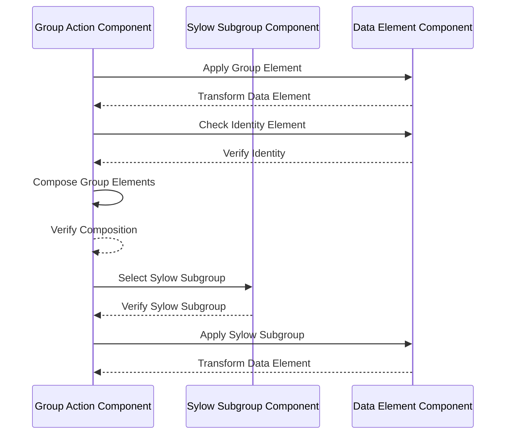

# Intermediate Foundation: Abstract Algebra 03 Group Actions And Sylow Theorems

## 1. Architectural Mental Model

In the realm of abstract algebra, particularly when delving into group actions and Sylow theorems, it is essential to build a robust mental model that integrates both theoretical constructs and practical applications. For engineers and practitioners, this involves understanding how group actions can be used to analyze symmetries and structures in systems, and how Sylow theorems can provide insights into the composition of groups.

### Group Actions

A **group action** of a group \( G \) on a set \( X \) is a function \( \cdot: G \times X \to X \) such that:
1. \( e \cdot x = x \) for all \( x \in X \) (where \( e \) is the identity element of \( G \)).
2. \( (gh) \cdot x = g \cdot (h \cdot x) \) for all \( g, h \in G \) and \( x \in X \).

In a production architecture, group actions can be seen as a way to model symmetries and transformations in data structures. For instance, consider a system where data is stored in a database that needs to be accessed and modified by different users. The group \( G \) could represent the set of all possible operations (e.g., read, write, delete) that can be performed on the data, and the set \( X \) could represent the data itself. The group action then describes how these operations transform the data.

### Sylow Theorems

The **Sylow theorems** provide a partial converse to Lagrange's theorem, which states that the order of any subgroup of a finite group \( G \) divides the order of \( G \). The Sylow theorems guarantee the existence of certain subgroups of a given order, specifically those whose order is a power of a prime.

In a production system, understanding the Sylow theorems can help in designing systems that are robust and scalable. For example, in a distributed system, the Sylow theorems can be used to analyze the structure of the group of nodes and ensure that certain critical subgroups (e.g., those responsible for maintaining consistency) are present and well-distributed.

## 2. Systems Taxonomy & Component Protocols

### Standard Interfaces

In the context of group actions and Sylow theorems, standard interfaces can be defined to facilitate communication between different components of a system. For example, a standard interface for a group action might include methods for applying group elements to data, checking the identity element, and composing group elements.

### Protocols

Protocols for group actions and Sylow theorems can be designed to ensure consistency and correctness. For instance, a protocol for applying a group action might specify the order in which operations are applied and how conflicts are resolved. Similarly, a protocol for analyzing Sylow subgroups might specify the criteria for selecting subgroups and the methods for verifying their properties.

### Data Models

Data models for group actions and Sylow theorems can be designed to represent the underlying mathematical structures in a way that is both efficient and easy to understand. For example, a data model for a group action might include a set of operations and a set of data elements, along with a function that describes how the operations transform the data. A data model for Sylow subgroups might include a set of subgroups and a set of criteria for selecting them.

## 3. Multi-Component Interaction Flow

### ASCII Sequence Diagram

```
+-------------------+          +-------------------+          +-------------------+
|  Group Action     |          |  Sylow Subgroup   |          |  Data Element     |
|  Component        |          |  Component        |          |  Component        |
+-------------------+          +-------------------+          +-------------------+
          |                                |                                |
          |  Apply Group Element           |                                |
          |------------------>             |                                |
          |                                |                                |
          |  Transform Data Element        |                                |
          |<------------------             |                                |
          |                                |                                |
          |  Check Identity Element        |                                |
          |------------------>             |                                |
          |                                |                                |
          |  Verify Identity               |                                |
          |<------------------             |                                |
          |                                |                                |
          |  Compose Group Elements        |                                |
          |------------------>             |                                |
          |                                |                                |
          |  Verify Composition            |                                |
          |<------------------             |                                |
          |                                |                                |
          |  Select Sylow Subgroup         |                                |
          |------------------>             |                                |
          |                                |                                |
          |  Verify Sylow Subgroup         |                                |
          |<------------------             |                                |
          |                                |                                |
          |  Apply Sylow Subgroup          |                                |
          |------------------>             |                                |
          |                                |                                |
          |  Transform Data Element        |                                |
          |<------------------             |                                |
          |                                |                                |
```

### Mermaid Sequence Diagram



## 4. Architectural Trade-offs & Production Pitfalls

### Trade-offs

1. **Complexity vs. Efficiency:** Designing a system that fully leverages group actions and Sylow theorems can be complex, but it can also lead to more efficient and robust systems. The trade-off is between the complexity of the design and the benefits it provides.
2. **Scalability vs. Consistency:** Ensuring that a system is both scalable and consistent can be challenging, especially when dealing with distributed systems. The trade-off is between the ability to scale the system and the ability to maintain consistency across all components.

### Pitfalls

1. **Over-Engineering:** It is easy to over-engineer a system by adding unnecessary complexity. This can lead to a system that is difficult to maintain and understand.
2. **Ignoring Edge Cases:** When designing a system, it is important to consider all possible edge cases. Ignoring edge cases can lead to unexpected behavior and system failures.

## 5. Socratic Discussion Starters

1. **How can group actions be used to model symmetries in a distributed system?**
2. **What are the implications of the Sylow theorems for the design of a fault-tolerant system?**
3. **How can the complexity of a system be managed while still leveraging the benefits of group actions and Sylow theorems?**
4. **What are the potential pitfalls of using group actions and Sylow theorems in a production environment?**
5. **How can the trade-off between complexity and efficiency be balanced in a system that uses group actions and Sylow theorems?**

By exploring these questions, engineers and practitioners can gain a deeper understanding of how abstract algebra concepts like group actions and Sylow theorems can be applied to system design and production architecture.
