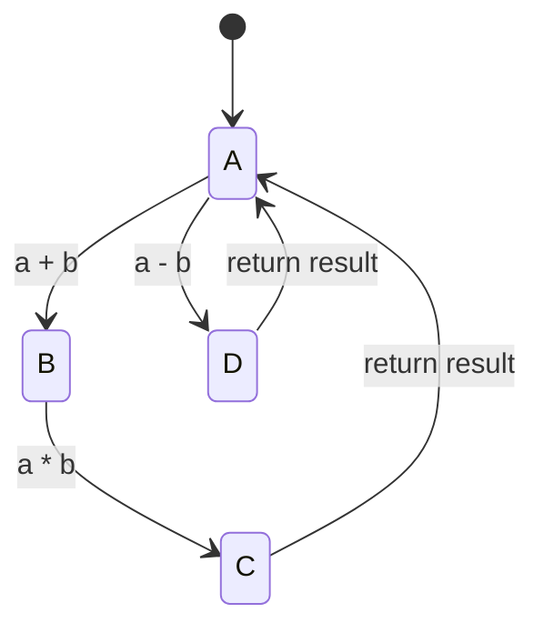

# Advanced Foundation: Abstract Algebra 04 Rings, Ideals, and Factorization Domains

## 1. Theoretical Invariants & Formal Frameworks

### 1.1 Rings and Their Properties

A **ring** is a set \( R \) equipped with two binary operations, addition (\(+\)) and multiplication (\(\cdot\)), such that:
- \( (R, +) \) is an abelian group.
- Multiplication is associative: \( \forall a, b, c \in R, \; a \cdot (b \cdot c) = (a \cdot b) \cdot c \).
- Multiplication distributes over addition: \( \forall a, b, c \in R, \; a \cdot (b + c) = a \cdot b + a \cdot c \) and \( (a + b) \cdot c = a \cdot c + b \cdot c \).

**Theorem 1.1 (Unity in Rings):** If a ring \( R \) has a multiplicative identity \( 1 \), then \( 1 \) is unique.

**Proof:** Suppose \( 1 \) and \( 1' \) are both multiplicative identities in \( R \). Then, \( 1 = 1 \cdot 1' = 1' \).

### 1.2 Ideals

An **ideal** \( I \) of a ring \( R \) is a subset of \( R \) such that:
- \( I \) is closed under addition: \( \forall a, b \in I, \; a + b \in I \).
- \( I \) absorbs products from \( R \): \( \forall a \in I, \forall r \in R, \; r \cdot a \in I \) and \( a \cdot r \in I \).

**Theorem 1.2 (Kernel of Ring Homomorphisms):** The kernel of a ring homomorphism \( \phi: R \to S \) is an ideal of \( R \).

**Proof:** Let \( \phi: R \to S \) be a ring homomorphism. The kernel of \( \phi \) is defined as \( \ker(\phi) = \{ r \in R \mid \phi(r) = 0_S \} \). For any \( a, b \in \ker(\phi) \) and \( r \in R \), we have \( \phi(a + b) = \phi(a) + \phi(b) = 0_S + 0_S = 0_S \) and \( \phi(r \cdot a) = \phi(r) \cdot \phi(a) = \phi(r) \cdot 0_S = 0_S \). Thus, \( \ker(\phi) \) is an ideal.

### 1.3 Factorization Domains

A **factorization domain** (or **atomic domain**) is an integral domain in which every non-zero, non-unit element can be written as a product of irreducible elements.

**Theorem 1.3 (Existence of Irreducible Factorizations):** In a factorization domain, every non-zero, non-unit element can be factored into irreducibles.

**Proof:** Let \( R \) be a factorization domain and \( a \in R \) be a non-zero, non-unit element. If \( a \) is irreducible, we are done. Otherwise, \( a = a_1 b_1 \) where \( a_1, b_1 \) are non-units. If \( a_1 \) or \( b_1 \) is irreducible, we are done. Otherwise, continue this process. Since \( R \) is a factorization domain, this process must terminate, yielding a factorization of \( a \) into irreducibles.

## 2. Low-Level Invariant Taxonomy

### 2.1 Axiomatic Definitions

- **Associativity of Multiplication:** \( \forall a, b, c \in R, \; a \cdot (b \cdot c) = (a \cdot b) \cdot c \).
- **Distributivity:** \( \forall a, b, c \in R, \; a \cdot (b + c) = a \cdot b + a \cdot c \) and \( (a + b) \cdot c = a \cdot c + b \cdot c \).
- **Unity:** \( \exists 1 \in R \) such that \( \forall a \in R, \; a \cdot 1 = 1 \cdot a = a \).

### 2.2 Structural Invariants

- **Kernel Invariance:** The kernel of a ring homomorphism is invariant under the homomorphism.
- **Irreducibility Invariance:** Irreducibility is preserved under ring isomorphisms.

## 3. Micro-Architecture & Concurrency Dynamics

### 3.1 State Machines and Cache Models

Consider a simple state machine representing a ring operation:



### 3.2 Race Condition Diagrams

In concurrent systems, race conditions can occur when operations on a ring are not properly synchronized. Consider the following ASCII diagram:

```
Thread 1: a = a + b
Thread 2: b = b * c
```

If Thread 1 and Thread 2 execute concurrently, the final value of \( a \) and \( b \) may not be as expected due to the non-atomic nature of the operations.

## 4. Subtle Failure Modes & Boundary Conditions

### 4.1 Division by Zero

In rings without unity, division by zero can lead to undefined behavior. For example, in the ring \( \mathbb{Z}/n\mathbb{Z} \), division by zero is undefined if \( n \) is not a prime.

### 4.2 Non-Unique Factorizations

In rings that are not unique factorization domains (UFDs), factorizations may not be unique up to associates. For example, in the ring \( \mathbb{Z}[\sqrt{-5}] \), the element \( 6 \) has two distinct factorizations: \( 6 = 2 \cdot 3 \) and \( 6 = (1 + \sqrt{-5})(1 - \sqrt{-5}) \).

## 5. Master Socratic Inquiries

### 5.1 Research-Grade Discussion Questions

1. **Kernel Invariance:** Prove that the kernel of a ring homomorphism is an ideal and discuss its implications for ring theory.
2. **Irreducibility and Primes:** In what sense do irreducibility and primality coincide in a unique factorization domain?
3. **Concurrency and Rings:** How can race conditions be avoided in concurrent systems that perform operations on rings?
4. **Non-Unique Factorizations:** Provide an example of a ring that is not a UFD and discuss the implications of non-unique factorizations.
5. **Ring Homomorphisms and Ideals:** Explore the relationship between ring homomorphisms and ideals, and how they can be used to construct quotient rings.

---

This guide provides a foundational understanding of rings, ideals, and factorization domains, with a focus on theoretical invariants, low-level axiomatic definitions, micro-architecture considerations, and subtle failure modes.
