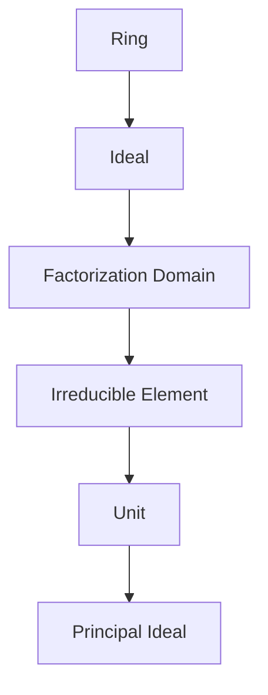

# Beginner Foundation: Abstract Algebra 04 Rings, Ideals, and Factorization Domains

## 1. Everyday Intuition & First Principles

Imagine you have a collection of colorful building blocks. Each block can be combined with another block to make a new block, and you can also take away blocks to get a different one. This is somewhat like how numbers work in a ring. Just as you can add or subtract blocks, you can add or subtract numbers in a ring. However, in a ring, you can also multiply numbers, much like stacking blocks to make a bigger structure. The study of rings helps us understand the underlying structure and properties of these operations.

## 2. Foundational Vocabulary & Glossary

- **Ring:** A set equipped with two binary operations, usually called addition and multiplication, satisfying certain properties such as associativity, distributivity, and the existence of an additive identity.
  - **Example:** The set of integers \(\mathbb{Z}\) with addition and multiplication is a ring.
  
- **Ideal:** A special subset of a ring that is closed under addition and "absorbs" multiplication by elements of the ring.
  - **Example:** The set of even integers \(2\mathbb{Z}\) is an ideal of the ring \(\mathbb{Z}\).
  
- **Factorization Domain (FD):** A ring in which every non-zero, non-unit element can be written as a product of irreducible elements.
  - **Example:** The ring of integers \(\mathbb{Z}\) is a factorization domain.
  
- **Irreducible Element:** An element in a ring that cannot be factored into a product of non-unit elements.
  - **Example:** In \(\mathbb{Z}\), the numbers 2, 3, 5, etc., are irreducible.
  
- **Unit:** An element in a ring that has a multiplicative inverse.
  - **Example:** In \(\mathbb{Z}\), the units are 1 and -1.
  
- **Principal Ideal:** An ideal generated by a single element of the ring.
  - **Example:** The ideal \(3\mathbb{Z}\) is a principal ideal generated by the element 3.

## 3. Visual System Flow

### ASCII Diagram

```
+-------------------+
|       Ring        |
+-------------------+
| - Addition        |
| - Multiplication  |
+-------------------+
          |
          v
+-------------------+
|       Ideal       |
+-------------------+
| - Closed under +  |
| - Absorbs *       |
+-------------------+
          |
          v
+-------------------+
| Factorization Dom |
+-------------------+
| - Every non-zero  |
|   non-unit can be |
|   factored        |
+-------------------+
          |
          v
+-------------------+
| Irreducible Eleme |
+-------------------+
| - Cannot be facto |
|   red further     |
+-------------------+
          |
          v
+-------------------+
|       Unit        |
+-------------------+
| - Has multiplica- |
|   tive inverse    |
+-------------------+
          |
          v
+-------------------+
| Principal Ideal   |
+-------------------+
| - Generated by    |
|   a single elemen |
+-------------------+
```

### Mermaid Flowchart



## 4. Common Beginner Misconceptions & Mental Traps

- **Misconception:** All rings are commutative (i.e., \(a \cdot b = b \cdot a\) for all \(a, b\) in the ring).
  - **Reality:** While many rings are commutative (like \(\mathbb{Z}\)), there are also non-commutative rings (like the set of \(2 \times 2\) matrices with real entries).

- **Misconception:** Every ideal is a principal ideal.
  - **Reality:** Not all ideals are principal. For example, in the ring of integers, the ideal \(2\mathbb{Z}\) is principal, but in more complex rings, there can be ideals that are not generated by a single element.

- **Misconception:** All elements in a ring can be factored into irreducibles.
  - **Reality:** This is true in factorization domains, but not all rings have this property. For example, in the ring \(\mathbb{Z}[\sqrt{-5}]\), the element 6 can be factored in two different ways: \(6 = 2 \cdot 3 = (1 + \sqrt{-5})(1 - \sqrt{-5})\).

## 5. Socratic Discussion Starters

- What are the key properties that define a ring?
- Can you give an example of a ring that is not commutative?
- How does the concept of an ideal relate to the concept of a subgroup in group theory?
- What is the significance of a principal ideal in the study of rings?
- Can you explain why the ring of integers \(\mathbb{Z}\) is a factorization domain?
