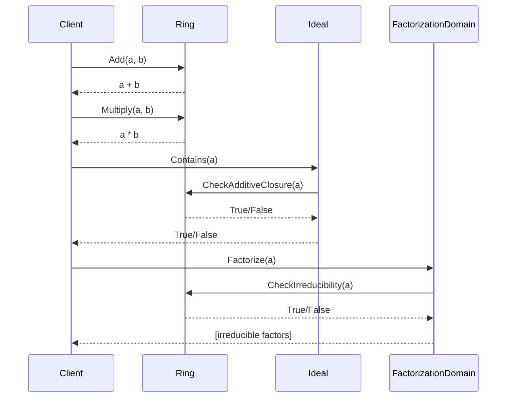

# Intermediate Foundation: Abstract Algebra 04 Rings, Ideals, and Factorization Domains

## 1. Architectural Mental Model

In the realm of abstract algebra, rings serve as a foundational structure that generalizes the arithmetic properties of integers. A ring is a set equipped with two binary operations, typically called addition and multiplication, that satisfy certain axioms. This mental model can be extended to understand how rings, ideals, and factorization domains interact in a system design context.

### Key Concepts:
- **Ring**: A set \( R \) with two operations \( + \) and \( \cdot \) such that:
  - \( (R, +) \) is an abelian group.
  - \( (R, \cdot) \) is a monoid.
  - Multiplication distributes over addition: \( a \cdot (b + c) = (a \cdot b) + (a \cdot c) \) and \( (a + b) \cdot c = (a \cdot c) + (b \cdot c) \).

- **Ideal**: A subset \( I \) of a ring \( R \) such that:
  - \( I \) is an additive subgroup of \( R \).
  - For any \( r \in R \) and \( i \in I \), both \( r \cdot i \) and \( i \cdot r \) are in \( I \).

- **Factorization Domain (FD)**: A commutative ring in which every non-zero, non-unit element can be written as a product of irreducible elements, and this factorization is unique up to order and units.

### Production Architecture:
In a production system, rings can be thought of as data structures that support operations analogous to addition and multiplication. Ideals can be seen as substructures that are closed under these operations and multiplication by any element of the ring. Factorization domains can be used to ensure that data can be uniquely decomposed into irreducible components, which is crucial for tasks like data compression and encryption.

## 2. Systems Taxonomy & Component Protocols

### Standard Interfaces:
- **Ring Interface**: Defines methods for addition, multiplication, and other ring operations.
- **Ideal Interface**: Extends the Ring Interface with methods to check if an element belongs to the ideal.
- **Factorization Domain Interface**: Extends the Ring Interface with methods for factorization and irreducibility checks.

### Protocols:
- **Addition Protocol**: Ensures that the addition operation is associative, commutative, and has an identity element.
- **Multiplication Protocol**: Ensures that the multiplication operation is associative, commutative, and has an identity element, and distributes over addition.
- **Ideal Protocol**: Ensures that the ideal is closed under addition and multiplication by any ring element.
- **Factorization Protocol**: Ensures that elements can be uniquely factored into irreducible components.

### Data Models:
- **Ring Data Model**: Represents a set with addition and multiplication operations.
- **Ideal Data Model**: Represents a subset of a ring that is closed under addition and multiplication by any ring element.
- **Factorization Domain Data Model**: Represents a ring where every non-zero, non-unit element can be uniquely factored into irreducible elements.

## 3. Multi-Component Interaction Flow

### ASCII Sequence Diagram:
```
Client -> Ring: Add(a, b)
Ring -> Client: a + b

Client -> Ring: Multiply(a, b)
Ring -> Client: a * b

Client -> Ideal: Contains(a)
Ideal -> Ring: CheckAdditiveClosure(a)
Ring -> Ideal: True/False
Ideal -> Client: True/False

Client -> FactorizationDomain: Factorize(a)
FactorizationDomain -> Ring: CheckIrreducibility(a)
Ring -> FactorizationDomain: True/False
FactorizationDomain -> Client: [irreducible factors]
```

### Mermaid Sequence Diagram:


## 4. Architectural Trade-offs & Production Pitfalls

### Trade-offs:
- **Performance vs. Accuracy**: Efficient algorithms for addition and multiplication may sacrifice some accuracy.
- **Complexity vs. Simplicity**: More complex data structures and algorithms can offer more functionality but may be harder to implement and maintain.
- **Scalability vs. Resource Usage**: Efficient use of resources is crucial for scalability, especially in large-scale systems.

### Pitfalls:
- **Non-Commutative Operations**: In non-commutative rings, the order of multiplication matters, which can lead to errors if not handled properly.
- **Non-Unique Factorization**: In rings that are not factorization domains, factorization may not be unique, leading to inconsistencies.
- **Inefficient Algorithms**: Poorly designed algorithms can lead to performance bottlenecks and increased resource usage.

## 5. Socratic Discussion Starters

### Questions Bridging Architecture to Low-Level Implementation:
- How can the concept of a ring be applied to data structures in a production system?
- What are the implications of using ideals in system design, and how can they be leveraged?
- How does the uniqueness of factorization in factorization domains impact system design and implementation?
- What are the challenges of implementing efficient algorithms for addition and multiplication in a ring?
- How can the properties of rings, ideals, and factorization domains be used to optimize system performance and resource usage?
