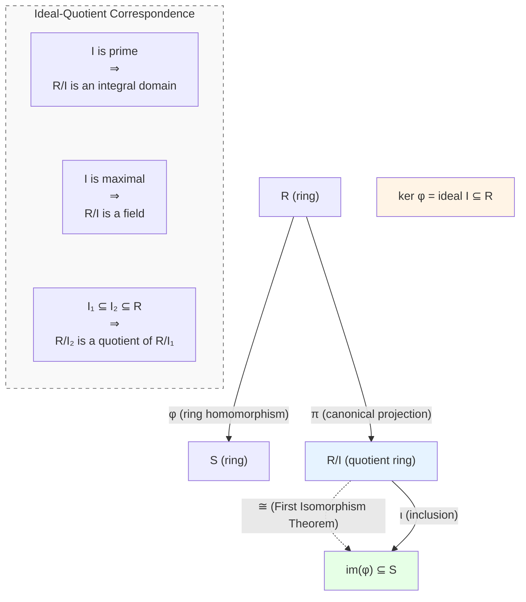

# Lesson 2: Rings, Ideals, Quotient Structures

## 1. First-Principles Intuition & Invariants

The concept of a group captures the pure essence of symmetry: a single binary operation, an identity, inverses, and nothing more. But mathematics, and indeed the number systems we inherited from antiquity, demand richer structure. The integers $\mathbb{Z}$ do not merely admit addition; they admit multiplication as well, and that multiplication interacts with addition through the distributive law in a way that generates nearly all of classical arithmetic. The abstraction of this two-operation interplay is the **ring**, and it is arguably the central object of modern algebra.

A ring $(R, +, \cdot)$ is a set $R$ equipped with two binary operations, addition and multiplication, satisfying three families of axioms. Under addition, $R$ must be an abelian group: addition is associative, there exists an additive identity $0 \in R$, every element $a \in R$ has an additive inverse $-a$, and addition commutes, so $a + b = b + a$ for all $a, b \in R$. Multiplication need only be a monoid: it is associative, and there exists a multiplicative identity $1 \in R$ satisfying $1 \cdot a = a \cdot 1 = a$ for all $a$. Crucially, commutativity of multiplication is not required in general, and this asymmetry births an entire theory of noncommutative rings essential to quantum mechanics and representation theory. The two operations are stitched together by the **distributive laws**:

$$a \cdot (b + c) = a \cdot b + a \cdot c \qquad \text{and} \qquad (a + b) \cdot c = a \cdot c + b \cdot c$$

for all $a, b, c \in R$. These laws are not incidental. They encode the fundamental relationship between addition and multiplication and are the reason ring theory inherits so much richness from the interaction of these two structures.

Before ascending to ideals and quotients, it is essential to classify elements by their multiplicative behavior, because the internal arithmetic character of a ring is what distinguishes a polynomial ring over a field from, say, the integers modulo a composite number.

**Units and zero divisors** occupy opposite ends of the multiplicative spectrum. An element $u \in R$ is a **unit** if there exists $v \in R$ such that $uv = vu = 1$. The units of $\mathbb{Z}$ are $\{1, -1\}$. The units of $\mathbb{Z}/n\mathbb{Z}$ are the residue classes $\bar{a}$ for which $\gcd(a, n) = 1$, a fact that connects ring theory directly to elementary number theory. The collection of units $R^\times$ forms a group under multiplication, called the **unit group** of $R$. By contrast, a nonzero element $a \in R$ is a **zero divisor** if there exists a nonzero $b \in R$ with $ab = 0$. In $\mathbb{Z}/6\mathbb{Z}$, the element $\bar{2}$ is a zero divisor because $\bar{2} \cdot \bar{3} = \bar{6} = \bar{0}$, yet $\bar{2} \neq \bar{0}$ and $\bar{3} \neq \bar{0}$. Zero divisors obstruct cancellation: if $ab = ac$ and $a$ is a zero divisor, one cannot conclude $b = c$ even when $a \neq 0$.

A commutative ring with $1 \neq 0$ that contains no zero divisors is called an **integral domain**. The integers $\mathbb{Z}$, the Gaussian integers $\mathbb{Z}[i]$, and the polynomial ring $\mathbb{R}[x]$ are all integral domains. The defining property of an integral domain is the **cancellation law**: if $a \neq 0$ and $ab = ac$, then $b = c$. This follows immediately from the absence of zero divisors, since $ab - ac = a(b-c) = 0$ with $a \neq 0$ forces $b - c = 0$.

At the summit of the structural hierarchy sits the **field**: a commutative ring in which every nonzero element is a unit. In a field $F$, the multiplicative structure $F^\times = F \setminus \{0\}$ is an abelian group. Familiar examples are $\mathbb{Q}$, $\mathbb{R}$, $\mathbb{C}$, and the finite fields $\mathbb{F}_p = \mathbb{Z}/p\mathbb{Z}$ for prime $p$. Every field is an integral domain, since if $ab = 0$ and $a \neq 0$, then multiplying both sides by $a^{-1}$ yields $b = 0$. The converse fails in general: $\mathbb{Z}$ is an integral domain but not a field. However, every finite integral domain is a field, a theorem whose proof hinges on the pigeonhole principle applied to the map $x \mapsto ax$ for nonzero $a$.

**Theorem (Finite Integral Domains are Fields).** Let $R$ be a finite integral domain. Then $R$ is a field.

*Proof.* Let $a \in R$ with $a \neq 0$. We must show $a$ is a unit. Consider the map $\phi: R \to R$ defined by $\phi(x) = ax$. Because $R$ is an integral domain, if $\phi(x) = \phi(y)$, then $ax = ay$, so $a(x - y) = 0$, and since $a \neq 0$, we conclude $x = y$. Thus $\phi$ is injective. Since $R$ is finite, every injective map from $R$ to itself is surjective. Therefore $1 \in \text{im}(\phi)$, meaning there exists $b \in R$ with $ab = 1$. This $b$ is a right inverse of $a$. Because $R$ is commutative, $ba = 1$ as well, so $a$ is a unit. Since $a$ was arbitrary, every nonzero element of $R$ is a unit, and $R$ is a field. $\blacksquare$

The ascending chain $\text{Field} \subsetneq \text{Integral Domain} \subsetneq \text{Commutative Ring} \subsetneq \text{Ring}$ is not merely taxonomic. Each level precisely names which algebraic operations are universally invertible, and this naming has direct consequences for factorization theory and for the construction of quotient structures.

### Characteristic and the Prime Subring

Every ring contains a canonical subring generated by the identity element $1$. Consider the unique ring homomorphism $\phi: \mathbb{Z} \to R$ defined by $\phi(n) = n \cdot 1_R$, where $n \cdot 1_R$ means the $n$-fold additive sum of $1_R$. The image of $\phi$ is the **prime subring** of $R$, the smallest subring of $R$. The kernel of $\phi$ is an ideal of $\mathbb{Z}$, hence of the form $(n) = n\mathbb{Z}$ for a unique $n \geq 0$. This integer $n$ is the **characteristic** of $R$, written $\text{char}(R)$.

If $R$ is an integral domain, then its characteristic is either $0$ or a prime $p$. To see why, suppose $\text{char}(R) = n = ab$ where $1 < a, b < n$. Then $(a \cdot 1)(b \cdot 1) = (ab) \cdot 1 = n \cdot 1 = 0$. Since $R$ is an integral domain, either $a \cdot 1 = 0$ or $b \cdot 1 = 0$, contradicting the minimality of $n$ as the characteristic. Therefore $n$ must be prime. This result implies that every finite field has prime power order $p^k$, since the prime subfield $\mathbb{F}_p$ embeds into the field, making the field a vector space over $\mathbb{F}_p$ of some finite dimension $k$.

---

## 2. Core Architecture & Mechanics

### Ideal Theory: The Substructures That Matter

Groups have normal subgroups; rings have **ideals**. An ideal is the precise generalization of the concept of "multiples of $n$" in $\mathbb{Z}$, and its definition is calibrated so that quotient rings are well-defined in exactly the same way normal subgroups make quotient groups well-defined.

A nonempty subset $I \subseteq R$ is a **left ideal** of $R$ if it is closed under addition and under left multiplication by arbitrary ring elements: for all $r \in R$ and $a \in I$, we have $ra \in I$. A **right ideal** requires $ar \in I$ instead. A **two-sided ideal** (simply called an ideal in commutative ring theory) satisfies both. For commutative rings, all three notions coincide. The defining axiom $rI \subseteq I$ captures the absorption property: ideals do not merely sit inside $R$ as additive subgroups; they are "absorbed" by the entire ring under multiplication.

The simplest and most ubiquitous ideals are **principal ideals**. For any element $a \in R$, the principal ideal generated by $a$ is

$$\langle a \rangle = \{ra : r \in R\} = aR$$

in a commutative ring. In $\mathbb{Z}$, every ideal is principal: if $I$ is an ideal of $\mathbb{Z}$, it is in particular an additive subgroup, so $I = m\mathbb{Z}$ for some $m \geq 0$, and $m\mathbb{Z} = \langle m \rangle$. A commutative integral domain in which every ideal is principal is called a **principal ideal domain (PID)**. The integers $\mathbb{Z}$ and the polynomial ring $F[x]$ over a field $F$ are the canonical PIDs. Their shared property drives the parallel theories of integer factorization and polynomial factorization.

More generally, ideals can be **finitely generated**: $I = \langle a_1, a_2, \ldots, a_n \rangle = \{r_1 a_1 + r_2 a_2 + \cdots + r_n a_n : r_i \in R\}$. The sum $I + J = \{a + b : a \in I, b \in J\}$ of two ideals is again an ideal, as is the intersection $I \cap J$ and the **product** $IJ = \{\sum_{\text{finite}} a_i b_j : a_i \in I, b_j \in J\}$. These operations on ideals form the substrate for the ideal-theoretic proof of unique factorization.

### Prime Ideals and Maximal Ideals

Two species of ideal dominate the theory and encode the deepest structural information about a ring.

A proper ideal $\mathfrak{p} \subsetneq R$ is **prime** if whenever $ab \in \mathfrak{p}$, then $a \in \mathfrak{p}$ or $b \in \mathfrak{p}$. This generalizes the defining property of prime numbers: $p \mid ab$ implies $p \mid a$ or $p \mid b$. The connection to quotient rings makes this precise: $\mathfrak{p}$ is prime if and only if the quotient ring $R/\mathfrak{p}$ is an integral domain. In $\mathbb{Z}$, the prime ideals are $\langle 0 \rangle$ and $\langle p \rangle$ for primes $p$, since $\mathbb{Z}/\langle 0 \rangle \cong \mathbb{Z}$ is an integral domain and $\mathbb{Z}/p\mathbb{Z}$ is a field (hence an integral domain), while $\mathbb{Z}/n\mathbb{Z}$ for composite $n$ has zero divisors.

A proper ideal $\mathfrak{m} \subsetneq R$ is **maximal** if no ideal $J$ satisfies $\mathfrak{m} \subsetneq J \subsetneq R$. Equivalently, $\mathfrak{m}$ is maximal if and only if $R/\mathfrak{m}$ is a field. Every maximal ideal is prime, because every field is an integral domain. The converse fails: $\langle 0 \rangle$ is prime in $\mathbb{Z}$ (since $\mathbb{Z}$ is an integral domain) but not maximal (since $\langle 2 \rangle$ is a strictly larger proper ideal). In a PID, every nonzero prime ideal is maximal, a fact that ties the linear structure of the ideal lattice to the arithmetic of the ring.

The existence of maximal ideals in arbitrary rings (with identity) is guaranteed by **Zorn's lemma**: the set of proper ideals of $R$, ordered by inclusion, has the property that every chain of proper ideals has an upper bound (their union, which remains a proper ideal since $1$ is in none of them), and therefore possesses a maximal element.

**Theorem.** A proper ideal $\mathfrak{m}$ of a commutative ring $R$ is maximal if and only if $R/\mathfrak{m}$ is a field.

*Proof.* The ideals of $R/\mathfrak{m}$ are in bijective correspondence with ideals of $R$ containing $\mathfrak{m}$, via the correspondence theorem for rings. Specifically, if $\pi: R \to R/\mathfrak{m}$ is the quotient map, then every ideal $J/\mathfrak{m}$ of $R/\mathfrak{m}$ corresponds to the ideal $J$ of $R$ with $\mathfrak{m} \subseteq J$. The ideal $\mathfrak{m}$ is maximal if and only if there are no ideals strictly between $\mathfrak{m}$ and $R$, which happens if and only if $R/\mathfrak{m}$ has no proper nonzero ideals. A commutative ring with identity is a field if and only if its only ideals are $\{0\}$ and the ring itself, since in a field every nonzero element is a unit, and an ideal containing a unit must be the whole ring. Therefore $\mathfrak{m}$ is maximal if and only if $R/\mathfrak{m}$ is a field. $\blacksquare$

### Quotient Rings: Arithmetic Modulo an Ideal

The quotient ring construction mirrors the quotient group construction exactly, exploiting the fact that every ideal is in particular a normal additive subgroup. Given a ring $R$ and an ideal $I$, the **quotient ring** $R/I$ is the set of cosets $\{a + I : a \in R\}$ equipped with addition $(a + I) + (b + I) = (a + b) + I$ and multiplication $(a + I)(b + I) = (ab) + I$. The critical check for well-definedness of multiplication is precisely the absorption property of ideals: if $a + I = a' + I$ and $b + I = b' + I$, then $a' = a + s$ and $b' = b + t$ for $s, t \in I$, so $a'b' = ab + at + sb + st$. Since $at \in I$, $sb \in I$, and $st \in I$ (by the ideal axiom), we have $a'b' - ab \in I$, confirming $a'b' + I = ab + I$.

The canonical projection $\pi: R \to R/I$ defined by $\pi(a) = a + I$ is a surjective ring homomorphism with kernel $I$. This is the archetypal example of a ring homomorphism, and the First Isomorphism Theorem for rings states that if $\phi: R \to S$ is any ring homomorphism, then $R/\ker\phi \cong \text{im}(\phi)$. The proof runs identically to the group-theoretic version: define $\tilde{\phi}: R/\ker\phi \to \text{im}(\phi)$ by $\tilde{\phi}(a + \ker\phi) = \phi(a)$, verify it is well-defined and injective (since $\phi(a) = \phi(b)$ iff $\phi(a - b) = 0$ iff $a - b \in \ker\phi$ iff $a + \ker\phi = b + \ker\phi$), and observe surjectivity onto $\text{im}(\phi)$ by definition.

The structure of the ideal lattice of $R/I$ is controlled by the **Correspondence Theorem**: there is an inclusion-preserving bijection between ideals of $R/I$ and ideals of $R$ that contain $I$. Under this correspondence, prime ideals of $R/I$ correspond to prime ideals of $R$ containing $I$, and maximal ideals of $R/I$ correspond to maximal ideals of $R$ containing $I$.

The following diagram captures the relationships among the central constructions:

### Domains of Factorization: EDs, PIDs, UFDs

The class of commutative integral domains admits a refinement ladder that precisely characterizes when unique factorization holds.

A **Euclidean domain (ED)** is an integral domain $R$ equipped with a Euclidean function $\nu: R \setminus \{0\} \to \mathbb{Z}_{\geq 0}$ such that for any $a, b \in R$ with $b \neq 0$, there exist $q, r \in R$ with $a = bq + r$ and either $r = 0$ or $\nu(r) < \nu(b)$. The integers with $\nu(n) = |n|$ and the polynomial ring $F[x]$ over a field with $\nu(f) = \deg(f)$ are the canonical examples. The Gaussian integers $\mathbb{Z}[i]$ form a Euclidean domain with $\nu(a + bi) = a^2 + b^2$.

Every Euclidean domain is a PID. The proof is clean: let $I$ be a nonzero ideal of an ED $R$, and choose $d \in I \setminus \{0\}$ with $\nu(d)$ minimal. For any $a \in I$, divide to get $a = dq + r$ with $r = 0$ or $\nu(r) < \nu(d)$. Since $r = a - dq \in I$ and $\nu(d)$ is minimal, $r = 0$, so $a = dq \in \langle d \rangle$. Thus $I = \langle d \rangle$.

Every PID is a **unique factorization domain (UFD)**: every nonzero nonunit element factors as a product of irreducibles, and this factorization is unique up to order and associates. The proof uses the ascending chain condition on principal ideals (which holds in any PID) to guarantee the existence of irreducible factorizations, and the coincidence of irreducible and prime elements in a PID to guarantee uniqueness.

The chain of implications reads:

$$\text{Euclidean Domain} \Rightarrow \text{PID} \Rightarrow \text{UFD} \Rightarrow \text{Integral Domain}$$

None of these implications reverses. The ring $\mathbb{Z}[\sqrt{-5}]$ is an integral domain that fails to be a UFD, as witnessed by $6 = 2 \cdot 3 = (1 + \sqrt{-5})(1 - \sqrt{-5})$. The ring of integers of a number field may be a Dedekind domain (every nonzero ideal factors uniquely into prime ideals) without being a UFD, and this discrepancy between ideal factorization and element factorization was the historical motivation for Kummer's invention of ideal theory in the nineteenth century.

### Ring Homomorphisms: Formal Definition and Kernel Theory

A **ring homomorphism** $\phi: R \to S$ is a map preserving both ring operations: $\phi(a + b) = \phi(a) + \phi(b)$, $\phi(ab) = \phi(a)\phi(b)$, and $\phi(1_R) = 1_S$. The requirement $\phi(1_R) = 1_S$ is sometimes omitted in definitions that do not require a multiplicative identity, but for rings with unity it is an essential normalizing condition that rules out the trivial zero map when $S \neq \{0\}$.

The **kernel** $\ker\phi = \{a \in R : \phi(a) = 0_S\}$ is an ideal of $R$, and the **image** $\text{im}(\phi) = \{\phi(a) : a \in R\}$ is a subring of $S$. The map $\phi$ is injective if and only if $\ker\phi = \{0\}$, the same criterion as for group homomorphisms.

There are two additional isomorphism theorems for rings that parallel the group-theoretic versions. The **Second Isomorphism Theorem** states that if $A$ is a subring of $R$ and $I$ is an ideal of $R$, then $A + I$ is a subring of $R$, $A \cap I$ is an ideal of $A$, and $(A + I)/I \cong A/(A \cap I)$. The **Third Isomorphism Theorem** states that if $I \subseteq J$ are both ideals of $R$, then $J/I$ is an ideal of $R/I$ and $(R/I)/(J/I) \cong R/J$.

These theorems are not merely structural curiosities. The Second Isomorphism Theorem, applied in polynomial rings, produces the standard change-of-variables identities in algebraic geometry, and the Third Isomorphism Theorem controls the filtrations on rings that appear in $p$-adic number theory and formal power series rings.

---

## 3. High-Performance Optimization & Failure Modes

### The Chinese Remainder Theorem: Decomposing Quotient Rings

The Chinese Remainder Theorem (CRT) is one of the most computationally powerful results in ring theory. Its ancient combinatorial form—solving simultaneous congruences—acquires its full power and generality when stated in terms of ideals and quotient rings.

**Theorem (Chinese Remainder Theorem for Rings).** Let $R$ be a commutative ring with identity, and let $I_1, I_2, \ldots, I_k$ be ideals of $R$ that are pairwise **comaximal**, meaning $I_i + I_j = R$ for all $i \neq j$. Then the natural ring homomorphism

$$\phi: R \longrightarrow R/I_1 \times R/I_2 \times \cdots \times R/I_k$$

defined by $\phi(a) = (a + I_1, a + I_2, \ldots, a + I_k)$ is surjective with kernel $I_1 \cap I_2 \cap \cdots \cap I_k = I_1 I_2 \cdots I_k$. Therefore:

$$R \big/ (I_1 \cap I_2 \cap \cdots \cap I_k) \;\cong\; R/I_1 \times R/I_2 \times \cdots \times R/I_k$$

The proof proceeds in two steps. First, we establish the key lemma that pairwise comaximality implies $I_1 I_2 \cdots I_k = I_1 \cap I_2 \cap \cdots \cap I_k$. For two ideals, if $I + J = R$, write $1 = x + y$ with $x \in I$, $y \in J$. For any $a \in I \cap J$, write $a = a \cdot 1 = ax + ay$. Since $a \in J$ and $x \in I$, we have $ax \in IJ$, and since $a \in I$ and $y \in J$, we have $ay \in IJ$. Thus $a \in IJ$, giving $I \cap J \subseteq IJ$. The reverse inclusion $IJ \subseteq I \cap J$ is always true, so $IJ = I \cap J$ when $I + J = R$.

Second, we verify surjectivity of $\phi$. It suffices to show that for each $j$, there exists an element $e_j \in R$ with $e_j \equiv 1 \pmod{I_j}$ and $e_j \equiv 0 \pmod{I_i}$ for $i \neq j$, since then an arbitrary target $(r_1 + I_1, \ldots, r_k + I_k)$ is hit by $r_1 e_1 + r_2 e_2 + \cdots + r_k e_k$. For fixed $j$, since $I_j + I_i = R$ for each $i \neq j$, we can find $x_i \in I_j$ and $y_i \in I_i$ with $x_i + y_i = 1$. Set $e_j = \prod_{i \neq j} y_i$. Then $e_j \equiv \prod_{i \neq j} (1 - x_i) \equiv 1 \pmod{I_j}$ (since each $x_i \in I_j$), and for each $i \neq j$, the product $\prod_{i' \neq j} y_{i'}$ contains the factor $y_i \in I_i$, so $e_j \in I_i$. This completes the surjectivity proof.

Concretely, in $\mathbb{Z}$, the ideals $\langle m \rangle$ and $\langle n \rangle$ are comaximal when $\gcd(m, n) = 1$, and the theorem recovers the classical CRT: for coprime $m, n$, the system $x \equiv a \pmod{m}$, $x \equiv b \pmod{n}$ has a unique solution modulo $mn$. The isomorphism $\mathbb{Z}/mn\mathbb{Z} \cong \mathbb{Z}/m\mathbb{Z} \times \mathbb{Z}/n\mathbb{Z}$ is a ring isomorphism, equipping the product with componentwise arithmetic.

The CRT has immediate computational consequences. Arithmetic in $\mathbb{Z}/mn\mathbb{Z}$ can be replaced by parallel arithmetic in the smaller rings $\mathbb{Z}/m\mathbb{Z}$ and $\mathbb{Z}/n\mathbb{Z}$, then reconstructed via the explicit idempotents $e_1, e_2$ above. This is the mathematical foundation of residue number system (RNS) arithmetic, used in hardware implementations to perform large integer computations without carries. It also underlies the factorization of the group $(\mathbb{Z}/n\mathbb{Z})^\times \cong (\mathbb{Z}/p_1^{a_1}\mathbb{Z})^\times \times \cdots \times (\mathbb{Z}/p_k^{a_k}\mathbb{Z})^\times$ for $n = p_1^{a_1} \cdots p_k^{a_k}$, which is the structural theorem behind the RSA cryptosystem's security analysis.

### Galois Field Arithmetic: $\mathbb{F}_{2^8}$ as a Quotient Ring

The most consequential concrete application of quotient ring theory in modern computing is the construction of finite fields of prime power order. The field $\mathbb{F}_{2^8}$ used in the AES (Advanced Encryption Standard) SubBytes and MixColumns operations is defined as a quotient ring of a polynomial ring.

Consider the polynomial ring $\mathbb{F}_2[x]$ over the two-element field $\mathbb{F}_2 = \{0, 1\}$. This is a Euclidean domain under polynomial division, and hence a PID. An irreducible polynomial $p(x) \in \mathbb{F}_2[x]$ of degree $d$ generates a maximal ideal $\langle p(x) \rangle$, and the quotient ring

$$\mathbb{F}_{2^d} = \mathbb{F}_2[x] / \langle p(x) \rangle$$

is a field with $2^d$ elements. For AES, the degree is $d = 8$ and the irreducible polynomial specified in the standard is

$$p(x) = x^8 + x^4 + x^3 + x + 1$$

which is irreducible over $\mathbb{F}_2$ (verified by checking that no element of $\mathbb{F}_2[x]$ of degree 1, 2, 3, or 4 divides it). Elements of $\mathbb{F}_{2^8}$ are polynomials of degree at most 7 with coefficients in $\{0, 1\}$, and they correspond bijectively to 8-bit bytes. The addition of two elements is polynomial addition modulo 2, which is bitwise XOR. Multiplication is polynomial multiplication followed by reduction modulo $p(x)$.

**Worked Example: Multiplication in $\mathbb{F}_{2^8}$.** Multiply $a(x) = x^6 + x^4 + x^2 + x + 1$ (byte $\texttt{0x57}$) by $b(x) = x^7 + x + 1$ (byte $\texttt{0x83}$) in $\mathbb{F}_{2^8}$.

Step 1: Compute the unreduced product $a(x) \cdot b(x)$ in $\mathbb{F}_2[x]$:

$$a(x) \cdot b(x) = (x^6 + x^4 + x^2 + x + 1)(x^7 + x + 1)$$

Expanding:

$$= x^{13} + x^{11} + x^9 + x^8 + x^7 + x^7 + x^5 + x^3 + x^2 + x + x^6 + x^4 + x^2 + x + 1$$

Collecting terms modulo 2 (like terms cancel since $1 + 1 = 0$ in $\mathbb{F}_2$):

$$= x^{13} + x^{11} + x^9 + x^8 + x^6 + x^5 + x^4 + x^3 + 1$$

Step 2: Reduce modulo $p(x) = x^8 + x^4 + x^3 + x + 1$. Use the relation $x^8 \equiv x^4 + x^3 + x + 1$ to replace each power $x^k$ for $k \geq 8$.

$$x^9 = x \cdot x^8 \equiv x^5 + x^4 + x^2 + x$$
$$x^{11} = x^2 \cdot x^9 \equiv x^7 + x^6 + x^4 + x^3$$
$$x^{13} = x^2 \cdot x^{11} \equiv x^9 + x^8 + x^6 + x^5 \equiv (x^5 + x^4 + x^2 + x) + (x^4 + x^3 + x + 1) + x^6 + x^5 = x^6 + x^3 + x^2 + 1$$

Substituting back and collecting modulo 2:

$$a(x) \cdot b(x) \equiv (x^6 + x^3 + x^2 + 1) + (x^7 + x^6 + x^4 + x^3) + (x^5 + x^4 + x^2 + x) + x^8 + x^6 + x^5 + x^4 + x^3 + 1$$

After reducing $x^8 \equiv x^4 + x^3 + x + 1$ and collecting all powers modulo 2:

$$\equiv x^7 + x^6 + 1 \quad \text{(byte \texttt{0xC1})}$$

This is the result AES uses internally. The entire construction rests on the quotient ring $\mathbb{F}_2[x]/\langle p(x) \rangle$, where the choice of $p(x)$ determines the field's multiplicative group structure. All $2^8 - 1 = 255$ nonzero elements form a cyclic group $\mathbb{F}_{2^8}^\times \cong \mathbb{Z}/255\mathbb{Z}$, and a generator of this group (a **primitive root**) is used to construct the AES S-box via field inversion followed by an affine transformation.

### Failure Modes and Structural Obstructions

A practitioner in ring theory must be acutely aware of several structural obstructions that can invalidate naive reasoning.

The most common failure is assuming that a quotient ring of an integral domain is again an integral domain. This holds only when the ideal you quotient by is prime. The ring $\mathbb{Z}[x]/\langle x^2 \rangle$ contains the nonzero element $\bar{x}$ satisfying $\bar{x}^2 = 0$, making it a **nilpotent** element and a zero divisor. Nilpotents arise whenever you quotient by a non-radical ideal, and they cause standard algebraic arguments about cancellation and unique factorization to fail. The **nilradical** $\mathfrak{N}(R) = \{a \in R : a^n = 0 \text{ for some } n \geq 1\}$ is the intersection of all prime ideals of $R$, a theorem that is both deep and practically important for understanding the structure of $R/\mathfrak{N}(R)$.

The failure of unique factorization in rings like $\mathbb{Z}[\sqrt{-5}]$ illustrates a subtler obstruction. Here, the equation $6 = 2 \cdot 3 = (1 + \sqrt{-5})(1 - \sqrt{-5})$ gives two genuinely distinct irreducible factorizations. The elements $2$, $3$, $1 \pm \sqrt{-5}$ are all irreducible (no non-unit factors), but none are prime: $2 \mid (1 + \sqrt{-5})(1 - \sqrt{-5})$ but $2 \nmid (1 + \sqrt{-5})$ and $2 \nmid (1 - \sqrt{-5})$. The diagnostic criterion is the **class number** of the ring: in a Dedekind domain, unique factorization holds at the element level if and only if the ideal class group is trivial. The class number of $\mathbb{Z}[\sqrt{-5}]$ is 2, which is precisely why unique factorization fails but can be restored by passing to ideals.

A third failure mode concerns the CRT: the theorem requires pairwise comaximality, not merely that the ideals are distinct. The ideals $\langle 2 \rangle$ and $\langle 4 \rangle$ in $\mathbb{Z}$ satisfy $\langle 2 \rangle + \langle 4 \rangle = \langle 2 \rangle \neq \mathbb{Z}$, so comaximality fails. Attempting to apply CRT here yields a map $\mathbb{Z}/8\mathbb{Z} \to \mathbb{Z}/2\mathbb{Z} \times \mathbb{Z}/4\mathbb{Z}$ that is surjective but not injective; for instance, $0$ and $4$ both map to $(0, 0)$, making the map 2-to-1. The correct observation is that $|\mathbb{Z}/\langle 8 \rangle| = 8$ while $|\mathbb{Z}/\langle 2 \rangle \times \mathbb{Z}/\langle 4 \rangle| = 8$, yet the rings are not isomorphic: $\mathbb{Z}/8\mathbb{Z}$ has a unique element of additive order 2 while $\mathbb{Z}/2\mathbb{Z} \times \mathbb{Z}/4\mathbb{Z}$ has three. The cardinality coincidence hides the structural non-isomorphism, and only the comaximality condition distinguishes the cases where CRT applies.

A fourth subtlety is the distinction between ideals and subrings. The integers $\mathbb{Z}$ form a subring of $\mathbb{Q}$, but $\mathbb{Z}$ is not an ideal of $\mathbb{Q}$: the product $\frac{1}{2} \cdot 1 = \frac{1}{2} \notin \mathbb{Z}$, violating absorption. In fact, a field has no nonzero proper ideals at all, since any ideal containing a nonzero element $a$ must contain $a \cdot a^{-1} = 1$ and therefore the entire ring. This means the only ring homomorphisms from a field are either injective or the zero map to the trivial ring, a fact used constantly in Galois theory when embedding fields into algebraically closed fields.

The cumulative picture of Lesson 2 is this: the ring axioms, properly internalized, generate a universe of structure where ideals play the role that normal subgroups play in groups, quotient constructions produce new rings encoding congruence relations, and the interplay of prime and maximal ideals encodes the deepest arithmetic properties of a ring. The Chinese Remainder Theorem gives this structure computational bite, decomposing complex arithmetic into parallel simpler computations. And the Galois field $\mathbb{F}_{2^8}$, realized as a quotient of $\mathbb{F}_2[x]$ by an irreducible polynomial, demonstrates that these abstract theorems are not philosophical curiosities but the operational foundation of modern cryptography.
